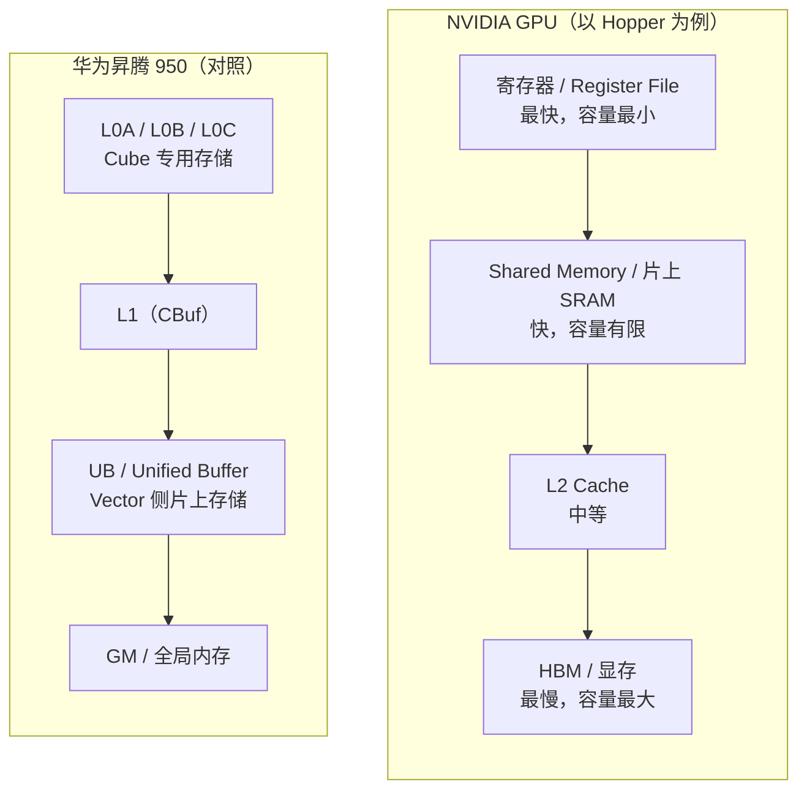
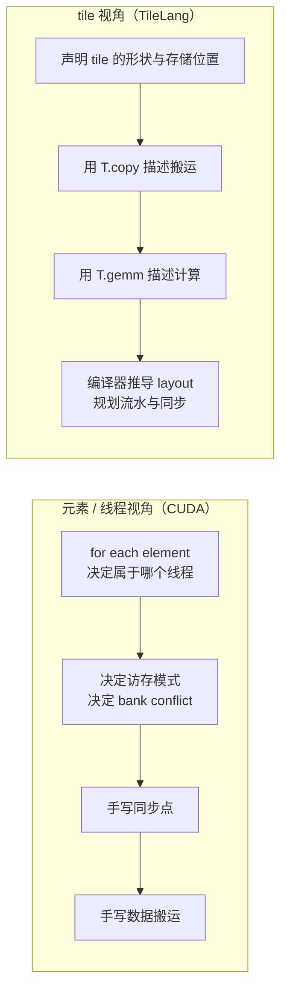
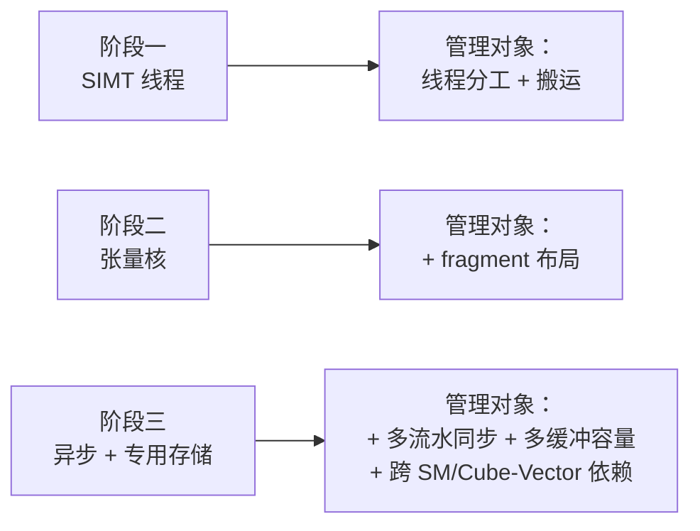
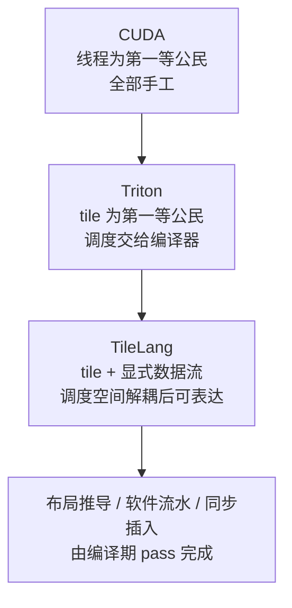
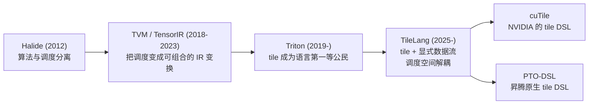

# 第 01 章 为什么需要 Tile DSL

## 学习目标

读完本章，你应当能够：

1. 用「算术强度（arithmetic intensity）」与「机器平衡点（machine balance）」解释：为什么同一个
   `softmax` 或 `MatMul`，在 PyTorch 里调用时可能只跑出硬件峰值的一小部分。
2. 说清存储层级（HBM/DRAM → 片上 SRAM → 寄存器）与「搬数据比算数据贵」之间的关系，并给出
   它的量化形式。
3. 按三个阶段（SIMT 线程模型 → 张量核 → 异步搬运与专用存储）说明硬件演进分别在编程模型上
   增加了什么约束，以及这些约束为什么让「手写 CUDA 就够了」这个前提不再成立。
4. 对照说明 CUDA、Triton、TileLang 三代方案各自解决了什么、又留下了什么问题。
5. 给出「tile（分块）」在本书中的精确定义（三个要素），并指出它在 TileLang 的语言层与编译期
   分别落在哪里。
6. 画出 Halide → TVM → Triton → TileLang → cuTile/PTO-DSL 的谱系，并说清每一代的关键取舍。

## 前置知识

* 会用 Python、写过 PyTorch（能读懂 `x + y`、`A @ B`、`softmax(x, dim=-1)`）。
* 知道矩阵乘法的定义，知道张量就是多维数组。
* **不需要**任何 CUDA、编译器或芯片知识。本章出现的每个硬件名词都会先用一两句话说明它解决
  什么问题，再给术语。现在看不懂的细节可以先跳过：第 2 章展开性能模型，第 5 章做横向对比，
  第 6 章给两台机器的抽象图。

本章是全书的开篇，所以它只回答一个问题：**为什么「在 PyTorch 里写模型、把慢的部分丢给
手写 CUDA」这条路，今天已经走不通了，以及为了解决它，编程模型是怎样一步一步变成现在
这个样子的。**

---

## 1. 问题的由来：为什么 PyTorch 里一个算子会慢

### 1.1 一次「慢」，慢在哪里

先看一段任何 PyTorch 用户都写过的代码：

```python
import torch

x = torch.randn(4096, 4096, device="cuda", dtype=torch.float16)
w = torch.randn(4096, 4096, device="cuda", dtype=torch.float16)

y = torch.softmax(x, dim=-1)   # 逐元素 + 沿行归约
z = y @ w                      # 矩阵乘
```

如果拿性能分析器去看，通常会发现两件事：

* `z = y @ w` 往往离厂商库（cuBLAS）的峰值不远，因为 PyTorch 会调用一个高度优化的
  矩阵乘 kernel；
* 但在真实模型里，大量时间花在**许多个小算子上**——归一化、激活、逐元素缩放、类型转换、
  attention 里的 softmax——它们单个都不慢，加起来很慢。

「慢」不是一个笼统的感觉，它有具体的来源。请把一次算子执行拆成两类动作：

1. **搬运**：把数据从显存搬到计算单元旁边，或者从计算单元搬回去。
2. **计算**：对这些数据做加、乘、比较、归约。

直觉上我们会以为时间花在「计算」上，但在真实的 AI 算子里，**时间经常花在搬数据和等数据
上**。NVIDIA 官方文档里的两句话说明了这种不对称：

> 「When accessing uncached local or global memory, there are hundreds of clock cycles of
> memory latency.」
> 「The latency of most arithmetic instructions is typically 4 cycles on devices of compute
> capability 7.0.」
> —— 来源：`../tilelang-corpus/05-nvidia-backend/raw/nvidia-cuda-best-practices.md`
> （CUDA C++ Best Practices Guide，抓取日期 2026-09-30）。测量条件：CUDA 编程模型下，
> 未缓存的 local/global 访存延迟；算术延迟以 compute capability 7.0 设备为例。

也就是说：**同一次访存要等上百个时钟周期，而同一次浮点运算通常只要几个时钟周期。**
这件事决定了几乎所有算子优化的方向——不是「算得更快」，而是「少搬一点、把计算搬到数据
到达的位置」。

### 1.2 三个具体的「慢」

把上面的直觉落到代码上，一个算子慢通常有三种原因，它们常常同时存在：

**（a）访存受限（memory-bound）。** 算子的计算量太小，带宽成了瓶颈。典型例子是逐元素
运算、RMSNorm、softmax。以 `softmax(x, dim=-1)` 为例，无论怎样优化，你至少要把 `x` 从
显存读一遍、把结果写一遍；如果实现不当（比如先减最大值走一遍、再 exp 走一遍、再求和走
一遍），访存次数会成倍增加。

**（b）没有把数据留在片上。** 如果每一轮计算都要重新从显存取一遍同样的数据，那么即使算法
本身是对的，实际访存量也会远大于理论最小值。矩阵乘就是最好的例子：朴素的 `A @ B` 会对
同一块 `A`、`B` 反复访存。

**（c）算力没有被喂饱。** 现代加速器里最贵的计算单元（张量核 / Cube）是被专门设计来
做矩阵乘的，它的峰值极高但不「自动」：你必须把数据整理成它要的形状，并且让它几乎不停。
只要数据没跟上，或者每次只喂一点点，峰值就用不上。

### 1.3 用 roofline 量化「慢」

上面的三种原因可以统一到一个简洁的模型里。定义**算术强度**：

```
算术强度 AI = 浮点运算次数 / 访问的字节数        （单位：FLOP/Byte）
```

再定义机器的**平衡点**：

```
机器平衡点 = 峰值算力 / 峰值带宽                 （单位：FLOP/Byte）
```

于是：

* 如果 `AI < 机器平衡点`，机器会**先被带宽卡住**，称为 memory-bound；
* 如果 `AI > 机器平衡点`，机器会**先被算力卡住**，称为 compute-bound。

举一个可以自己核对的例子。据 NVIDIA 公开资料，H100 SXM5 使用 HBM3，「delivering over
3 TB/sec of memory bandwidth」，同时它的 FP16 张量核密集吞吐在厂商公开的**初步规格表**
里是 1000 TFLOPS：

> 来源：`../tilelang-corpus/05-nvidia-backend/raw/nvidia-blog-hopper-architecture-in-depth.md`
> （NVIDIA Hopper Architecture In-Depth，2022）。条件：H100 SXM5，厂商公开资料与
> 「Table 1. NVIDIA H100 Tensor Core GPU preliminary performance specs」，属未实测的
> 厂商初步规格。

用这两个数**粗略估算**（本书的推导，不是厂商给的数字）：

```
机器平衡点 ≈ 1000e12 / 3.0e12 ≈ 333 FLOP/Byte
```

也就是说，H100 要跑到峰值，平均每访问 1 字节就得做 300 多次浮点运算。现在算一下两个
算子的算术强度（假设 fp16、按理论最小访存量计算）：

| 算子 | 运算量 | 最小访存量（fp16） | 算术强度 |
| --- | --- | --- | --- |
| `softmax`，$x \in \mathbb{R}^{4096\times4096}$ | 按每元素 3 FLOP 粗估 ≈ 50 MFLOP | 读 32 MiB + 写 32 MiB | 0.75 FLOP/Byte |
| `MatMul`，$4096^3$ | $2MNK \approx 1.37\times10^{11}$ FLOP | $(MK + KN + MN)\times2$ 字节 = 96 MiB | ≈ 1365 FLOP/Byte |

（上表由 `code/01-op-cost-model/op_cost_model.py` 复算，数值即该脚本的实际输出。）

结论很清晰：**softmax 这类算子的算术强度比平衡点低两个数量级，它天生就是
memory-bound；而大矩阵乘天生是 compute-bound。** 两者的优化方向完全不同：

* memory-bound 的算子要减少访存次数（融合、复用片上数据）；
* compute-bound 的算子要把数据留在片上、喂满张量核。

本书 `code/01-op-cost-model/` 里的脚本就是上面这张表的可运行版本，你可以改形状和机器参数
自己复算。

### 1.4 小结：慢的根源是「数据没有待在它该待的地方」

到这里可以给本章的核心判断下一个断言：

> AI 算子的性能问题，本质上是**数据在存储层级之间流动的问题**；优化一个算子，主要不是
> 在改数学公式，而是在改「数据什么时候、以什么形状、在哪一级存储上被读取和计算」。

这就解释了为什么我们需要一门**面向数据流、以「片」为单位**的语言。下一节先把这套
「存储层级 + 分片」的词汇定义清楚。

---

## 2. 概念与模型

### 2.1 存储层级：谁是「近」的，谁是「远」的

所有现代加速器都遵循同一张图：越靠近计算单元，容量越小、延迟越低、带宽越高。



图 1：两台机器的存储层级对照。NV 侧的层级来自
`../tilelang-corpus/05-nvidia-backend/raw/nvidia-cuda-c-programming-guide.md`；昇腾侧的层级来自
`../tilelang-corpus/09-zhihu-da-zhi-ruo-yu/raw/zhihu-dazhiruoyu-deepseek-ascend.md`
（社区一手文章，非厂商官方文档）与
`_vendor/tilelang-v0.1.15/tilelang/ascend/README.md:134-139`。完整展开见第 6 章。

两个细节值得现在就记住：

* **两台机器的层级不是一一对应的。** 昇腾的 L0A/L0B/L0C 是 Cube（矩阵单元）的专用存储，
  在 NVIDIA 侧没有一个同名的对应物；反过来，NVIDIA 的「shared memory」在昇腾上要拆成
  L1 与 UB 两种角色。
* **数据「在哪里」比数据「是什么」更重要。** TileLang 里每个 buffer 都要声明它的存储作用域
  （storage scope），因为放在哪一级直接决定了后续能不能被某类计算单元直接消费。

### 2.2 「搬」和「算」可以重叠

如果只有上一节的内容，结论会是「尽量减少搬运」。但现代硬件还有一个更强的能力：
**让搬运和计算同时进行**。

做法是把一次搬运所在的缓冲区开成多份（多缓冲 / multi-buffer）：第 0 份数据在被计算时，
第 1 份正在被搬运。理想情况下，搬运的延迟被完全藏在计算的背后，机器不再「等数据」。

这带来两个必须管理的资源约束：

* **片上容量**：多开一份就多占一份片上空间，而片上空间是有限的。据 NVIDIA 公开资料，
  H100 每个 SM 有 256 KB 的 shared memory + L1 合并空间，其中 shared memory 可配置
  最多 228 KB（来源：`../tilelang-corpus/05-nvidia-backend/raw/nvidia-blog-hopper-architecture-in-depth.md`，
  H100 厂商公开资料）。份数不可能无限加。
* **同步**：当搬运是异步的（「已经发出去了」不等于「已经做完了」），就必须用某种信号
  机制保证「计算开始前数据真的到了」「下一轮覆盖前上一轮真的读完了」。在 CUDA 里这套
  机制是 `cp.async` 的 commit/wait、`mbarrier`；在昇腾里是 MTE 流水之间成对的 Set/Wait。

### 2.3 什么是 tile

现在可以给出本书里最重要的一个定义。**tile（分块）** 是：

> **对一个逻辑张量的一次「定形的取样」，它同时携带三件事**：
> 1. **形状（shape）**——这块数据在逻辑张量里的定形子区域（静态形状）；
> 2. **存储位置（storage scope）**——这块数据被放在哪一级存储上；
> 3. **物理布局（layout）**——逻辑下标到物理（线程、寄存器槽位、存储地址）的映射。

这三条缺一不可，尤其是第 3 条经常被忽略：

* 少了第 2 条，tile 就只是「循环分块（loop tiling）」，一种循环变换技巧；
* 少了第 3 条，tile 就只是「一块数据」，编译器还得替你在物理上重新排列一遍。

这不是本书自创的说法。Triton 2019 年的原始论文把 tile 定义为
「statically shaped multi-dimensional sub-arrays」（定形的多维子数组）：

> 来源：`../tilelang-corpus/11-related-compilers/raw/triton-mapl-2019.md`
> （Triton, MAPL 2019，DOI 10.1145/3315508.3329973），第 1 页摘要。

TileLang 官方文档给出的说法更贴近工程：

> 「A tile represents a shaped portion of data, which can be owned and manipulated by a
> warp, thread block, or equivalent parallel unit.」
> 来源：`../tilelang-corpus/01-tilelang-official-docs/raw/site/_sources/get_started/overview.md`
> （Tile Language: A Brief Introduction）。

把两者合起来，就是本书的用法：**tile 是「程序里最小的可寻址数据单元」，也是一个可以被
某个并行单元（warp / thread block / Cube 核）拥有和操作的定形数据片。**

### 2.4 以 tile 为单位思考，和以线程为单位思考有什么不同

对比一下同一件事在两种视角下的描述方式。以 `C = A @ B`（$A\in\mathbb{R}^{M\times K}$，
$B\in\mathbb{R}^{K\times N}$）为例：

| 视角 | 第一等公民 | 「我」要描述什么 | 谁负责决定 |
| --- | --- | --- | --- |
| CUDA（SIMT） | 线程（thread） | 第 `(i, j)` 个线程算哪几个元素 | 全部由人决定 |
| tile 视角 | tile | 这块 `block_M × block_K` 的 A 放哪、和哪块 B 相乘、结果累积到哪 | 布局/流水/同步可由编译器决定 |

线程视角的问题是：**它是「机器视角」**。程序员被迫在写算法的时候同时思考线程编号、
bank conflict、同步点。而 tile 视角允许你先说「我要把 A 的一块搬到片上，和 B 的一块做
矩阵乘」，把「谁来做、怎么排布、什么时候同步」留给编译器——这就是本书后续要展开的核心
主张。



图 2：两种编程视角的对照。左列是第 4.1 节要讲的 CUDA 路线，右列是第 4.4 节要讲的
TileLang 路线。

---

## 3. 用法：一个 tile 程序长什么样

本节只展示「长什么样」，不解释语法细节——语言基础在第 8 章，原语在第 9 章。

### 3.1 从元素视角的伪代码

如果用最朴素的「元素视角」描述 `C = A @ B + ReLU`，你会写出这样的伪代码：

```text
for i in range(M):
    for j in range(N):
        acc = 0
        for k in range(K):
            acc += A[i, k] * B[k, j]
        C[i, j] = max(acc, 0)
```

这段代码在数学上完全正确，但直接映射到 GPU 上会反复访存 `A` 和 `B`，且完全没用上
张量核。注意：这段伪代码里**没有任何地方提到数据放在哪一级存储、以什么布局排布**。

### 3.2 tile 视角：分块 → 上片 → 计算 → 回写

TileLang 给出的写法则显式地把上面缺的信息补上。下面这段与锁定的 v0.1.15 官方 quickstart
（`_vendor/tilelang-v0.1.15/examples/quickstart.py`）一致，只去掉了 import 与一处被注释
掉的 `T.use_swizzle`；它同时包含矩阵乘和一个 ReLU 后处理：

```python
@tilelang.jit
def matmul(A, B, block_M: int, block_N: int, block_K: int):
    M, N, K = T.const("M, N, K")
    dtype = T.float16
    accum_dtype = T.float32
    A: T.Tensor((M, K), dtype)
    B: T.Tensor((K, N), dtype)
    C = T.empty((M, N), dtype)

    with T.Kernel(T.ceildiv(N, block_N), T.ceildiv(M, block_M), threads=128) as (bx, by):
        A_shared = T.alloc_shared((block_M, block_K), dtype)         # 片上
        B_shared = T.alloc_shared((block_K, block_N), dtype)         # 片上
        C_local = T.alloc_fragment((block_M, block_N), accum_dtype)  # 累加器

        T.clear(C_local)
        for ko in T.Pipelined(T.ceildiv(K, block_K), num_stages=3):
            T.copy(A[by * block_M, ko * block_K], A_shared)          # 搬运
            T.copy(B[ko * block_K, bx * block_N], B_shared)          # 搬运
            T.gemm(A_shared, B_shared, C_local)                      # 计算

        for i, j in T.Parallel(block_M, block_N):
            C_local[i, j] = T.max(C_local[i, j], 0)                  # 融合的 ReLU

        T.copy(C_local, C[by * block_M, bx * block_N])               # 回写
    return C
```

请只注意**结构与上一节伪代码的差别**，不要纠结 API 细节：

1. 网格从「元素」变成了「块」：`T.Kernel(...)` 的每次迭代负责输出矩阵的一个
   `block_M × block_N` 分块。这是 tile 视角的第一层含义。
2. 数据被**显式声明了存储位置**：`T.alloc_shared`（片上）、`T.alloc_fragment`（累加器）。
3. 搬运被**显式描述**：`T.copy` 说的是「把 A 的这一块搬到片上」，不是「第几个线程搬第
   几个元素」。
4. 计算被**显式描述**：`T.gemm` 说的是「对这两个片上 tile 做矩阵乘」，而不是循环。
5. 循环被标记为流水：`T.Pipelined(..., num_stages=3)` 说的是「这三份缓冲轮转起来，
   让搬运和计算重叠」，而不是「我手写一个多缓冲」。

第 3、4、5 点正是「调度空间」——在 CUDA 里它们全部是人的工作，在 TileLang 里它们是可以
被编译器接管的声明。第 3 章会解释为什么 TileLang 选择把它们留在语言里，而不是像某些
高层 DSL 那样完全隐藏。

> **本机限制**：本教程的写作环境没有 NVIDIA GPU，也没有昇腾 NPU。上面这段代码摘自锁定
> 版本的官方示例，只做了 API 存在性与签名核对（见本章 `references.md`），**没有在本机
> 运行过**。运行方式见 `code/02-first-tile-kernel/README.md`。

---

## 4. 实现机制：三代方案的问题演进

本节按时间顺序讲三次「问题 → 方案 → 遗留问题」。它同时也是本章标题的答案：为什么
在 CUDA 和 Triton 之后，还需要 TileLang 这样一门 tile DSL。

### 4.1 第一代：CUDA —— 用线程模型换到通用性

CUDA 的历史地位无可替代：它第一次让「在通用硬件上写并行程序」变得可行。它的核心抽象是
**SIMT 线程模型**：

```
Grid → Thread Block → Warp → Thread
```

程序员写的是「第 `threadIdx.x` 个线程做什么」，硬件负责把同一 warp 内 32 个线程的指令
一起发射。要写一个高性能算子，你需要手工处理：

* 把数据从 global memory 搬到 shared memory（以及要不要用 `cp.async`）；
* shared memory 的 **bank conflict** 与 **swizzle**（数据摆放方式，避免多个线程抢同一
  个存储体）；
* 什么时刻插 `__syncthreads()`，什么是 `mbarrier`；
* 哪些线程负责搬数据、哪些负责算；
* 不同算力代际要用不同的指令（`mma` → `wgmma` → `tcgen05`）。

这套体系是**能写出世界最快算子**的，FlashAttention、CUTLASS 都是它的产物。但它留下
的问题是致命的：

* **每次硬件换代，经验都要重学一遍。** 张量核出现后，数据必须排成特定 fragment 布局；
  异步搬运出现后，同步协议从「一个 `__syncthreads`」变成「多数量的 mbarrier 相位」。
* **复杂度是组合的，不是线性叠加的。** 存储位置 × 布局 × 同步 × 流水 × 算力单元，
  每加一个维度，需要人手工维持的正确性条件就翻一倍。
* **「正确」变得难以验证。** 同步少放一处，往往不是编译报错，而是偶发的数值错误。

一句话：**CUDA 把「通用性」给了程序员，代价是把「所有硬件细节」也一起给了程序员。**

### 4.2 硬件是怎么把「手写 CUDA 就够了」这个前提打破的

过去十多年，加速器沿着三条线演化。每一条都在编程模型上新增一层必须被显式管理的资源。

**阶段一：SIMT 线程模型（Kepler / Pascal 时代）。**
程序员只需要关心两件事：线程怎么分工、数据在 global 和 shared 之间怎么搬。这一阶段
「手写 CUDA」确实是通解。CUDA 官方的编程手册到今天仍以这套模型为基础
（`../tilelang-corpus/05-nvidia-backend/raw/nvidia-cuda-c-programming-guide.md`）。

**阶段二：张量核（Tensor Core）。**
从 Volta 起，GPU 里多出一个**专用的矩阵乘单元**，它的吞吐远高于通用浮点单元，但要求
输入必须是特定的 fragment 布局、累加必须发生在特定的寄存器组上。于是「数据怎么摆」第一次
成了一个**必须显式表达**、否则直接拿不到性能的约束。程序员的工作从「排线程」变成了
「排线程 + 对布局」。

**阶段三：异步搬运与专用存储（Hopper / Blackwell，以及昇腾 950）。**
这一阶段的变化最彻底。以 Hopper 为例，官方架构说明里写：

> 「NVIDIA H100 is the first truly asynchronous GPU. H100 extends A100's global-to-shared
> asynchronous transfers across all address spaces...」
> 「New asynchronous execution features include a new **Tensor Memory Accelerator (TMA)**
> unit that can transfer large blocks of data efficiently between global memory and shared
> memory.」
> 来源：`../tilelang-corpus/05-nvidia-backend/raw/nvidia-blog-hopper-architecture-in-depth.md`
> （NVIDIA Hopper Architecture In-Depth，2022；条件：H100，厂商公开资料）。

再加上 thread block cluster 与 distributed shared memory，「什么时候搬、谁在等谁」这
张时间表，已经从「一个 block 内的事」升级为「多个 SM 之间、多条异步流水之间的协议」。
Blackwell 又新增了张量内存（TMEM）与 `tcgen05` 系列 MMA，把「累加器住在哪」也变成
必须显式管理的对象。

昇腾侧是同构的问题、不同的语言。社区一手文章对昇腾 950 的描述是：

> 「Cube/AIC 和 Vector/AIV 从一开始就承担着不同类型的计算，数据又要在 L1、L0A、L0B、
> L0C、UB 这些具有明确角色的存储之间流动，再加上 MTE 等搬运流水，很多在 CUDA 里默认
> 附着在线程层次上的事情，到了这里必须重新说清楚到底由哪种资源负责。」
> 来源：`../tilelang-corpus/09-zhihu-da-zhi-ruo-yu/raw/zhihu-dazhiruoyu-deepseek-ascend.md`
> （知乎「乱序摸鱼」，2026；**社区文章，非厂商官方文档，数字与结论未经官方复核**）。

同一篇文章还指出，把「GPU 是 SIMT、NPU 是 SIMD」当作概括已经失效了——昇腾 950 后端
本身就同时支持 SIMT 与 SIMD 两种向量执行方式。这件事在第 6 章会展开。

**阶段三的必然后果是：手写 CUDA 的成本开始指数上升。** 不是因为 CUDA 变难了，而是因为
「需要被同时正确管理的东西」变多了：



图 3：硬件演进与「必须人工管理的资源」的增长。前三阶段的 NV 侧事实来源同 4.2 节引用的
Hopper 架构资料；昇腾侧的对照见第 6 章。

### 4.3 第二代：Triton —— 把 tile 变成语言的第一等公民

Triton 的关键贡献，是把上一节的复杂度**从人手里拿走一部分**：让程序员以 tile 为单位
写程序，让编译器负责「tile 内部怎么分配线程、怎么合并访存、怎么排布」。

Triton 2019 年的原始论文里，作者把当时的 DNN 编译器分成三类，并说明自己的路线：

> 「By contrast, Triton relies on the addition of tile-level operations and optimizations
> into traditional compilation pipelines. This approach provides (1) more flexibility than
> XLA and Glow; (2) support for non-affine tensor indices contrary to TC and Diesel; and
> (3) automatic inference of possible execution schedule that would otherwise have to be
> specified manually to Halide or TVM.」
> 「The benefits of Triton come at the cost of increased programming efforts.」
> 来源：`../tilelang-corpus/11-related-compilers/raw/triton-mapl-2019.md`
> （Triton, MAPL 2019），第 3 页。

**它解决了什么：** 用 tile 描述数据并行，程序员不必再手写「哪个线程处理哪个元素」、
不必再手工处理合并访存（coalescing）与共享内存布局；同一份代码更容易跨 GPU 代际复用。

**它留下了什么：** 「tile 是什么」和「这个 tile 怎么被调度」被绑在一起交给了编译器。当
硬件要求你**显式说出**「这块数据放 L1 还是 UB」「这个中间结果留在片上还是写回」时，
在 Triton 里你要么表达不出来，要么一「下钻」就离开它的抽象、退化回手写低层代码。论文
自己也承认这条路「comes at the cost of increased programming efforts」。

### 4.4 第三代：TileLang —— 显式 tile + 把「调度空间」解耦出来

TileLang 的主张写在它的论文摘要里：

> 「TileLang decouples scheduling space (thread binding, layout, tensorize and pipeline)
> from dataflow, and encapsulated them as a set of customization annotations and
> primitives. This approach allows users to focus on the kernel's data-flow itself, while
> leaving most other optimizations to compilers.」
> 来源：`../tilelang-corpus/03-tilelang-papers/raw/arxiv-2504-17577.md`
> （TileLang, arXiv:2504.17577, 2025），摘要。

这句话可以拆成两半：

* **数据流（dataflow）留给人**：tile 的形状、放在哪一级存储、怎么在存储之间流动、
  在哪一级做计算——这些是算法作者真正知道、也应该负责的信息。
* **调度空间（scheduling space）交给编译器**：线程绑定、物理布局、tensorize（把运算
  映射到硬件矩阵指令）、软件流水——这些是从数据流可以推导出来的。

官方文档把接口分成三层，并且允许在同一个 kernel 里混用：

| 层次 | 面向谁 | 提供什么 | v0.1.15 状态 |
| --- | --- | --- | --- |
| Beginner（硬件无关） | 只想写逻辑的人 | 不涉及存储层级的写法 | 官方文档明确标注「not yet fully implemented」 |
| Developer（tile library） | 懂一点存储层级的人 | `T.copy` / `T.gemm` / `T.Pipelined` 等 tile 原语 | 稳定，日常 90% 的代码在这一层 |
| Expert（thread primitives） | 要抠极致性能的人 | 线程原语与硬件专用存储 | 稳定，是昇腾侧的主要入口 |

来源：`../tilelang-corpus/01-tilelang-official-docs/raw/site/_sources/get_started/overview.md`
与 `_vendor/tilelang-v0.1.15/tilelang/language/kernel.py:431-455`（`T.Kernel` 的 docstring
原文把一次 launch 描述为「a grid of tile programs」）。「三层可以混用」这一点就是论文
标题里 *composable* 的含义。

**它解决了什么：** 在保留 Triton「以 tile 为单位」这个前提的同时，把「存储位置、布局、
流水、同步」这些**影响合法性与性能的资源信息**重新变成可以显式表达的东西；同时又不要求
人为每一条都手写实现——能推导的交给 pass 去推导。

**它留下了什么：** 代价是**程序员要做的决策更多了**。同样一个逐元素 kernel，在 Triton
里可能几行就写完；在 TileLang 里你需要说清楚数据放哪、怎么搬。写得太「高层」反而拿不到
性能——这是第 3 章和第 12 章会反复强调的坑。此外，这一层抽象目前还在快速演化：v0.1.15
里 beginner 层尚未完全实现，就是一个直接证据。

### 4.5 三代方案的对照

| 代际 | 代表 | 第一等公民 | 人负责 | 编译器负责 | 主要遗留问题 |
| --- | --- | --- | --- | --- | --- |
| 第一代 | CUDA | 线程 | 线程分工、搬运、布局、同步、流水 | 指令选择与寄存器分配 | 复杂度随硬件代际指数增长；正确性难验证 |
| 第二代 | Triton | tile | tile 级的算法与索引 | tile 内部布局、线程分配、调度 | tile 与调度绑定，硬件资源信息无法显式表达 |
| 第三代 | TileLang | tile + 显式数据流 | 数据流与资源信息 | 布局推导、流水、同步、多缓冲 | 需要更多显式决策；抽象仍在演化 |



图 4：三代方案的信息分工演进。CUDA 的三项事实来源见 4.1 节；Triton 的设计取舍来源见
4.3 节引用的 MAPL 2019 论文；TileLang 的解耦声明见 4.4 节引用的 arXiv:2504.17577。

---

## 5. 进阶与陷阱

### 5.1 谱系：tile 这个概念是怎么一步步被推出来的

上面讲的「三代」是硬件驱动的。如果换成**编程模型**的视角，会得到一条更长的谱系——本书
把它概括为 Halide → TVM → Triton → TileLang → cuTile/PTO-DSL。



图 5：tile DSL 的谱系。各节点来源见下文的逐条说明。

**Halide（算法与调度分离）。** Halide 提出把「算什么」和「怎么排」分开写。官方文档里
的示例把这两件事写在同一段代码的两个部分：

> 「// The algorithm - no storage or order ... // The schedule - defines order, locality;
> implies storage」
> 来源：`../tilelang-corpus/11-related-compilers/raw/halide-docs.md`（halide-lang.org，
> 抓取日期 2026-09-30）。

这是整个谱系的思想起点：**同一个算法可以有很多种合法且性能差异巨大的排布方式，而排布
方式应该是一种可以独立表达、独立优化的东西。**

**TVM / TensorIR（把调度变成 IR 变换）。** TVM 把 Halide 的思路搬到了深度学习编译器里，
并把调度做成一组可以组合、可以被搜索的 IR 变换（split/fuse/reorder/tile/vectorize）。
随后 TensorIR 把这套抽象正式化为一套 IR，使「自动调度」成为可能：

> 来源：`../tilelang-corpus/04-language-and-ir/raw/arxiv-1802-04799.md`（TVM, OSDI 2018）、
> `../tilelang-corpus/04-language-and-ir/raw/arxiv-2207-04296.md`（TensorIR, ASPLOS 2023）。

TileLang 的编译器骨架就建立在这条线上：它的 IR 是 TVM 的 TIR，所以「给 TileLang 加功能」
很多时候等于「写一个 TIR pass」。

**Triton（tile 成为语言第一等公民）。** 见 4.3 节。Triton 把 tile 从「一种循环变换」
升级成「一种语言原语」，代价是调度也一并交了出去。

**TileLang（tile + 显式数据流）。** 见 4.4 节。它把 Triton 交出去的调度空间**重新变成
可选的、可注解的**，让人可以只在自己关心的维度上干预编译器。

**cuTile 与 PTO-DSL（把 tile 抽象带到各家硬件）。** 这条谱系里离现在最近的一环，是两家硬件厂各自
推出面向自家芯片的 tile 级 Python DSL。昇腾官方的 PTO-DSL 项目 README 把自己的定位
写得很直接：

> 「PTO-DSL provides a programming abstraction similar to cuTile, but native to NPU.」
> 「PTO-DSL exposes more NPU-native memory hierarchy such as L0/L1/UB.」
> 来源：`../tilelang-corpus/06-huawei-ascend/raw/github-huawei-csl-pto-dsl.md`
> （huawei-csl/pto-dsl，GitHub，抓取日期 2026-09-30）。

PTO 本身是一套形式化的 tile 级指令集（`../tilelang-corpus/06-huawei-ascend/raw/pto-spec/README.md`
里写明它定义了「Direct Tile operations」118 条、64 个 T/U/M/N Tile 寄存器与独立的
execution mask）。这条线的意义是：**tile 正在成为跨厂商的公共抽象层**——不同厂商用
不同的实现去接同一个概念。第 5 章会给出这一族方案的逐项对比。

### 5.2 常见陷阱

1. **把「慢」都归因于算法。** 大多数 AI 算子的算法早已固定，性能差异来自数据流动方式。
2. **把 tile 等同于「循环分块」。** 少了「存储位置」和「物理布局」两要素，分块只是循环
   变换，不是本书说的 tile。
3. **把 Triton 与 TileLang 当竞品。** 它们是同一问题上的两种设计取舍：Triton 换通用性
   与简洁，TileLang 换可控性与跨硬件表达能力。第 5 章会做同题对照。
4. **拿厂商宣传性能当基线。** 一定要核对测量条件：dtype、shape、是否包含 epilogue、
   是否含 sparse、是 dense 还是 sparse 口径。本章所有数字都尽量标了来源与条件。
5. **把 GPU 的直觉直接套到 NPU。** 存储层级、执行单元、同步协议都不同；「GPU 是 SIMT、
   NPU 是 SIMD」这类概括在昇腾 950 上已经不成立（见 4.2 节引用的社区文章）。
6. **指望 beginner 层。** v0.1.15 的官方文档明确写了这一层尚未完全实现，不要依赖它。

### 5.3 本章不做什么

* 不教 TileLang 语法：第 7–9 章从安装和第一个 kernel 开始。
* 不做横向详评：第 5 章才逐项对比 CUDA / Triton / CUTLASS-CuTe / TVM / cuTile /
  Ascend C / PTO-DSL。
* 不解释两台机器的硬件细节：第 6 章。
* 不解释编译器内部：第 4 章给全局流程，第 20–25 章深入 pass 与后端。

---

## 6. 本章小结

* **性能困境的本质**是数据在存储层级之间的流动。一次算子慢，通常慢在访存次数过多、数据
  没有被留在片上、或算力单元没有被喂饱。
* **量化工具**是算术强度与机器平衡点。以 H100 的公开规格粗估，平衡点在数百 FLOP/Byte
  量级；`softmax` 这类算子低两个数量级（memory-bound），大矩阵乘高一个数量级
  （compute-bound）。两者优化方向完全不同。
* **硬件演进**沿三个阶段增加了程序员的负担：SIMT 线程模型 → 张量核（新增布局约束）→
  异步搬运与专用存储（新增多流水同步、多缓冲容量、跨核依赖）。第三阶段让「手写 CUDA
  就能写好算子」这个前提失效。
* **三代方案**：CUDA 给通用性、把硬件细节全交给人；Triton 把 tile 变成语言原语、把调度
  交给编译器；TileLang 把「调度空间」从「数据流」里解耦出来，让该表达的资源信息可以
  显式表达，同时把能推导的部分留给 pass。
* **tile 的定义（本书口径）**：一个逻辑张量上的定形子区域，同时携带形状、归属、存储位置
  三要素（「归属」在编译期落实为具体的物理布局 layout：谁拥有这块数据的哪个元素）。
  它是 TileLang 语言层与编译期共同的核心概念。完整定义见第 3 章 §2.4。
* **谱系**：Halide（算法/调度分离）→ TVM/TensorIR（调度成为可组合 IR 变换）→
  Triton（tile 成为语言原语）→ TileLang（tile + 显式数据流）→ cuTile / PTO-DSL
  （tile 抽象跨厂商化）。

下一章（第 2 章）会把本章的直觉补齐成一套可计算的方法：一次训练/推理迭代里算子扮演什么
角色、roofline 怎么算、`torch.compile` 的边界在哪里、以及什么时候必须自己写 kernel。

## 延伸阅读

* 想先建立全局心智模型：第 2、3 章。
* 想看七种同类方案的逐项对比：第 5 章。
* 想看两台机器的抽象对照：第 6 章。
* 想读本章引用的全部原始资料：见 `references.md`，其中 `R1`–`R12` 逐条给出了 corpus 路径、
  上游链接、版本与核验状态。
* 想亲手算一遍算术强度：`code/01-op-cost-model/`（纯 Python，可在任何机器上离线运行）。
