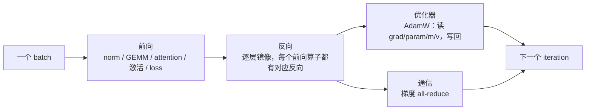
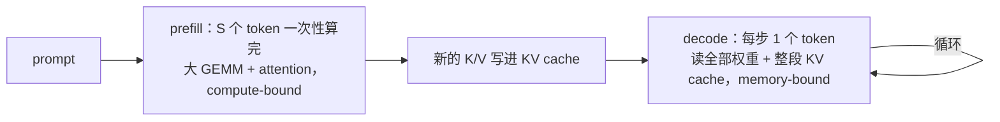

# 第 02 章 从 PyTorch 到 kernel：算子在栈里的位置

## 学习目标

读完本章，你应当能够：

1. 画出一次训练迭代（前向 / 反向 / 优化器 / 通信）与一次推理请求（prefill / decode /
   KV cache）的**算子地图**，说清每个位置上算子扮演什么角色。
2. 对任意一个算子做「**读多少字节、算多少次**」的推导，算出算术强度，并与机器平衡点比较，
   判断它是 memory-bound 还是 compute-bound。
3. 能手算 LayerNorm、GEMM、attention（prefill 的两种写法、decode）这四类算子的账，
   并解释为什么融合能把 attention 的中间量访存从 $O(S^2)$ 降回 $O(S)$。
4. 说清**一行 PyTorch 在 eager 模式下到底发生了什么**（dispatch → 逐算子 kernel），
   以及 `torch.compile` / TorchInductor 在哪些层面替你做了决定、在哪些层面做不了。
5. 用一页判据清单判断**什么时候需要自己写 kernel**，并知道「语法正确、数值正确、
   但比库慢几百倍」这种风险的来源。
6. 说清本章每一个数字的**出处与口径**：哪些是厂商规格、哪些是第三方实测、
   哪些是本书的公式推导。

## 前置知识

* 第 1 章：算术强度、机器平衡点、存储层级、tile 的定义。本章会直接用到「平衡点」这个词，
  如果忘了它可以先回去看一眼 1.3 节。
* 会用 PyTorch：写过 `torch.nn.Module`、`loss.backward()`、`optimizer.step()`，
  读过 `F.scaled_dot_product_attention` 或 HuggingFace 的建模代码。
* 知道矩阵乘法与 attention 的公式即可。**不需要** CUDA、不需要性能分析经验，
  本章所有推理都是从「一个算子要读多少字节、算多少次」这种方法出发的。

本章回答一个问题：**当你写下 `y = model(x)` 这一行时，从你的 Python 代码到硬件上真正运行的
kernel，中间隔了几层；每一层的代价是什么。** 它是第 3 章（TileLang 的设计哲学）、
第 4 章（编译全流程）和后面所有算子章节的共同前提。

本章的代码全部是纯 Python 的账本脚本，不需要 GPU 也能跑（`code/`）。
写作环境没有 NVIDIA GPU，也没有昇腾 NPU，因此本章**没有任何一条性能数字来自本机实测**；
每个数字都标了来源与测量条件。

---

## 1. 问题的由来：算子在一次迭代里出现在哪些位置

### 1.1 训练一步：四个阶段，四种瓶颈

把一次训练迭代拆开，算子出现在四个位置（图 1）：



图 1 的完整版本（含每层内部结构）见 `figures/01-training-step-operator-map.md`。

这四个阶段的特征完全不同：

**（a）前向**：主体的算子是三类——归一化（RMSNorm / LayerNorm）、矩阵乘
（QKV 投影、输出投影、MLP 的三个矩阵）、attention（$QK^\top$、softmax、$PV$）。
此外还有一批容易被忽略的逐元素算子：RoPE、残差相加、SiLU/GELU、mask、类型转换。
在长序列、小 batch 的训练里，前向的瓶颈几乎总是**算力**：FLOPs 远大于必须搬动的字节数。

**（b）反向**：与前向逐层镜像。这里有一个值得记住的精确关系：对一个线性层
$C = AB$（$A\in\mathbb{R}^{M\times K}$，$B\in\mathbb{R}^{K\times N}$），
前向是 $2MNK$ FLOP；反向要算两个梯度 $\mathrm{d}A = \mathrm{d}C\,B^\top$ 和
$\mathrm{d}B = A^\top \mathrm{d}C$，各 $2MNK$ FLOP。所以

```
反向的 FLOPs = 2 × 前向的 FLOPs（对 GEMM 而言，精确成立）
```

对 GEMM 主导的模型，反向的总量因此约为前向的两倍；attention 的反向还要额外处理
softmax 的中间量（要么保存，要么重算），通常比这更贵。本章的账本脚本
（`code/02-step-budget/step_budget.py`）就用这个 2 倍关系估算反向。

**（c）优化器**：AdamW 不是「一行 Python 代码」，它是一个完整的算子。
昇腾 CANN 的官方算子文档把它的输入输出讲得很清楚：`varRef`（参数 $\theta$）、
`mRef`、`vRef` 三个张量既是输入也是输出，另外读入 `grad` 与学习率、权重衰减、
$\beta_1^t$、$\beta_2^t$ 等标量，公式为
$m_t=\beta_1 m_{t-1}+(1-\beta_1)g_t$、$v_t=\beta_2 v_{t-1}+(1-\beta_2)g_t^2$、
$\theta_{t+1}=\theta_t-\frac{\eta}{\sqrt{\hat v_t}+\epsilon}\hat m_t-\eta\lambda\theta_{t-1}$
（来源：`../tilelang-corpus/06-huawei-ascend/raw/hiascend/llms-content/document/detail/canncommercial/canncommercial_900_API_aolapi_context_ops-nn_aclnnApplyAdamW_md.md:25-60`）。

数一下它的访存：每个参数要读 `grad`、`param`、`m`、`v`，再写回 `param`、`m`、`v`。
如果状态是 fp32、梯度是 bf16，就是 $2 + 3\times4 + 3\times4 = 26$ 字节/参数，
而算术只有十几个 FLOP。算术强度约 0.6 FLOP/Byte——**比任何 GEMM 都低两个数量级**。
一个 70 亿参数的模型，优化器一步要搬 182 GB 数据（本书推导，见
`code/01-op-traffic-model/op_traffic.py` 的 `adamw` 一行）。这是训练里最纯粹的
带宽阶段，也是 ZeRO、分片优化器状态这些技术的动机。

**（d）通信**：数据并行时每个 rank 都算出完整梯度，然后用 all-reduce 汇总。
ring all-reduce 搬运的数据量是梯度本身的 $2(N-1)/N$ 倍（$N$ 为卡数），
**一个 FLOP 都不做**。对 8B 模型、bf16 梯度、8 卡，这一项就是每步约 28 GB 的搬运量。

### 1.2 一次推理请求：prefill 与 decode 是两件事

推理的算子地图不一样（图 2，完整版见 `figures/02-inference-request-operator-map.md`）：



**prefill** 的形状与训练前向很像：$S$ 个 token 一起过网络，矩阵乘的 $S$ 维足够大，
是算力密集的。**decode** 完全不同：每一步只有 1 个 query token，但要与整段 KV cache
做 attention，还要把整个模型的权重读一遍来决定这一个 token。用本章的口径算
（8B 级模型、32 层、KV 长度 4096、bf16）：

```
prefill：66.1 TFLOP，28.5 GB    → compute-bound
decode ：16.1 GFLOP，14.5 GB    → memory-bound（每产出一个 token 读 14.5 GB）
```

同一个 attention 算子，在两段的判据是相反的。这一条会在第 15 章（attention 家族）
和第 18 章（推理与部署）反复出现。

KV cache 本身也要算子来维护。CANN 里有一个算子 `aclnnKvRmsNormRopeCache`，功能是
「对输入张量（kv）的尾轴，拆分出左半边用于 rms_norm 计算，右半边用于 RoPE 计算，
再将计算结果分别 scatter 到两块 cache 中」（来源：
`../tilelang-corpus/06-huawei-ascend/raw/hiascend/llms-content/document/detail/canncommercial/canncommercial_900_API_aolapi_context_ops-transformer_aclnnKvRmsNormRopeCache_md.md:25`）。
TileLang 的 paged MLA decode kernel 里则能看到对应的接口形态：`block_table` 描述
这个 sequence 的 KV 落在哪些块上，`cache_seqlens` 描述长度
（`_vendor/tilelang-v0.1.15/examples/deepseek_mla/example_mla_decode_paged.py:30-38`）。

### 1.3 所有算子最终都变成 kernel

把视角拉远一点。一个 PyTorch 模型从你的代码到硬件，中间是这样几层：

```
你的 Python 模型
   │  torch.compile / TorchDynamo 捕获计算图（可选）
   ▼
算子图（aten IR）
   │  TorchInductor：图级融合、调度、生成 kernel
   ▼
一个个 kernel：可能是 Inductor 生成的 Triton kernel、厂商库里的现成 kernel，
   │            也可能是你手写的 TileLang / CUDA / Ascend C kernel
   ▼
硬件
```

TileLang 的位置在图的中间偏下：**它不管「整张图怎么切」，只负责「一个算子怎么写快」**。
本书的合成文档把这句话写得很直接：

> 「TileLang **不是** PyTorch 的替代品，也不是完整的图编译器。它解决的是「一个算子内部
> 怎么写快」，位置在 Inductor 之下、CUDA/Ascend C 之上。」
> —— `../tilelang-corpus/90-synthesis/01-knowledge-system.md:44-48`

在 TileLang 的代码里，这个位置对应几个具体入口：装饰器 `@tilelang.jit`
（`_vendor/tilelang-v0.1.15/tilelang/jit/__init__.py:571-600`）、把 TIR 变成可调用对象的
`tilelang.compile`（同文件 `:94-140`）、包装好的 `JITKernel`
（`_vendor/tilelang-v0.1.15/tilelang/jit/kernel.py:41`，它的 `__call__` 在 `:206`，
`get_kernel_source()` 在 `:532`，`get_profiler()` 在 `:516`）。`compile` 的签名里有一项
`execution_backend`，取值包括 `"cython"`、`"tvm_ffi"`、`"nvrtc"`、`"torch"`、`"cutedsl"`
——这就是「怎么和在 PyTorch 里跑的模型接起来」的那个接缝，第 26 章会展开。

**这一层的存在，是本章后面所有讨论的前提**：既然算子最终都要变成 kernel，
那么「谁来写这个 kernel、它读多少字节、算多少次」就是一个可以被计算、被比较的问题。

---

## 2. 概念与模型：一个算子要读多少字节、算多少次

### 2.1 记账法：四条规则

性能建模最容易被误解的一点是：**「访存量」不是「你读了多少数据」，而是「算法最少必须
搬多少数据」**。本书采用的口径与 TileLang 生态里 TileOPs 仓库的 roofline 模型一致
（`../tilelang-corpus/12-operator-libraries/raw/TileOPs/docs/design/roofline.md:16-66`）：

1. 每个**输入**存储读一次，每个**输出**存储写一次；被读写的中间张量**不单独计**。
2. 一个基本运算（add / sub / mul / div / max）记 1 FLOP；一个超越函数
   （exp / log / tanh / sqrt / rsqrt / cos / sin…）在账本上也记 1 FLOP。
3. 矩阵乘的一次乘加记 2 FLOP。
4. 一次「算子调用」的代价就是 $(flops, bytes)$ 这两个整数；由此得到

```
算术强度 AI = flops / bytes                   （FLOP/Byte）
访存时间   = bytes / 带宽
计算时间   = flops / 峰值算力
时间下界   = max(访存时间, 计算时间)
```

这套口径给的是**下界**：真实实现只会更慢，因为还有 cache 未命中、kernel 启动、
尾部效应、同步开销。下界的用处不是预测，而是**判断优化方向**和**验收**（离下界还有多远）。

### 2.2 机器平衡点：把「算力」和「带宽」放在同一把尺子上

定义机器平衡点：

```
平衡点 = 峰值算力 / 峰值带宽     （FLOP/Byte）
```

于是：`AI < 平衡点` 时机器先被带宽卡住（memory-bound），`AI > 平衡点` 时先被算力卡住
（compute-bound）。

用两个公开的机器参数各算一次（都是本书的推导，公式就是上面的比值）：

| 机器 | 参数 | 出处与条件 | 平衡点 |
| --- | --- | --- | --- |
| H100 SXM5 | 1000 TFLOPS fp16 dense / over 3 TB/s，HBM3 | NVIDIA 官方博客，厂商公开的 preliminary specs，未实测（`../tilelang-corpus/05-nvidia-backend/raw/nvidia-blog-hopper-architecture-in-depth.md:141`、`:334`） | ≈ 333 FLOP/Byte |
| H200 | 989.5 TFLOPS fp16 dense / 4800 GB/s 规格值；仓库自带标定后折算成 729 TFLOPS / 4502 GB/s | `../tilelang-corpus/12-operator-libraries/raw/TileOPs/src/tileops/perf/profiles/h200.yaml:15-38`（标定条件写在该文件注释里：2048 MB working set、5 次 ×200 轮、显存 3201 MHz、算力受 700 W 限制） | 162 FLOP/Byte（标定后） |

请注意第二行里藏着一个重要的习惯：**「厂商规格」和「能跑到的」不是一个数。**
H200 的标定文件里，fp16 张量核的 `calibration` 是 0.7370（burst），持续值只有 0.6684
（受 700 W 限制）；显存带宽的 `calibration` 是 0.9380，而纯 copy 混合只有 0.8183。
本章后面的所有例子都用**标定后**的 729 TFLOPS / 4502 GB/s，因为它更接近真实可用的水平。

### 2.3 四个可以手算的例子

下面四个例子的完整输出由 `code/01-op-traffic-model/op_traffic.py` 复算，
数值与正文一致。约定：fp16 输入输出（每个元素 2 字节），机器用 H200 标定参数
（729.3 TFLOPS / 4502 GB/s / 平衡点 162）。

**例 1：逐元素链。** 先看最简单的：$y = \sin(\cos(x))$，$x$ 有 16.8M 个元素
（即 $4096\times4096$）。

```
eager（两个 kernel）：读 x(33.6MB) + 写 a(33.6MB) + 读 a(33.6MB) + 写 b(33.6MB) = 134.2 MB
融合（一个 kernel）：读 x + 写 b                                          =  67.1 MB
算术强度（融合后）：33.6 MFLOP / 67.1 MB ≈ 0.5 FLOP/Byte
```

结论：远低于平衡点 162，是典型的 memory-bound；融合把访存量减半，因此时间下界也从
29.8 µs 降到 14.9 µs。**这就是 PyTorch 官方文档里那个例子的完整算术**
（"we can turn 2 reads (x, a) and 2 writes (a, b) into 1 read (x) and 1 write (b)"，
来源见 4.3 节）。

**例 2：LayerNorm。** $M=8192$ 行、$H=4096$ 列，fp16。

```
融合实现：读 x + 写 y                    = 134.2 MB
用基础算子手工拼（均值一趟、方差一趟、归一化+仿射一趟）：
          读 x 三次 + 写 y             = 268.4 MB
运算量（本书口径，每元素约 8 FLOP）：0.268 GFLOP
```

算术强度只有 1.0–2.0 FLOP/Byte，比平衡点低两个数量级。归一化类算子的优化空间
**完全在访存上**：能少读一遍就少读一遍。这也是「`x.mean()`、`(x-m).pow(2).mean()`、
`rsqrt`、`*w+b` 各写一行」这种写法在性能上不可接受的原因——eager 会为每一步各发一个
kernel，中间张量在显存里来回；而 PyTorch 自带的 `F.layer_norm` 是一个融合 kernel。

**例 3：GEMM。** $4096^3$，fp16。

```
运算量：2MNK = 1.37e11 FLOP = 137 GFLOP
访存量：读 A(33.6MB) + 读 B(33.6MB) + 写 C(33.6MB) = 100.7 MB
算术强度：1365 FLOP/Byte   ← 远高于平衡点 162
```

GEMM 天生是 compute-bound 的。有意思的是它**可以翻转**：同样按「A、B、C 各读/写一遍」
记账，边长 1024 时算术强度降到 341，边长 512 时降到 171——已经贴着平衡点
（这两个数字由脚本复算，也是第 1 章习题里出现过的现象）。所以「小矩阵乘」和
「大矩阵乘」在 roofline 上是两种东西：大 GEMM 的技巧是「把数据留在片上喂满张量核」，
小 GEMM 的技巧是「减少启动与访存」。

**例 4：attention。** 这是本章最有信息量的一个例子。取 $B=1$、32 个 head、
head_dim $d=128$、序列长度 $S=4096$，fp16。

*prefill（标准写法：把 $S\times S$ 的分数矩阵落到显存）*

```
运算量：32 × (4·S²·d + 5·S²) ≈ 278 GFLOP
访存：Q/K/V/O 各一趟 134.2 MB
      + 分数矩阵被写一次、被 softmax 读一次写一次、被 PV 读一次
        = 6 × 32 × 4096² × 2 字节 ≈ 6.44 GB   ← 主体是它，不是 Q/K/V
算术强度：42.2 FLOP/Byte  →  memory-bound
```

*prefill（flash 风格：分数只在片上存活）*

```
运算量：同样的 278 GFLOP
访存：只有 Q/K/V/O 四趟 = 134.2 MB
算术强度：2068 FLOP/Byte  →  compute-bound
时间下界从 1.461 ms 降到 380.6 µs（约 3.8 倍）
```

*decode（KV 长度 32768，每步 1 个 token）*

```
运算量：32 × (4·S·d + 5·S) ≈ 0.54 GFLOP
访存：读 K/V cache = 2 × 32 × 32768 × 128 × 2 字节 ≈ 537 MB
算术强度：1.01 FLOP/Byte  →  极端 memory-bound
```

把三个数字放在一起，你会看到同一个 attention 的三种面貌：

| 写法 | 算术强度 | 判据 | 瓶颈 |
| --- | --- | --- | --- |
| prefill，落 $S\times S$ | 42.2 | memory-bound | 中间量在 HBM 往返 |
| prefill，flash 风格 | 2068 | compute-bound | 张量核利用率 |
| decode | 1.01 | memory-bound | KV cache 的读取 |

FlashAttention 那篇论文的核心论证正是第一条与第二条的对比：**把「HBM 的读写次数」当成
一等公民来优化**，"IO-aware" 指的就是这件事（论文摘要见
`../tilelang-corpus/03-tilelang-papers/raw/arxiv-2205-14135.md`；其报告的训练加速为
BERT-large 15%、GPT-2 3×、LRA 2.4×，测量条件见论文正文）。而 decode 之所以是
memory-bound，是因为每读一个 KV 元素只做一次乘加——这正是 MQA/GQA、KV cache 量化、
投机解码这些技术要解决的问题（第 18 章）。

「prefill 是 compute-bound」并不意味着它一定能跑满算力。FlashAttention-3 的论文摘要
给了一个公开的数据点：**FlashAttention-2 在 H100 上只做到 35% 的利用率**；他们用
warp specialization 把 Tensor Core 与 TMA 的异步性重叠起来、并引入 FP8，
才把 FP16 推到 **740 TFLOPs/s（75% 利用率）**、FP8 接近 **1.2 PFLOPs/s**
（来源：`../tilelang-corpus/03-tilelang-papers/raw/arxiv-2407-08608.md`，论文摘要，
测量条件见论文正文；这是论文自述的数字，不是本章的实测）。
换句话说：**判断「它该是 compute-bound」只是第一步，做到那一步是另一回事**——
这正是第 15 章要讲的 attention 演进史。

### 2.4 把算子拼成模型：两张账本

单个算子的账再清楚，也不足以说明「训练慢在哪」。`code/02-step-budget/step_budget.py`
把它拼成一个 8B 级模型（32 层、hidden 4096、ffn 14336、32 个 query head / 8 个 KV head、
seq_len 4096、batch 1、8 卡、bf16 权重、fp32 优化器状态）：

```
训练一步（下界，来自脚本实际输出）
  前向（全部层）    66.1 TFLOP    28.45 GB    90.575 ms   27.9%
  反向（全部层）   132.1 TFLOP    56.91 GB   181.151 ms   55.9%
  优化器            0.12 TFLOP   208.78 GB    46.375 ms   14.3%
  通信                  0         28.11 GB     6.243 ms    1.9%

推理
  prefill（整段 prompt） 66.1 TFLOP   28.45 GB    90.575 ms
  decode（每个 token）    0.016 TFLOP  14.50 GB     3.220 ms
```

这张表是**本书口径的粗模型**（假设写在脚本注释里：反向按 2 倍前向 FLOPs、
激活只算残差流与 MLP 中间量、通信按 ring all-reduce），它的价值在于给出数量级关系：

* 训练一步里，算力集中在**前向 + 反向**（合计约 84%），优化器是纯带宽阶段
  （120 GFLOP 的算术，却要搬 208.78 GB）；
* prefill 与 decode 的判据完全相反，因此**优化手段也完全不同**——一个要喂满张量核，
  一个要少读字节。

### 2.5 这个模型的边界

三件事必须说清楚，否则上面的数字会被误用：

1. **它是下界，不是预测。** 真实 kernel 一定更慢。TileOPs 的 roofline 文档甚至定义了
   一类专门的失败模式：当 `sol_time` 和实测时间都低于某个阈值时，说明 kernel 太小、
   启动开销占主导，模型对这种情况「没有抓手」，只能标成 latency-bound
   （`../tilelang-corpus/12-operator-libraries/raw/TileOPs/docs/design/roofline.md:40-42`）。
2. **cache 与 locality 被忽略了。** 模型假设每次访问都直接去 HBM。真实程序有 L2、有
   片上复用，实际访存可能远低于（也可能高于）这个下界。
3. **超越函数的记账是「账本上记 1 FLOP」**，不是硬件成本。`exp`、`tanh` 在硬件上走 SFU，
   吞吐远低于 FMA。所以 softmax、SiLU 密集的算子，实际时间会比这个模型给出的更多，
   TileOPs 的文档也明确写了「不保证 SFU-bound 的 kernel 就在极限」
   （同文件 `:44-52`）。

---

## 3. 用法：一行 PyTorch 到底做了什么

### 3.1 eager 模式：一行代码 = 一串 kernel launch

PyTorch 默认是 **eager（即时执行）** 模式。`y = torch.sin(torch.cos(x))` 的执行过程是：

1. Python 解释器逐行执行，先算 `torch.cos(x)`，再算 `torch.sin(...)`；
2. 每个 Tensor 上的运算都经过 **dispatcher**，选中一个 `aten` 算子（如 `aten::cos`）；
3. 这个算子被展开成**一次（有时是多次）kernel launch**，写回一张新分配的显存张量。

所以 `cos` 之后接 `sin`，在 eager 下就是两个 kernel，中间结果 `a` 必须落到显存再读回来。
PyTorch 官方文档对这件事的说法是：

> "Pointwise ops in eager mode are suboptimal because each one would need to read a tensor
> from the memory, make some changes, and then write back those changes."
> —— PyTorch 官方文档「Getting Started with torch.compile」，
> <https://docs.pytorch.org/docs/2.14/user_guide/torch_compiler/torch.compiler_get_started.html>
> （2026-10-01 核验）

除了访存，eager 还有第二个代价：**启动开销**。每个 kernel 都要从 Python 侧发起，
小算子上这笔开销可能比计算本身还大。PyTorch 的性能文档里有一个很直观的口径：
在 densenet121 这种小算子的模型上，小 batch 时 "Percent of time when GPU is busy" 只有
32.69%，也就是说大部分墙钟时间花在 CPU 侧的准备与启动上
（<https://docs.pytorch.org/docs/2.14/user_guide/torch_compiler/torch.compiler_inductor_profiling.html>，2026-10-01 核验；
测量条件见该页所引的 benchmark 脚本）。

### 3.2 你会看到什么：kernel 表

判断「我的模型里有多少个 kernel、每个叫什么」，标准做法是看 profiler。用
`TORCHINDUCTOR_UNIQUE_KERNEL_NAMES=1` 之后，Inductor 生成的 kernel 会带上语义化名字，
形如 `triton_poi_fused_cat_155`：`poi` 表示 pointwise，`fused` 表示它把多个算子融进了
同一个 kernel，`cat` 是被融合的 ATen 算子的名字（来源同上）。

这个命名规则本身就是一条很好的证据链：**Inductor 的 kernel 边界是「融合后的算子组」，
不是「一个 ATen 算子一个 kernel」。** 名字里的 `cat` 告诉你哪些 eager 下会各占一个 kernel
的算子在编译后合并了。

### 3.3 用本章的脚本复算

```
python3 code/01-op-traffic-model/op_traffic.py          # 单算子账本
python3 code/02-step-budget/step_budget.py              # 一次迭代/一次请求
```

两个脚本只用标准库，输出就是本章的表格。建议按下面顺序做一次：

1. 先用默认参数跑一遍，确认能复现正文里的数字；
2. 把 `--machine h100-spec` 换成 H100，看平衡点从 162 变成 333，哪些算子的判据会翻转；
3. 把 `--seq-len` 从 4096 改到 32768，看训练一步里 attention 的占比怎么变；
4. 把 `--params` 改成 70e9、`--world` 改成 64，看优化器与通信的占比怎么变。

这四步做完，你就有了「不看 profiler 也能对量级有判断」的能力——这正是后面第 28 章
（性能模型与算子设计方法论）的起点。

---

## 4. 实现机制：融合是默认答案，torch.compile 做到哪一步

### 4.1 逐算子执行的两个代价

把 2.3 节的例子总结成一条规律：

```
每一个「读入 → 计算 → 写出」的算子，都要为它读写的每个字节付一次 HBM 的钱。
链上第 k 个算子读的是第 k-1 个算子刚写下去的中间张量——这次往返本可以完全避免。
```

于是有两类代价：

* **访存代价**：中间张量的写 + 读，等于给数据多买了两次票（例 1、例 2）；
* **启动与调度代价**：kernel 数量多、每个都很小的时候，启动开销占比升高（3.1 节）。

注意这两类代价都是**在算术强度很低的时候才致命**。GEMM 融合与否，差别有限
（省下的只是输出矩阵 C 的写出与再读入，而它的访存是被 A、B 主导的）；
逐元素链和归一化融合与否，差别是 2 倍到几十倍。**融合的收益正比于「省下的字节数
占原本访存量的比例」**，而不是正比于「省下了几个算子」。

### 4.2 融合的账本与厂商证据

图 5（`figures/05-fusion-ledger.md`）给出了本章三个融合例子的账本：

| 例子 | 融合前访存 | 融合后访存 | 下界之比 |
| --- | --- | --- | --- |
| $\sin(\cos(x))$，16.8M 元素 | 134.2 MB | 67.1 MB | 2.0× |
| LayerNorm（手工拆三趟） | 268.4 MB | 134.2 MB | 2.0× |
| attention prefill（落 $S\times S$） | 6.58 GB | 134.2 MB | 49× |

融合不只是「编译器的小技巧」，它是**生产算子库的组织方式**。三个来自昇腾 CANN
官方文档的证据：

* `aclnnAddRmsNormDynamicQuant`：「将RmsNorm前的Add算子和RmsNorm归一化输出给到的1个或2个
  DynamicQuant算子融合起来，**减少搬入搬出操作**」
  （`../tilelang-corpus/06-huawei-ascend/raw/hiascend/llms-content/document/detail/canncommercial/canncommercial_900_API_aolapi_context_ops-nn_aclnnAddRmsNormDynamicQuant_md.md:25`）；
* `aclnnKvRmsNormRopeCache`：切分 + RMSNorm + RoPE + 写入两块 cache，一个算子；
* `aclnnApplyAdamW`：整个优化器更新，一个算子。

TileLang 侧的对应物是 examples 里的融合算子：`examples/norm/rms_norm.py` 把
「平方求和 → 归约 → rsqrt → 缩放」写在一个 kernel 里
（`_vendor/tilelang-v0.1.15/examples/norm/rms_norm.py:22-30` 里的 `T.reduce_sum` 与
`T.rsqrt` 就在同一个 `T.Kernel` 作用域内）；`examples/elementwise/example_elementwise_add.py`
是逐元素融合的最小例子（`_vendor/tilelang-v0.1.15/examples/elementwise/example_elementwise_add.py:11-33`）。

### 4.3 torch.compile / TorchInductor 能做到什么

`torch.compile` 想做的事，就是把 4.1 节的两类代价交给编译器去消除。它的组件与分工
（来源：PyTorch 官方 torch.compiler 文档，
<https://docs.pytorch.org/docs/2.14/user_guide/torch_compiler/torch.compiler.html>，2026-10-01 核验）：

| 组件 | 做什么 |
| --- | --- |
| **TorchDynamo** | 用 CPython 的 Frame Evaluation API 捕获 PyTorch 计算图，得到一张 Aten IR 图；遇到无法捕获的代码就产生 **graph break**，回退到 eager |
| **AOTAutograd** | 「captures not only the user-level code, but also backpropagation」——提前把反向也捕获成图，于是前向和反向都能被编译 |
| **TorchInductor** | 默认后端：先做图级优化（**融合**、内存复用、乱序执行、工作放置），再生成代码；在 NVIDIA/AMD/Intel GPU 上「leverages OpenAI Triton as the key building block」 |

Inductor 自己把「最重要的优化」说得很清楚：

> "The single most important optimization that inductor performs is fusion."
> —— PyTorch 官方文档「Getting Started with torch.compile」（URL 见上；2026-10-01 核验）

除了融合，官方 FAQ 还列了另外三条通用手段：**水平融合**（把多个矩阵乘排在一起执行，
例如 grouped GEMM）、**乱序执行**（按数据依赖重排节点、复用缓冲区）、**自动工作放置**
（把节点映射到合适的硬件与存储资源）。FAQ 里还有一句很重要的话：Inductor
"first takes care of fusing whatever it can and only then generates Triton kernels"
——**先决定融合边界，再生成 kernel**。
（<https://docs.pytorch.org/docs/2.14/user_guide/torch_compiler/torch.compiler_faq.html>，2026-10-01 核验）

在工程上还有两件值得知道的事：

* **自动调参**：`TORCHINDUCTOR_MAX_AUTOTUNE` 会让 Inductor 多试几组 Triton 配置并选
  实测最快的一组；这对应本书第 11 章的自动调优话题。
* **CUDA Graph**：Inductor 可以自动把一串 kernel 用 CUDA Graph 包起来，消除逐 kernel 的
  启动开销（这就是 3.1 节里「GPU busy 只有 32%」这类问题的解法）。

### 4.4 边界在哪

`torch.compile` 覆盖不到的地方，恰好就是你要自己写 kernel 的地方。四类边界：

**（a）图捕获本身会断。** Dynamo 遇到它无法捕获的代码就 graph break，回退到 eager；
`fullgraph=True` 会把 graph break 变成错误而不是静默回退。graph break 的代价是
「这段代码不参与融合」，而且反向在 break 处无法继续（「We cannot propagate gradients
through a graph break」，同上 FAQ 页）。

**（b）融合能力受限于「它能看见什么」。** Inductor 的融合是**图级**的：它能把相邻的
逐元素算子合并，但它不会为你发明一个代价模型驱动的、跨层重排的数据流。当一个算子的
性能取决于「tile 多大、数据放在哪一级存储、几条流水怎样重叠」时（attention、MLA、
MoE、paged decode），这些决策不在它的融合抽象里。

**（c）后端目标有限。** Inductor 的主要 GPU 后端建立在 Triton 之上；昇腾 NPU 不在
Triton 的目标列表里，这也是昇腾侧需要 TileLang 与 CANN 算子库的原因之一
（这是本书基于上面官方文档措辞的判断，不是文档原话）。

**（d）自定义算子的接缝有明确约束。** 把 TileLang（或其他手写）算子挂进
`torch.compile` 的图里，需要走 `torch.library.custom_op` 这类注册接口。TileOPs 项目把
这些约束写得很具体（`../tilelang-corpus/12-operator-libraries/raw/TileOPs/src/tileops/ops/compile_boundary.py:1-25`）：
被 Dynamo 追踪的 `forward` **不能构造 kernel、不能进入 TileLang builder**——缓存查找、
kernel 构造与启动都必须发生在未追踪的一侧；传给自定义算子的 key 必须是 `str`，
因为「dynamo treats string operator arguments as compile-time constants, while an `int`
is generalized to an unhashable `SymInt`」；而且 Inductor 会把 fake tensor 的输出形状
烤进磁盘缓存，所以同一个 key 绝不能在不同实例之间复用。同一套设计文档还把一条
纪律写死了：**「PyTorch is the spec oracle, not a runtime path」**——算子层不允许在
forward 里直接调用 `torch.sum`、`F.softmax` 这类高层算子，否则「库里测的和发的
其实是 PyTorch」（`../tilelang-corpus/12-operator-libraries/raw/TileOPs/docs/design/layer-boundaries.md`）。

> **本机限制**：本章写作环境没有 GPU/NPU，上面提到的 `TORCH_COMPILE_DEBUG`、
> `TORCHINDUCTOR_UNIQUE_KERNEL_NAMES`、Nsight Compute 都没有在本机跑过；
> 4.3 节的所有说法都直接来自 PyTorch 官方文档的原文，4.4 节的约束来自 TileOPs
> 源码快照。它们的可复现步骤见 `code/README.md` 的「在真实机器上怎么接着往下做」。

---

## 5. 进阶与陷阱：什么时候你需要自己写 kernel

前面四节其实已经在回答这个问题了。把判据整理成一页清单（图 6，
`figures/06-when-to-write-a-kernel.md`）：

**前置动作：先测量。** 用 profiler 找出占 GPU 时间最多的几个算子，先试
`torch.compile` 和厂商库里的现成融合算子。**不做这一步就直接写 kernel，是资源浪费。**
下面四条是「试过之后仍然要做」的理由。

**判据 1：融合缺失，且省下的访存占比很大。** 典型是「一串低算术强度的算子
被拆成很多小 kernel」——norm + 残差 + RoPE + 量化、mask + softmax 的组合。
判断方式就是本章的账本：算一遍融合前后的 `bytes`，比值在 2 倍以上就值得做。

**判据 2：库里根本没有这个算子。** 新论文里的算子（MLA、NSA、DSA indexer、
稀疏 attention、新的位置编码）在库更新之前都不存在。生产里能看到这类算子的
TileLang 实现，比如 SeerAttention-R 报告「Using TileLang, we develop a highly optimized
sparse decoding kernel」（`../tilelang-corpus/03-tilelang-papers/raw/arxiv-2506-08889.md`），
以及把 NSA 的设计动机直接写成「arithmetic intensity-balanced algorithm design」的论文
（`../tilelang-corpus/03-tilelang-papers/raw/arxiv-2502-11089.md`）。

**判据 3：需要库不支持的低精度或布局。** fp8 block scaling、int4 权重、
NZ/fractal 布局、按 block 的 scale 与反量化——这些是「数据怎么摆」的问题，
库要么不支持，要么不支持你要的那种组合。第 27 章会专门讲数值与低精度。

**判据 4：单个算子已经贴着下界，但整段流水还在等。** 这时要动的是**跨算子的数据流**：
多缓冲、流水线、persistent kernel、把多个算子放进一次 launch。TileLang 把这类能力
做成了语言里的显式概念（`T.Pipelined(num_stages=...)`、存储作用域），
第 11、22 章会展开；昇腾 README 里那张「你写 TileLang，Ascend C 里可以省掉什么」的
表，其中「Synchronization | None (Just write operations in order!)」一行说的就是这件事
（`_vendor/tilelang-v0.1.15/tilelang/ascend/README.md:141-152`）。

**然后是风险：写得对≠写得快。** 一篇 2026 年的实证研究在 NVIDIA A100 与 GH200 上
检查了 22 个 Triton/TileLang kernel，结论是：**「an idiomatic TileLang LayerNorm kernel
passes KernelBench's correctness check while running more than 300× slower than the
PyTorch baseline」**；而且慢的原因在不同算子族里不一样——归一化/归约类的慢「mainly
repairable authoring defects, such as sequential reductions and unnecessary dtype
conversions」，卷积与大 GEMM 的差距则来自代码生成与调优覆盖不足。这篇论文提出的两个
轻量验收判据正是本章的工具：**库相对效率**（和 PyTorch/厂商库比）与 **roofline 利用率**
（和本章算出的下界比）——「together they flag every functionally valid but inefficient
kernel in our suite」（`../tilelang-corpus/03-tilelang-papers/raw/arxiv-2607-04454.md`）。

所以正确的顺序是：

```
测量 → 算账（本章）→ 先试 torch.compile / 库算子 → 仍然要写，就用 roofline 利用率验收
```

### 5.1 本章的三条常见陷阱

1. **把厂商规格当基线。** 1000 TFLOPS 与 729 TFLOPS 不是一个东西；`calibration` 这类
   标定值连测量条件（显存频率、功耗上限、working set）都会改变。引用数字时必须带条件。
2. **只看 FLOPs 不看字节。** 本章一半的例子（LayerNorm、decode attention、AdamW）
   算术强度不超过 2 FLOP/Byte，它们的性能与 FLOPs 基本无关。
3. **把「算子数量」当瓶颈。** 融合的收益取决于省下的字节占比，不是省下的算子个数。
   一条 $k$ 个算子的逐元素链，理论上最多把这条链的访存降到 $1/k$；但如果这条链的
   访存只占整个模型的百分之一，端到端收益仍然不到百分之一。

### 5.2 本章不做什么

* 不教你写 TileLang kernel：第 7–9 章从安装与第一个 kernel 开始。
* 不做真实的性能测量与调优：第 12 章（调试与性能分析）、第 11 章（流水线与调优）。
* 不展开各类算子的完整实现：第 13–16 章。
* 不展开编译器内部：第 4 章给全流程，第 20–26 章深入 pass 与后端。

---

## 6. 本章小结

* **算子在地图上的位置**决定了它的命运：训练一步里，前向/反向是算力阶段，
  优化器是纯带宽阶段（每参数 ±26 字节），通信是纯搬运（ring all-reduce 搬
  $2(N-1)/N$ 倍梯度）；推理请求里，prefill 是算力阶段，decode 是带宽阶段
  （每 token 读全套权重 + 整段 KV cache）。
* **账本方法**：数出 $(flops, bytes)$ → 算算术强度 → 和机器平衡点比 →
  得到 memory-bound / compute-bound 与时间下界。四个手算例子：逐元素链（0.5 F/B）、
  LayerNorm（1–2 F/B）、GEMM 4096³（1365 F/B）、attention（落 $S^2$ 42 F/B、
  flash 风格 2068 F/B、decode 1 F/B）。
* **Eager 的代价**是「每个算子都要为它读写的字节付一次 HBM 的钱」，
  外加逐 kernel 的启动开销；`cos` 接 `sin` 这种两算子链，融合后访存量减半。
* **torch.compile 的分工**：Dynamo 捕获图（graph break 就回退）、AOTAutograd 把反向也
  捕获、Inductor 先融合再生成 Triton kernel，另外还有 CUDA Graph 与自动调参。
  它覆盖「整图怎么切、相邻算子怎么并」，不覆盖「单个复杂算子的数据流怎么排」。
* **什么时候自己写 kernel**：融合缺失且省下的访存占比大、库里没有这个算子、
  需要不被支持的低精度/布局、需要跨算子的数据流重组。先测量，再用 roofline 利用率
  验收，因为「正确但慢 300 倍」是真实发生过的事。
* **TileLang 的位置**：Inductor 之下、CUDA/Ascend C 之上，负责「一个算子内部怎么写快」。
  这正是第 3 章要开始讲的东西。

## 延伸阅读

* 想亲手复算本章的每个数字：`code/01-op-traffic-model/`、`code/02-step-budget/`。
* 想看本章每一张图：`figures/`（含 `figures/README.md` 的来源表）。
* 想核对本章引用的全部原始资料与版本：`references.md`。
* 想继续往下走：第 3 章（TileLang 的设计哲学与编程模型）、
  第 4 章（架构总览与一次编译的全流程）。
* 想直接看真实算子的实现：第 13–16 章；想看真实的性能测量：第 12 章。
