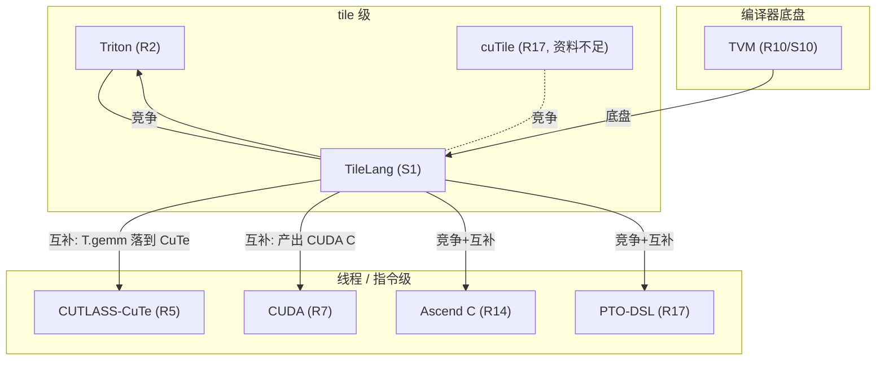

# 第 05 章 习题答案

每题给出**解题思路 + 参考答案 + 常见错误**。涉及源码的答案都给出文件与行号，方便复核。

---

## E1 抽象层次

**思路**：回到本章 2.1 节的三个决策，逐个对象照填。

**参考答案**：

| 对象 | 谁搬数据 | 谁切 tile | 谁插同步 |
| --- | --- | --- | --- |
| CUDA | 用户（`__shared__`、`cp.async`、TMA） | 用户 | 用户（`__syncthreads`/mbarrier） |
| Triton | 编译器从块级程序反推 | 用户给块尺寸，autotune 搜索 | 编译器（tile 级 pass） |
| TileLang（NVIDIA） | 用户写 `T.copy`，codegen 决定指令 | 用户给 tile 尺寸与 `num_stages` | 编译器（`ThreadSync` 等 pass） |

TVM 不在表里，因为它不是“写一个算子”的工具，而是提供 IR、pass、target/device 抽象的
底盘；它没有“用户搬数据 / 切 tile / 插同步”这一层用户接口。它服务于上面三行，而不是
和它们并列。

**常见错误**：把 Triton 的“谁切 tile”写成“编译器”。Triton 的块尺寸仍由用户/autotune
给（论文里是 `tunable` 常量），编译器负责的是块内部的调度与同步。

---

## E2 tile 的定义

**思路**：直接引原文，再解释“为什么 CUDA 没有这个层次”。

**参考答案**：原文是 “the concept of tile, i.e., **statically shaped multi-dimensional
sub-arrays**”，来源 `../tilelang-corpus/11-related-compilers/raw/triton-mapl-2019.md:37`。

“静态形状的多维子数组”是一个**语言里的类型概念**：它能被编译器拿去做数据流分析、
allocate 共享内存、推导布局。Triton 与 TileLang 都把它做成了语言类型，所以 tile 是它们
的一等公民。CUDA 里只有指针 `float*` 与线程索引，shared memory 数组是用户自己算出来的，
编译器不知道“这是一片 tile”，因此也无法自动搬它、自动为它插同步。

**常见错误**：把 tile 说成“一块共享内存”。tile 是逻辑上的子数组，它可以落在 register、
shared、L1、UB 任意一级；放在哪一级是另一个决策。

---

## E3 2019 Triton 的能力边界

**思路**：找论文的结论段，看它把什么列为“未来工作”。

**参考答案**：不成立的部分是“原生支持张量核”。2019 论文的结论写：“Directions of future
work includes support for tensor cores, implementation of quantized kernels [26] and
integration into higher level DSLs.”，来源
`../tilelang-corpus/11-related-compilers/raw/triton-mapl-2019.md:943-946`。也就是说，
在论文描述的那个版本里，张量核支持是**尚未完成**的方向。今天 Triton 当然有 tensor core
路径，但那属于论文之后的发展，不能倒推回 2019 的结论。

**常见错误**：把“今天的 Triton 支持张量核”当成“论文说了它支持”，从而用错误的前提
去评价论文的设计取舍。

---

## E4 读 TileLang 源码：谁在插同步

**思路**：打开 `cuda/pipeline.py`，定位注释里点名的两处。

**参考答案**：

* 流水段：`_vendor/tilelang-v0.1.15/tilelang/cuda/pipeline.py:129-130`，
  `PipelinePlanning()` → `InjectSoftwarePipeline()`；紧接着 `:134` 是 `LayoutInference()`，
  `:142` 是 `LowerTileOp()`。
* 同步段：`_vendor/tilelang-v0.1.15/tilelang/cuda/pipeline.py:258-259`，
  `ThreadSync("shared")` 与 `ThreadSync("shared.dyn")`。

用户不写 `__syncthreads()`，是因为 `ThreadSync` 会根据对 shared buffer 的读写关系
（RAW/WAR）自动插入同步；软件流水则由 `PipelinePlanning` + `InjectSoftwarePipeline`
决定 stage 与多缓冲。这两件事在 CUDA 里是用户手写的，在 TileLang 里是 pass 的职责。

**常见错误**：只写 `ThreadSync` 而漏掉流水那一段。流水和多缓冲同样属于“用户不用写、
编译器代劳”的部分。

---

## E5 TVM 的角色

**思路**：找证据要落到“TileLang 用了 TVM 的东西”。

**参考答案**（任答两条即可）：

1. pass 名字与基础设施来自 TVM：`_vendor/tilelang-v0.1.15/tilelang/cuda/pipeline.py:129-142`
   里的 `PipelinePlanning`、`InjectSoftwarePipeline`、`LayoutInference`、`LowerTileOp`
   全部是挂在 IRModule 上的 pass，这套 pass 机制由 TVM 提供。
2. 昇腾自动调度直接建在 TVM 的算术分析与 pass 上，并用 Z3 做求解：
   `_vendor/tilelang-v0.1.15/tilelang/ascend/pipeline.py:108-114` 与
   `_vendor/tilelang-v0.1.15/tilelang/ascend/transform/z3_scheduler.py:1-26`。
3. IR 层：TileLang 的 IR 就是 TVM 的 TIR/TIRX（见第 20 章与 R10 的 TIRx 小节）。

如果 TileLang 自己写一套 IR 框架，它会失去：成熟的 IR 表示与 pass 管理、target/device
抽象、以及上游 TVM 社区对 IR 语义与 bug 的长期修复。这些都不是一两个 PR 能替代的。

**常见错误**：把“TVM 提供了 IR”当成唯一证据，忽略 pass 基础设施与 target 抽象。

---

## E6 Ascend C 与 TileLang@Ascend 的分工

**思路**：读对照表，把“Ascend C code you can skip”一栏抄下来。

**参考答案**：对照表在 `_vendor/tilelang-v0.1.15/tilelang/ascend/README.md:141-151`。
至少三件可以跳过的事：

* `TPipe` / `TQue` setup 与 DMA 调用（Buffering and data movement 行），由 TileLang
  的 `T.alloc_*`、`T.copy`、`T.dual_copy` 承担；
* Set/wait flags 与 flag ID 管理（Synchronization 行），TileLang 里“None (Just write
  operations in order!)”，由编译器插入成对 flag；
* 手动 schedule 与 buffer-slot rotation（Scheduling and pipelining 行），由
  `T.Pipelined(...)` 与自动调度承担。

**常见错误**：把“跳过”理解成“消失”。它们被移到了编译器里（`ascend/pipeline.py`），
不是不存在。

---

## E7 PTO-DSL 与 TileLang@Ascend 的关系

**思路**：PTO-DSL 的 README 有专门的 “Compare to other frameworks” 小节。

**参考答案**：

1. 更“低层”的是 **PTO-DSL**。原文：“PTO-DSL intentionally exposes lower-level
   control”，并且它把 tilelang-ascend 描述为也可以把 PTO-ISA 当 codegen 后端，
   来源 `../tilelang-corpus/06-huawei-ascend/raw/pto-dsl/README.md:31-35`。
2. 例子：L2 swizzling 在 tilelang 里是一行 `T.use_swizzle`，在 PTO-DSL 里是用户自定义
   函数（同一段落原文：'L2 swizzling is a one-liner `T.use_swizzle` in tilelang, but is
   a user-defined custom function in PTO-DSL'）。

**常见错误**：认为两者只能二选一。PTO-DSL 自己是把 tilelang 列为“可以复用其 codegen”
的关系（互补），而不是纯竞争。

---

## E8 统一例子：融合 epilogue 的位置

**思路**：区分“融合”在两层的含义。

**参考答案**：

1. 在 CUDA 里，一个 kernel 的边界由用户决定的 block/grid 决定；矩阵乘往往写成一个
   kernel，epilogue（如 ReLU）要么另起一个 kernel，要么在同一个 kernel 里手工多加一段。
   在 TileLang 里，“什么算一个 kernel、计算单元怎么划分”由 tile 级原语与 pass 决定，
   所以对 `C_local` 做 ReLU 就只是同一个 `T.Kernel` 里的几行元素级代码，不需要新 kernel。
   这一点也是 TileLang@Ascend 强调的：GEMM 与 ReLU 在同一个 kernel 里完成，没有单独的
   epilogue launch（`tilelang/ascend/README.md:124`）。
2. 融合 ReLU 的代码在 `_vendor/tilelang-v0.1.15/examples/quickstart.py:41-43`。

**常见错误**：把 ReLU 当成“TileLang 的新原语”。它就是普通元素级运算，
`for i, j in T.Parallel(...): C_local[i, j] = T.max(C_local[i, j], 0)`。

---

## E9 昇腾上的 persistent kernel

**思路**：找 PTO-DSL matmul 教程的第 0 步。

**参考答案**：原文指出 NPU 算子基本都属于 CUDA 术语里的 persistent kernels，
`block_dim` 等于硬件核数而不是随输入增长，并且 `block_dim >= 65536` 会溢出；来源
`../tilelang-corpus/06-huawei-ascend/raw/pto-dsl/examples/aot/matmul_optimization_guide/matmul_optim_guide_zh.md:36-44`。
TileLang@Ascend 对应的原语是 `T.Persistent`，例如
`_vendor/tilelang-v0.1.15/tilelang/ascend/README.md:88`：
`for tile in T.Persistent([M // block_M * n_tiles], num_blocks, bx):`。

**常见错误**：把 `T.Persistent` 当成“循环语法糖”。它表达的是“固定的核网格迭代取
work tile”这一执行模型，是昇腾上的默认组织方式。

---

## E10 决策：该选谁

**思路**：按“先硬件、再算子/编译器、最后控制权”的顺序。

**参考答案**：

1. 昇腾 950 上的自定义 attention、要自动多缓冲与同步 → **TileLang@Ascend**。理由：它把
   多缓冲与同步建成编译期调度问题（`ascend/pipeline.py:108-114`），且官方文档明确列出
   “Synchronization: None (Just write operations in order!)”（`tilelang/ascend/README.md:141-151`）。
   如果想要更贴硬件、不接受自动调度，可退回 Ascend C / PTO-DSL。
2. H100 上 fp8 blockscaled GEMM、要完全控制 epilogue → **CUTLASS / CuTe**。理由：
   CUTLASS README 明确列出 FP8（e5m2/e4m3）、block scaled dtypes（NVFP4、MXFP4/6/8）
   与跨代 tensor core 支持（R5:28-51）；CuTe 给你 layout 层级与 epilogue 组件。
   若要更省事，可考虑 TileLang（它有 blockscaled 原语，见第 14/27 章）。
3. 给 TileLang 加 pass → **不是选第三方**，而是用 TileLang+TVM。理由：pass 建在 TVM 的
   IRModule/pass 框架上（S10/S11/S12），写法见第 29 章。

**常见错误**：场景 2 答 Triton 却给不出“blockscaled + epilogue 完全控制”的理由；
场景 3 答“用 TVM 重写”。

---

## E11 资料缺口

**思路**：收集本章所有“资料不足”标注。

**参考答案**（列举 5 处，答三处即可）：

1. **cuTile**：本地没有任何 cuTile 官方文档或代码。缺 `docs.nvidia.com/cuda/cutile-python/`
   正文与样例；缺了就写不出“用户写什么 / 编译器替你做什么”，只能保留它“存在且与
   CuTe DSL 并列”的判断。
2. **CUTLASS 融合 epilogue 的真实代码**：缺 CUTLASS `examples/` 下完整源文件与 CuTe
   GEMM 教程全文；缺了就只能描述“CuTe 在低层”，无法给出可对照的 epilogue 实现。
3. **Ascend C 的 GEMM+融合 epilogue 完整样例**：缺 CANN 官方 GEMM 样例或 CATLASS
   kernel 源码；缺了就只能用逐元素算子（LeakyReLU）说明 Ascend C 的编程范式。
4. **Ascend 950 两条后端路线的官方取舍建议**：issue #3317 只有提问没有回答（本 corpus
   快照）；缺维护者答复，本章不臆测。
5. **可审计的性能对比**：社区文章的“打平 / 差几倍”没有公开基线与测量口径；缺带条件
   的 benchmark 报告。

**常见错误**：把“资料不足”写成“不重要”。缺口本身就是结论的一部分。

---

## E12 代码阅读：CuTe DSL 与 TileLang 的区别

**思路**：认线程/指令级词汇。

**参考答案**：属于线程/指令级的 API 例如
`_block_sum(..., tidx: cutlass.Int32, ...)`、`cute.arch.warp_reduction_sum(value)`、
`cute.arch.barrier()`、`cute.autovec_copy(...)`、`cute.make_fragment(VEC, BF16)`
（来源
`../tilelang-corpus/07-tilelang-ascend-adapter/raw/TileFoundry/examples/minicpm3_4b-cutedsl/kernels/cute_gemv.py:36-113`）。

同样的事用 TileLang 写时，会消失的概念包括：显式 `tidx` 与线程索引、warp 内归约的
具体实现、`barrier` 的摆放、元素级向量拷贝 `autovec_copy`。这些由 `T.Parallel`、
`T.reduce_*`、流水/同步 pass 承担。

这不意味着 CuTe DSL“更差”：它的自述目标就是“与 CuTe C++ 抽象完全一致、暴露 hardware
atom、完全控制线程与数据层级”（R5）。它在**另一层**提供**更细的控制**，代价是要自己
写这些细节。层次不同，优劣取决于你要什么。

**常见错误**：把“代码更短”当成“必然更好”。

---

## E13 社区数字的引用规范

**思路**：套用本章引用规则：来源性质 + 链接 + 测量口径 + 本书如何使用。

**参考改写**：

> 一位知乎作者在其个人文章中断言：TileLang@Ascend 的性能“和主线 Ascend C 打得有来有回”，
> 且“代码行数差了好几倍”。该说法出自个人文章（非华为官方文档），未给出基线、矩阵形状、
> 昇腾型号等测量条件，也没有随文公开 benchmark 方法。本书因此仅将其作为**定性描述**
> 引用，不作为性能结论。（来源：`../tilelang-corpus/09-zhihu-da-zhi-ruo-yu/raw/zhihu-dazhiruoyu-deepseek-ascend.md`，社区一手文章，非厂商材料。）

**常见错误**：直接抄“打平 cuBLAS/CATLASS”这类句子而不带来源和条件。这类数字一旦脱离
上下文就是不可审计的。

---

## E14 动手：画坐标系

**思路**：三层 + 连线类型 + 证据编号。

**参考答案**（示意，Mermaid）：

**常见错误**：把 CUTLASS 放到 tile 级。CuTe DSL 虽然用 Python，但用户仍写 `tidx`、warp
归约、barrier（R27），属于低层。

---

## E15 读源码：Z3 在昇腾调度里的位置

**思路**：读文件头注释，再对照 pipeline。

**参考答案**：`z3_scheduler.py:1-26` 顶部写着这是一个 “Z3-based scheduler for
auto-scheduling”，并注释“Global lock to serialize Z3 calls — Z3 is not thread-safe”；
也就是说 Z3 本身不是线程安全的，需要串行化调用。它对应
`_vendor/tilelang-v0.1.15/tilelang/ascend/pipeline.py:109` 的 `AutoSchedule()` pass，
即 `EstimateLatency → AutoSchedule → PrepareMultiBuffer → InsertSync → MaterializeMultiBuffer`
这条流水里的第二个。

**常见错误**：把 Z3 说成“TileLang 的调度器”。Z3 只是求解器；硬件知识（访问区域、
资源占用、延迟、物理存储大小）由 TileLang 建模后翻译成约束，这一点在
`../tilelang-corpus/09-zhihu-da-zhi-ruo-yu/raw/zhihu-dazhiruoyu-deepseek-ascend.md`
的“Z3”段里有清楚的描述。
