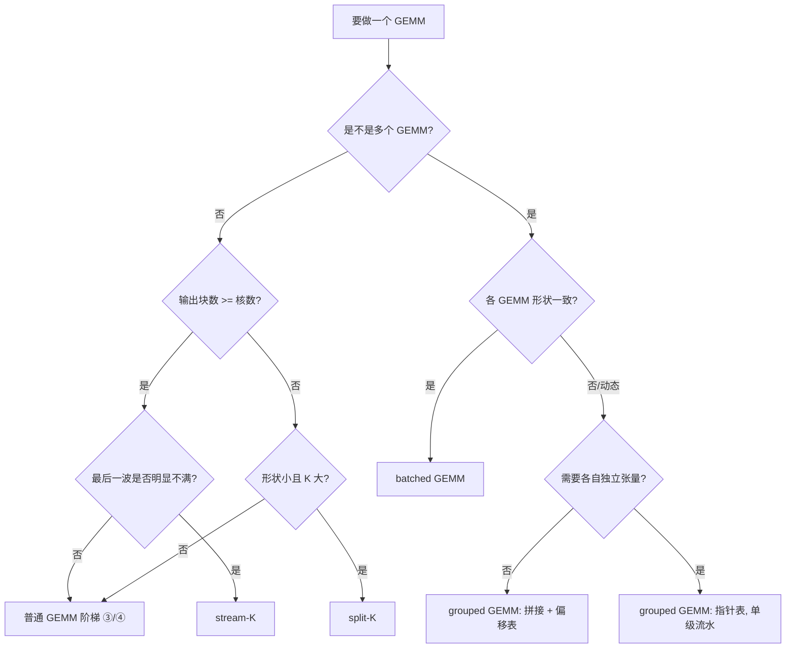

# 第 14 章 算子实战 II：GEMM 全家族

## 学习目标

读完本章，你应当能够：

1. 用「性能账本」的方式解释一个 GEMM 慢在哪里：写出它的 FLOPs 与最小 DRAM
   访存量，算出算术强度，并据此判断它是 compute-bound 还是 memory-bound。
2. 从 tile 尺寸出发，估算一份配置的**片上访存**（shared memory 占用）与
   **寄存器压力**（每个线程要持有的累加器个数），并在写代码之前说清它能不能
   同时放下、会不会掉 occupancy。
3. 读懂 GEMM 的**五级阶梯**，并说清每一级相对上一级多解决了什么：
   ① 朴素分块版 → ② `T.gemm` + shared memory → ③ `T.Pipelined` 多级流水 →
   ④ swizzle / layout 注解 → ⑤ 官方 intrinsic / 手动 MMA。
4. 判断该用哪种变体：普通 GEMM、split-K、stream-K、grouped GEMM、batched
   GEMM；每种都给得出「什么时候用它」的具体判据（而不是「看情况」）。
5. 说清 fp8 / int4 / dequantize / block-scaled 这四类低精度 GEMM 在**结构**和
   **调用方式**上的区别（数值细节留给第 27 章）。
6. 在昇腾上把 TileLang 实现与 CATLASS / 手写基线对齐：知道要比什么、怎么比、
   什么才算「对齐了」，以及一个可复用的性能对比清单（dtype、shape、epilogue、
   预热与重复次数）。

## 前置知识

* 第 7–9 章：`@tilelang.jit`、`T.Kernel`、`T.copy` / `T.gemm` / `T.clear` 的语义。
* 第 10 章：shared memory 与 fragment 的区别、swizzle 的直觉、`plot_layout`。
* 第 11 章：`T.Pipelined` 与多缓冲，`num_stages` 与 `order` / `stage`；
  本章的阶梯会直接复用那里的时空图与占用估算。
* 第 12 章：`lower_trace` / `pass_diff`，以及 Nsight Compute（NV）/ msProf（昇腾）。
* 第 6 章（可选）：NV 与昇腾的存储层级对照，本章 6 节会用到。
* 第 2 章：roofline 与算术强度；本章 1 节是它的 GEMM 专题版。

**本章的验证边界（务必先读）**：写作环境是 macOS (Apple Silicon)，**没有 NVIDIA
GPU，也没有昇腾 NPU**。因此本章所有 TileLang kernel 代码的最高验证级别是
**仅静态核对**（API 名与签名逐个在 `_vendor/` 中比对过，并用 `py_compile` 过了
语法），**没有任何一条性能数字来自本机实测**。凡出现数字，都只有两类来源：

* **模型输出**（`code/01` 与 `code/06`，纯标准库，可在任意机器复算）；
* **厂商公开资料 / 上游文档 / 上游样例里的数字**（带 corpus 路径与条件）。

---

## 1. 问题的由来：GEMM 的性能账本

### 1.1 一笔账：FLOPs、字节与算术强度

GEMM 是「性能账本」这个概念最好的教材，因为它的账目干净得可以手算。对
$C_{M\times N} = A_{M\times K} B_{K\times N}$：

* **计算量**：输出的每个元素要做 $K$ 次乘加，每次乘加 2 FLOP，所以总计算量是
  $2MNK$ FLOP。注意它和「怎么切块」无关——切块只影响数据怎么流动，不改变要算
  多少次。
* **最小 DRAM 访存量**：在最理想的情况下，$A$、$B$ 各从显存读一次，$C$ 写一次，
  即 $b\,(MK + KN + MN)$ 字节，其中 $b$ 是每个元素的字节数。
* **算术强度（arithmetic intensity）**：

$$
\mathrm{AI} = \frac{2MNK}{b\,(MK+KN+MN)} \quad [\mathrm{FLOP/Byte}]
$$

对正方形 $M=N=K$ 退化成 $AI = \frac{2M}{3b}$，即**算术强度随边长线性增长**。
这一点非常关键：它意味着「同样算法，换规模，判类会翻转」。

用第 2 章的机器模型套一下（H100 SXM5，公开规格 fp16 张量核 1000 TFLOPS、
HBM3 带宽 over 3 TB/s，机器平衡点约 333 FLOP/Byte）：

| 规模（fp16，fp32 累加） | 计算量 | 最小 DRAM 访存 | 算术强度 | 判定 |
| --- | --- | --- | --- | --- |
| $4096^3$ | 137.4 GFLOP | 96 MiB | 1365 F/B | compute-bound |
| $512^3$ | 0.27 GFLOP | 1.5 MiB | 171 F/B | **memory-bound** |
| $128^3$ | 4.2 MFLOP | 96 KiB | 42.7 F/B | memory-bound |

这张表由 `code/01-gemm-ledger/gemm_ledger.py` 复算，机器参数与第 2 章同源。
它能直接回答一个日常问题：**为什么大模型里的 GEMM 要拼命做 tile，而小
GEMM（batch=1 的 GEMV 类）再怎么调 block 也没用——它根本不吃算力。**

### 1.2 为什么大 GEMM 是 compute-bound

上面那条 $AI \approx 2M/(3b)$ 说明：只要 $M$ 足够大，算术强度就会远远超过
机器平衡点。把 333 代回去，fp16 的正方形 GEMM 在 $M \approx 10^3$ 附近跨过
平衡点。**这条线的意义是：它给出「可以靠调 tile 提性能」的下限规模。**
低于这条线的 GEMM 该做的是减少访存（融合、量化、复用），而不是加流水。

但也别把结论读死。真实 GEMM 的 DRAM 流量**总是高于**这个下界，原因有两个：

1. **分块导致重复读**。若输出按 $m_1 \times n_1$ 切块、沿 $K$ 分块搬运，那么
   $A$ 的每一行会被读到 $N/n_1$ 次、$B$ 的每一列会被读到 $M/m_1$ 次（如果
   完全不复用 cache）。CATLASS 的文档把这笔账写成了显式公式（见 1.5 节）：
   总读取量为 $b \cdot MNK \left(\frac{1}{m_1} + \frac{1}{n_1}\right)$。
2. **片上放不下，需要多趟**。如果 $m_1$、$n_1$ 选得小，重复读的倍率就大；
   如果选得大，片上又放不下（见 1.3）。

所以「为什么大 GEMM 是 compute-bound」是**上限判断**；「为什么我的实现
还是慢」往往要回到这张账本上，看实际 DRAM 流量离下界差多少。

### 1.3 tile 尺寸决定两件事：片上访存与寄存器压力

分块之后，一个输出块 $C_{\text{block}}$（$block\_M \times block\_N$）的计算
要沿 $K$ 迭代 $K/block\_K$ 次。每次迭代要做两件消耗资源的事：

**（a）片上访存：shared memory 占用。** 每次迭代搬入
$A_{\text{tile}}$（$block\_M \times block\_K$）和 $B_{\text{tile}}$
（$block\_K \times block\_N$）。若做 $S$ 级流水，则需要在片上同时保留
$S$ 个版本的 A/B tile：

$$
\text{SMEM} \approx S \cdot b \cdot \bigl(block\_M \cdot block\_K
+ block\_K \cdot block\_N\bigr)
$$

对 $block\_M=block\_N=128,\ block\_K=32,\ b=2$（fp16），单级是
$(128\cdot32 + 32\cdot128)\times2 = 16\,\mathrm{KB}$，三级流水 48 KB。
H100 每个 SM 的 shared memory 可配到 228 KB（厂商公开资料），所以这个配置
理论上能驻留约 4 个 block——但还要和寄存器的账一起算。

**（b）寄存器压力：累加器。** $C_{\text{block}}$ 在计算期间必须以累加器
fragment 的形式常驻寄存器。它的元素个数是 $block\_M \times block\_N$，
被 `threads` 个线程瓜分：

$$
\text{regs/thread} \approx
\frac{block\_M \times block\_N}{\text{threads}}
\times \frac{\text{sizeof}(accum\_dtype)}{4}
$$

128×128 的 fp32 累加器有 16384 个元素；128 线程时是 **128 个 fp32/线程**，
也就是光累加器就吃掉 128 个 32 位寄存器。这不是小数目：CUDA 最佳实践文档
写明，compute capability 7.0 的 SM 有 65536 个 32 位寄存器、最多 2048 个
驻留线程，折算下来**每个线程 32 个寄存器才能到 100% occupancy**，而且寄存器
分配以「每 warp 256 个」为单位向上取整。所以「把 $block\_M \times block\_N$
开大」和「保持高 occupancy」天然是一对矛盾：**大 tile 换来更少的重复读，
但用寄存器换的。**

### 1.4 三张约束表

把上面的账整理成三张表，你写 kernel 之前应该能填出它：

| 约束 | 公式（NV 视角） | 超了会怎样 |
| --- | --- | --- |
| DRAM 流量 | $b\cdot MNK\left(\frac{1}{m_1}+\frac{1}{n_1}\right) \ge b(MK+KN+MN)$ | 带宽吃满，算力闲置 |
| 片上容量 | $S\,b\,(m_1k_1 + k_1n_1) \le \text{SMEM}$ | 编译期报错，或被迫降级 `num_stages` |
| 寄存器 | $\frac{m_1 n_1 \cdot 4}{\text{threads}} \lesssim 255$ | 溢出到 local memory（`ld.local`/`st.local`），性能断崖 |

第一行是**下界**，越接近越好；第二、三行是**硬上限**，越接近越危险（剩下的
空间要留给别的东西）。第 11 章给出的「先算占用再编译」方法，在 GEMM 上就是
把这三张表填满。

### 1.5 昇腾的同款账本：CATLASS 的 tiling 建模

这套账不是 NVIDIA 专属。CATLASS（昇腾算子模板库）在
`docs/zh/2_Design/01_kernel_design/04_matmul_summary.md` 里把「Common 模板」
的约束写成了和我们上面几乎一一对应的形式：

$$
\begin{aligned}
m_1k_1\cdot L1Stage_A + n_1k_1\cdot L1Stage_B &\le \text{L1Size}/2\,\mathrm{Byte}\\
m_0k_0\cdot L0AStage &\le \text{L0ASize}/2\,\mathrm{Byte}\\
n_0k_0\cdot L0BStage &\le \text{L0BSize}/2\,\mathrm{Byte}\\
m_0n_0\cdot L0CStage &\le \text{L0CSize}/4\,\mathrm{Byte}
\end{aligned}
$$

读法：L1 相当于 NV 的 shared memory，L0A/L0B 是 Cube 的输入缓冲，L0C 是
Cube 的累加输出。出现 $/2\,\mathrm{Byte}$ 是因为 fp16 每元素 2 字节，
$/4\,\mathrm{Byte}$ 是因为 L0C 上按 fp32 累加。这套约束里还有两条
NV 上没有的等式：$m_0=m_1$、$n_0=n_1$（即 L0 层不再细分 M/N），这是昇腾
存储层级的形状决定的。

**同一套账本，两条硬件主线。** 后面 6 节讲昇腾实现时会反复回到这组公式。

---

## 2. 五级阶梯：从朴素版到 intrinsic

### 2.0 阶梯总览

这一节是全章的主干。每一级都按同一个节奏走：

> **PyTorch 参考 → TileLang 代码 → 性能瓶颈分析 → 下一级要解决什么**

五级之间的关系不是「谁替代谁」，而是**每一级把一个被暴露出来的瓶颈收进
编译器**：

| 级 | 关键改动 | 收进编译器的东西 | 解决后的瓶颈 |
| --- | --- | --- | --- |
| ① 朴素分块 | 直接读 global 做乘加 | —— | 功能正确（基准） |
| ② `T.gemm` + shared | 把 tile 先搬进 shared，再调 tile 级 GEMM | 线程映射、MMA 指令选择 | 访存复用 |
| ③ `T.Pipelined` | 沿 K 显式流水 | 多缓冲、同步插入 | 搬运与计算的重叠 |
| ④ swizzle / layout | 注解 shared 的物理排布和金块顺序 | bank conflict 规避、L2 局部性 | 片上带宽与 cache 命中 |
| ⑤ intrinsic | 手写 ldmatrix / mma / stmatrix | 什么都不收（自己控制） | 逼近手写上限 |

### 2.1 第 ① 级：朴素分块版

**PyTorch 参考。** 最直白的定义式：

```python
def gemm_torch(a, b):
    return a @ b          # 这里交给 cuBLAS；我们只是需要一个正确性基准
```

如果连 `@` 都不想用，定义式的三重循环是
`C[i, j] = sum(a[i, k] * b[k, j] for k in range(K))`。

**TileLang 代码**（`code/02-tilelang-ladder/gemm_ladder.py` 的 `RUNG_0`）：

```python
@tilelang.jit
def gemm_naive(A, B, block_M, block_N, dtype=T.float16, accum_dtype=T.float32):
    M, N, K = T.const("M, N, K")
    A: T.Tensor((M, K), dtype)
    B: T.Tensor((K, N), dtype)
    C = T.empty((M, N), dtype)

    with T.Kernel(T.ceildiv(N, block_N), T.ceildiv(M, block_M), threads=128) as (bx, by):
        C_local = T.alloc_fragment((block_M, block_N), accum_dtype)
        T.clear(C_local)
        for i, j in T.Parallel(block_M, block_N):
            for k in T.serial(K):
                C_local[i, j] = C_local[i, j] + A[by * block_M + i, k] * B[k, bx * block_N + j]
        T.copy(C_local, C[by * block_M, bx * block_N])

    return C
```

它已经用了「分块」和 `T.Parallel` 把输出切开，但**每个输出元素仍然沿着
整个 $K$ 从 global memory 顺序读**。

**性能瓶颈。** 访存量退化成 $O(MNK)$ 量级：$A$ 的第 $i$ 行会被同一 block
里 $block\_N$ 个输出列各读一遍，$B$ 同理。对 $4096^3$ 的 fp16 GEMM，
最小访存是 96 MiB，而这一版光读 $A$、$B$ 就是 $2 \times 4096^3 \times 2 \approx 275$ GB——差了三个数量级。**它是一道算术题，不是一道性能题。**

**下一级要解决什么。** 让同一块数据被多次使用：把 $A_{\text{tile}}$、
$B_{\text{tile}}$ 搬进片上（shared memory），让它被 block 内所有线程
共享，只在片上重复读。这一步把访存量压回 $O(MNK(1/m_1 + 1/n_1))$，也就是
1.4 节的第一张表。

### 2.2 第 ② 级：`T.gemm` + shared memory

**PyTorch 参考。** 语义不变，仍然是 `C = A @ B`；变的是「我们开始按块把
数据搬上片」。

**TileLang 代码**（`RUNG_1`，也就是官方
`examples/gemm/example_gemm.py` 去掉 `T.Pipelined` 的版本）：

```python
with T.Kernel(T.ceildiv(N, block_N), T.ceildiv(M, block_M), threads=128) as (bx, by):
    A_shared = T.alloc_shared((block_M, block_K), dtype)
    B_shared = T.alloc_shared((block_K, block_N), dtype)
    C_local  = T.alloc_fragment((block_M, block_N), accum_dtype)

    T.clear(C_local)
    for ko in T.serial(T.ceildiv(K, block_K)):          # ← 先不流水
        T.copy(A[by * block_M, ko * block_K], A_shared)
        T.copy(B[ko * block_K, bx * block_N], B_shared)
        T.gemm(A_shared, B_shared, C_local)

    T.copy(C_local, C[by * block_M, bx * block_N])
```

这里出现了三个本章的主角：`T.alloc_shared`（片上共享缓冲）、
`T.alloc_fragment`（寄存器累加器）、`T.gemm`（tile 级矩阵乘）。
`T.gemm` 的签名是
`T.gemm(A, B, C, transpose_A=False, transpose_B=False, policy=GemmWarpPolicy.Square, clear_accum=False, annotations=None)`
（`_vendor/tilelang-v0.1.15/tilelang/language/gemm_op.py:160`）。

**为什么这一级就快很多。** `T.gemm` 不是「一个会算矩阵的函数」，它是一个
**tile op**：编译器会把它降到硬件矩阵乘指令（NV 上是 MMA，昇腾上是 Cube 的
MAD），并负责把 `C_local` 的 fragment 按线程切开、决定每个 warp 负责哪一块。
这正是第 9 章说的「tile op 不直接展成 CUDA」——它是留给编译器的调度空间。

**性能瓶颈。** 这一版里 `T.copy`（搬运）和 `T.gemm`（计算）是**串行**的：
每次迭代都是「搬 → 等 → 算 → 搬 → 等 → 算」。GPU 上搬运是内存延迟主导、
计算是张量核吞吐主导，两者本可以并行。现在每次迭代都要付一遍
global→shared 的延迟，张量核有相当一部分时间在等数据。

**下一级要解决什么。** 让第 $i$ 次迭代的计算和第 $i+1$ 次迭代的搬运重叠，
也就是做**软件流水**（software pipelining）。

### 2.3 第 ③ 级：`T.Pipelined` 多级流水

**PyTorch 参考。** 没有对应的 PyTorch 写法——这是 kernel 层面的优化，
PyTorch 把它藏在 cuBLAS 内部。**这一步是「从会写到写得快」的分水岭。**

**TileLang 代码**（`RUNG_2`，就是官方最小示例的确切形态）：

```python
T.clear(C_local)
for ko in T.Pipelined(T.ceildiv(K, block_K), num_stages=3):
    T.copy(A[by * block_M, ko * block_K], A_shared)
    T.copy(B[ko * block_K, bx * block_N], B_shared)
    T.gemm(A_shared, B_shared, C_local)
```

唯一的改动是 `T.serial` 变 `T.Pipelined(..., num_stages=3)`。

**它做了什么。** 第 11 章已经把机制讲透，这里只重复结论：`num_stages=3`
意味着在片上保留 3 个版本的 A/B tile，编译器重排循环，让
「搬 stage $i+2$」「算 stage $i$」在时间上重叠。填充（prologue）和排空
（epilogue）只占一次迭代，稳态里搬运延迟被计算时间掩盖。

顺带说一个容易踩的点：**`num_stages=0` 等于不做流水**。`T.Pipelined`
的 docstring 明确写着：「For compiler-inferred pipelines, if `num_stages`
is 0, pipeline will not be enabled」（`tilelang/language/loop.py:112-140`）。
你在 `examples/gemm_splitk` 里看到的 `T.Pipelined(..., num_stages=0)` 就是
「借 `T.Pipelined` 的语法但故意不流水」。

**性能瓶颈。** 流水解决「搬运/计算重叠」，但没解决**片上带宽**：
`A_shared` 从 shared memory 读进 MMA fragment 时，如果物理排布是朴素行主序，
同一个 warp 的线程会撞上 bank conflict；同时，输出块的调度顺序若不好，
相邻 block 之间无法复用 L2。这两件事都不改变 DRAM 流量的下界，却会让
片上读写和张量核的供给效率下降。

**下一级要解决什么。** 用**注解**告诉编译器 shared memory 的物理排布
（swizzle）和 block 的遍历顺序（rasterization）。

### 2.4 第 ④ 级：swizzle / layout 注解优化版

**PyTorch 参考。** 同样没有对应物；这是 cuBLAS/CUTLASS 内部做的事。

**TileLang 代码**（`RUNG_3`，对应官方
`examples/gemm/README.md` 的 “Enhanced GEMM Example with Annotations”）：

```python
from tilelang.cuda.intrinsics import make_mma_swizzle_layout

with T.Kernel(T.ceildiv(N, block_N), T.ceildiv(M, block_M), threads=128) as (bx, by):
    A_shared = T.alloc_shared((block_M, block_K), dtype)
    B_shared = T.alloc_shared((block_K, block_N), dtype)
    C_local  = T.alloc_fragment((block_M, block_N), accum_dtype)

    T.annotate_layout({
        A_shared: make_mma_swizzle_layout(A_shared),
        B_shared: make_mma_swizzle_layout(B_shared),
    })
    T.use_swizzle(panel_size=10)          # threadblock rasterization，改善 L2 复用

    T.clear(C_local)
    for ko in T.Pipelined(T.ceildiv(K, block_K), num_stages=3):
        T.copy(A[by * block_M, ko * block_K], A_shared)
        T.copy(B[ko * block_K, bx * block_N], B_shared)
        T.gemm(A_shared, B_shared, C_local)

    T.copy(C_local, C[by * block_M, bx * block_N])
```

两个注解各管一件事：

* `T.annotate_layout`（`tilelang/language/annotations.py:45`）把 `A_shared`
  的**物理布局**指定成 MMA swizzle 布局。`make_mma_swizzle_layout` 在
  `tilelang/cuda/intrinsics/layout/mma_layout.py:336`，它先算
  `can_swizzle = shape[-1] * dtype.bits % 512 == 0`：行宽的比特数不是 512
  的整数倍就退回恒等布局，是才生成 swizzle 变换。（`example_gemm_intrinsics.py`
  里另抄了一份简化版，把判据写成了「恰好 512 bit」；读源码时注意这两处的
  差别。）
* `T.use_swizzle`（`annotations.py:30`）不改数据，改的是**block 的遍历顺序**
  （`rasterization2DRow` 等）。`panel_size=10` 表示按 10 个 block 宽的
  面板做 2D 蛇形遍历，目的是让相邻启动的 block 共享 $A$ 的行 / $B$ 的列，
  提高 L2 命中率。

**注意一个常见误解**：第 10 章讲过，TileLang 会**自动做 layout inference**，
所以第 ③ 级的代码在多数情况下也能跑出正确结果、甚至自动选到不错的布局。
加 `T.annotate_layout` 的价值在于**当自动推断的结果不是最优、或你想固定
行为做可复现的对比时**，把布局从「编译器猜」变成「我说了算」。这也是
第 21 章 layout inference 的引子。

**性能瓶颈。** 到这一级，你已经把「分块、复用、流水、布局、调度」都表达
出来了。剩下的差距来自两处：

1. **指令级的细节**（`ldmatrix` 的选取、`cp.async` / TMA 的用法、是否用
   warp specialization）；
2. **编译器对你这版配置的调度选择未必是全局最优的**——它是在你给的约束里
   做选择。

**下一级要解决什么。** 要么把配置交给 autotuner 搜（第 11 章），要么**下钻
到 thread/warp 原语，自己写 MMA 的数据搬运与发射**，即 Level 3。

### 2.5 第 ⑤ 级：官方 intrinsic 版

**PyTorch 参考。** 不存在。这一级的对照物是 CUTLASS 的 warp-level MMA 代码。

**TileLang 代码**（`code/02-tilelang-ladder/gemm_intrinsic.py`，照
`examples/gemm/example_gemm_intrinsics.py` 的结构裁剪）。核心变化：

```python
from tilelang.cuda.intrinsics.macro.mma_macro_generator import TensorCoreIntrinEmitter

mma_emitter = TensorCoreIntrinEmitter(
    a_dtype=in_dtype, b_dtype=in_dtype, accum_dtype=accum_dtype,
    a_transposed=False, b_transposed=True,
    block_row_warps=2, block_col_warps=2,
    warp_row_tiles=64, warp_col_tiles=64, chunk=block_K,
)

# ... shared memory 与 fragment 按 warp 显式分配 ...
for ko in T.Pipelined(K // block_K, num_stages=stage):
    for i, k in T.Parallel(block_M, block_K):
        A_shared[i, k] = A[by * block_M + i, ko * block_K + k]
    for j, k in T.Parallel(block_N, block_K):
        B_shared[j, k] = B[bx * block_N + j, ko * block_K + k]

    for ki in T.serial(0, block_K // micro_size_k):
        mma_emitter.ldmatrix_a(A_local, A_shared, ki)   # shared → fragment（矩阵化的 ldmatrix）
        mma_emitter.ldmatrix_b(B_local, B_shared, ki)
        mma_emitter.mma(A_local, B_local, C_local)      # 发射 MMA

mma_emitter.stmatrix(C_local, C_shared)
```

它手工指定了 warp 划分（`block_row_warps`/`block_col_warps`）、每个 warp 的
tile（`warp_row_tiles`/`warp_col_tiles`）以及 MMA 的微形状
（`micro_size_x/y/k`），并用 `ldmatrix_a/b`、`mma`、`stmatrix` 显式控制数据
在 shared 与寄存器之间的流动。`TensorCoreIntrinEmitter` 定义在
`tilelang/cuda/intrinsics/macro/mma_macro_generator.py:46`。

在 Blackwell（sm100）上，「intrinsic 版」换了形态：`T.gemm` 默认的同步
路径会自动降级到 `tcgen05`，并隐式插入 `mbarrier_wait_parity`；想手写异步
调度则用 `T.tcgen05_gemm(...)` + 显式 `T.mbarrier_wait_parity(...)`
（`T.gemm` docstring 与 `examples/gemm_tcgen05/README.md`）。也就是说，
**第 ⑤ 级在 Hopper 上是「手动 ldmatrix + mma」，在 Blackwell 上是「手动
TMEM + mbarrier 协议」**。

**什么时候值得下钻到第 ⑤ 级？** 只有两种：一是你要的能力编译器还没暴露
（比如某个新的 PTX 指令、某个特殊的内存序）；二是你已经用第 ④ 级 + 自动
调优逼近平台上限，需要榨最后几个百分点。**绝大多数生产算子停在 ③–④ 级**：
官方 examples 里的正式 GEMM/Attention 实现，绝大多数也写的是 `T.gemm` 而
不是手搓 `mma`。`example_gemm_intrinsics.py` 自己的注释就写着
“This is a debug config”。

### 2.6 阶梯对照表

| 级 | 相对上一级多做的事 | 主要收益 | 主要代价 | 什么时候停在这里 |
| --- | --- | --- | --- | --- |
| ① 朴素 | —— | 正确性基准 | DRAM 流量 $O(MNK)$ | 只用来验证算法 |
| ② shared + `T.gemm` | 片上复用 | 访存降一个数量级 | 搬运/计算串行 | 教学、极小规模 |
| ③ `T.Pipelined` | 重叠 | 掩盖搬运延迟 | 更多片上缓冲 | **大多数应用算子的终点** |
| ④ swizzle/layout | 物理排布与调度 | 片上带宽 + L2 命中 | 需要理解布局 | 生产算子 + 自动调优 |
| ⑤ intrinsic | 手写指令 | 逼近手写上限 | 可移植性、维护成本 | 只有前一级到顶时 |

---

## 3. 实现机制：这些原语在编译器里发生了什么

### 3.1 `T.gemm` 的降级路径

第 ①–⑤ 级里唯一始终在场的原语是 `T.gemm`。它的降级发生在 pass pipeline
的中段：以 CUDA 后端为例，`tilelang/cuda/pipeline.py:127-142` 的顺序是

```
PipelinePlanning → InjectSoftwarePipeline → LayoutInference → LowerTileOp
```

读法：

1. **PipelinePlanning / InjectSoftwarePipeline** 先把 `T.Pipelined` 展开成
   多缓冲的显式循环——所以 `num_stages` 是在**布局推断之前**定下来的，
   这解释了「为什么改 `num_stages` 会连带改变 layout 结果」。
2. **LayoutInference** 给 fragment 和 shared buffer 定物理布局。若你在
   第 ④ 级写了 `T.annotate_layout`，这一步会尊重你的注解。
3. **LowerTileOp** 才把 `tl.tileop.gemm` 降到具体的 MMA 指令、把
   `T.copy` 降到向量化搬运。

昇腾侧的 pipeline 是同一套思想、不同的 pass
（`tilelang/ascend/pipeline.py:108-114`）：

```
EstimateLatency → AutoSchedule → PrepareMultiBuffer → InsertSync → MaterializeMultiBuffer
```

区别最大的一点是 **`InsertSync`**：NV 侧大量同步是 `cp.async`/TMA 的
隐式等待和 `__syncthreads()`，而昇腾要显式插入 MTE/Cube/Vector 之间的
Set/Wait 标志——TileLang 把它变成了编译器的事（第 22、25 章展开）。

### 3.2 swizzle 与 layout inference

第 ④ 级那两个注解作用在两个不同层次，别混：

| 注解 | 作用对象 | 目的 | 定义位置 |
| --- | --- | --- | --- |
| `T.annotate_layout` | buffer 的**物理布局** | 消除 bank conflict、匹配 MMA 取数模式 | `tilelang/language/annotations.py:45` |
| `T.use_swizzle` | **block 的遍历顺序** | 提高 L2 命中率 | `tilelang/language/annotations.py:30` |

一个改「数据怎么摆」，一个改「block 按什么顺序跑」。推理链是：
`T.use_swizzle` 让相邻 block 的 $A$/$B$ tile 尽量相邻 → L2 命中率上升 →
DRAM 流量接近 1.4 节的下界；`T.annotate_layout` 让 shared→fragment 的
读不会撞 bank → 张量核供给更顺。两者都不改变 FLOPs。

### 3.3 源码位置索引

| 你在代码里写的 | 定义位置（v0.1.15） |
| --- | --- |
| `T.gemm` | `tilelang/language/gemm_op.py:160` |
| `T.gemm_blockscaled` | `tilelang/language/gemm_op.py:275` |
| `T.gemm_sp` | `tilelang/language/experimental/gemm_sp_op.py:106` |
| `T.copy` | `tilelang/language/copy_op.py:59` |
| `T.Pipelined` | `tilelang/language/loop.py:112` |
| `T.Parallel` | `tilelang/language/loop.py:13` |
| `T.clear` / `T.fill` | `tilelang/language/fill_op.py:48` / `:11` |
| `T.annotate_layout` / `T.use_swizzle` | `tilelang/language/annotations.py:45` / `:30` |
| `T.alloc_shared` / `T.alloc_fragment` / `T.alloc_tmem` | `tilelang/language/allocate.py:49` / `:81` / `:254` |
| `T.atomic_add` | `tilelang/language/atomic.py:211` |
| `GemmWarpPolicy` | `tilelang/tileop/base.py:5` |
| `make_mma_swizzle_layout` | `tilelang/cuda/intrinsics/layout/mma_layout.py:336` |
| `TensorCoreIntrinEmitter` | `tilelang/cuda/intrinsics/macro/mma_macro_generator.py:46` |
| Ascend `T.gemm`（带 `unit_flag_ctrl`） | `tilelang/ascend/language/gemm_op.py:168` |

---

## 4. 变体家族：split-K / stream-K / grouped / batched

主阶梯解决的是「一个 $M\times N\times K$ 的 GEMM 怎么写快」。真实负载里，
GEMM 的形状分布很极端，于是长出四个变体。判断依据全部落在一句话上：
**输出的并行度够不够填满设备，以及 K 要不要被切开。**

### 4.1 split-K：当输出块装不满设备

**什么时候需要它。** 当 `ceildiv(M, block_M) * ceildiv(N, block_N)`（输出块数）
小于设备上可并行的核数（NV 上是 SM 数）时，grid 太小，一部分核闲着。
典型场景：$M$ 或 $N$ 很小、$K$ 很大（例如 $M=256$ 的推理 GEMM、
$K=8192$ 的权重矩阵）。

**做法。** 把 $K$ 切成 `split_k` 段，grid 的第三维 `bz` 就是 K 段号，每个
block 只负责一段的 partial sum，最后用 atomic 累加合并。看官方
`examples/gemm_splitk/example_tilelang_gemm_splitk.py`：

```python
with T.Kernel(T.ceildiv(N, block_N), T.ceildiv(M, block_M), split_k, threads=128) as (bx, by, bz):
    ...
    T.clear(C_local)
    for ko in T.Pipelined(T.ceildiv(splitK, block_K), num_stages=0):
        T.copy(A[by * block_M, bz * splitK + ko * block_K], A_shared)
        T.copy(B[bz * splitK + ko * block_K, bx * block_N], B_shared)
        T.gemm(A_shared, B_shared, C_local)

    for i, j in T.Parallel(block_M, block_N):
        T.atomic_add(C[by * block_M + i, bx * block_N + j], C_local[i, j])
```

同一目录还有 `..._vectorize_atomicadd.py`，区别只在最后一行换成
`T.atomic_add(C[by * block_M, bx * block_N], C_local)`（tile 级原子加，
让编译器决定向量化）。

**它的账。** 读入量不变（还是 $b\,MNK(1/m_1+1/n_1)$），但**写出量变成
原来的 `split_k` 倍**：$b\,MNK/k$（CATLASS 的多核切 K 模板给出的是同一个
结论），再加上原子的开销。所以 split-K 是用**带宽**换**并行度**。

**什么时候不要用。** 输出块数已经远大于 SM 数时，split-K 只会凭空增加写出
流量和原子竞争，纯亏。

### 4.2 stream-K：当输出块数和设备数「不整除」

**什么时候需要它。** 纯数据并行（4.1 之外的默认做法）会让 grid 排成
若干「波」（wave）。如果总块数不是 SM 数的整数倍，最后一波会只有一部分
SM 在干活——这叫 **tail wave / wave quantization**。split-K 可以解决
「块数太少」，但对「块数够多、只是最后一波不满」无能为力。

**做法。** stream-K 不再按「一个 block 一个输出块」分配，而是把
「$K$ 方向的所有迭代」当成一个总工作量，平均切成与 SM 数相等的份。
看 `examples/gemm_streamk/example_tilelang_gemm_streamk.py`：先算出
`streamk_tiles`（需要跨 SM 切 K 的块）与 `blocking_tiles`（整块分给一个
SM 的块），然后：

* 没被切开的块：算完直接 `T.copy(C_local, C[...])`；
* 被切开的块：`T.atomic_add` 累加 partial。

代码里那两句注释把判据写得很清楚：
“last iteration of the tile always happens before its start on another SM”。
也就是**只有被切开的块才需要原子合并**，其余保持确定性写出。

**什么时候用。** 形状不规则（比如 MoE 里每个专家的 token 数不一致）、
或者你发现 profiler 上 kernel 尾部有一段「只有少数 SM 在跑」的平台期。
代价是实现了复杂度（要自己算 tile 划分和 fixup），以及比纯数据并行更长
的编译/deprecated 调试成本。

> 提醒：以上两条判据都基于官方 example 的实现方式，**不是实测结论**。
> 判断某个具体 shape 该用哪种，最终要用第 12 章的工具在真机上量出
> 「kernel 结束前的 SM 占用曲线」。

### 4.3 grouped GEMM：MoE 的必需品

**什么时候需要它。** 当你手上有 $G$ 个**形状不同的** GEMM，它们共享 $K$
和 $N$、只有 $M$ 不同，且必须放在一个 kernel 里做。最典型的例子就是
**MoE**：$G$ 个专家，每个专家收到的 token 数不同（`batch_sizes[g]`），
把每个专家的 GEMM 单独启动既浪费启动开销、又没法保证设备打满。

**做法。** 官方 `examples/grouped_gemm/example_grouped_gemm_fwd.py` 给的是
「拼成一个大张量 + 偏移表」的写法：把 $G$ 个专家的 $A$ 按 M 拼成一个
`[batch_sum, K]`，再传入 `batch_sizes` / `batch_offsets` /
`batch_padded_offsets` 三个 int32 表，grid 的大小是
`total_m_blocks = sum(ceildiv(size, block_M))`。kernel 内先用偏移表反推出
当前 block 属于哪个专家：

```python
m_start_padded = bx * block_M
cur_batch_idx = 0
for i in range(batch_count):
    in_cur_batch_idx = m_start_padded >= batch_padded_offsets[i]
    cur_batch_idx = T.if_then_else(in_cur_batch_idx, i, cur_batch_idx)
cur_batch_size = batch_sizes[cur_batch_idx]
m_start = m_start_padded - batch_padded_offsets[cur_batch_idx] + batch_offsets[cur_batch_idx]
```

同一目录还有 `example_grouped_gemm_fwd_ptr.py`，用**指针表**而不是拼接：
每个专家各自持有独立张量，通过 `T.make_tensor(A_ptrs[cur_batch_idx], ...)`
在 kernel 里构造视图。它的文件头注释写了两条重要限制，值得原样记住：

* “ptr-backed tensors with runtime-varying shapes are not stable enough yet”,
  所以每个专家都用同一个 `max_M` 的存储形状；
* “Multi-stage software pipelining on ptr-backed tensors is not correct yet”,
  所以那份实现把 `copy_num_stages` 固定为 1。

**判断依据。** 用 grouped GEMM 当且仅当「多个 GEMM 的形状不同、或数量
动态」。如果 $G$ 个 GEMM 形状完全一致，用 4.4 的 batched GEMM 更简单也
更快（pointer table 的间接寻址有代价）。

### 4.4 batched GEMM：形状一致的批量

**什么时候需要它。** $G$ 个 GEMM 形状完全相同（或可以 padding 成相同），
共享同一套 tile 配置。典型场景：attention 里按 head 批、卷积里按
batch 批、扩散模型里按图像批。

**做法。** 昇腾侧的实现最干净
（`_vendor/tilelang-ascend-v0.1.2.000/examples/batch_gemm/batch_gemm.py`）：
把 (batch, m_block, n_block) 展平成一维 grid，

```python
total = B * m_num * n_num
with T.Kernel(total, is_npu=True) as (cid, _):
    bid = cid // (m_num * n_num)
    rem = cid % (m_num * n_num)
    bx  = rem // n_num
    by  = rem % n_num
    A_L1 = T.alloc_shared((block_M, K_L1), dtype)
    B_L1 = T.alloc_shared((K_L1, block_N), dtype)
    C_L0 = T.alloc_fragment((block_M, block_N), accum_dtype)
    for k in T.serial(T.ceildiv(K, K_L1)):
        T.copy(A_mat[bid, bx * block_M, k * K_L1], A_L1)
        T.copy(B_mat[bid, k * K_L1, by * block_N], B_L1)
        T.gemm_v0(A_L1, B_L1, C_L0, init=(k == 0))
    T.copy(C_L0, C_mat[bid, bx * block_M, by * block_N])
```

NV 侧通常用 `T.Kernel(..., batch)` 这样的第三维，或直接在 kernel 里把
batch 维度加进指针。核心判断只有一条：**每个 batch 的形状是否一致，
以及显存布局是否连续**。不一致就退回 grouped GEMM。

### 4.5 选择判断树



---

## 5. 低精度 GEMM：结构与调用方式

低精度 GEMM 的**数值正确性**是第 27 章的主题。这里只讲**结构**：它和第 ①–⑤
级阶梯有哪些不同，调用方式长什么样。

### 5.1 fp8

结构上和 fp16 没有区别——只是 `dtype` 变成 fp8（E4M3 或 E5M2），累加仍在
fp32。看 `examples/gemm_fp8/example_tilelang_gemm_fp8.py`：kernel 主体与
`example_gemm.py` 一字不差，`T.gemm(A_shared, B_shared, C_local, transpose_B=True)`，
只是 `dtype` 由 `determine_fp8_type()` 给出（默认 E4M3，可传 `"e5m2"`）。

**唯一的结构性差别是 K 方向的对齐要求**：fp8 张量核的 $K$ 微步通常比 fp16
更小/更宽，所以你会看到 fp8 example 用 `block_K=64`（而不是 32）。这是
硬件约束，不是风格问题。

### 5.2 int4

结构上的关键差别是**打包**：两个 int4 塞进一个字节。`examples/gemm_int4/
example_tilelang_gemm_int4.py` 把 A/B 声明成 `T.int4` 张量、累加器声明成
`T.int32`：

```python
A: T.Tensor((M, K), T.int4)
B: T.Tensor((N, K), T.int4)
C: T.Tensor((M, N), T.int32)
...
T.gemm(A_shared, B_shared, C_local, transpose_B=True)
```

前端期望 `T.gemm` 直接吃 int4 操作数（该文件开头就写着 “Frontend
expectation: T.gemm should accept int4 operands directly”），示例里还附了
`pack_int4()`：把两个 int8 的低 4 位合并进一个 int8。**int4 的小数点在哪、
怎么扩维、什么时候 dequantize，是第 27 章的内容。**

### 5.3 dequantize GEMM

结构上，dequantize GEMM = 「搬入时顺手反量化」+ 「普通 GEMM」。权重以
int4/int8/fp4 存放，kernel 把量化权重搬进 shared/寄存器时乘上 scale，还原
成 fp16/bf16，再喂给 `T.gemm`。粒度分 per-tensor / per-channel /
per-group / fine-grained，示例目录 `examples/dequantize_gemm/` 里
`example_dequant_gemm_w4a8.py`、`example_dequant_gemm_fine_grained.py`
分别对应不同粒度。**本章只需记住：它是「访存减少 + 反量化算力开销」的
交换；粒度越细，反量化的元数据和算力开销越大。**

### 5.4 block-scaled（MX 系列）

结构上，block-scaled GEMM 多了一对**输入**：A 和 B 的 scale factor
（`SFA` / `SFB`）。TileLang 的通用接口是
（`tilelang/language/gemm_op.py:275`）：

```python
T.gemm_blockscaled(A, B, C, SFA, SFB,
                   transpose_A=False, transpose_B=False,
                   k_start=...,                   # 本 tile 在逻辑 K 轴上的起点
                   sf_a_granularity_k=...,        # 一个 A scale 覆盖多少 K 元素
                   sf_b_granularity_k=...)
```

它在语义上等于 $C \mathrel{+}= (A \cdot SFA) \mathbin{@} (B \cdot SFB)$，
scale 按 K 方向的**块**施加。看 `examples/blockscaled_gemm_sm100/
gemm_mxfp8_blockscaled_1d1d.py`：文件头写 “Blockscale size:
(M, N, K) = (1, 1, 128)”，scale factor 以 `uint32` 打包存放
（一个 `uint32` 装 4 个 K-block 的 E8M0 scale），累加器放在 TMEM
（`T.alloc_tmem`）里。

昇腾侧有对应的 `T.gemm_blockscaled` 方言重载
（`tilelang/ascend/language/gemm_op.py:110`），它把
`sf_*_granularity_k` 固定成 32（MX 规范），scale 的 K 偏移从 SFA 切片
自己推。**同一个概念，不同硬件的 scale 粒度不同——这正是第 27 章要
对齐的事情之一。**

| 变体 | 输入 dtype | 累加 dtype | 额外输入 | 结构上多出的东西 |
| --- | --- | --- | --- | --- |
| fp8 | e4m3 / e5m2 | fp32 | 无 | 更严的 K 对齐 |
| int4 | int4（打包） | int32 | 无 | 打包/解包 |
| dequantize | int4/int8/fp4 | fp32 | scale/zero（粒度可变） | 搬入时反量化 |
| block-scaled | fp8/fp4 | fp32 | SFA / SFB | scale 按 K 块施加 |

---

## 6. 昇腾对照：CATLASS 与 tilelang-ascend

### 6.1 CATLASS 的分层与模板

CATLASS 是昇腾官方的算子模板库（Ascend C 实现），目标读者和 TileLang 不同：
它让你在 C++ 里**组装**算子。它的分层是：

```
Kernel  →  Block  →  Tile      （越往下越接近硬件）
```

和本章阶梯的对应关系：

| 本章概念 | CATLASS 里的对应物 |
| --- | --- |
| 输出分块 grid | `BlockScheduler`（默认 `GemmIdentityBlockSwizzle`） |
| tile 尺寸 / 流水 | `dispatchPolicy`（如 `MmadAtlasA2Pingpong` / `MmadAtlasA2Preload`） |
| shared memory / 片上复用 | L1 多 buffer、`block_mmad_*` 组件 |
| split-K | `MultiCoreSplitK` 模板（`09_splitk_matmul`） |
| stream-K | `37_streamk_matmul` / `66_ascend950_streamk_matmul` |
| grouped GEMM | `02_grouped_matmul_slice_m`、`07_..._per_token_dequant_moe` |
| batched GEMM | `01_batched_matmul`、`45_strided_batched_matmul_tla` |
| swizzle | `02_swizzle.md` 里的 `SwizzleOffset` / `SwizzleDirection` |

CATLASS 的 `04_matmul_summary.md` 还有一个判据表值得直接搬进你的知识库：
**M ≥ N 时用 SwizzleOffset=3、Direction=0；M < N 时用 Direction=1。**

### 6.2 tilelang-ascend 的对应实现

昇腾上的 TileLang GEMM 有两个仓库、三种写法：

1. **主干 v0.1.15 的 `examples/ascend/example_gemm.py`**：persistent +
   `T.Pipelined` + swizzle + 混合核心 epilogue。kernel 形如
   `with T.Kernel(NUM_BLOCKS) as bx:`，用 `T.Persistent([...], NUM_BLOCKS, bx)`
   遍历输出 tile，K 循环里 `T.copy` 到 `T.alloc_l1`，再
   `T.gemm(x_l1, w_l1, res, transpose_B=True, clear_accum=kt == 0,
   unit_flag_ctrl=...)`。
2. **主干 v0.1.15 的 `examples/ascend/example_gemm_splitk.py`**：
   对应 4.1。
3. **适配器仓库 `_vendor/tilelang-ascend-v0.1.2.000/examples/gemm/`**：
   从最朴素的 `T.gemm_v0` 版本，到带完整 flag 管理的手写流水版本
   （`example_gemm_intrinsic.py`），正好就是本章 ①–⑤ 阶梯在昇腾上的
   翻版。

最朴素的适配器版本（`examples/gemm/example_gemm.py`）长这样：

```python
with T.Kernel(m_num * n_num, is_npu=True) as (cid, _):
    bx = cid // n_num
    by = cid % n_num
    A_L1 = T.alloc_L1((block_M, K_L1), dtype)
    B_L1 = T.alloc_L1((K_L1, block_N), dtype)
    C_L0 = T.alloc_L0C((block_M, block_N), accum_dtype)
    with T.Scope("C"):
        for k in T.serial(T.ceildiv(K, K_L1)):
            T.copy(A[bx * block_M, k * K_L1], A_L1)
            T.copy(B[k * K_L1, by * block_N], B_L1)
            T.barrier_all()
            T.gemm_v0(A_L1, B_L1, C_L0, init=(k == 0))
            T.barrier_all()
        T.copy(C_L0, C[bx * block_M, by * block_N])
```

对照 NV 的第 ② 级：`A_shared/B_shared` → `A_L1/B_L1`，
`alloc_fragment` → `alloc_L0C`，`T.gemm` → `T.gemm_v0`，多出来的
`T.barrier_all()` 就是昇腾必须显式处理的同步（在主干后端里这一步被
`InsertSync` 自动做掉了）。

### 6.3 怎样才算「对齐了手写基线」

这是本章最容易被含糊过去、也最需要纪律的一节。CATLASS 的 README 说：为
定制场景提供性能优化模块，「在定制 shape 下的性能能达到相应算子标杆性能的
0.98~1.2 倍」。**这句话本身就是「对齐」的模板**：它同时给定了
（a）对比对象（标杆性能）、（b）条件（定制 shape）、（c）区间（0.98–1.2×）。

反过来，主干 v0.1.15 的昇腾 README 给的是另一种口径：TileLang 与
**Torch NPU** 对比，用 BF16 GEMM、FP8 casting、GQA backward 各 4 个 shape，
compute-bound 的报 TFLOP/s、memory-bound 的报 GB/s。

两条口径都成立，所以「对齐手写基线」必须先把下面五件事说死：

1. **基线是谁**：cuBLAS / CATLASS 模板 / Ascend C 手写 kernel /
   Torch NPU 算子。不同基线结论完全不同。
2. **同一个 shape**：M、N、K、batch、是否转置、是否 padding、Row/Column
   major 还是 NZ。
3. **同一个 dtype 与累加精度**：A/B 输入 dtype、累加 dtype、输出 dtype；
   fp32 输入要不要排除 TF32。
4. **同一个 epilogue**：有没有 bias / activation / 量化；包含还是不包含。
5. **同一套测量协议**：预热与重复次数（见 7 节）、是否 flush L2、取
   mean/median/min、kernel-only 还是含启动开销。

只有这五条全部一致，「0.98×」和「1.2×」才是可比较的两个数。任何一条不同，
数字就没有可比性——这就是在第 6.3 节反复出现的「口径」二字的全部含义。

---

## 7. 性能对齐方法论

### 7.1 先固定口径

对比 cuBLAS / CATLASS 时，最容易犯的错是「两个数字都写 TFLOP/s，就直接比」。
下面这份清单来自三个上游实现（Triton benchmark 脚本、cuBLAS benchmark、
TileLang `do_bench`）的实测口径，可以直接当模板：

| 维度 | 必须写明的内容 |
| --- | --- |
| dtype | 输入、累加、输出；fp32 是否允许 TF32 |
| shape | M/N/K；batch；转置；布局（ND / NZ / Row / Column） |
| epilogue | 是否含 bias / 激活 / 量化 / 类型转换 |
| 计算量口径 | `2MNK`，说明是否按 padding 后的形状算 |
| 计时范围 | kernel-only（cupti/cudagraph）还是含 host 启动 |
| 预热 | 目标毫秒数或固定迭代数 |
| 重复 | 目标毫秒数、取 mean/median/min、是否 flush L2 |
| 结果 | 正确性判据（rtol/atol）+ 性能数（TFLOP/s 或 GB/s） |

### 7.2 预热与重复次数

为什么不写「预热与重复次数」的对比结果不可信？因为 GPU 的时钟、L2 状态和
编译器/驱动的热身都会改变前几次测量的结果。三个上游实现给的口径是：

| 上游 | 预热 | 重复 | 备注 |
| --- | --- | --- | --- |
| TileLang `do_bench` | `warmup=25` ms（默认） | `rep=100` ms（默认） | 默认 flush 256 MB L2；`return_mode="mean"` |
| cuBLAS benchmark（corpus 快照） | 先跑一轮测每轮耗时 | `max(5, 100ms / 单次耗时)` | `minimal_repeat_ms = 100` |
| Triton / TileLang benchmark 脚本 | 按 timer 自动 | 按 timer 自动 | 与 `do_bench` 同源 |

`do_bench` 的签名是
`do_bench(fn, warmup=25, rep=100, ..., backend="event", return_mode="mean")`
（`tilelang/profiler/bench.py:31`）。它会在每次采样前清 L2、按目标毫秒数
自动换算预热/重复次数，并支持 `event` / `cupti` / `cudagraph` 等多种后端。
**报数时必须写清用的是哪一个后端**：`event` 含 kernel 之间的间隙，
`cupti` 更接近 kernel 纯耗时，`cudagraph` 会消掉 launch 开销。

### 7.3 一份可复用的对比清单

```text
1. 固定 shape / dtype / 累加精度 / 输出 dtype
2. 固定 epilogue：无融合 <--> 有融合，各自单独报
3. 用同一个 do_bench 口径：warmup=25ms, rep=100ms, 同一 backend
4. 至少报 TFLOP/s；memory-bound 的变体再报 GB/s
5. 报正确性：与同一 golden 比，给 rtol/atol
6. 报编译期参数：block_M/N/K, num_stages, threads, policy, split_k
7. 如果对比 cuBLAS：写明是否 TF32、用的是 cublas / cublasLt、是否 strided-batched
8. 如果对比 CATLASS：写明用的哪个 example（模板 + dispatchPolicy + swizzle）
```

`code/06-bench-methodology/bench_methodology.py` 把上面第 3、4 条做成了一个
纯标准库的小工具：它按「目标毫秒数 → 迭代次数」的换算规则算出一份
对比表，可以离线复算，**但它不测量任何真实性能**。

---

## 8. 常见陷阱

1. **把 `T.Pipelined` 当成万能加速器。** 它只解决搬运/计算重叠；如果
   kernel 是 memory-bound（比如 $M$ 很小的 GEMM），加 `num_stages` 只会
   多占片上缓冲。
2. **忘记 `clear_accum` / `T.clear`。** 默认 `T.gemm` 是**累加**（`+`），
   不是赋值。第一次迭代前不清零，或者在昇腾上用 `init=(k == 0)` 传错，
   结果就是脏数据（数值上表现为「多了前一次的值」）。
3. **`num_stages` 与片上容量打架。** 4.1 节那张表能提前算出来；编译报
   shared memory 超限时，先降 `num_stages`，不是先降 `block_K`。
4. **split-K 之后用 fp16 累加。** 官方 split-K 示例把输出 C 声明成
   `out_dtype=T.float32` 再用 `atomic_add`，就是为了避免原子加时的精度
   损失；用 fp16 累加会放大误差。
5. **int4/fp8 直接当 fp16 用。** 打包格式、K 对齐、scale factor 的粒度
   都是硬约束，不是可选项。
6. **用「仅静态核对」的示例结果当实测数字。** 本章所有 kernel 都**没有**
   在硬件上运行过；任何写进报告的性能数字都必须来自真机，且带 7.1 的口径。

---

## 本章小结

* **GEMM 的账本**：$2MNK$ FLOP、$b(MK+KN+MN)$ 字节下界、
  $AI = 2M/(3b)$（正方形）。规模够大就是 compute-bound，够小就是
  memory-bound；tile 尺寸决定片上容量（shared memory）和寄存器压力
  （累加器 = $m\times n$ 个 fp32 / threads）。
* **五级阶梯**：朴素分块 → shared + `T.gemm` → `T.Pipelined` →
  swizzle/layout → intrinsic。每一级把一个瓶颈收进编译器；生产算子多数
  停在 ③–④ 级。
* **变体判据**：输出块数 < 核数 → split-K；块数够但尾波不满 → stream-K；
  多个形状不同的 GEMM（MoE）→ grouped；形状一致的批量 → batched。
* **低精度**：fp8（只换 dtype）、int4（打包）、dequantize（搬入时反量化）、
  block-scaled（多一对 SFA/SFB）。数值正确性 = 第 27 章。
* **昇腾对照**：CATLASS 的 Kernel/Block/Tile + dispatchPolicy + swizzle，
  与 TileLang 的阶梯一一对应；「对齐手写基线」= 固定基线、shape、dtype、
  epilogue、测量协议五件事。
* **性能对比纪律**：所有数字必须带来源与条件；预热/重复/L2 flush/取数
  口径要一致；本章没有实测数字。

## 延伸阅读

* `references.md` 的 S1–S12（源码引用）：`T.gemm`、`T.gemm_blockscaled`、
  `T.gemm_sp`、`make_mma_swizzle_layout`、`TensorCoreIntrinEmitter`、
  CUDA/Ascend pass pipeline。
* `references.md` 的 R1–R12（Corpus 资料）：官方 matmul / matmul_sparse
  教程、CATLASS 设计文档、TileLang 论文与 benchmark。
* 第 11 章：`T.Pipelined` 与自动调优的机制（本章第 ③ 级的展开）。
* 第 21 章：layout inference（本章第 ④ 级注解背后的 pass）。
* 第 24 / 25 章：NV 与昇腾后端各自的硬件特性（wgmma / tcgen05 / Cube）。
* 第 27 章：低精度与数值正确性（本章第 5 节留给它的部分）。
* 第 28 章：从性能模型反推实现。
