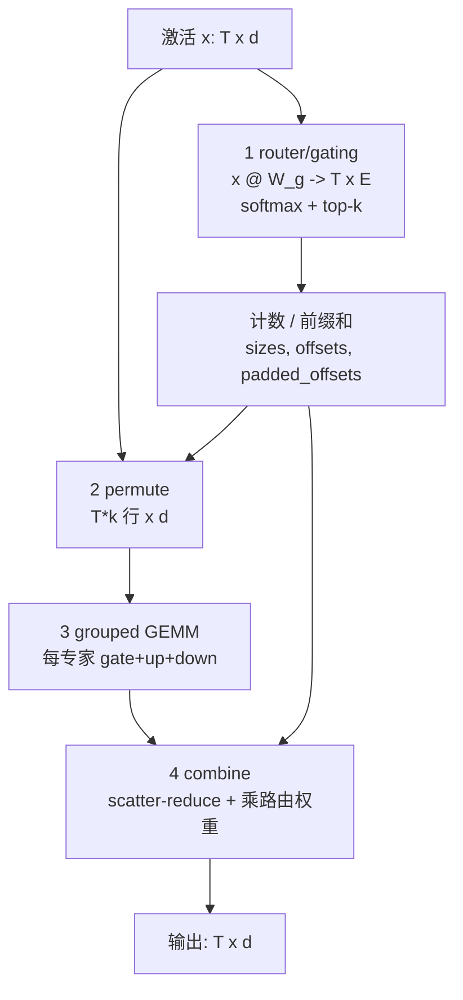

# 第 16 章 算子实战 IV：MoE 与 MLA

## 学习目标

读完本章，你应当能够：

1. 把 MoE 的一层拆成四段，**路由（router/gating）→ 重排（dispatch/permute）→
   grouped GEMM → 合并（combine）**，并写出每段的 FLOP 与字节账；能说明为什么
   这四段里有两段**完全没有矩阵乘**。
2. 用“每个专家分到多少 token”判断一个 routed GEMM 是 compute-bound 还是被
   权重流量压成 memory-bound，并解释为什么这是**结构问题**而不是“实现没调好”。
3. 说清 MLA（Multi-head Latent Attention，多头潜注意力）相对 MHA / GQA 的
   KV 压缩发生在哪一步，算出 KV 预算与 decode 算术强度；并同时说清它**为什么
   对 kernel 友好**（KV 小、复用高）和**为什么不友好**（576/512 的 head 维度、
   寄存器与片上容量压力）。
4. 区分 NSA / DSA（lightning indexer + top-k selector）/ HISA 三类稀疏与索引
   路线，说清它们对 kernel 的要求，以及 indexer 自己的算力代价。
5. 在昇腾侧把同一套 MoE 拆解对应到 `fusedmoe` / `moe_token_permute` /
   `dispatch_combine` 的写法：L1/L0C、combineCV 与自动同步、shmem 的 put/get。
6. 说出**显存、通信、varlen、一致性（确定性）**四个工程约束如何改变 MoE / MLA
   的 kernel 设计，并给出“一个 decode step 里哪些算子最贵”的判断表。

## 前置知识

* 第 7–9 章：`@tilelang.jit`、`T.Kernel`、`T.copy` / `T.gemm` / `T.alloc_shared` /
  `T.alloc_fragment` 的语义，本章直接引用官方 example，不再重复骨架。
* 第 10–11 章：shared memory 与 fragment、`T.annotate_layout` / `T.use_swizzle`、
  `T.Pipelined` 与多缓冲。本章的 grouped GEMM 会直接复用第 11 章的时空图。
* 第 13 章：融合（把 SiLU、逐元素乘并进 GEMM 的 epilogue）。
* 第 14 章：**grouped GEMM / batched GEMM / split-K 的判据**、低精度 GEMM、以及
  “tile 尺寸决定片上访存与寄存器压力”的三张约束表。本章的 MoE 一半内容就是
  grouped GEMM 的延伸。
* 第 15 章：attention 家族、online softmax、split-KV（FlashDecoding）、paged KV、
  varlen。本章的 MLA 与稀疏注意力都建立在它之上。
* 第 2 章：roofline 与算术强度；第 6 章（可选）：NV 与昇腾的存储层级对照。

**本章的验证边界（先读这一段）**：写作环境是 macOS (Apple Silicon)，
**没有 NVIDIA GPU，也没有昇腾 NPU**。因此：

* 本章**没有任何一条性能数字来自本机实测**。凡是出现的数字，只有两类来源：
  **本书模型输出**（`code/` 下的纯 Python 账本，可在任意机器复算）与
  **锁定版本里的第一方配置 / 官方 example 的既有表述**（带路径与条件）。
* 本章不重复贴第 13–15 章已经给过的算子骨架，而是**直接引用官方 example**，
  并把每条引用的“文件 + 行号”做成可运行的核对（`code/04`、`code/05`、`code/06`）。
  这些引用并未在硬件上运行过，验证级别是**仅静态核对**。

---

## 1. 问题的由来：一个 decode step 里最贵的是什么

第 15 章讲完了 attention 家族。到了 DeepSeek 这一代模型，attention 只是半边天：
另外半边是 MoE。两者合起来决定了“一次 decode step 要花多久”。我们先把
**真实形状**摆出来，再谈 kernel。

### 1.1 先把模型形状钉死

锁定版本里有一份第一方配置：
`_vendor/tilelang-v0.1.15/examples/deepseek_v32/inference/config_671B_v3.2.json`。
它是 DeepSeek-V3.2-671B 的推理配置，也是本章所有“真实模型形状”的唯一来源：

| 参数 | 值 | 含义 |
| --- | --- | --- |
| `dim` | 7168 | 模型隐藏维 |
| `n_layers` | 61 | 总层数（其中 `n_dense_layers=3` 层是 dense FFN） |
| `n_heads` | 128 | query head 数 |
| `kv_lora_rank` | 512 | MLA 压缩潜向量维度 d_c |
| `qk_rope_head_dim` | 64 | 解耦 RoPE 维度 d_r |
| `n_routed_experts` | 256 | 路由专家数 |
| `n_activated_experts` | 8 | 每个 token 激活几个专家 |
| `moe_inter_dim` | 2048 | 每个专家的中间维度 |
| `index_n_heads` / `index_head_dim` | 64 / 128 | lightning indexer 的形状 |
| `index_topk` | 2048 | sparse attention 每步选多少个 KV 位置 |

这张表本身就是本章的骨架：**MLA 决定了 KV cache 有多大，MoE 决定了每 token 要
做多少次小 GEMM，indexer 决定长上下文里“省下的 attention”要花多少代价买回来。**

### 1.2 两类结构，两条不同的瓶颈

用 `code/01-cost-ledger/decode_step_ledger.py` 把账算出来（默认形状取官方
`fusedmoe` 示例：T=8192、d=7168、d_e=2048、E=8、k=4）：

| 部分 | FLOP | 字节（下界） | 算术强度 | 判定 |
| --- | --- | --- | --- | --- |
| router（`T×d @ d×E`） | 0.94 GFLOP | 112 MB | 8.0 | memory-bound |
| permute + combine（纯搬运） | **0** | 1.75 GB | 0 | memory-bound |
| grouped GEMM（gate+up+down） | 2.89 TFLOP | 2.11 GB | 1365 | compute-bound |

同一份记账，换到“decode 的小 batch”上，结论会翻转。用
`code/03-mla-kv/kv_budget.py` 的 KV 预算与 `code/01` 的单专家账：

| 形状（`code/01` 的三组） | 每个专家分到多少 token | grouped GEMM 的算术强度 | 判定 |
| --- | --- | --- | --- |
| T=8192, E=8, k=4（大 prefill 批） | 4096 | 1365 FLOP/Byte | compute-bound |
| T=128, E=64, k=6（小批） | 12 | 11.9 FLOP/Byte | memory-bound |
| T=8192, E=256, k=6（专家多） | 192 | 175.5 FLOP/Byte | memory-bound |
| T=1, E=256, k=8（纯 decode 单步） | 约 0.03 | ≲ 1 FLOP/Byte | memory-bound |

这两张表加起来就是本章的主命题：

> **MoE 的矩阵乘本身不是稀缺资源，稀缺的是“把数据按专家摆好”的能力。**
> 原因有两个：小 M 的 GEMM 打不满张量核（第二张表的后三行），而重排与通信是
> 每个 token 都要付、且完全不产生 FLOP 的固定成本（第一张表的 permute+combine 行）。

MLA 那边是另一条瓶颈线。用 `code/03` 的账：

| 变体 | 每 token 每层 KV | decode 算术强度 |
| --- | --- | --- |
| MHA（128 heads × 128 dim，含 K/V） | 65536 字节 | 1.0 FLOP/Byte |
| GQA（8 个 kv-head） | 4096 字节 | 16.0 FLOP/Byte |
| **MLA（c_KV 512 + k_R 64）** | **1152 字节** | **241.8 FLOP/Byte** |

MLA 把 KV cache 压到 MHA 的 **1.76%**，同时把 decode 的算术强度抬高了两个数量级。
它不是“更快的 attention”，而是**换了一种 attention 的算术结构**。

### 1.3 本章要解决的四个问题

1. MoE 的四段各自怎么写、瓶颈各在哪（第 2 节）；
2. MLA 的结构变化如何决定 kernel 的形状（第 3 节）；
3. 稀疏/索引类算子为什么出现、对 kernel 提了什么新要求（第 4 节）；
4. 昇腾侧实际怎么做，以及显存/通信/varlen/一致性四个约束（第 5、6 节）。

最后在第 7 节给出一张“一个 decode step 里最贵算子”的总结表，作为第 17、18 章
（端到端训练与推理）的输入。

---

## 2. MoE：四段结构，两段不是矩阵乘

### 2.1 全景图

先看整条数据流。图的源码在 `figures/moe-one-layer.md`：



官方 `fusedmoe` 例子就是按这四段写的，而且**不是**一个巨型 kernel：
`_vendor/tilelang-v0.1.15/examples/fusedmoe/example_fusedmoe_tilelang.py`
里有两个 kernel，`moe_forward_tilelang_shared`（共享专家，第 12 行）与
`moe_forward_tilelang_routed`（路由专家，第 92 行），中间夹着 PyTorch 侧的路由、
排序与 `scatter_reduce`（第 406 行）。这个“几个 GEMM kernel + host 侧重排”
的结构，是当前 MoE 实现的主流形态，也是理解瓶颈的关键。

### 2.2 第 1 段：router / gating

router 本身极小：`logits = x[T,d] @ W_g[d,E]`，即一个 `M=T`、`N=E`、`K=d` 的 GEMM。
在我们默认形状下它只有 0.94 GFLOP，算术强度 8.0 FLOP/Byte。**它不吃算力**。

router 真正花时间的是它后面的三件事：

1. **softmax + top-k**。`top-k` 不是矩阵乘，是选择/排序。TileLang 里至少有两条
   实现路线：
   * 小规模、直接可读的版本：`examples/topk/example_topk.py:18` 的 `tl_topk`，
     用 `for k in T.serial(topk)` 反复取最大值（第 34 行），适合 `topk` 很小
     （个位数）且 `E` 不大的情形。
   * 长序列、大规模版本：`examples/deepseek_v32/topk_selector.py:11` 的
     `convert_to_uint16`，先把 float 映射成**保序的整数**，再用两遍 8-bit 基数
     排序（先直方图定阈值 bin，再细化）。它的输入不是专家维，而是**整条序列**，
     所以属于第 4 节的稀疏索引家族。
2. **计数与前缀和**。要按专家分组，先得知道每个专家收到多少 token：
   `counts → tokens_per_expert(cumsum) → group_offsets`。官方实现这几步在 host 上
   用 `torch` 做（`example_fusedmoe_tilelang.py:362-382`）；昇腾侧的
   `moe_token_permute` 则把它做进 kernel（见 5.2）。
3. **负载均衡**。DeepSeek-V3 的技术报告摘要明确写了它采用
   “auxiliary-loss-free strategy for load balancing”（见
   `../tilelang-corpus/12-operator-libraries/raw/arxiv-2412-19437.md`）。
   从 kernel 的角度，这个策略是否有效，直接表现为**每个专家拿到的 token 数是否
   接近平均值**，也就是 2.5 与 6.3 节要算的不均衡度。
   配置里还有 `n_expert_groups=8` / `n_limited_groups=4` 的**分组受限路由**，
   它把“每个 token 可以选哪些专家”限制在若干组内，这会影响 dispatch 的通信
   模式（第 6.2 节）。

### 2.3 第 2 段：dispatch / permute，零 FLOP 的那一段

MoE 的输入是“按 token 排列”的，而专家 GEMM 需要“按专家排列”的。这一步重排
有两种名字：

* **permute / unpermute**：在**同一张卡内**按专家把 token 行重排（昇腾的
  `moe_token_permute` 就是它）。
* **dispatch / combine**：在**多卡之间**把 token 发到专家所在的 rank，再把结果
  收回（昇腾的 `dispatch_combine` 就是它）。

先只看卡内的 permute。它的账非常干净：读 `T×k` 行 `d` 维、写 `T×k` 行 `d` 维，

```
bytes = 2 * T * k * d * b        （b = 每元素字节数）
FLOP  = 0
```

在我们的默认形状下这是 **896 MB**（`code/01` 的输出）。而 grouped GEMM 要用
2.89 TFLOP 换来 2.11 GB 的访存，**两者是同一个数量级**。换句话说：
一层 MoE 里，“搬一遍数据”和“算一遍矩阵”花掉的字节数差不多。

permute 的实现要点有三条，都能在官方代码里指到：

1. **它是数据相关的 gather**，不是规则的 `T.copy`。目标地址由
   `group_offsets`/`padded_offsets` 决定，源地址由 `argsort` 的结果决定。这类
   访问的合并性差，编译器也很难把它和 GEMM 的流水融合。
2. **为了给 GEMM 一个规整的 grid，必须 padding 对齐**。官方 `fusedmoe` 里
   ```python
   group_padded_offsets[i] = group_padded_offsets[i-1] +
       math.ceil((counts[i-1] + 1) / padding_M) * padding_M
   ```
   （`example_fusedmoe_tilelang.py:366`，`padding_M=128`）。昇腾侧把它写成一张
   `block_metadata[total_m_blocks, 3] = [expert, m_start, valid_m]` 的表
   （`example_fusedmoe.py:1163` 的 `_build_block_metadata`）。
3. **padding 是浪费**。`code/02-moe-routing/routing_sim.py` 把一个偏斜的路由
   分布跑了一遍：8 个专家、128 个 assignment、`block_M=32` 时，padding 后的总
   行数是 320 行，**浪费 150%**，最热专家是平均值的 3.31 倍。这些浪费不产生任何
   有用结果，却要占满 grid 和显存。

`code/02` 还顺手验证了一件工程上必须成立的事：**重排是可逆的**。token 按专家
重排 → 逐 assignment 算专家 → 按原位置 `scatter_reduce` 求和，结果与“不重排、
直接对每个 token 调用它选中的专家”精确相等（最大误差 0.0）。这就是
`combine` 能写成一次归约的前提。

### 2.4 第 3 段：grouped GEMM

第 14 章已经把 grouped GEMM 的两种形态讲清楚了，这里只补 MoE 特有的三点。

**（a）grid 是“每个专家各自的块数之和”**。拼接式的实现里，
`total_m_blocks = Σ_e ceil(size_e / block_M)`
（`examples/grouped_gemm/example_grouped_gemm_fwd.py:64`），然后在 kernel 内
用偏移表反解当前 block 属于哪个专家：

```python
m_start_padded = bx * block_M
cur_batch_idx = 0
for i in range(batch_count):
    in_cur_batch_idx = m_start_padded >= batch_padded_offsets[i]
    cur_batch_idx = T.if_then_else(in_cur_batch_idx, i, cur_batch_idx)
actual_rows = T.max(0, T.min(block_M, cur_batch_size
                             + batch_padded_offsets[cur_batch_idx] - m_start_padded))
```
（`example_grouped_gemm_fwd.py:85-92`）。`actual_rows` 用来保证写回时**只写有效
行**，既不越界也不写脏 padding 区（第 104 行）。`fusedmoe` 的 routed kernel 用
的是同一套逻辑，只是换成查表 `group_idx_for_bx[bx]`
（`example_fusedmoe_tilelang.py:157`）。

**（b）指针表版本把流水限制在 1 级**。`example_grouped_gemm_fwd_ptr.py` 用
`T.make_tensor(A_ptrs[cur_batch_idx], ...)`（第 63 行）在 kernel 里构造每个专家
的张量视图，好处是不必真的把 token 拼成一个大张量；代价写在文件头注释里：
“Multi-stage software pipelining on ptr-backed tensors is not correct yet”，
所以 `copy_num_stages = 1`（第 32 行）。**这是一个用“放弃流水”换“不用拼接”的
取舍**，不是免费的选择。

**（c）gate 与 up 可以共享同一次 input 读**。MoE 的 MLP 是
`up * silu(gate)`，两个 GEMM 的输入都是同一个 `x`、只是权重不同。于是可以写一个
dual GEMM把两份权重都读进来、`x` 只读一次。昇腾的 `example_fusedmoe.py:89`
就是 `dual_gemm_kernel`，它的 routed 版本
（`grouped_dual_gemm_kernel_fixed`，第 886 行）把这一招和 grouped 路由合在一起。
这不是“少算”，而是**少读一遍激活**，在小 M 场景下，省下的正是稀缺的那一项。

最后回到 2.5 的核心：**小 M 让这个 GEMM 变成 memory-bound**。单个专家的
权重是 `3·d·de·b` 字节（三个矩阵）；给它 1 个 token 也要付这一遍。表在
`code/01` 里：`tokens_for_expert` 从 16 涨到 512，算术强度从 15.8 涨到 384
（跨过 333 的平衡点）。这就是为什么 MoE 的专家数越多、每个专家越“瘦”
（如 V3.2 的 256 个专家、每个只激活 8 个），小 M 问题越严重。

### 2.5 第 4 段：combine

combine 做两件事：把 `T×k` 行结果**按原 token 位置聚合**，再乘上 gating 权重。
官方 `fusedmoe` 用一行 `torch.scatter_reduce(..., reduce="sum")`
（`example_fusedmoe_tilelang.py:406`）完成聚合，昇腾侧则把它写进 GEMM 的
epilogue（`routed_expert_kernel` 里的 `output_gm * expert_weights.unsqueeze(1)`）。

它的账和 permute 对称：`2·T·k·d·b` 字节、0 FLOP。但有两个**额外**的坑：

* **浮点求和的顺序决定结果**。`k` 路求和，按什么顺序加，结果会有末位差异。
  用原子加（第 14 章的 split-K）或 `scatter_reduce` 都意味着顺序不由你控制。
  要可复现，就得固定一个顺序（例如按 expert id 排序后串行累加）或用更高精度累加。
* **它常常和 permute 的逆过程耦合**。理想情况是“谁 permute 谁 unpermute”，
  但如果 dispatch 阶段已经打散了顺序，combine 就需要一份额外的“来源表”
  （昇腾 `dispatch_combine` 里的三元组 `(rank, token, topk_id)`），这笔记录本身
  也要存、也要传。

### 2.6 为什么“瓶颈常在通信与重排”

把上面的账合起来，MoE 的瓶颈可以归成五条，每条都有可复算或可指认的依据：

1. **零 FLOP 的固定成本**。permute + combine = `4·T·k·d·b` 字节，随 token 数
   线性增长，且完全不产生 FLOP。它不会因为你的 GEMM 调得更好而变小。
   （`code/01`：默认形状下 1.75 GB。）
2. **小 M 的 GEMM 打不满张量核**。每个专家分到的 token 数常远小于权重能摊薄的
   规模；账面上是 memory-bound，实际是“张量核在等权重”。
3. **跨卡时多一次 all-to-all 与一次全局同步**。dispatch 送 `k` 份、combine 收
   `k` 份，`code/06` 的账是每 token 每方向 `k·d·b` 字节；在 T=8192、k=8、d=7168
   下，一层就要搬 1879 MB，是这层激活量的 16 倍。而这一步是**同步**的：最慢的
   rank 决定整步时间。
4. **不均衡与 varlen 直接变成浪费**。热点专家决定关键路径；padding 对齐（
   `ceil(size/block_M)*block_M`）决定 grid 大小。两者都是结构性的。
5. **很多个小 kernel 的启动与调度开销**。router、permute、gate/up GEMM、down
   GEMM、combine 是五个以上的阶段，阶段之间要么有依赖、要么要同步。

**但要给出反例**：如果 batch 足够大、专家数很少（比如默认例子的 T=8192、E=8），
每个专家能拿到几千个 token，grouped GEMM 的算术强度（1365 FLOP/Byte）远高于
平衡点。这时**矩阵乘就是主角**，重排只是一次性成本。所以正确的表述是：

> MoE 的瓶颈**随规模迁移**：大 prefill 批 → 算力主导；decode/小批、专家多、
> 跨卡 → 重排、通信与启动开销主导。写 kernel 之前先算这两张表，比直接调
> `block_M` 有用得多。

---

## 3. MLA：换一种 attention 的算术结构

### 3.1 从 MHA 到 MLA：被缓存的东西变了

先把三代的“缓存什么”摆在一起（图见 `figures/mla-structure.md`）：

| 变体 | 每个 token、每层缓存什么 | 大小 |
| --- | --- | --- |
| MHA | 每个 head 的 K（d 维）与 V（d 维） | `2·H·d` |
| GQA / MQA | 只有 `H_kv` 个 KV head 的 K、V | `2·H_kv·d` |
| **MLA** | 一份低秩潜向量 `c_KV`（`d_c` 维）+ 一份**解耦的 RoPE key** `k_R`（`d_r` 维） | `d_c + d_r` |

GQA 的思路是“少缓存几个 head 的 KV”；MLA 的思路是**换一个被缓存的对象**。
K 和 V 不再直接缓存，而是缓存一个低秩潜向量，K/V 在**用的时候**从它长出来：

```
c_KV = W_DKV · h                (h: 当前 token 的隐状态, c_KV: d_c 维)
k_h  = W_UK,h · c_KV            (每个 head 一张上投影, d_h 维)
v_h  = W_UV,h · c_KV            (每个 head 一张上投影, d_h 维)
```

再加一条与它并列的、**不做低秩压缩**的 RoPE 分支：位置编码直接作用在一个
`d_r=64` 维的小 key 上，避免 RoPE 的旋转把低秩结构破坏掉。这就是“解耦
（decoupled）RoPE”的含义。

### 3.2 关键一步：把上投影“吸收”掉

如果真按上式做，每个 head 都要算一份 `k_h`、`v_h`，KV 依旧很大。MLA 的巧妙
之处在于**矩阵结合律**：

```
score_h = q_h · k_h
        = q_h · (W_UK,h · c_KV)
        = (W_UK,h^T · q_h) · c_KV          ← 把 W_UK 吸收进 query 侧

o_h     = Σ_s a_s · v_s
        = Σ_s a_s · (W_UV,h · c_s)
        = W_UV,h · (Σ_s a_s · c_s)         ← 把 W_UV 挪到 attention 之后
```

于是 **attention kernel 只需要和 `c_KV`（潜向量）打交道**：

* 左边的 `Q` 已经是“吸收过 `W_UK`”的 512 维向量；
* 右边的 `V` 就是 `c_KV` 本身，attention 的输出仍在 512 维潜空间，
  最后再乘一次 `W_UV`（这一步在 kernel 之外）。

这不是本书的推导，而是官方例子的实际形状：
`examples/deepseek_mla/example_mla_decode.py` 里
`Q` 是 `[batch, heads, dim=512]`、`KV` 是 `[batch, seqlen_kv, 1, 512]`
（`kv_head_num == 1`，第 20 行直接断言），`Output` 也是 512 维
（第 23-28 行的签名）。也就是说，**kernel 里的 128 个 query head 共享同一份
512 维潜向量**。

### 3.3 KV 压缩带来的访存收益

按 `config_671B_v3.2.json` 的参数（`n_heads=128`、`kv_lora_rank=512`、
`qk_rope_head_dim=64`），`code/03-mla-kv/kv_budget.py` 给出：

```
MHA   128 heads x 128 dim : 2*128*128*2 = 65536 字节/token/层
MLA   c_KV(512) + k_R(64) :     576*2 =  1152 字节/token/层   （MHA 的 1.76%）
```

换成“一条序列、整个模型”的量级（61 层）：

| 序列长度 | MLA 潜 KV | MHA 等价 KV |
| --- | --- | --- |
| 8192 | 549 MB | 30.5 GB |
| 131072 | 8.58 GB | 488 GB |

（`code/01` 与 `code/03` 的输出；MHA 一列按同样的 61 层、128 heads × 128 dim 折算。）

再看 decode 的算术强度。MHA/GQA 在 decode 时每个 KV 元素只被“H_q / H_kv 个
query head”复用一次，于是

```
AI(MHA/GQA) = 2·H_q / (H_kv · b)                  ← 与序列长度无关
AI(MLA)     = 2·H_q·(2·d_c + d_r) / (b·(d_c + d_r))
```

代进 128 个 query head：

| 变体 | AI |
| --- | --- |
| MHA（128 kv-heads） | 1.0 FLOP/Byte |
| GQA（8 kv-heads） | 16.0 FLOP/Byte |
| MLA（1 个潜向量） | **241.8 FLOP/Byte** |

**MLA 的 decode 不是“省了一些字节”，而是把算术强度提高了两个数量级。**
原因是分母只有一份潜向量，而分子里有 128 个 head 在复用它。这也解释了
3.4 节那个反直觉的现象：MLA 的 decode kernel 在账面已经很接近机器平衡点，
却仍然不是张量核吞吐受限的。

### 3.4 为什么 MLA 对 kernel 友好

1. **访存量降一个数量级**：decode 每步的 KV 读取是 `L·(d_c+d_r)·b`，不是
   `L·2·H·d·b`。长上下文下这条差距决定“能不能装下 / 能不能跑完”。
2. **复用率高**：一份潜向量服务 128 个 head，算术强度高，接近平衡点，
   在大批量的 prefill 上更容易让张量核吃饱。
3. **数据形态规整**：每个 token 的 KV 就是连续的一段“512 + 64”，单个 kv-head，
   天然适合做 paged KV 与流式读取（第 4、5 节的稀疏变体也都建立在这一点上）。
4. **K 维不必是 576**：官方做法是拆成两段，潜向量 512 用一次 `T.gemm`，
   RoPE 的 64 用另一次 `T.gemm`，**累加到同一个 `acc_s`**
   （`example_mla_decode.py:65-66`）。这样避开了 576 这个非 2 的幂宽度的对齐问题。

### 3.5 为什么 MLA 对 kernel 不友好

官方文档把不友好的原因写得非常直白（
`../tilelang-corpus/01-tilelang-official-docs/raw/site/_sources/deeplearning_operators/deepseek_mla.md`）：

> a major challenge in optimizing MLA is its large head dimensions — `query` and
> `key` have head dimensions of 576 (512 + 64), while `value` has a head dimension
> of 512. This raises a significant issue: `acc_o` becomes too large, and with
> insufficient threads (e.g., 128 threads), register spilling occurs…

把它翻成账本，`code/03` 的 C 部分给出（`block_H=64`、`dim=512`、`threads=256`）：

| 累加器 | 元素数 | 折成寄存器/线程 |
| --- | --- | --- |
| `acc_o`（block_H × 512） | 32768 个 fp32 | **128** |
| `acc_s`（block_H × block_N） | 4096 个 fp32 | 16 |

光 `acc_o` 就 128 个寄存器；CUDA 常规上限是每线程 255 个，而 fragment 之外还有
Q/K/V 的寄存器、地址与循环变量。于是：

1. **不能靠缩小 `block_H` 来减 `acc_o`**。Hopper 上主力的
   `wgmma.mma_async` 要求 M ≥ 64（4 个 warp 组成一个 warpgroup），`block_H`
   最多只能降到 64。`block_H` 越大 `acc_o` 越大，两头夹住。
2. **只能沿 `dim` 把 `acc_o` 切开**。官方的解法是让两个 warpgroup 各算一半
   `acc_o`。这就是 `T.gemm(..., policy=T.GemmWarpPolicy.FullCol)`
   （`example_mla_decode.py:65`；策略定义在
   `tilelang/tileop/base.py:5`：`FullCol = 2`，把 warp 全分到列方向）。
3. **切开之后必须交换 `acc_s`**。`acc_o` 的左右两半都要用到完整的
   `acc_s`，所以一个 warpgroup 算出的那半 `acc_s` 要通过 shared memory
   交给另一个。这是 MLA kernel 里额外的片上流量，也是这张
   “layout inference”示意图想说明的事（第 21 章会讲编译器如何自动推出这些
   形状）。
4. **片上容量紧张**。把官方 example 的 buffer 逐项相加是 288 KB（`code/03` 的
   C 部分），已经超过 H100 单 SM 的 228 KB，真实占用靠编译器的缓冲复用才压下来。
   在 MI300X（约 64 KB shared）上，官方给的对策是**把 Q 从 shared 搬到寄存器
   fragment**，并降低流水级数。
5. **split-KV 是必需品，不是优化**。decode 时 batch 小、`L` 大，grid 的并行度只能
   从 `L` 方向切。官方 example 的 `main_split` 把 `L` 切成 `num_split` 段，
   每段写 `Output_partial` 与 `glse`，再用第二个小 kernel 合并
   （`example_mla_decode.py:30-31` 分配、第 88-113 行合并）。这就是第 15 章的
   FlashDecoding，只是换了形状。
6. **fp8 又多一层约束**。`examples/deepseek_v32/README.md:189` 记录：SM90 上 fp8
   的 `wgmma.mma_async` 没有 `imm-trans-a/b` 操作数，两个 GEMM 操作数都必须是
   K-major；否则 `T.gemm` 退回 `mma.sync`，**整个 kernel 慢 1.81x**
   （同一文件第 212-213 行给了该实验的绝对数字：S=8192、H=128、topk=2048，
   H800 SXM 上 25.79 ms / 14.24 ms / 13.77 ms；**这是厂商 example 作者的数字，
   不是本书的测量**）。该 README 同时给出一条重要
   结论：**那个 fp8 kernel 并没有比 bf16 更快**，因为它受限于 softmax 与
   shared memory 流量，而不是张量核吞吐。这正好呼应 3.3 节的判断。

### 3.6 decode 的形状与官方变体

MLA decode 的形状特征是**batch 小、`L` 极大、head 维极大**，因此官方给了
一组变体，各解决一个约束：

| 文件 | 解决什么 |
| --- | --- |
| `example_mla_decode.py` | 基础版 + split-KV 合并 |
| `example_mla_decode_paged.py` | paged KV（第 15 章的 page table） |
| `example_mla_decode_persistent.py` | persistent kernel，摊薄启动开销 |
| `example_mla_decode_ws.py` | warp specialization：producer 搬数据、consumer 计算 |
| `experimental/example_mla_decode_kv_fp8.py` | fp8 KV cache |

官方文档的卖点之一是“**around 80 lines of Python code**”做到与 FlashMLA 相当
的性能。这句话本身在 corpus 里，可以直接引用；但请注意它的条件是
Hopper + 特定 batch/seqlen，且**不是本机实测**。

---

## 4. 稀疏与索引类算子：NSA、DSA、lightning indexer

### 4.1 它们为什么出现

dense attention 的代价随序列长度长起来：prefill 的 QKᵀ 是 `O(L²)`，decode 每步
要读完整 KV（`O(L)` 字节/token），KV cache 也随 `L` 线性膨胀。到了 10 万 token
这个量级，“每条 query 都看所有 KV”变成了不可承受的默认值。

思路只有一句话：**不要 attend 所有位置，先选出值得看的那几个。** 但“选”本身
是新的算子，于是出现了 4.2–4.4 的三条路线。

### 4.2 NSA：把稀疏做成可训练的

DeepSeek 的 NSA（Native Sparse Attention）用三条并行的分支覆盖不同的信息尺度：
粗粒度的**压缩块**、细粒度的**选中块**、以及局部的**滑窗**（选摘要见
`../tilelang-corpus/03-tilelang-papers/raw/arxiv-2502-11089.md` 的摘要）。
它的卖点是“natively trainable”，稀疏模式在整个预训练里参与学习，而不是
推理时外挂剪枝。

在 TileLang 里，NSA 的输入是一张**块索引**表：

```python
block_indices_shape = [batch, seq_len, head_kv, selected_blocks]
...
BlockIndices: T.Tensor(block_indices_shape, block_indices_dtype)
```
（`examples/deepseek_nsa/example_tilelang_nsa_fwd.py:37-50`）。kernel 主体是一个
普通的 flash-attention 循环，只是**每次迭代只加载 `BlockIndices` 指定的那个
block**，并用
```python
i_s = BlockIndices[i_b, i_t, i_h, i] * BS
if i_s <= i_t and i_s >= 0:        # 因果 + 有效性
```
做掩码。注意这里多出来的东西：一个**间接寻址**，和一个**每个 query 都可能不同**
的 block 列表。`code/05` 的引用核对表把它标为“NSA：按 block 索引做块稀疏
注意力”。

### 4.3 DSA：indexer + top-k + sparse MLA（DeepSeek-V3.2 的路子）

V3.2 把“选”拆成了三个独立的 kernel，正好对应 `examples/deepseek_v32/` 的三个文件：

| 阶段 | 文件 | 做什么 |
| --- | --- | --- |
| 1 打分 | `fp8_lighting_indexer.py` | 一个小 MQA（`index_n_heads=64`、`index_head_dim=128`）在**整条序列**上算 logits；ReLU + 按头加权后归约 |
| 2 选位 | `topk_selector.py` | 从 logits 里选出 top-k 的**位置**；float → 保序 uint16 → 两遍 8-bit 基数排序 |
| 3 算注意力 | `sparse_mla_fwd.py` | 按位置 gather KV，跑 MLA |

第 1 步的形状：`T.gemm(index_k_shared, index_q_shared, s, transpose_B=True,
clear_accum=True, policy=T.GemmWarpPolicy.FullCol)`（`fp8_lighting_indexer.py:155`），
然后
```python
s_reshaped[...] = (T.max(s[...], 0) * weights[bq_i, h_i]) * index_k_scale_fragment[...]
T.reduce_sum(s_reshaped, logits, dim=-1, clear=True)
```
（第 165-167 行），先是 ReLU，再按每个 index head 的权重加权，最后归约成一条
logits。官方 README 还记录了一个 varlen 细节：长序列时用每 token 的
`CuSeqLenKS` / `CuSeqLenKE` 下界与上界，把循环限制在 `[cu_k_s_min, cu_k_e_max)`
区间里（`examples/deepseek_v32/README.md` 的 “Lightning Indexer” 一节）。

第 3 步把 dense MLA 改成了稀疏版，改动小得惊人，**只换了 KV 的加载方式**：

```python
# dense：遍历所有 KV
for k in T.Pipelined(T.ceildiv(seqlen_kv, block_N), num_stages=2):
    T.copy(KV[bid, k * block_N:(k + 1) * block_N, cur_kv_head, :], KV_shared)

# sparse：只加载被选中的行
for i_i in T.Pipelined(NI, num_stages=num_stages):
    for bi_i, d_i in T.Parallel(BI, D):
        KV_shared[bi_i, d_i] = KV[b_i, Indices[b_i, s_i, g_i, i_i * BI + bi_i], g_i, d_i]
```
（`sparse_mla_fwd.py:120` 是上面第二种写法）。**其它部分（online softmax、
输出累加）一行都不用改。**

### 4.4 HISA 与 V4：两条后续路线

* **HISA（HIerarchical Sparse Attention）** 把“平面扫描”换成两级：
  先按 `k_block_size` 把 K 做 mean-pool，选出 `block_topk` 个块；再在这些块内部
  按原始 token 做全分辨率打分，选出 `topk_tokens` 个 token
  （`examples/dsa_hisa/README.md:8-14`）。它替换的是 indexer 的搜索路径，
  而不是 attention 本身。
* **DeepSeek-V4 的 sparse flash MLA** 用**同一套骨架**支持三种访问模式：
  滑窗（`swa`）、原始 + 压缩（`hca`）、以及原始 + 按 top-k 选中的压缩（`csa`）；
  差别只在“访问哪些 KV block”（
  `_vendor/tilelang-ascend-v0.1.2.000/examples/deepseek_v4/sparse_flash_mla/bench_mark.md`）。
  该文档还给了官方的性能对比（同一 shape、`msprof` 的 device Task Duration、
  丢掉 first launch 取平均），这里只引用它的**口径**而不复述数字。因为那是厂商
  在特定设备上的实测，不是本书的测量。

### 4.5 indexer 不是免费的：一个必须算的账

稀疏 attention 的常见误解是“省了 attention”。但 indexer 要在**整条序列**上
算相似度，而被它选中的 attention 只算 top-k 个位置。`code/05` 用 V3.2 的真实
参数算了这笔账：

```
每个 KV 位置在 attention 上的 FLOP : 2·H_q·(2·d_c+d_r) = 278528
每个 KV 位置在 indexer 上的 FLOP  : 2·I·di          =  16384   (MQA，只算一份 KV)
```

| L | indexer FLOP | attention(topk=2048) FLOP | 比值 |
| --- | --- | --- | --- |
| 8192 | 134 MF | 570 MF | 0.24× |
| 32768 | 537 MF | 570 MF | 0.94× |
| 131072 | 2147 MF | 570 MF | **3.76×** |

也就是说，在 128K 上下文上，**indexer 自己的算力比它选中的 attention 还多**。
收益不在 FLOP，而在访存：

| L | dense KV | indexer KV | sparse KV（topk=2048） | 稀疏/稠密 |
| --- | --- | --- | --- | --- |
| 8192 | 9.4 MB | 2.1 MB | 2.4 MB | 0.47× |
| 131072 | 151 MB | 33.6 MB | 2.4 MB | **0.24×** |

盈亏平衡点是 `topk = L · I·di / (H_q·(2·d_c+d_r))`（V3.2 参数下约为 `0.0588·L`）：
`L=131072` 时要选到约 7710 个位置，indexer 才与 attention 打平，而配置里只选 2048。
**这就是为什么稀疏算子的设计目标不是“省 FLOP”，而是“（算术强度）平衡”**
NSA 的摘要里用的正是 “arithmetic intensity-balanced algorithm design” 这个说法。

### 4.6 这类算子对 kernel 的要求

1. **tile 级 gather**：索引是数据相关的，访问不连续。要按 tile 加载、在 tile 内
   做 `T.Parallel` 的逐元素拷贝，而不是指望 `T.copy` 一把搬完。
2. **掩码必须精确**。`sparse_mla_fwd.py:33-34` 有两行断言值得背下来：
   `assert is_causal == True`（当时的实现不支持非因果），以及
   `assert topk % block_I == 0, “otherwise will load some index=0 thus causing
   wrong kv to be loaded”`，**索引里混进一个 0，就会读到错误的 KV，而且不报错。**
   稀疏 kernel 的正确性问题大多是这种“静默错误”。
3. **top-k 是排序/直方图问题**，不是 GEMM。它需要 shared memory 里的直方图、
   原子加、以及**确定性**的并列处理（基数排序天然对并列稳定）。
4. **索引本身要存、要传**。`indices: [batch, seq, kv_group, topk]` 是 int32，
   2048 个位置就是 8 KB/query；它自己也是一次访存。
5. **paged KV 与 varlen 是常态**。稀疏索引通常指向 paged KV 的块（V4 的
   `block_size=128`、`cmp_ratio=4/128`），而每个 query 的有效范围由
   `cu_seqlens` 决定。这两件事决定了 kernel 的循环边界是**运行时**的，
   不能编译期展开。

---

## 5. 昇腾侧的实际做法

昇腾适配器里的 MoE 是**四条独立路线**，正对应第 2 节的四段。它们的共同点是：
把 Cube（矩阵）、Vector（向量）、MTE（搬运）分工显式写出来，容量要自己算。

### 5.1 `fusedmoe`：几个纯 GEMM kernel + PyTorch 后处理

文件头一句话就把策略说清了（
`_vendor/tilelang-ascend-v0.1.2.000/examples/fusedmoe/example_fusedmoe.py:1-10`）：

> Strategy: pure GEMM kernels + PyTorch post-processing. … SiLU + element-wise mul
> done in PyTorch between kernel calls.

它的 kernel 家族是：

| kernel | 作用 |
| --- | --- |
| `single_gemm_kernel`（第 39 行起） | 通用单 GEMM：`Input @ Weight^T` |
| `dual_gemm_kernel`（第 89 行） | gate + up 共享一次 input 读 |
| `grouped_gemm_kernel`（第 146 行起） | 按 `block_metadata` 路由的 grouped GEMM |
| `grouped_dual_gemm_kernel`（第 212 行起） | 两者合一 |
| `dual_gemm_kernel_mma`（第 324 行） | developer 模式：`T.mma` + L0 双缓冲 + 手写 flag |
| `*_fixed`（第 780 / 886 行） | persistent：固定核数 + grid-stride，换 L2 权重复用 |

四个可迁移的工程点：

1. **显式容量账**，官方直接写在注释里：
   `Capacity (block_M=64, block_N=256, block_K=128): L1 = 144KB (< 512KB);
   L0C = 2*(64*256*4) = 128KB (= 128KB, at limit)`（第 228-230 行）。
   和第 14 章昇腾侧的三张约束表是同一套账。
2. **`combineCV` + 自动同步**：`pass_configs` 打开
   `TL_ASCEND_AUTO_CV_COMBINE` / `TL_ASCEND_AUTO_CV_SYNC` / `TL_ASCEND_AUTO_SYNC`
   （第 29-33 行），于是 kernel 里**不需要手写 `T.barrier_all()`**，对比适配器
   最朴素的 GEMM 例子（第 14 章的 6.2 节）可以看到这个差别。
3. **路由表是 `[total_m_blocks, 3]` 的 `block_metadata`**（第 163 行），
   `[expert, m_start, valid_m]` 三个字段就够 kernel 定位数据。生成它的
   `_build_block_metadata` 在第 1163 行。
4. **两条实现风格并存**：`T.gemm_v0` 的简洁版（由 combineCV 自动插同步）与
   `T.mma` + `set_flag`/`wait_flag` 的 developer 版（第 324 行起，L0A/L0B/L0C
   双缓冲、手写 MTE2→MTE1→M→FIX 流水）。同一文件里还有一句作者自评：
   “Best performance: 21.28ms pipeline (vs 23.26ms original, 8.5% speedup)”
   （第 961 行）。**这是该 example 作者在特定设备上的自测数字，不是本书的测量**，
   引用它只为了说明“developer 模式确实能换来收益”。

### 5.2 `moe_token_permute`：把重排做成 kernel

第 2.3 节说 permute 是零 FLOP 的纯搬运，昇腾给了它专门的 kernel：
`examples/moe_token_permute/moe_token_permute.py`。要点：

* 用 UB（Unified Buffer，向量单元的片上缓冲）做**直方图与前缀和**，把
  “每个专家收到多少 token”算出来（第 79 行起的 `T.alloc_ub`）。
* 需要一块 **workspace** 做跨核前缀和：
  `@tilelang.jit(out_idx=[2, 3], workspace_idx=[4], ..., target="pto")`（第 38 行）。
  这块 workspace 是 host 侧要备好的中间显存，**重排的成本不只字节，还有中间缓冲**。
* 同一目录还给了逐元素乘法与反向（`moe_token_unpermute*`），以及
  `moe_token_utils.py` 里的 `pad_first_dim` / `pad_last_dim` / `auto_tile_t`
  对齐与分块这两件事在这里是显式工具函数。

### 5.3 `dispatch_combine`：跨 rank 的 all-to-all

`examples/dispatch_combine/dispatch_combine_shmem.py` 是**两个 kernel**
（`moe_dispatch_kernel` 第 17 行、`moe_combine_kernel` 第 270 行）+ 一段
多进程 host 代码（用 `aclshmem` 建共享张量）。关键设计：

| 元素 | 作用 |
| --- | --- |
| `win_data` / `win_status` | 对端可见的“窗口”缓冲：数据区 + 状态区 |
| `T.shmem_ub_put_nbi`（第 148 行） | 非阻塞 put，把 token 写到目标 rank 的窗口 |
| `ep_receive_count`（第 68 行） | dispatch 输出的前缀和：每个专家收到多少 token |
| `expert_token_nums_out`（第 254 行） | 用前缀和差分算出每个专家最终的 token 数 |
| 三元组 `(rank, token, topk_id)` | 随 token 一起传的来源表，combine 靠它找回原位置 |
| `T.set_flag` / `T.wait_flag` | 同一核内 MTE/V/C 流水的手工同步 |

README 里的运行前提也要记住：需要 Atlas A3 系列 + CANN 8.2.RC1 以上（D2D 功能）、
**当前不支持 graph 模式**、只支持非量化模式、且 shmem 组件要避免重复初始化。
这些是真实的工程约束，不是文档套话。

### 5.4 `deepseek_v4`：稀疏注意力与 mHC

`examples/deepseek_v4/` 是昇腾侧最新的一批 DeepSeek 算子（README 第 20 行：
“Released DeepSeek V4 kernels”），与本章相关的是：

* `lightning_indexer.py`：昇腾上的 indexer，q/k 缓冲放在 **L1**（第 575 行
  `T.alloc_L1`），累加器在 **L0C**，top-k 在 kernel 内完成。
* `sparse_flash_mla/`：V4 的 sparse flash MLA，用 paged KV 支持
  `swa` / `hca` / `csa` 三种访问模式（`bench_mark.md`）。对比口径是
  `msprof` 的 device Task Duration、丢掉第一次启动后取平均。这是**厂商实测**，
  本章只引用它作为“昇腾上这类算子已经能跑到什么程度”的证据，不复述具体数值。
* `hc_split_sinkhorn.py`（第 27 行）：mHC（Manifold-Constrained Hyper-Connections）
  里的 Sinkhorn 归一化。它不属于 MoE 或 MLA，但和它们出现在同一批 V4 算子中，
  说明**残差流的重排/归一化也已经被做成 kernel**，“数据重排”这类工作的
  占比在上升。

### 5.5 昇腾与 NV 的两点结构差异

| 维度 | NV 侧（本章引用的 example） | 昇腾侧（适配器） |
| --- | --- | --- |
| 片上缓冲的命名与容量 | `alloc_shared`，H100 每 SM 228 KB | `alloc_L1` / `alloc_L0A/L0B/L0C` / `alloc_ub`，容量分档且要手算 |
| 同步 | 大多由流水/layout 推断自动插 | `combineCV` + auto sync 后也可自动；developer 模式仍要手写 flag |
| 跨 rank | NVLink / 多 stream | `aclshmem` 的 put/get 窗口 |
| 路由表 | `batch_sizes/offsets/padded_offsets` 三张表 | `block_metadata[total_m_blocks, 3]` 一张表 |

**同一个数据流，两种表达。** 学会把第 2 节的四段和这张表的四行对应起来，
从 NV 侧迁移到昇腾侧时就不需要重新理解算法。

---

## 6. 四个工程约束

### 6.1 显存

三类显存压力会同时出现：

1. **KV cache**（只在 MLA 里被压小）：`code/03` 给的数字是每 token 每层 1152
   字节（fp16），131072 上下文、61 层时约 8.58 GB/序列；换回 MHA 结构是 488 GB。
   这也是 MLA 在长上下文场景“从不可能变成可能”的原因。
2. **专家权重**。每个专家 `3·d·d_e·b` 字节。按 V3.2 的 fp8 权重
   （`b=1`）折算：`3 × 7168 × 2048 × 1 = 44.0 MB/专家`，256 个专家就是
   **11.3 GB/层**，58 个 MoE 层合计约 **654 GB**，和“671B 参数”对得上。
   （本书推导，用 `code/01` 的公式。）
   > 顺带一个工程结论：专家权重不可能全放片上，甚至不一定全放单卡；所以
   > **专家并行（EP）几乎是必然的**，而 EP 就把 6.2 的通信变成常项。
3. **中间缓冲**。permuted token 缓冲要 `T·k·d·b` 字节（默认形状下 448 MB 一份，
   输入输出各一份）；permute 还需要 workspace（5.2）。这类“为了规整而付的”
   显存常被忽略。

### 6.2 通信

* **字节量**：`code/06` 的账，每 token 每方向 `k·d·b`；dispatch + combine 是
  这个数的两倍。T=8192、k=8、d=7168、fp16 时，**一层**要搬 1879 MB，
  是该层激活量的 16 倍。
* **同步性**：dispatch → 专家 GEMM → combine 是串行依赖，而且要和其它 rank
  对齐；**最慢的 rank 决定整步时间**。这就是为什么负载均衡不是“训练技巧”，
  而是 kernel 性能的一部分。
* **rank 数与专家数的关系**：从纯工程角度看，专家数与并行度越接近，每个 rank
  上的专家越少、dispatch 的目标越集中。corpus 里有一篇知乎分析
  （`../tilelang-corpus/09-zhihu-da-zhi-ruo-yu/raw/answers/2031020927979406721.md`）
  提到 V4-Pro 有 384 个 routed experts、每个 token 激活 6 个，并把它与
  “昇腾 384 超节点”并列讨论。**这是二手分析，不是官方规格**，本书引用它只为
  说明“专家数、并行度、互联拓扑在设计上是耦合的”这一工程直觉。

### 6.3 varlen：长度不齐是常态，不是异常

* **attention 侧**：batch 内序列长度不齐 → 用 `cu_seqlens`（前缀和）描述每个
   样本的范围，kernel 的循环边界变成运行时量；再叠加 paged KV（第 15 章）与
   split-KV（3.5 节）。官方 `flash_decoding/example_gqa_decode_varlen_logits.py`
   就是 varlen decode 的例子（用 `cu_seqlens_k` 限定每个 batch 的 K 范围）。
* **MoE 侧**：每个专家收到的 token 数**每一步都不同**（取决于这一批数据），
   于是 `group_sizes` 是运行时的 int32 张量而不是编译期常数。这就是 grouped
   GEMM 存在的意义；也是 `fusedmoe` 要把 `group_sum`（`= T*k`）作为编译期
   参数传进去、而把每个专家的 `size` 留成运行时的原因。稀疏 attention 里
   `CuSeqLenKS` / `CuSeqLenKE` 也是同一类东西。
* **代价**：varlen + padding 对齐会让“有效算力”下降。用 `code/02` 的偏斜
   例子，`block_M=32` 时 padding 浪费 150%；如果 `block_M` 再开大，浪费更多，
   但如果开小，又会掉进 2.4 节的小 M 陷阱。**这是一个两头夹的取舍。**

### 6.4 一致性（确定性）

MoE 和 MLA 都引入了“顺序”问题，值得单列一条：

1. **combine 的求和顺序**。`k` 路加权求和，按什么顺序加，浮点结果会有末位差异。
   `torch.scatter_reduce` 与原子加都不保证顺序；要可复现就得固定顺序（例如按
   expert id 排序后串行累加）或用更宽累加。
2. **split-K 的原子合并**。第 14 章讲过 split-K 用 `atomic_add`（fp32），
   顺序不定；MLA 的 split-KV 用“写 `Output_partial` + 第二个 kernel 合并”
   回避了原子（`example_mla_decode.py:30-31`），代价是多一份中间显存，
   **确定性是可以买到的，只是要付显存或时间。**
3. **top-k 的并列**。logits 相同时取哪个位置？基数排序天然稳定；但用
   `atomic_add` 抢占位置的实现就不稳。稀疏算子的可复现性从这一步开始。
4. **路由本身是数据相关的**。`x` 变一个 bit，某个 token 可能换专家，进而换掉
   整个重排布局；如果实现里有原子加，两次相同的运行也可能给出不同的末位结果。
   DeepSeek 的 aux-loss-free 均衡策略还会**在训练中更新路由偏置**，这让
   “同一份输入、不同时刻”的结果本来就不该完全相同。做数值回归测试时必须把
   这一层区分开。

**一句话总结这一节**：显存决定“能不能跑”，通信决定“跑多快”，varlen 决定
“布局有多难”，一致性决定“结果能不能用来做回归”。这四件事在 MoE/MLA 里
都不是可选项。

---

## 7. 总结表：一个 decode step 里哪些算子最贵

下表是**本章模型的结论**（可用 `code/01-cost-ledger/decode_step_ledger.py`
复算），不是任何设备的实测。它是第 17、18 章的输入：第 17 章要用它决定
“哪些热点算子值得换成 TileLang kernel”，第 18 章要用它决定“推理服务里
先优化哪一段”。

| # | 算子 | 一次 decode step 的规模 | 受什么限制 | 关键机制 / 备注 |
| --- | --- | --- | --- | --- |
| 1 | Router / gating | `T × d_model × E`（GEMM 极小）+ top-k | **启动延迟与 top-k/排序**，基本不吃张量核 | `E` 大时 top-k 自身是瓶颈；分组受限路由改变通信模式 |
| 2 | Token permute / dispatch | `2·T·k·d_model·b` 字节 | **显存带宽**；EP 时是网络 all-to-all | 零 FLOP；数据相关 gather，无法用规则 `T.copy` |
| 3 | Grouped GEMM（专家） | `6·T·k·d_model·d_expert` FLOP | 大 batch → **compute-bound**；小 batch/专家多 → **权重流量压成 memory-bound** | 每专家 M 不齐；gate/up 可融合共享一次 input 读 |
| 4 | Combine（unpermute + 归约） | `2·T·k·d_model·b` 字节 + 归约 | **显存带宽 + 归约的确定性** | `k` 路求和顺序影响可复现性；可融进 GEMM epilogue |
| 5 | MLA attention（decode） | `T·L·H_q·(2·d_c+d_r)` FLOP；每 token 读 `L·(d_c+d_r)·b` 字节 | `L` 大时是 **KV 带宽**；账面 AI≈242（高于 MHA/GQA 两个量级） | 128 个 head 共享 1 份潜向量；`acc_o` 寄存器压力决定 tile 形状 |
| 6 | Sparse indexer（仅 DSA/NSA 类） | 约 `T·L·d_index` FLOP + top-k(L) | **与 attention 同量级的访存**；top-k 是排序/直方图 | `L` 很长时 indexer 的 FLOP 可超过被选中的 attention |
| 7 | Dense 投影 / 共享专家 / Norm / RoPE | `O(T·d_model²)` 或 `O(T·d_model)` | `T` 大时 compute-bound；`T=1` 时 memory-bound | decode 单步是“小而多”的算子，走第 13 章的融合 |

### 7.1 谁最贵？看你在哪个 regime

这张表不能只看单行，要把规模代入。四个典型 regime：

| regime | 最贵的是 | 为什么 |
| --- | --- | --- |
| 短上下文、大批量（大 prefill） | **3 grouped GEMM** | 每个专家分到几千 token，AI 远高于平衡点，张量核主导 |
| 短上下文、小批量（纯 decode） | **3 grouped GEMM + 2 permute/dispatch** | 每个专家只有个位数 token，权重流量主导；重排是固定成本 |
| 长上下文（`L` 十万级） | **5 MLA attention** | 每步要读 `L` 长度的潜 KV；这是 MLA 仍在为长上下文省下的主要成本 |
| 跨机专家并行 | **2 + 4 的通信** | all-to-all 的字节量是激活的十几倍，且是全局同步点 |
| 超长上下文 + 稀疏（DSA/NSA） | **6 indexer** | 扫全序列的代价随 `L` 增长，而被选中的 attention 已经固定为 top-k |

读法：**先判断 regime，再决定优化对象**。这也解释了第 18 章为什么要分开讨论
“prefill 吞吐”与“decode 延迟”。它们的瓶颈根本不是一个算子。

### 7.2 这张表怎么被第 17、18 章使用

* 第 17 章（从零训练 7B）：训练是 **大 batch 的 prefill**，落在第 1 个 regime。
  要换的应该是第 3 行（grouped GEMM）与第 7 行（融合的逐元素/归一化），
  而不是先去动重排。
* 第 18 章（推理与部署）：decode 是 **小 batch + 长 `L`**，落在第 2、3、5 行。
  要优化的是 KV 管理（paged、量化）、split-KV、以及把 combine 融进 epilogue；
  如果开了稀疏，还要把第 6 行的 indexer 一起算进去。

---

## 8. 常见陷阱

1. **把 MoE 当成“一个大 GEMM”**。它至少有四段，其中两段没有 FLOP。
   只算 `2MNK` 会得出“MoE 是 compute-bound”的错误结论。
2. **忘记 `valid_m`**。padding 出来的行必须被 mask 掉；`actual_rows` 写错就会
   把脏数据写进结果，而且**不会报错**。官方 grouped GEMM 与昇腾 `block_metadata`
   都专门为此留了第三个字段。
3. **把 permute/dispatch 当免费**。它是零 FLOP，但字节量与 GEMM 同量级；
   EP 时还多一次全网同步。
4. **用 fp16 累加做 combine / 原子合并**。`k` 路求和 + 原子加的顺序不确定，
   低精度累加会放大误差（第 14 章 split-K 也是同一个坑）。
5. **以为 MLA 的一个 head 可以直接用一个 `K=576` 的 GEMM**。576 不是 2 的幂，
   官方做法是拆成 512 + 64 两段累加到同一个 `acc_s`；更有甚者，整个潜向量
   吸收（3.2 节）会让 kernel 的形状与“教科书 MLA”完全不同。
6. **相信“稀疏一定更快”**。`code/05` 的账显示 `L=131072` 时 indexer 的 FLOP
   是被它选中的 attention 的 3.76 倍；稀疏省的是**访存**，不是 FLOP。
7. **忽略 varlen 与 paged KV**。`cu_seqlens` 与 page table 让循环边界是运行时量；
   `topk % block_I != 0` 之类的对齐约束一旦违反，就会静默读到错误的 KV
   （`sparse_mla_fwd.py:34` 有原文断言）。
8. **把“仅静态核对”的示例当实测**。本章所有 kernel 引用都**没有**在硬件上
   运行过；写进报告的性能数字必须来自真机，并带第 14 章 7.1 节的完整口径。

---

## 本章小结

* **MoE = 四段**：router/gating → dispatch/permute → grouped GEMM → combine。
  中间两段零 FLOP，但字节量与 GEMM 同量级。`code/02` 验证了重排的可逆性，
  `code/01` 给出了每段的 FLOP/字节账。
* **瓶颈随规模迁移**：大 prefill 批 → grouped GEMM（compute-bound，AI 1365）；
  小批/decode → 权重流量（AI 11.9 甚至更低）与重排；跨机 EP → all-to-all
  （一层 1879 MB，是激活的 16 倍）。
* **MLA 换了缓存对象**：缓存 `c_KV(512) + k_R(64)` 而不是每 head 的 K/V；
  靠矩阵结合律把上投影吸收进 Q 和输出侧。KV 降到 MHA 的 1.76%，
  decode 算术强度从 1.0 抬到 241.8 FLOP/Byte。
* **MLA 的代价在形状**：head 维 512/576 → `acc_o` 吃掉 128 个寄存器/线程，
  wgmma 又要求 M ≥ 64，只能按 `dim` 切（`policy=FullCol`）并跨 warpgroup
  交换 `acc_s`；fp8 还强制 K-major，否则慢 1.81×。
* **稀疏/索引是第三种代价**：NSA 用 block 索引、DSA 用 indexer + top-k +
  sparse MLA、HISA 用两级层级；共同点是“读索引 + 读少量 KV”，
  代价是 indexer 扫全序列与一次 top-k。
* **昇腾侧**：`fusedmoe`（L1/L0C + combineCV + `block_metadata`）、
  `moe_token_permute`（UB 直方图 + workspace）、`dispatch_combine`
  （`aclshmem` 的 put/get 窗口 + 三元组来源表）、`deepseek_v4`
  （lightning indexer / sparse flash MLA / mHC）。
* **四个约束**：显存（KV + 专家权重 654 GB + 中间缓冲）、通信（all-to-all 且
  同步）、varlen（`cu_seqlens` 与运行时专家计数）、一致性（求和顺序与 top-k 并列）。
* **第 7 节的表**给出了“哪个 regime 里谁最贵”，是第 17、18 章的输入。

## 延伸阅读

* `references.md` 的 S1–S30（源码引用）：`fusedmoe`、`grouped_gemm`、
  `deepseek_mla`、`deepseek_v32`、`deepseek_nsa`、`dsa_hisa`，以及昇腾侧
  `fusedmoe` / `moe_token_permute` / `dispatch_combine` / `deepseek_v4`。
* `references.md` 的 R1–R10（Corpus 资料）：MLA 官方教程、DeepSeek-V3 技术报告、
  NSA 论文、昇腾 README，以及 V3.2 推理配置。
* 第 14 章：grouped GEMM / split-K / 低精度 GEMM 的判据（本章 2.4 的前置）。
* 第 15 章：online softmax / split-KV / paged KV / varlen（本章第 3、4 节的前置）。
* 第 21 章：layout inference，MLA 里“两个 warpgroup、一份 `acc_s`”是如何被
  编译器推导出来的。
* 第 24 / 25 章：`wgmma` / TMEM 与昇腾 Cube/MTE 的硬件细节。
* 第 27 章：fp8 KV cache 与低精度累加的数值问题。
* 第 17 / 18 章：把第 7 节的总结表用到端到端训练与推理里。
