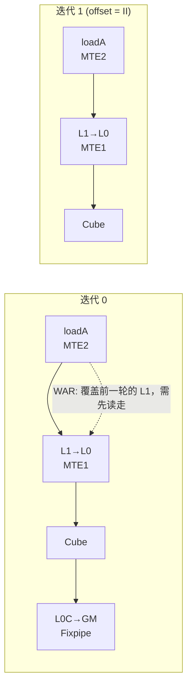

# 第 23 章 自动调度与约束求解（昇腾）

## 学习目标

读完本章，你应当能够：

1. 说清 Ascend C 里“人肉维护同步与多缓冲”的三类痛苦，Set/Wait 配对、Cube/Vector
   生产者—消费者关系、跨迭代复用同一块 UB/L1，并解释为什么这三件事可以一起写成
   一个**调度问题**。
2. 把一段 kernel 拆成带资源标签的任务。标签只有七个：MTE1 / MTE2 / MTE3 / Cube /
   Vector / Fixpipe / Scalar；你要能写出“任务 + 依赖边 + 延迟估计 + 片上容量”这套
   四元模型，并说出每一部分对应哪个源码文件。
3. 数出 v0.1.15 里 `AutoSchedule` 前后一共 13 个 pass，说出每个 pass 的职责与文件
   位置，并能用 `code/pass_order/` 里的脚本自己核一遍。
4. 写出 Z3 在这里解的是什么：整数变量是什么、布尔变量是什么、约束是什么、目标是什么；
   并解释为什么 II（相邻两轮迭代的启动间隔）和 buffer 份数必须**一起**解。
5. 把一个调度解一路追到 IR：求解结果 → buffer 份数 → `set_flag`/`wait_flag` →
   AIV/AIC 的最终 body。
6. 说明为什么 CUDA 侧不需要这一步，并指出这里的关键差异是**硬件同步语义**与
   **编译器已有基础设施**，不是“NV 更简单”。
7. 列出模型不准确、约束写错、求解失败三种情况各自的后果，并给出在有 NPU 的机器上
   验证本章结论的实验步骤。

## 前置知识

* **第 6 章**：Cube/AIC 与 Vector/AIV 的分工、`GM→L1→L0A/L0B→Cube→L0C→Fixpipe` 与
   成对 Set/Wait 的硬件背景。本章不再重复这些名词的定义。
* **第 11 章**：`T.Pipelined` 的软件流水语义与 `num_stages` 的直觉。
* **第 20 章**：TIR 结构与 pass pipeline 的组织方式，以及怎么看一条 pass 链。
* **第 22 章**：流水线规划、多缓冲与同步插入的一般原理（NV 侧怎么做）。本章只讲昇腾
   这一侧的**求解**部分。

你**不需要**学过 SMT/Z3。本章会把用到的每一类约束都写成一行可以手算的不等式。
你只需要会 Python、写过 PyTorch。

> **本章的验证边界。** 写作环境是 macOS（Apple Silicon），**没有 NVIDIA GPU、
> 没有昇腾 NPU，也没有安装 `z3-solver`**（见 `references.md` V8）。因此：
>
> * 本章没有一条性能数字是本机测出来的；引用的常量都是源码里的默认参数或社区文章的
>   说法，逐条标注来源与条件。
> * 本章给出的“最小可复现玩具模型”用纯 Python 实现并**在本机跑过**，它复现的是
>   `z3_scheduler.py` 的**约束语义**，不等于验证了 Z3 或 TileLang 的行为。
> * 凡是无法在 `_vendor/tilelang-v0.1.15/` 里找到依据的说法，一律标“**待核**”。

---

## 1. 问题的由来：Ascend C 里最难的不是写，是排

### 1.1 一张必须一直放在脑子里的时间表

在 Ascend C 里写一个带流水的算子，难点通常不在数学，而在同步。社区里流传很广的一段
描述来自知乎《DeepSeek 开源昇腾基础组件将会带来哪些影响？》（来源 id
`zhihu-dazhiruoyu-deepseek-ascend`，**community 级，非厂商文档**）：

> “大家真正写过昇腾应该都有体会，Ascend C 难写的地方很多，但最折磨人的往往还是同步，
> 因为 MTE、Cube、Vector 都是相对独立的流水，一边要靠 Set/Wait 保证不同 Pipeline 之间
> 的数据真正 ready，一边还要处理 Cube 和 Vector 之间的生产消费关系，再叠上 double
> buffer、跨迭代流水以后，程序员脑子里实际上一直维护着一张时间表：这一轮 MTE2 搬到哪里
> 了，Cube 什么时候才能吃，Vector 什么时候读完，下一轮什么时候可以覆盖同一块 UB，
> 只要其中一个 Wait 放早了，性能掉下去，放晚了或者少了，结果直接就可能错。”
> 来源：`../tilelang-corpus/09-zhihu-da-zhi-ruo-yu/raw/zhihu-dazhiruoyu-deepseek-ascend.md`

把这段话拆开，其实是三件互相纠缠的事。这三件事就是本章要自动化的对象。

**(a) Set/Wait 配对。** 昇腾的流水之间没有一条统一的栅栏可以一劳永逸，只有
`HardEvent`（生产者流水 × 消费者流水）上的成对 `SetFlag`/`WaitFlag`。放早了，
消费者读到旧数据；放晚了，本来能重叠的两段被串行化；漏一条，结果直接错。

**(b) Cube 与 Vector 的生产者—消费者关系。** GEMM 的结果在 L0C，后处理（ReLU、
量化、softmax）要搬到 UB 交给 Vector 做，而 Cube 和 Vector 是两条独立流水。
谁等谁、等多久、中间那块 UB 什么时候能换主人，都要人写。

**(c) 跨迭代复用同一块 buffer。** 多缓冲不是“写一个 `i % 2`”那么简单。
第 0 轮还占着 slot 0 的时候第 1 轮去用 slot 1，这样下一次绕回 slot 0 才多争取了
一整轮的时间；但多一份版本就实打实多占一份 UB 或 L1。所以“开几份”和“什么时候发”
本来就是同一个问题。

---

### 1.2 为什么它可以被形式化为调度问题

上面三件事看起来是硬件知识，其实都是**约束**。一旦把硬件事实写成约束，剩下的就是一个
标准的约束满足 + 优化问题。同一个来源把 TileLang 的做法概括得很准确：

> “它的做法也很直接，先把一次 kernel 里面的计算和搬运拆成任务，标清每个任务使用的是
> MTE1、MTE2、MTE3、Cube、Vector、Fixpipe 还是 Scalar，同时把谁读谁写、谁依赖谁、
> 一个任务大概多久以后能产生可用结果、同一条流水隔多久还能继续接下一项任务，以及
> UB、L1 这些片上空间到底还有多少容量全部放进同一个调度模型里，然后再去决定这些任务
> 到底应该什么时候发、哪些可以跨 iteration 重叠、一个 buffer 到底应该开一份还是两份
> 三份。”
> 来源：同上，community 级

这段话正好给出了模型的五个要素。本章后面每一节都对应其中一项：

| 要素 | 含义 | 本章位置 | 源码位置 |
| --- | --- | --- | --- |
| 任务（task） | 一次调度里不可再分的一个执行单元 | §2.1 | `MaterializeScheduleUnits` |
| 资源标签（pipe） | 这个任务占用哪条硬件流水 | §2.2 | `ResourcePipe` |
| 依赖边（dependency） | 谁必须在谁之前、跨几轮 | §2.3 | `dependency_analysis.cc` |
| 延迟（latency / II） | 多久出结果、多久能再发一条 | §2.4 | `EstimateLatency` |
| 容量（capacity） | 片上还剩多少给多缓冲 | §2.5 | `memory_groups` |

> “Z3 自己当然不知道什么叫 Cube，也不知道什么叫 MTE，它只是负责解方程，真正的硬件
> 知识仍然来自 TileLang 对访问区域、资源占用、延迟和物理存储大小的建模。”
> 来源：同上，community 级

这句话是本章的题眼。**编译器团队的大部分工作不是写求解器，而是把这个模型建准。**
第 5 节会说明建不准的三种后果。

---

### 1.3 编译器自己怎么说：它接过了多少活

锁定版本源码里有一张对照表（`tilelang/ascend/README.md:141-152`），把“用 TileLang
写”和“你自己写 Ascend C”逐项对照。其中两行正好对应本章的两半内容：

| 关注点 | 你用 TileLang 写什么 | 可以省掉的 Ascend C 代码 | 编译器替你做什么 |
| --- | --- | --- | --- |
| 调度与流水 | `T.Pipelined(...)` | 手写调度表、手转 buffer slot | 给任务分配 AIC/AIV，安排重叠与多缓冲 |
| 同步 | 什么都不写 | 手动 Set/Wait 与 flag id 管理 | 推断流水与 Cube/Vector 依赖，插入配对 flag |

注意“同步”那一行里 TileLang 侧写的是 `None`，原文是
`None (Just write operations in order!)`。也就是说，在默认路径下，用户**按数据流顺序
写操作**，同步由编译器补。这句话要成立，前提就是本章要讲的这套建模与求解。

本章不重复“多缓冲与同步是什么”（第 22 章已讲），只回答一个问题：
**编译器怎么知道该在哪儿插、插几条、buffer 开几份？**

---

## 2. 建模：把 kernel 变成一个调度问题

### 2.1 任务：从语句到 TaskNode

调度器的输入不是“语句”，而是**任务**。一条语句可能被合并进任务，一个任务也可能包含
若干条必须顺序执行的语句。

`MaterializeScheduleUnits`（`src/ascend/transform/materialize_schedule_units.cc`,
文件头注释在 `:18-22`）负责把任务边界规范化。它做两件事：

1. 把用户用 `T.Task()` / `T.PerCoreTask()` 显式标记的区域变成一个任务；
2. 把其余“带依赖的叶子语句”就地推断成任务，让调度器面对的永远是整齐的任务列表。

用户侧的两个标记在 `tilelang/ascend/language/schedule_hint.py:65` 和 `:13` 定义：

* `T.Task(latency=None, ii=None)`：把一段**顺序**语句合成一个任务。文档明确写了两条
  契约，“所有语句必须使用同一条昇腾硬件流水和同一个 AIC/AIV 核心”、“`latency >= ii`”。
* `T.PerCoreTask()`：把一个“逻辑上的单核任务”表达成一组互斥的候选点（例如按
  `block_idx` 分派到不同核）。调度器把它当一个任务分析，但在插同步时会把同一对
  Set/Wait 放回每一个候选访问点。

任务在 IR 里靠两个属性标记，见 `src/ascend/transform/attr.h:27` 与 `:38`：

* `tl.ascend_task`：这个区域要合成一个 TaskNode；
* `tl.schedule_unit`：AutoSchedule 之后、下游 pass 之间传递 stage/guard 元数据的
  短命包装，不再引入任务分组语义。

编译期真正承载任务的对象是 `TaskNode`（`ir_structure.h:494`），它上面挂着
`SetLatency`/`SetII`（`:330-333`）、`GetPipeMask`（`:519`）、读写区域
（`:533-536`）。也就是说，任务这个东西**不是抽象概念，就是 IR 上的一个类**。

### 2.2 资源标签：只有七条流水

昇腾的硬件流水被抽象成一个 7 位的位掩码，定义在
`src/ascend/transform/ascend_pipe.h:52-62`：

| 位 | 名字 | 覆盖的搬运/计算 |
| --- | --- | --- |
| `1<<0` | MTE1 | L1 → L0A / L1 → L0B |
| `1<<1` | MTE2 | GM → UB / GM → L1 |
| `1<<2` | MTE3 | UB → GM / UB → L1 |
| `1<<3` | Cube | M 流水：MAD 矩阵乘 |
| `1<<4` | Vector | V 流水：SimtVF / SimdVF / 向量算术 |
| `1<<5` | Fixpipe | L0C → UB / L0C → GM |
| `1<<6` | Scalar | S 流水：标量与配置类操作 |

此外还有 `kAll`（全 1），只用于整核 `PIPE_ALL` 栅栏。这个位掩码在 Z3 侧就是
`resource_flags` 数组，注释写在 `tilelang/ascend/transform/z3_scheduler.py:87-88`：
`MTE1=1, MTE2=2, MTE3=4, Cube=8, Vector=16, Fixpipe=32, Scalar=64`。

**为什么是这七个？** 因为它们就是“发射端口”的粒度：一条 MTE2 和一条 Cube 可以在
同一拍各自发射，而两条 MTE2 不能。它们争用同一个端口。注意“不能同时**发射**”
不等于“不能同时在**飞**”：只要 `ii < latency`，同一条流水上前一条还没搬完就可以
发射下一条（这正是 §2.4 要讲的区分）。所以约束写成“同一条流水上两个任务不能并发
发射”，而不是“不能重叠”。

### 2.3 依赖边：两类，三种距离

依赖分析在 `src/ascend/transform/auto_schedule/dependency_analysis.h` 与
`dependency_analysis.cc`。`DepInfo`（`dependency_analysis.h:56-75`）只定义了**两类**
依赖：

* `kData`：有向的生产者→消费者数据依赖（就是通常说的 RAW，加上写后写、写后读这类
  需要保序的访问冲突）；
* `kOwnerExclusion`：同一块“可多缓冲的存储”被两个**互不相关**的 owner 使用。
  这两个 owner 谁先谁后都可以，但它们的存储生命周期不能重叠。

每类依赖还带一个 `distance`，语义写在 `dependency_analysis.h:62-73`：

| `distance` | 含义 |
| --- | --- |
| `0` | 同一轮迭代内的依赖 |
| `-1` | 跨迭代依赖，尚未定版；交给调度器用 ring 宽度（buffer 份数）解决 |
| `>=1` | 手工多缓冲的 buffer，跨了几轮硬件依赖已经由用户写死 |

注意 `-1` 这一档：**“跨几轮”不是分析出来的，是求解出来的。** 这让“依赖”和
“buffer 开几份”变成了同一个未知数。

哪块存储**可以**被多缓冲，由 `AnnotateMultiBufferEligible`
（`src/ascend/transform/annotate_multi_buffer_eligible.cc:19-38`）决定：自动推断出
“写在前、读在后、且完整覆盖一次 epoch”的最深循环作为 owner，同一存储可以有多个
owner；用户也可以用 `T.annotate_buffer_versions({buf: 1})` 把它移出候选。

### 2.4 延迟：latency 与 II 是两件事

这是本章最容易搞错、也是原文专门点出的一处：

> “这里有一个很关键的细节，就是 TileLang 会把 latency 和 issue interval 分开，因为
> 一条指令需要 30 个 cycle 才产生结果，并不意味着这条 Pipeline 30 个 cycle 内都不能
> 接下一项任务，有些流水可能每隔 8 个 cycle 就能继续 issue……”，同上，community 级

源码里两者是两个字段（`src/ascend/transform/auto_schedule/task_annotations.h:41-42`）：

* `latency`：从任务发射到**输出可用**要多少 cycle，约束的是消费者；
* `ii`：同一条流水**下一次发射**至少要隔多少 cycle，约束的是生产者自己。

两者都必须满足 `latency >= ii`（`task_annotations.h:149-153` 会 ICHECK）。

`EstimateLatency`（`src/ascend/transform/estimate_latency.cc`）负责把这两个数算出来，
它的算法写在自己的注释里（`:330-345`）：

1. **访存延迟**：遍历读写区域，把 (src scope, dst scope) 映射到一条物理路径，
   记 `base + bytes / bandwidth`；
2. **计算延迟**：Cube 记 `M*K*N / cube_throughput_<dtype> + base`，Vector 取
   “操作计数”与“`bytes / valu_bandwidth`”的较大者，纯标量任务记 1 cycle；
3. **II**：对每条活跃流水取“带宽/吞吐限制的发射间隔”的最大值；
4. **总延迟 = 访存延迟 + 计算延迟**（顺序假设），重叠交给 Z3 用 II 处理（`:941`）。

这些公式里的硬件常量是**源码里的默认参数**，不是实测数字。例如
`estimate_latency.h` 里 `cube_base_latency{8}`、`cube_throughput_fp16{8192}`
（ops/cycle，含乘加计两次）、`mte2_gm_to_l1_base_latency{190}`、
`mte2_gm_to_l1_min_ii{64}`、`mte2_gm_to_ub_base_latency{90}`、
`mte3_ub_to_gm_base_latency{180}`、`l1_to_l0a_bandwidth{256}`、
`valu_bandwidth{256}`。
这些数字**只代表模型**：它们对不对，要靠第 5.5 节的实验去校准。

### 2.5 片上容量：把 buffer 份数变成约束

片上空间是有限的，多开一份版本就多占一份。`AutoSchedule` 为每个 scope 设一个容量上限
（`auto_schedule.cc:1341-1347`）：

```cpp
unit_builder.SetMemoryLimit("shared", shared_mem_limit);          // UB
unit_builder.SetMemoryLimit("shared.l1", GetL1MemoryLimit(target));
unit_builder.SetMemoryLimit("shared.l0c", GetL0CMemoryLimit(target));
unit_builder.SetMemoryLimit("shared.l0a", GetL0AMemoryLimit(target));
unit_builder.SetMemoryLimit("shared.l0b", GetL0BMemoryLimit(target));
```

用户可以用 `T.annotate_unlimit_memory(scope)` 把某个 scope 当成无限大，见
`tilelang/ascend/language/annotations.py:165`。

在传给 Z3 之前，这些信息被整理成 `memory_groups`：每组是
`[容量, buffer_idx...]`（`z3_scheduler.py:325-330` 的文档，Python 侧约束在
`:431-436`）。于是“多缓冲”变成一个纯算术约束：

```text
sum(buf[i] * size[i] for i in group) <= capacity
1 <= buf[i] <= num_stages
```

不能多缓冲的 buffer（以及被用户钉死份数的 buffer）会**直接从容量里扣掉**
（`auto_schedule.cc:846-857`），所以如果扣完之后容量已经为负，Z3 还没开始就已经无解，
源码会提前报错（见 §5.2）。

### 2.6 软件流水的表示法：`start = k * II + r`

最后一块拼图是“时间怎么表示”。循环里的调度器不直接解绝对时间，而是解
**模序调度（modulo scheduling）** 的标准形式：

```text
start_i = k_i * II + r_i        k_i >= 0, 0 <= r_i < II
```

* `II` 是“相邻两轮迭代的最小启动间隔”（initiation interval），也是要最小化的目标；
* `r_i` 是任务在流水稳态里的**相位**，决定同一轮里谁先谁后；
* `k_i` 是任务的**流水级**（stage），决定它相对第一轮被推迟了几轮。

对应的概念图（Mermaid 源见 `figures/modulo-schedule.mmd`）：



---

## 3. 用法：你要写多少，编译器替你写多少

### 3.1 默认路径：什么都不用写

默认情况下 `TL_ENABLE_AUTO_SCHEDULE` 是打开的吗？是。`tilelang/ascend/pipeline.py:22-33`
里的 `allow_autoschedule()` 用 `pass_ctx.config.get(..., True)` 取值，默认 `True`；
关掉它只是“不调度”，而不是换一个调度器，注释原文是
`disabling it leaves the kernel unscheduled`。

所以下面这段**改写自**锁定版本 `examples/ascend/example_gemm.py:60-80` 的代码
（为便于阅读去掉了 `unit_flag_ctrl` 与 `acc` 分支），**一行同步都没写**：

```python
with T.Kernel(NUM_BLOCKS) as bx:
    res = T.alloc_l0c((TILE_M, TILE_N), "float32")
    x_l1 = T.alloc_l1((TILE_M, TILE_K), dtype)
    w_l1 = T.alloc_l1((TILE_N, TILE_K), dtype)
    temp = T.alloc_shared((TILE_M // 2, TILE_N), out_dtype)
    for tile_idx in T.Persistent([OUT_TILES], NUM_BLOCKS, bx):
        m_tile, n_tile = aswt_swizzle(tile_idx)
        for kt in T.Pipelined(K_TILES, num_stages=NUM_STAGES):
            T.copy(X[...], x_l1)
            T.copy(W[...], w_l1)
            T.gemm(x_l1, w_l1, res, transpose_B=True, clear_accum=kt == 0)
        if MIXED:
            T.dual_copy(res, temp)
            T.dual_copy(temp, C[...])
        else:
            T.copy(res, C[...])
```

用户表达的是**数据流**（数据先去哪、算在哪、结果去哪），剩下的交给 13 个 pass。
这里的 `NUM_STAGES = 2`（`example_gemm.py:32`）就是 §4.2 里传给 Z3 的 `num_stages`：
它是**自动 buffer 的份数上界**，不是最终份数。

### 3.2 手动路径：调度器留了哪些旋钮

当自动结果不理想或需要精确控制时，前端提供了下面这些旋钮。全部来自
`tilelang/ascend/language/schedule_hint.py` 与 `annotations.py`，逐个在
`_vendor/tilelang-v0.1.15` 里核对过：

| API | 作用 | 定义位置 |
| --- | --- | --- |
| `T.Task(latency, ii)` | 手工给出任务的延迟与发射间隔，覆盖估算 | `schedule_hint.py:65` |
| `T.PerCoreTask()` | 把一个逻辑单核任务写成多个互斥候选点 | `schedule_hint.py:13` |
| `T.Stage(k)` | 手工指定流水级；一旦某个子列表里出现，整个子列表转为手动调度 | `schedule_hint.py:118` |
| `T.annotate_buffer_versions({buf: n})` | 固定/移除某个 buffer 的版本数；也可只给模式 `"auto"/"iteration"/"counter"` | `annotations.py:19` |
| `T.annotate_manual_multi_buffer(buf, {buf: n})` | 声明“我已经自己多缓冲了”，只让编译器做依赖分析与插同步 | `annotations.py:107` |
| `T.annotate_unlimit_memory(scope)` | 某个 scope 视为无限大 | `annotations.py:165` |
| `T.assume_no_conflict(...)` | 告诉依赖分析两条访问不冲突 | `schedule_hint.py:196` |
| `T.assume_conflict(...)` | 强制两条访问视为冲突 | `schedule_hint.py:246` |
| `T.Pipelined(..., num_stages=n)` | 自动 buffer 的份数上界 | 第 11 章 |

几点容易被忽略的规则（都写在对应 API 的 docstring 里）：

* `T.Stage` 必须包住**完整的调度任务**，不能出现在 `T.Task`、`T.SimtVF`、`T.SimdVF`、
  SBlock 或并行循环**内部**；
* 非零 `T.Stage` 要求外层循环开启 `annotations={"enable_offset": True}`，
  否则 Z3 侧会直接抛错（`z3_scheduler.py:369-370`）；
* 手动调度时不能再传 `T.Pipelined` 的 order/stage 参数，昇腾手动模式从**源码顺序**
  推导每条流水的发射顺序（`auto_schedule.cc:723-733` 的 ICHECK）。

### 3.3 一个两种模式都成立的骨架

下面这个骨架把自动和手动放在同一段代码里（常量与省略号处的索引按真实 shape 补全；
**本机只做了 API 名核对，未在 NPU 上运行**；可运行的完整版本是锁定版本的
`examples/ascend/example_gemm.py`）：

```python
import tilelang
import tilelang.ascend.language as T


@T.prim_func
def gemm_relu(X: T.Tensor((M, K), "bfloat16"),
              W: T.Tensor((N, K), "bfloat16"),
              C: T.Tensor((M, N), "float32")):
    with T.Kernel(NUM_BLOCKS) as bx:
        a_l1 = T.alloc_l1((TILE_M, TILE_K), "bfloat16")
        b_l1 = T.alloc_l1((TILE_N, TILE_K), "bfloat16")
        c_l0c = T.alloc_l0c((TILE_M, TILE_N), "float32")
        c_ub = T.alloc_shared((TILE_M // 2, TILE_N), "float32")

        # 只给上界；真正开几份由 Z3 在容量约束下决定
        for kt in T.Pipelined(K // TILE_K, num_stages=2):
            T.copy(X[bx * TILE_M, kt * TILE_K], a_l1)
            T.copy(W[0, kt * TILE_K], b_l1)
            T.gemm(a_l1, b_l1, c_l0c, transpose_B=True, clear_accum=(kt == 0))

        T.dual_copy(c_l0c, c_ub)
        with T.SimtVF(threads=128):
            for i, j in T.Parallel(TILE_M // 2, TILE_N):
                c_ub[i, j] = T.max(c_ub[i, j], 0)
        T.copy(c_ub, C[bx * TILE_M, 0])
```

这段和知乎原文引用的官方 GEMM+ReLU 例子形状一致（原文给出的是同一类代码，
**community 级转述，未逐字核对**）。它体现的设计选择是：**昇腾特有的资源信息
（L1/L0C/UB）暴露在前端，但调度与同步不暴露**。因为前者影响合法性，后者可以解。

---

## 4. 实现机制：13 个 pass 与一个 SMT 求解器

### 4.1 自动调度是一条 13 个 pass 的链

打开 `_vendor/tilelang-v0.1.15/tilelang/ascend/pipeline.py`，第 103-116 行就是全部：

```python
if auto_schedule_enabled:
    mod = ascend_transform.NormalizeControlFlowForSchedule()(mod)
    mod = ascend_transform.NormalizeConflictHints()(mod)
    mod = ascend_transform.MaterializeScheduleUnits()(mod)
    mod = ascend_transform.AnnotateMultiBufferEligible()(mod)
    mod = ascend_transform.EstimateLatency()(mod)
    mod = ascend_transform.AutoSchedule()(mod)
    mod = ascend_transform.AssignCore()(mod)
    mod = ascend_transform.PrepareMultiBuffer()(mod)
    mod = ascend_transform.ResolveCore()(mod)
    mod = ascend_transform.InsertSync()(mod)
    mod = ascend_transform.MaterializeMultiBuffer()(mod)
    mod = ascend_transform.LowerScheduledTIR()(mod)
    mod = ascend_transform.RestoreWhileLoops()(mod)
```

每个 pass 的实现文件可以在 `src/ascend/transform/` 找到。下面这张表是
`code/pass_order/ascend_pass_order.py` 在本机跑出来的实际结果（脚本从
`pipeline.py` 抽顺序，再找 `refl::GlobalDef().def("tl.transform.<Pass>")`）：

| # | pass | 做什么 | 实现（`src/ascend/transform/`） |
| --- | --- | --- | --- |
| 1 | `NormalizeControlFlowForSchedule` | 把 `while` 改写成有界 `for`，抽出复杂条件，让循环体能被调度 | `normalize_control_flow_for_schedule.cc:240` |
| 2 | `NormalizeConflictHints` | 规范化 `T.assume_no_conflict/assume_conflict` | `normalize_conflict_hints.cc:309` |
| 3 | `MaterializeScheduleUnits` | 规范化任务边界，物化平凡调度单元 | `materialize_schedule_units.cc:578` |
| 4 | `AnnotateMultiBufferEligible` | 标出每个循环里哪些片上 buffer 可以被多缓冲 | `annotate_multi_buffer_eligible.cc:835` |
| 5 | `EstimateLatency` | 给每个任务标 latency 与 II | `estimate_latency.cc:2271` |
| 6 | `AutoSchedule` | **调 Z3 求调度解**（唯一一次求解） | `auto_schedule.cc:1400` |
| 7 | `AssignCore` | 给任务标最宽的合法 AIV/AIC mask | `assign_core.cc:401` |
| 8 | `PrepareMultiBuffer` | 选多缓冲时钟，插入 counter 的 init/advance 任务 | `prepare_multi_buffer.cc:1249` |
| 9 | `ResolveCore` | 按真实消费者收窄核候选 | `resolve_core.cc:559` |
| 10 | `InsertSync` | 插同步：算 hard_event、分配 flag、生成 Set/Wait | `insert_sync.cc:2568` |
| 11 | `MaterializeMultiBuffer` | 把逻辑多缓冲访问降到物理 buffer 版本 | `materialize_multi_buffer.cc:561` |
| 12 | `LowerScheduledTIR` | 把调度后的 TIR 降成 AIV/AIC 的 body | `lower_scheduled_tir.cc:744` |
| 13 | `RestoreWhileLoops` | 把 `synthetic_while` 还原成 `while(true)` | `restore_while_loops.cc:117` |

**只有第 6 个 pass 真正在求解**。它前后都是“准备模型”与“落地结果”。这也解释了
为什么第 5 节说“加能力 = 改模型”：想影响调度结果，改 `EstimateLatency` 或
`dependency_analysis`，比改 Z3 调用有用得多。

注意 pass 3-5 的顺序是硬约束：`AnnotateMultiBufferEligible` 的 docstring 明说它要求
先跑 `NormalizeControlFlowForSchedule` 和 `MaterializeScheduleUnits`
（`tilelang/ascend/transform/__init__.py:31-37`），否则 buffer 相关的循环边界还不是
可调度的任务，写先读后的判断就不可靠。

### 4.2 Z3 到底解的是什么

先看事实：求解器**用 Python 写的**，通过 TVM FFI 被 C++ 调用。C++ 侧在
`auto_schedule.cc:474-479` 用 `ffi::Function::GetGlobal("tl.transform.z3_schedule_python")`
找函数；Python 侧在 `z3_scheduler.py:229` 与 `:785` 用
`@tvm_ffi.register_global_func` 注册。两个入口分工不同：

| 入口 | 用途 | 定义 |
| --- | --- | --- |
| `z3_schedule_python` | 直线（无循环）任务表：最小化 makespan | `z3_scheduler.py:67-226` |
| `z3_schedule_loop_python` | 循环体：最小化 II，同时解 buffer 份数 | `z3_scheduler.py:268-783` |

循环版是本章的重点。它的变量只有四类（`z3_scheduler.py:412-420`）：

```text
k[i]   : Int   —— 任务 i 的流水级（stage）
r[i]   : Int   —— 任务 i 在稳态里的相位，0 <= r[i] < II
buf[j] : Int   —— 第 j 个自动 buffer 的物理份数，1 <= buf[j] <= num_stages
O_i_j  : Bool  —— 任务 i 与 j 谁先发（只在同流水冲突时创建）
start[i] = k[i] * II + r[i]
```

约束一共五类。前三类是硬件事实，后两类是调度策略：

**(1) 数据依赖**（`z3_scheduler.py:442-455`）。给定 `distance >= 0`：

```text
start[v] - start[u] >= latency - II * distance
```

`distance < 0` 时，`II * distance` 换成 `II * buf[-distance-1]`，**依赖跨了几轮，
由求解器挑的那个 buffer 份数决定**。这一行就是“多缓冲必须和调度一起算”的全部秘密。

**(2) 资源冲突**（`:456-468`）。同一流水上的一对任务二选一，并且要保护**绕回**
（因为模序是环形的，`r` 在 `II` 处折返）：

```text
o_ij  ->  r[j] - r[i] >= ii_i  且  r[i] - r[j] + II >= ii_j
¬o_ij ->  r[i] - r[j] >= ii_j  且  r[j] - r[i] + II >= ii_i
```

**(3) 片上容量**（`:431-436`）：

```text
sum(buf[j] * size[j] for j in group) <= capacity[group]
1 <= buf[j] <= num_stages
```

**(4) owner-exclusion**（`:472-488`）。两个不相关 owner 共用同一段物理 ring 时，
选一个模序，并**同时**保护正向交接和绕回交接（注释原文：
`protect both the forward hand-off and the wrap-around hand-off`）。

**(5) 策略约束**。两条容易忽略：

* `stage_order_deps`（`:489-499`）在拷贝 Let 变量时要求 `k_u <= k_w`，保证被克隆的
  Let 读到的是写之前的旧值；
* `enable_offset`（`:503-514`）。默认 `False` 时，每条流水上的任务必须落在**同一个 II
  窗口内**（`max(start) - min(start) < II`），即不允许把一条流水的任务摊到多个流水级；
  置 `True` 才解开。手写 `T.Stage` 的非零流水级要求打开它（见 §3.2）。

**目标**：最小化 `II`。实现方式是**对 II 做二分**（`:398-540`），而不是让求解器直接
优化 II。因为约束里 `r[i] < II` 和 `II * distance` 都以 II 为参数，把它当常数后
每个子问题都是纯可行性问题。二分范围是 `[max(ii_i), max(sum(latency), sum(ii)) + 1]`。

三个工程细节值得记住：

* **每次求解用私有 `z3.Context()`**（`:391` 与 `:132`）。注释直接写了原因：共用全局
  context 会让“重复的同一个求解”返回不同的（都合法的）模型，导致编译结果不可复现；
* **Z3 不是线程安全的**，Python 侧用一把全局锁串行化（`:17` 的 `_z3_lock`）；
* **`rlimit = 1000000`**（`:415`）限制求解步数，`seed = 42`（FFI 默认，
  `:849`）固定随机性。

### 4.3 最小可复现的玩具模型

这一段的目标是：把上面的约束缩到**你能用手算验证**的规模。
`code/toy_scheduler/toy_schedule.py` 用纯 Python 实现了同一套约束（不用 Z3，
用回溯搜索），跑一个 4 任务的 GEMM 流水：

```text
任务：
  0  loadA(MTE2 GM->L1)   latency=40  ii=10  pipe=MTE2
  1  l1->l0(MTE1)         latency=15  ii= 3  pipe=MTE1
  2  cube(Cube)           latency=30  ii= 8  pipe=Cube
  3  l0c->gm(Fixpipe)     latency=25  ii= 6  pipe=Fixpipe

同迭代真依赖：  0 -> 1 (>=40)   1 -> 2 (>=15)   2 -> 3 (>=30)
跨迭代 WAR：    1 -> 0，distance = -1（自动 buffer 0）
资源冲突：      (2, 1)（Cube 与 MTE1 争 L0 端口）
容量：          L1 上 buffer 0 一份 1000 字节，容量 4096，num_stages = 2
```

约束就是 §4.2 的五类去掉 owner-exclusion。手推的关键只有两条：

* 真依赖要求 `start[1] >= start[0] + 40`；取 `start[0] = 0`，即 `start[1] >= 40`；
* 跨迭代 WAR 是 `start[0] - start[1] >= 15 - II * buf[0]`（`distance = -1`），
  代入 `start[0] = 0` 得 `start[1] <= II * buf[0] - 15`。

两式相消：`II * buf[0] >= 55`。所以

* `buf[0] = 1` → `II >= 55`（不重叠，退化成串行）；
* `buf[0] = 2` → `II >= 28`（L1 占用 2000 <= 4096，装得下）。

程序实测结果（本机 `python3 toy_schedule.py demo`，完整输出见
`code/toy_scheduler/README.md`）：

```text
first feasible II = 28, buffer versions = [2]
    [  0] loadA(MTE2 GM->L1)   k=0 r= 0 latency=40 ii=10 pipe=MTE2
    [ 40] l1->l0(MTE1)         k=1 r=12 latency=15 ii= 3 pipe=MTE1
    [ 55] cube(Cube)           k=1 r=27 latency=30 ii= 8 pipe=Cube
    [ 85] l0c->gm(Fixpipe)     k=3 r= 1 latency=25 ii= 6 pipe=Fixpipe
```

它和真实 Z3 求解器的差别只有两点，必须说清楚：

1. **求解器不同**。玩具用回溯搜索；Z3 用 SMT。对 4 个任务的实例两者都精确，但
   “回溯能解”不证明“Z3 会给出同样的解”，Z3 只保证在给定目标下最优，不保证
   唯一（这也是源码要用私有 context 固定随机性的原因）。
2. **少了 owner-exclusion**。玩具模型里每个 buffer 只有一个 owner。

`python3 toy_schedule.py --print-smt` 会把同一实例写成 z3 API 的约束文本；
装了 `z3-solver` 的机器上 `--z3` 会真正复算并比对（**本机没有 z3，未验证**）。

### 4.4 求解结果怎么落地：从 `start_times` 到 Set/Wait

Z3 只回答“这样排在数学上成立”。把它变成程序要走四步。

**第 1 步：写回 stage / start / buffer 份数（pass 6）。**
`auto_schedule.cc:1137-1144` 从 `start_times[i] / II` 反推出每个任务的 stage，
并把 start_time 归一化到从 0 开始：

```cpp
nodes[i]->SetStage(manual_schedule
                       ? static_cast<int>(manual_stages[i])
                       : (enable_offset ? (raw_k[i] - min_k_raw) : 0));
GetAutoScheduleExtraInfo(nodes[i])->SetStartTime(start_times[i] - min_start_time);
```

紧接着 `:1284-1295` 把每个 storage 的版本数合并进 `selected_buffer_versions_`
（`MergeSelectedBufferVersion`，定义在 `:245`）。注意 `:251-257` 的注释坦承了一个
**已知限制**：两个 owner 的版本数取 `max` 之后**不再复核物理上限**，可能产出一个
超过片上容量的合并分配，“until a lifetime-aware global check exists, this is an
accepted limitation”，只能靠下游或 runtime 报错。这是本章第 5 节要讲的风险之一。

**第 2 步：核分配与多缓冲协议（pass 7、8、9）。**
`AssignCore`（`assign_core.cc:401`）先给每个任务一个“最宽的合法 AIV/AIC mask”，
`PrepareMultiBuffer`（`prepare_multi_buffer.cc:1249`）选多缓冲时钟并**插入 counter
的初始化与推进任务**，`ResolveCore`（`resolve_core.cc:559`）再根据真实消费者把 mask
收窄。分成三步是因为“能放在哪个核”和“最终放在哪个核”是两件事：插入 counter 会
产生新的标量消费者，必须等它们都出现之后才能定核。

**第 3 步：插同步（pass 10）。** `InsertSync`（`insert_sync.cc:2568`）是这一章里
代码量最大的 pass（约 104 KB）。它做三件事：

1. 由“生产者流水 × 消费者流水”算出 `HardEvent` 名字，`GetHardEvent` 在 `:751`，
   例如 `MTE2` + `Cube` 要归一化成 `MTE2_MTE1`（因为 Cube 从 L0 取数，前面实际是
   MTE1）；
2. 给每个同步点分配 flag id，并把 event id 与**版本号**绑起来
   （`MakeFlagEventId`，`:2299`）；
3. 生成 IR：`MakeAscendSetFlag` / `MakeAscendWaitFlag`（`:2270-2280`）产出
   `Evaluate(Call(ascend_set_flag(), {StringImm(hard_event), event_id}))`。

跨核（AIC↔AIV）另有一对 `ascend_cross_core_set_flag` / `wait_flag`
（`:2287-2297`），它们在 `:2391-2414` 处按 mode 组合成正式同步。

**第 4 步：物化 buffer 版本与最终 body（pass 11、12、13）。**
`MaterializeMultiBuffer`（`materialize_multi_buffer.cc:561`）把逻辑访问
`buf[...]` 改写成 `buf[version, ...]`，注意它连 buffer 的存储 stride 都一起算
（`BufferStoragePitch`，`:56`），所以所有 alias view 会看到同一份物理
版本。`LowerScheduledTIR`（`lower_scheduled_tir.cc:744`）再把调度后的 TIR 降成
AIV/AIC 各自的 body，`RestoreWhileLoops` 收尾。

于是整条链可以浓缩成一句话：

```text
II / stage / start(K, r)
        │  AutoSchedule 写回
        ▼
buffer 份数 ──► PrepareMultiBuffer（counter init/advance）
        │
        ▼
依赖 + 流水资源 ──► InsertSync ──► set_flag/wait_flag(hard_event, event_id)
        │
        ▼
MaterializeMultiBuffer ──► buf[version, ...] ──► LowerScheduledTIR ──► AIV/AIC body
```

在 AutoSchedule 之后的 pass 里，还有两个只和“资源不够分”有关的 pass 值得点名：
`MergeUBAllocations` 做片上存储复用合并；`RewriteFlagToBuf` 把每个 hard_event 归一到
**8 个 flag 槽**，装不下时用 0/1 背包（容量 8）挑一部分，其余溢出到共享的
**32 槽 `get_buf`/`rls_buf` 互斥池**（`rewrite_flag_to_buf.cc:3-14`）。
这两条都说明：昇腾侧连“flag 编号”都是需要分配的资源。

### 4.5 为什么 CUDA 侧不需要这一步

同样一个 TileLang 前端，CUDA 后端里**没有** Z3、没有 AutoSchedule、没有“求解器”。
打开 `tilelang/cuda/pipeline.py` 能看到对应位置是什么：

```python
# tilelang/cuda/pipeline.py:129-130
mod = tilelang.transform.PipelinePlanning()(mod)
mod = tilelang.transform.InjectSoftwarePipeline()(mod)
...
# tilelang/cuda/pipeline.py:258-259
mod = tilelang.transform.ThreadSync("shared")(mod)
mod = tilelang.transform.ThreadSync("shared.dyn")(mod)
```

三个差异，**都不是“NV 更简单”**，而是模型不同：

**差异一：多缓冲份数在 CUDA 上是“算出来的”，不是“解出来的”。**
`src/transform/inject_pipeline.cc:1498` 起，版本数是一条结构化的上界：

```cpp
// `use - def + 1` is a upper bound of the needed versions
int num_versions = buffer_info.use - buffer_info.def + 1;
```

再加一个 `num_versions == 2` 的特例判断（`:1504-1546`）。推导依据是
`PipelinePlanning` 已经分配好的 stage 与 order，不存在“容量装不下要退几份”的
联合优化。因为 CUDA 的流水级由用户/autotuner 的 `num_stages` 直接决定，
shared memory 的份数只影响占用，不影响合法性。

**差异二：CUDA 的“自动调度”是固定角色启发式，不是求解。**
`src/cuda/transform/auto_schedule/role_based_scheduler.h:17-22` 的注释写的是
`Fixed-role heuristic`：按 lowering 资格把算子分成 Load / MMA / Store / Worker，
把 warp-private 的 def-use 链拉进消费者的角色，再给每个跨角色传递的 shared/tensor
memory 存储做流水。角色是**分类**出来的，不是**求解**出来的。

**差异三（最根本）：硬件同步语义不同。** 这部分来自知乎那张对照表（**community
级**）与第 6 章的结论：

| 维度 | NVIDIA GPU | 昇腾 950 |
| --- | --- | --- |
| 数据传递 | 普通访存 + `cp.async`/TMA 等异步机制 | 不同存储层级通过**指定搬运路径**连接 |
| 同步 | 线程、线程组、异步操作各自的完成协议 | 需要处理**流水线间、Cube/Vector 间、多缓冲复用**的完成协议 |

具体到 TileLang 的实现差异，可以归纳成三句话：

1. **CUDA 侧的同步粒度是“块”**：`ThreadSync` 只需在 block 内插 barrier 语义
   （`tvm_storage_sync`），而 block 内的 shared memory 可见性由硬件 barrier 保证。
   所以在 TileLang 的 CUDA 路径里，同步一旦插入就是**保守但正确**的：粒度粗一点只是慢。
2. **昇腾侧的同步粒度是“流水对 + flag 槽”**：`HardEvent` 有生产者、消费者两个维度，
   flag id 还是有限资源，所以“插哪里”和“用哪个编号”都是组合问题。
3. **昇腾侧不存在统一栅栏可用**：用一条全核栅栏换正确性会把所有重叠都杀掉，
   这正是第 1.1 节说的“放晚了性能掉下去”。

反过来说，如果昇腾只有一种执行单元、或者只有一条流水，那么用保守栅栏就够了，
也就不需要 Z3。**需要求解，是因为硬件给了 7 条可独立发射的流水和好几块容量不同的
片上存储，而正确性只能靠显式 flag 保证。**

---

## 5. 进阶与陷阱

### 5.1 模型不准：从“慢”到“错”

模型里的每一个数字都是一个**假设**。假设偏小（估得比真实快）会让消费者提前启动，
结果是错的；假设偏大（估得比真实慢）只是把机器排得更保守，结果是慢的。

这不是空谈。`code/toy_scheduler/toy_schedule.py` 的 `sensitivity` 模式就是这件事的
可复现版本（本机实测）：

```text
== 真值 ==  MTE2 latency = 40  ->  II = 28，buffer versions = [2]
== 低估后 == EstimateLatency 报 16 -> II = 16，buffer versions = [2]
== 用真值复核 ==
  违约：l1->l0(MTE1) 比 loadA(MTE2 GM->L1) 早了 24 cycles（数据未就绪）
```

也就是说，**一个 24 cycle 的估计误差，就足以让求解器给出一个在真实硬件上非法的
时间表**。真实系统里对应的风险点有：

* `estimate_latency.h` 里的带宽/吞吐常量是**按芯片世代手工标定的**（如
  `cube_throughput_fp16{8192}`、`mte2_gm_to_ub_bandwidth{100}`）。换芯片、换
  dtype、换 hf32 模式都会改变真值，但表不会自动跟着变；
* `EstimateLatency` 的总延迟是 `memory_latency + compute_latency`（`estimate_latency.cc:941`），
  这是一个**顺序假设**；真实硬件上不同路径之间的重叠比这个假设好，所以估算偏保守；
* 未知操作走 `default_operation_throughput{0}` 的“1 cycle 兜底”
  （`estimate_latency.h`），这属于**偏小**的估计，正好是危险的方向。

所以“性能次优”和“结果错误”在同一个根因下：模型。这也是为什么原文说
“加能力 = 改模型”。

### 5.2 求解失败的四种形态

`AutoSchedule` 是 fail-fast 与静默降级的混合体。列出四种，按“可诊断性”从好到坏：

**(1) 容量先天不足 → 直接 FATAL。** `auto_schedule.cc:866-891` 在调用 Z3 之前先检查：
`scope` 容量为负，或“每个可多缓冲 buffer 至少一份”已经超过剩余容量，就报
`Z3 loop scheduling failed: scope "..." capacity ...`，并提示用
`T.annotate_unlimit_memory(scope)` 或减小 buffer。这类最好查。

**(2) 手动调度不可行 → 抛异常。** `z3_scheduler.py:534-537`：手动模式下如果找不到
任何可行 II，会 `raise RuntimeError("Manual schedule constraints are infeasible; ...")`
并提示检查每条流水的源码顺序、`T.Stage` 取值、依赖和资源占用。这是**对的**，
手动模式是用户契约，不能偷偷改。

**(3) 自动模式不可行 → 静默退化成串行。** 这是最需要警惕的一条。
`z3_scheduler.py:539-550`：

```text
No feasible II found; falling back to sequential schedule
start_times[i] = start_times[i-1] + latencies[i-1]
best_ii = max(sum(latencies), 1)
buffer_versions = [1] * len(buffer_sizes)
```

注意这段只在 `verbose=True` 时打印。默认 FFI 路径不传 verbose
（`z3_scheduler.py:785-854`），所以**编译会成功，程序会正确，但性能可能塌回完全不重叠**。
如果某天你发现“加了 `num_stages` 却一点没变快”，先怀疑掉进了这个分支。

**(4) 求解被 rlimit 截断 → 可能被当成不可行。** 每个子问题设 `rlimit = 1000000`
（`:415`）。代码的判断是 `if solver.check() == z3.sat: ... else: ii_lower = ii_mid + 1`
（`:518-532`），也就是说 **`unknown` 会被当成 infeasible**，然后 II 被推大。
这是一个从代码读出来的**推理风险，本章未实测**（本机无 z3）。任务数多、依赖稠密时，
它可能让调度器给出一个偏保守的 II，或者落到形态 (3)。

### 5.3 启发式与用户契约：两个会“悄悄错”的地方

求解器是精确的，喂给它的东西不是。两处需要特别注意：

**(a) 多缓冲资格是启发式推断的。** `AnnotateMultiBufferEligible` 通过“写先读后、
完整覆盖一个 epoch”来找 owner。它的 docstring 提醒：当“自动推断漏掉了对旧数据的
读取”时，用户要用 `T.annotate_buffer_versions({buf: 1})` 把该 storage 从多缓冲候选里
移除（`annotations.py:41-46`）。反过来说，**推断错了会直接产出错误的多缓冲**，
而这类错误通常只在特定 shape / 特定迭代 / 流水压得很紧时暴露，正是原文说的
“这种 bug 基本属于查起来最痛苦的那一类”。

**(b) `T.assume_no_conflict` 是在删约束。** 它的 docstring 明说：动态索引
（例如 `state_cache[perm[idx], ...]`）导致依赖分析无法证明不重叠，于是插入冗余同步，
这个 hint 就是让用户声明“它们真的不重叠”（`schedule_hint.py:196-244`）。声明错了，
依赖被删掉，程序并行到了不该并行的地方。这是**用户自己签字的正确性契约**。
保守的做法是：只在能用数学证明（比如 `perm` 是置换）时才写。

两个 `T.Task(latency, ii)` 的坑也顺便记一下：给出的值是**精确覆盖**，不是 hint
（`schedule_hint.py:65-115`）；而且会被 ICHECK 校验 `latency >= ii`。写错方向
（ii 给大、latency 给小）等于在 5.1 的坑里自己再挖一层。

### 5.4 版本与状态：这一章的东西在哪个仓库

这一节的所有 pass、求解器、`T.Task`/`T.Stage` API 都在**主干仓库**
`_vendor/tilelang-v0.1.15/` 里。核对方式（本章实际执行过）：

```bash
ls _vendor/tilelang-v0.1.15/tilelang/ascend/transform/   # z3_scheduler.py 在这里
ls _vendor/tilelang-v0.1.15/src/ascend/transform/        # 13 个 pass 的 .cc 在这里
python3 code/pass_order/ascend_pass_order.py             # 顺序与注册点一次性核对
```

而适配器仓库 `_vendor/tilelang-ascend-v0.1.2.000/` 里**没有** AutoSchedule：

```bash
grep -rl "AutoSchedule" _vendor/tilelang-ascend-v0.1.2.000/src _vendor/tilelang-ascend-v0.1.2.000/tilelang
# 无输出（本机 2026-10-01 实测）
```

这与 `VERSIONS.md` 的结论一致：昇腾后端已经进主干。你在适配器仓库里能拿到的
是**文档与例子**，例如《TileLang-Ascend Programming Guide》第 4.1.4.2 节讲
`T.Pipelined` 的 intra-core / inter-core 两种用法。

另外有两个 pass config 键**在 v0.1.15 里找不到**，只出现在适配器仓库的文档与
skill 说明中：`tl.ascend_auto_cv_combine` 与 `tl.ascend_auto_cross_core_sync`
（适配器文档要求“使用核间流水线时必须开启”，见
`../tilelang-corpus/07-tilelang-ascend-adapter/raw/tilelang-ascend/docs/TileLang-Ascend Programming Guide.md:1201`）。
它们在 `_vendor/tilelang-v0.1.15/tilelang/transform/pass_config.py` 里搜不到
（本章实测）。**待核**：这属于“文档描述的旧配置面 vs 主干现状”的差异，
按 `VERSIONS.md` 的规则，本书只以主干为准，本节引用的跨核同步语义请以
`InsertSync` 的 `ascend_cross_core_set_flag/wait_flag`（`insert_sync.cc:2287-2297`）
为准。

### 5.5 在有 NPU 的机器上怎么验证

本章所有结论都能用下面这套实验流程检验。写成“变量 → 观察量 → 判据”的形式，
方便你改造成回归脚本。**这套流程本章一次也没跑过**（无 NPU、无 CANN）。

**准备。** 入口用锁定版本的 `examples/ascend/example_gemm.py`（`T.Persistent` +
`T.Pipelined(num_stages=NUM_STAGES)`），它的 benchmark 走
`do_bench(..., backend="msprof", _n_warmup=30, _n_repeat=repeats)`
（`example_gemm.py:98`），性能口径是 TFLOP/s。

**实验 A：多缓冲份数到底开了几份。**

* 变量：把 `example_gemm.py:32` 的 `NUM_STAGES` 从 2 改成 1/3/4；
* 观察量：每个大 shape 的 TFLOP/s；以及 `T.annotate_buffer_versions` 显式钉死份数
  （如 `{x_l1: 2, w_l1: 2}`）后的对比；
* 判据：如果 `num_stages` 从 2 加到 4 而性能不变，先怀疑 §5.2 的形态 (3)（静默退化）
  或容量约束把版本数压回了 1。

**实验 B：看求解器实际给出的计划。**

* 变量：直接调用 `tilelang.ascend.transform.z3_scheduler.z3_schedule_loop_python`，
  传 `verbose=True`；
* 观察量：控制台会打印每个任务的 `start_time / latency / II / resource_flags`，
  并在 `debug/schedule_NNN/schedule_info.json` 写入完整输入输出，
  同时尝试画一张时间线图（`z3_scheduler.py:602-780`）；
* 判据：把 `minimal_II` 与 `max(ii_i)`、`sum(latencies)` 三者比较。如果
  `minimal_II == sum(latencies)`，说明退化成了串行，需要查依赖是否过保守
  （例如该写 `T.assume_no_conflict` 的地方没写）。

**实验 C：看 IR 里的 buffer 版本与 Set/Wait。**

* 变量：打开 IR dump，`PassConfigKey.TL_ENABLE_DUMP_IR = "tl.enable_dump_ir"` 与
  `TL_DUMP_IR_DIR = "tl.dump_ir_path"`（`tilelang/transform/pass_config.py:338-342`）；
* 观察量：`AutoSchedule` 之后、`InsertSync` 之后的 IR 差异：新出现的
  `ascend_set_flag` / `ascend_wait_flag` 调用、`tl.multi_buffer` 相关的 buffer 版本
  维度、以及 `bind` 出来的 counter 变量；
* 判据：每个 producer→consumer 的 RAW 边都应有配对的 Set/Wait；`buf` 的第一维应等于
  求解器给出的版本数。

**实验 D：没有 NPU 也能做的一步，camodel 仿真。**

适配器文档第 2.4 节说明：装了含 A5 simulator 镜像（`Ascend950PR_9599`）的 CANN 包后，
可以在任意 x86/Linux 机器上用 **camodel（cycle-accurate model）** 跑 kernel，
并输出每个 AIC core 的指令日志（`core*.instr_log.dump`）与 UB 读写日志
（`core*.ub.rd_log.dump` / `core*.ub.wr_log.dump`）
（`_vendor/tilelang-ascend-v0.1.2.000/docs/TileLang-Ascend Programming Guide.md:194-232`）。
这意味着**即使手上只有 x86 服务器没有 950**，也能验证“Set/Wait 放的位置”是否与
求解器的计划一致。这是本章最值得做的一步验证。

**实验 E：故意把模型弄错，看它怎么坏。**

* 变量：临时把 `estimate_latency.h` 里 `mte2_gm_to_l1_base_latency` 改小；
* 观察量：正确性（与 `torch_npu` 参考值比对）与性能；
* 判据：如果只是变慢，说明下游 `InsertSync` 兜住了；如果数值出错，说明求解器真的
  把消费者提前了。这正是 §5.1 在真实机器上的版本。**这个实验会改 `_vendor/` 之外
  的源码树，做之前先备份。**

---

## 6. 本章小结

**一句话**：昇腾后端把“什么时候发、开几份 buffer、在哪儿插 Set/Wait”这三件事
建模成一个模序调度问题，用 Z3 求最小 II，再用一串 pass 把解落成真实的 IR。

复习卡片：

1. **问题**：Ascend C 里 MTE/Cube/Vector 是独立流水，同步靠成对的 Set/Wait，
   多缓冲靠人肉算时间表；放早了慢、放晚了或漏了直接错。
2. **建模五要素**：任务（`TaskNode`）、资源标签（7 位 `ResourcePipe`）、依赖边
   （`kData` / `kOwnerExclusion`，`distance` 有 0 / -1 / ≥1 三档）、延迟
   （`latency` 与 `ii` 分开）、容量（`memory_groups`）。
3. **求解**：`start = k * II + r`；变量是 `k[i]`、`r[i]`、`buf[j]`、`O_i_j`；
   约束是数据依赖、资源冲突（含绕回）、容量、owner-exclusion、stage 顺序；
   目标是对 II 做二分取最小可行值。`distance < 0` 的那条依赖把“buffer 开几份”
   耦合进了同一个问题。
4. **落地**：`AutoSchedule`（写回 stage/start/版本数）→ `AssignCore` →
   `PrepareMultiBuffer`（counter init/advance）→ `ResolveCore` → `InsertSync`
   （`set_flag`/`wait_flag` + flag 分配）→ `MaterializeMultiBuffer`（`buf[version,...]`）
   → `LowerScheduledTIR`；后段还有 `MergeUBAllocations` 与 `RewriteFlagToBuf`
   （8 槽 flag + 32 槽互斥池）。
5. **为什么 NV 不用**：CUDA 的版本数是结构公式 `use - def + 1`，自动调度是
   固定角色启发式，同步可以靠块级 barrier 兜底；昇腾是 7 条独立流水 + 显式 flag +
   多条容量不同的片上存储，所以既需要求解，也需要分配。
6. **风险**：模型估小了会**错**、估大了只是**慢**；自动模式求解失败会**静默退化成
   串行**；`assume_no_conflict` 是用户签字的正确性契约；合并后的分配可能超过物理上限
   （源码注释里的 accepted limitation）。

## 延伸阅读

* 硬件与流水背景：第 6 章；流水线一般原理：第 22 章；昇腾 codegen：第 25 章。
* 本章引用清单与核验状态：`references.md`。
* 可运行的分析工具：`code/pass_order/`（核 pass 顺序）、`code/toy_scheduler/`
  （核调度模型）。
* 图：`figures/modulo-schedule.mmd`、`figures/task-graph.mmd`。
* 上游一手材料（community 级）：`../tilelang-corpus/09-zhihu-da-zhi-ruo-yu/raw/zhihu-dazhiruoyu-deepseek-ascend.md`。
