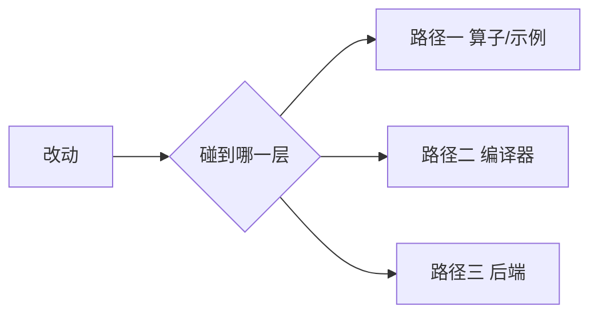
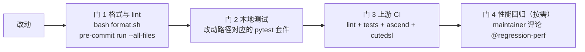

# 第 31 章 贡献指南

## 学习目标

读完本章，你能：

1. 判断自己的改动属于哪条贡献路径——写算子/示例、改编译器、加/改后端——并说出该路径
   在锁定版本仓库里**实际存在**的门禁（测试套件、CI job、脚本），而不是凭印象猜。
2. 描述 TileLang 上游从 issue 到 RFC 到 PR 到 review 到 CI 的完整链路，并指出哪些环节
   有模板、哪些环节没有成文模板。
3. 按 `docs/developer_guide/cpp_style.md` 与 `pyproject.toml` 的规则，写出一个能过
   `format.sh` 与 `pre-commit` 的改动。
4. 说清 `testing/` 的组织方式、CI 会跑哪些套件，以及性能回归如何被检测、由谁触发。
5. 说明昇腾侧两个仓库的分工与差异，并区分「仓库里写明的规则」与「只是观察到的事实」。
6. 按本章的「第一次贡献清单」与「改动自检清单」独立完成并提交一个 PR。

## 前置知识

* 第 29 章（编译器工程：写 pass、测试与回归）：本章的改动自检清单直接对照它列出的
  测试与回归要求。
* 第 30 章（前沿探索）：本章提到那些只在 `main` 上、未进 v0.1.15 的方向时，不再重复
  它们的细节。
* 第 4 章（架构总览）与第 20–26 章（IR、布局、流水、后端、运行时）：理解 pass 顺序与
  后端边界，才看得懂路径二/路径三的评审意见。
* 会用 `git`、`pytest`、`pre-commit`；不需要预先有开源贡献经验。

本章所有关于「仓库里有什么」的判断，都以
[../../VERSIONS.md](../../VERSIONS.md) 锁定的两个版本为准：
TileLang `v0.1.15`（`_vendor/tilelang-v0.1.15/`）与
TileLang-Ascend `TileLang-ascend-v0.1.2.000-release`
（`_vendor/tilelang-ascend-v0.1.2.000/`）。凡是锁定版本里找不到依据的说法，本章会显式
标注「无法确认」。写作环境没有 GPU、没有 NPU，因此本章不给出任何性能数字。

---

## 1. 问题的由来

前面三十章回答的是「怎么用」和「怎么改」。最后这一章回答剩下的问题：
**你改出来的东西，怎么变成上游的一部分？**

这件事值得单独成章，因为它和写代码是两种技能，而且失败点很具体：

* 有人写了一个很漂亮的算子，但它只能在作者自己的机器上跑，进不了 CI 矩阵，
  于是 PR 一直挂着。
* 有人改了流水线的 pass 顺序，效果很好，但没在 `testing/python/transform/` 留下任何
  可回归的用例，维护者没法判断这个顺序以后会不会被别的 PR 改回去。
* 有人在 `tilelang/engine/lower.py` 里加了一个目标分支，让新后端跑起来了——
  而 `tilelang-backend` 这份仓库内指南明确要求把目标分派留在后端包里。

换句话说：**上游接受的不只是「能跑」，而是「能被长期维护、能被别人复核」的改动。**
本章就是把这份隐含契约摊开写成流程。

还有一层背景必须说清楚：TileLang 不是一个仓库，而是**两个**。

| 仓库 | 本地锁定版本 | 角色 |
| --- | --- | --- |
| `tile-ai/tilelang` | `_vendor/tilelang-v0.1.15/` | 主干。所有后端的公共前端、IR、pass 框架、NVIDIA/AMD/Metal/CUDA-后端，以及已经并入的昇腾后端（`tilelang/ascend/`、`src/ascend/`，见 VERSIONS.md） |
| `tile-ai/tilelang-ascend` | `_vendor/tilelang-ascend-v0.1.2.000/` | 昇腾适配器。独立的 `VERSION`、`AGENTS.md`、`CONTRIBUTING.md`、`format.sh`、CI 与 PR 模板 |

向主干提交和向适配器提交，规则不一样。第 7 节专门讲这件事。

---

## 2. 概念与模型：三种路径、四道门

### 2.1 三种路径

把改动按「它碰到了哪一层」分成三类，每一类的典型 PR、需要的测试、评审关注点都不同。

| | 路径一 · 算子/示例 | 路径二 · 编译器 | 路径三 · 后端 |
| --- | --- | --- | --- |
| 你改什么 | 用 TileLang 写一个 kernel | 改 TIR pass、布局推导、codegen 逻辑 | 让一个新芯片/新模式跑起来 |
| 主要落点 | `examples/<op>/` | `src/transform/`、`src/layout/`、`tilelang/<backend>/pipeline.py` | `tilelang/<backend>/`、`src/<backend>/`、`CMakeLists.txt` |
| 典型 PR 大小 | 1 个示例目录 + 1 个测试文件 | 1 个 pass + 1 个测试文件 | 跨 Python 与 C++ 的多文件改动 |
| 需要硬件吗 | 视算子，CI 要在 CUDA/ROCm/Metal 上跑 | 多数能在 IR 层测，不必上卡 | 冒烟必须在目标硬件 |
| 最难的一关 | 证明它在 CI 矩阵里不是只对作者有效 | 证明 pass 顺序与 FFI 契约没被破坏 | 不在 `engine/lower.py` 里开洞 |



完整版图见 [figures/contribution-paths.md](figures/contribution-paths.md)。

### 2.2 为什么不是「三种角色」而是「三种路径」

同一个人会在三条路径之间移动：先写算子摸清行为，再改编译器让它更快，最后发现某个后端
缺原语就去补后端。路径决定的是**审稿人的口味**：

* 审算子 PR 的人关心「数值对不对、覆盖了哪些 shape/dtype、有没有性能口径」；
* 审编译器 PR 的人关心「语义是不是最小改动、IR 契约有没有被隐式改变、测试能不能
  锁住这个行为」；
* 审后端 PR 的人关心「接口边界、别的后端会不会被带崩、打包能不能成立」。

### 2.3 四道门

不管走哪条路径，推送前都有四道门（本地两道、上游两道）：



门的名字和命令我放在后面的具体小节里，每条都能在锁定版本里找到出处。

---

## 3. 上游流程：从 issue 到 CI 的实际形态

这一节按顺序走一遍，并标出每一步在仓库里的**实际文件**。

### 3.1 issue

`.github/ISSUE_TEMPLATE/` 在锁定版本里有四个模板：

| 文件 | 用途 | 必填项 |
| --- | --- | --- |
| `bug-report.yml` | 报 bug | 已读文档、已搜索 issue（复选，必勾）；TileLang 版本；系统信息；问题描述；可复现的最小代码 |
| `feature-request.yml` | 提功能 | 已搜索 issue；Motivation（必填）；Solution / Alternatives 可选 |
| `questions.yml` | 提问 | 已读文档、已搜索 issue；问题描述 |
| `release-plan.yml` | 发布计划 | 版本、里程碑、范围、任务清单、就绪检查 |

`config.yml` 里 `blank_issues_enabled: true`，也就是**允许空白 issue**。所以模板是
「引导」而不是「闸门」：你不填模板也能开 issue，但内容不全的 issue 大概率只会换来
一句「请给最小复现」。

`CONTRIBUTING.md:18-25` 把这条写成规则：

> `Any issue you open must include:` 一个**最小**复现的代码片段，以及清楚的问题说明。

`bug-report.yml` 比 `CONTRIBUTING.md` 更细，它要求你贴出
`python3 -m torch.utils.collect_env` 的输出，并要求用
`python3 -c 'print(__import__("tilelang").__version__)'` 报出版本号。这不是形式主义：
一个没有版本号的 bug 报告，在每天都变的主干上无法复现。

### 3.2 RFC：仓库里没有专门的模板

大改动（改公共语义、换构建基座、加后端）在上游以 **RFC** 的形式先讨论。但要注意两点，
它们都能在仓库里直接验证：

1. `.github/ISSUE_TEMPLATE/` 里**没有** RFC 模板，也没有 RFC 标签的配置文件。
2. 实际的 RFC 是以**普通 issue** 提交的，靠标题前缀 `[RFC]` 或 `[RoadMap]` 识别。
   证据是 corpus 里的快照：`github-issue-2196.md`（TVM 迁移）、
   `github-issue-3178.md`（CUDA cache policy）、`github-issue-2897.md`（reducer 语义）、
   `github-issue-2708.md`（atomic 内存序）都以 issue 形式存在。

因此，「RFC 需要哪些章节」这条**无法确认**——仓库没写。本章第 12 节给出一份从真实
RFC 反推出来的骨架，并在 `code/02-rfc-lint/` 里做成可检查的工具；读者要明白那是
从范例归纳的经验，不是上游的强制要求。

哪些改动值得先写 RFC？从 corpus 里已存在的 RFC 看，共同点是**会改变别人已经写下的
代码的含义**：

* 换掉 vendored 的 TVM（`#2196`）：影响所有人的构建。
* 给 `T.copy` 加新的缓存策略参数（`#3178`）：影响 API 面与 codegen。
* 重新定义 reducer 的所有权语义（`#2897`）：影响现有 kernel 的正确性。
* 定义 atomic 的内存序（`#2708`）：影响正确性推理。

反过来，加一个示例、修一个边界、补一个测试，不需要 RFC。

### 3.3 PR：fork、分支、本地预检

`CONTRIBUTING.md:64-93` 给出主干仓库的标准做法：

```bash
git clone --recurse-submodules git@github.com:<your username>/tilelang.git
cd tilelang
git remote add upstream git@github.com:tile-ai/tilelang.git

uv venv --seed .venv
source .venv/bin/activate
python3 -m pip install --upgrade pip setuptools wheel "build[uv]"
uv pip install --requirements requirements-dev.txt

pre-commit install --install-hooks
```

注意 `--recurse-submodules`：TileLang 依赖 `3rdparty/tvm` 等子模块，漏掉它会在构建阶段
报错。`CONTRIBUTING.md:95-109` 另外给了 editable 安装方式
（`python3 -m pip install --no-build-isolation --verbose --editable .`），以及
用 `PYTHONPATH` 手工工作的方式。

**主干仓库没有 PR 模板。** `.github/` 下只有 `ISSUE_TEMPLATE/`、`dependabot.yml` 和
`workflows/`，没有 `pull_request_template.md`。所以主干 PR 的正文是自由的——
这意味着**你更要自己把「做了什么、为什么、怎么验证的」写清楚**。昇腾仓库反过来，
有一份很长的 PR 模板（第 7 节）。

### 3.4 review 与 CI

`.github/workflows/ci.yml` 在 `pull_request` 的 `opened`、`synchronize`、`reopened`、
`ready_for_review`、`labeled`、`unlabeled` 六种事件上触发（`ci.yml:1-14`），也可以
手动 `workflow_dispatch`。它有三个层级、四个 job：

```text
lint (ubuntu-latest)                        ci.yml:37-76
  ├─ compileall -q -f tilelang             （Python 3.10 AST 检查）
  ├─ audit_cpp_api_style.py --github-warnings --limit 20   （仅告警，不阻断）
  └─ pre-commit run --all-files

tests (matrix)   needs: [lint]              ci.yml:77-441
  ├─ self-hosted + nvidia,  CUDA-auto       → ../examples（排除 grouped_gemm 与 examples/ascend），再跑 ./python
  ├─ self-hosted + amd,     ROCm-7.2        → ./python，再跑 4 个 portable example
  └─ macos-latest,          Metal           → ./python -k metal

ascend           needs: [lint]              ci.yml:442-508
  └─ self-hosted + ascend, USE_ASCEND=ON
       → pytest -n 4 ../examples/ascend
       → pytest -n 32 ascend

cutedsl          needs: [tests]             ci.yml:509-663
  └─ TILELANG_TARGET=cutedsl → ../examples（排除 examples/ascend）
```

几个容易读漏的细节：

* `tests`、`ascend`、`cutedsl` 的 `if` 都带 `github.repository_owner == 'tile-ai'`。
  这是防止 fork 仓库同步代码时白跑自家 self-hosted runner；向 `tile-ai/tilelang`
  提的 PR 满足这个条件，正常会跑。
* `if` 里还有 `!github.event.pull_request.draft`——**草稿 PR 不会跑测试矩阵**。
  所以「CI 没绿」有时只是因为你把它标成了 draft。
* `cutedsl` 的 `needs: [tests]`，只有 NVIDIA 矩阵通过后才会跑。
* Metal 矩阵用的是 `-k metal ./python`，也就是靠 pytest 名字过滤；一个新加的、名字里
  没有 `metal` 的 Metal 测试不会在这个 job 里被执行。

### 3.5 合入之后

`.github/workflows/publish-docs.yml` 在 PR `closed` 且 `merged == true` 且基分支是
`main` 时构建文档（否则需要手动触发）。也就是说**文档构建不在 PR 阶段验证**——
文档改动如果不在本地 `bash maint/scripts/build_docs.sh` 跑一遍，问题可能要到合入
之后才暴露。

---

## 4. 路径一：写算子与示例

### 4.1 典型 PR 长什么样

主干仓库的惯例是「一个算子一个目录」。锁定版本里 `examples/` 有 54 个子目录加 3 个顶层
文件（`conftest.py`、`pytest.ini`、`quickstart.py`，见 VERSIONS.md），例如
`examples/gemm/`、`examples/flash_attention/`、`examples/norm/`。

一个典型 PR 的形状：

```text
examples/<op_name>/
├─ example_<op_name>.py      实现（用 @tilelang.jit）
├─ test_<op_name>.py         正确性测试（pytest 能收集到）
└─ README.md                 可选：口径、限制、如何跑
```

关键点是**目录里必须有 pytest 能收集的测试**。CI 的 examples 步骤是
`pytest ... ../examples`（`ci.yml:366-379`），它收集的是测试函数，不是脚本本身。
只写一个 `example_*.py`、没有 `test_*.py`，这个示例在 CI 里等于不存在。

### 4.2 需要哪些测试

* 正确性：与参考实现（通常是 PyTorch）逐元素比对，给出误差容限。
* 覆盖：至少覆盖算子会遇到的几类 shape 边界（非整除的 M/N/K、单行、尾块）。
* 可移植性：如果用到了 `tilelang.testing.requires_cuda` / `requires_rocm` /
  `requires_metal`，说明这个测试只对某个后端成立。`.agents/skills/tilelang-submit-pr/SKILL.md`
  对此有一条反直觉但重要的提醒：

  > Explicit source-only lowering to a target such as
  > `{"kind": "cuda", "arch": "sm_100a"}` still requires the CUDA backend to be
  > built and registered. Mark it with `requires_cuda` even if no kernel runs.

  也就是说，**「不跑 kernel、只生成源码」的测试同样可能要标 `requires_cuda`**。
  把这类测试不加标记地放进 `testing/python/`，会在 AMD 或 Metal 的 job 上失败。

### 4.3 评审关注什么

1. 你比较的参考实现是谁，误差口径是什么。
2. 新示例是否属于「已经有了同类」；重复造例会被要求合并或说明差异。
3. 是否混进了与算子无关的改动（格式化整仓、改公共 API）。
4. 有没有把私有路径、token、机器名写进代码——`pre-commit` 的
   `detect-private-key`、`check-added-large-files` 只兜住一部分，评审会看。

### 4.4 常见被拒原因

* 没有测试，只有一段能跑的脚本。
* 测试依赖作者本机的路径或数据文件。
* 性能声明没有口径（没有 warmup/rep、没有 baseline、没有 shape）。
* 只在一个 CUDA 架构上验证，却放在通用的 `testing/python/` 下，导致其他矩阵红。

---

## 5. 路径二：改编译器（pass / layout / codegen）

### 5.1 一个 pass 的典型 PR

以锁定版本里真实存在的 `LoopUnswitching` 为例，一个 native pass 的完整改动面是：

```text
src/transform/loop_unswitching.cc           实现 + 注册
tilelang/transform/__init__.py               Python wrapper（LoopUnswitching）
tilelang/<backend>/pipeline.py               把 pass 挂进某条流水线
testing/python/transform/test_tilelang_transform_*.py   回归测试
```

`src/transform/loop_unswitching.cc` 的末尾能看到 native 侧的注册点：

```cpp
TVM_FFI_STATIC_INIT_BLOCK() {
  namespace refl = reflection;
  refl::GlobalDef().def("tl.transform.LoopUnswitching", LoopUnswitching);
}
```

以及 `tilelang/transform/__init__.py` 里对应的一行：

```python
def LoopUnswitching():
    ...
    return _ffi_api.LoopUnswitching()
```

挂进哪条流水线是**架构决策**，不是随手选。以 v0.1.15 为例：

* CUDA 的 pass 顺序在 `tilelang/cuda/pipeline.py`，`PipelinePlanning`（`:129`）→
  `InjectSoftwarePipeline`（`:130`）→ `LayoutInference`（`:134`）→ `LowerTileOp`
  （`:142`）。
* 昇腾的顺序在 `tilelang/ascend/pipeline.py`，`EstimateLatency`（`:108`）→
  `AutoSchedule`（`:109`）→ `PrepareMultiBuffer`（`:111`）→ `InsertSync`（`:113`）→
  `MaterializeMultiBuffer`（`:114`）。

`.agents/skills/tilelang-backend/SKILL.md` 把这条写成硬约束：

> Keep the complete pass order in `tilelang/<backend>/pipeline.py`.
> Keep target dispatch out of `tilelang/engine/lower.py`.

注意：这条规则写在 `tilelang-backend` 这份**仓库内指南**里，不在 `CONTRIBUTING.md` 里。
这也是为什么本章反复说「路径决定审稿人的口味」：主干 PR 没有模板，很多约束只存在于
这类指南和评审习惯中。

### 5.2 需要哪些测试

* 单元测试放 `testing/python/transform/`。目录里已经按 pass/行为分文件，例如
  `test_tilelang_transform_layout_inference.py`、`test_tilelang_transform_thread_sync.py`、
  `test_tilelang_transform_pipeline_planning.py`。
* 测试应当是 **IR 级**的：给一段输入 IR，跑改动的那一个 pass，断言输出 IR 的结构，
  而不是断言打印出来的文本。`testing/ascend/README.md` 把这条说得很直白：
  「Inspect IR nodes instead of matching the IR printer's text.」
* 如果改的是**布局推导**，还有一份专门的黄金用例工具：
  `maint/layout_inference/`。它用带注释的 IR 用例锁定「哪个 layout 胜出」：

  ```bash
  python run.py                # 校验全部用例
  python run.py --case NAME    # 过滤
  python run.py --record       # 用当前行为重写 golden
  python run.py --anchor       # 对照真实向量化宽度
  python run.py --cute         # 对照 CuTe layout 代数
  ```

  它的 README 明确警告：`--record` 不是批准，「Recording is not approval:
  after `--record`, read the diff under `expected/`」。也就是说，改了布局代价模型
  却直接重录 golden，等于把回归锁换成橡皮图章。
* 如果改的是**数学函数或精度相关的 lowering**，`maint/precision/` 里有
  `compare_ops.py` 与 `cuda_ops.cu`，它给出 TileLang、Triton、PyTorch、CUDA 各方
  相对 double 的误差表（在仓库里的 `README.md` 有实测数据）。新增/修改这类实现时，
  误差口径要跟着更新。
* 如果改的是**运行时/适配器的参数校验**，`maint/host_checks/` 有 10 个脚本
  （`01_num_args_mismatch.py` 到 `10_scalar_type_mismatch.py`）加一个 `run_all.py`，
  每个脚本故意触发一种 host 侧报错。改这些错误路径时应当跑 `run_all.py`。

### 5.3 评审关注什么

1. **一个 pass 只做一件事**，测试能锁住这一件事。
2. pass 在流水线里的**位置**有理由，而且不会破坏前后 pass 的前置条件。
3. FFI 可见的名字（`tl.transform.*`、Python 侧导出的函数名、ObjectNode 的反射字段）
   有没有被改动；改了要不要兼容。
4. 有没有把风格清理混进语义改动。`cpp_style.md:341-349` 的迁移政策写得明白：
   「Avoid combining broad formatting changes with behavior changes.」
5. 是否碰了 `3rdparty/`。`cpp_style.md:1-10` 说得很直接：不要对 vendored 代码做
   大范围风格改动。

### 5.4 常见被拒原因

* 顺手把整个文件重新格式化，评审看不出语义改动在哪。
* 改了 FFI 可见字段名却没有兼容说明（`cpp_style.md:115-149`）。
* 把 pass 顺序改了但没有对应测试，维护者无法判断是不是别处依赖了旧顺序。
* 新增 pass 却只在 `tilelang/engine/lower.py` 里按 target 名字分支调用。

---

## 6. 路径三：加/改后端

路径三是三条里门槛最高的。好消息是：锁定版本自带一份非常详细的后端接入清单，
位置是 `.agents/skills/tilelang-backend/`，
其中 `references/integration-checklist.md` 有 378 行，包含 Scope Matrix、
Preflight Decisions、以及从语言方言到打包的 9 个步骤与 Definition of Done。

### 6.1 后端由四块编译器自有的实现区组成

`.agents/skills/tilelang-backend/SKILL.md` 给出的模型是：

```text
Language Dialect
  -> target/BackendContext contribution
  -> PassPipeline
  -> HostCodegen + DeviceCodegen
  -> compatibility contract

BackendContext selects a shared ExecutionBackend
  -> Build -> Load -> Launch
```

先分清三类请求，因为它们的门槛完全不同：

| 类别 | 需要做什么 |
| --- | --- |
| 新目标后端 | 四块实现区 + 声明兼容的执行后端 + 原生构建/打包 + 测试 + 文档 |
| 同 target kind 的变体 | 独立 `BackendModule` + 互斥的 `supports_target` 谓词 + 明确复用/替换了哪些组件 |
| 新执行模式 | 只有当没有任何现成适配器能消费产物时，才实现 Build/JIT/Runtime |

「目标后端」「Python 包名」「TVM target kind」「执行后端名」是四个不同的东西，
指南明确要求**不要把四者混为一谈**。

### 6.2 需要哪些测试

清单里的 Definition of Done 要求按风险分层验证，顺序是：

1. 包导入与 manifest 注册；
2. target 归一化与 `create_backend_context()`；
3. 方言导出与 IR 构造；
4. 完整 pipeline lowering，以及每个后端专有 IR 形式；
5. **source-only codegen**（在无硬件的条件下也要能测）；
6. 生成源码的语法/结构；
7. 通过每条声明的共享执行路径做一次 Build/load/launch 冒烟；
8. 新执行模式才需要 cache/export/autotuning 全覆盖；
9. 不支持的操作与架构要给出明确报错。

落点：后端框架测试在 `testing/python/backend/`（锁定版本有
`test_tilelang_backend_module.py`、`test_tilelang_backend_auto_schedule.py`），
target 测试在 `testing/python/target/`。清单还要求同步更新
`testing/python/backend/test_tilelang_backend_module.py` 里的内建期望。

### 6.3 评审关注什么

* 是不是「照抄 CUDA 后端」。清单有一句原话：
  「Do not begin by copying the CUDA backend wholesale.」
* 有没有把后端专有符号塞进 `tilelang.language.common` 或默认的 CUDA facade。
* 有没有在共享 JIT/cache/export/autotuning 代码里按 target kind 分支；
  正确做法是按 **execution name** 分派。
* 声明执行后端时，是不是真的做过冒烟。清单原话：
  「Do not declare an execution backend merely because its name is already available.」
* 原生源码有没有通过 backend 自己的 CMake 接入；`pyproject.toml` 是自动包含 Python
  包的，但 native source 不会自动生效。

### 6.4 常见被拒原因

* 只让 target 解析成功就宣称「后端完成」。清单明确禁止：
  「Do not report a backend complete when only registration or source generation passes.」
* 在 `tilelang/engine/lower.py` 里加 target 分支（第 5 节已经说过）。
* 一个新 target kind 却忘了让 TVM 先认识它。
* 把不支持的算子静默降级成另一个 target 的实现，而不是在 lowering 阶段报错。

---

## 7. 昇腾侧的特殊流程

### 7.1 适配器仓库与主干是两套规则

锁定版本 `_vendor/tilelang-ascend-v0.1.2.000/` 里的实际情况：

| 项目 | 主干 `tilelang-v0.1.15` | 适配器 `tilelang-ascend-v0.1.2.000` |
| --- | --- | --- |
| `VERSION` | `0.1.15` | `0.1.4`（而 VERSIONS.md 记录 tag 是 `v0.1.2.000-release`，两者不一致） |
| `CONTRIBUTING.md` | 有，且较完整 | 有，但较简略；`♥ help` 链接甚至指向 `ianstormtaylor/TileLang` 而不是 `tile-ai` |
| PR 模板 | **没有** | 有，且很长（70 行，见下） |
| `AGENTS.md` | 有（`.agents/skills/` 索引） | 有，且是中文的完整开发规范 |
| `format.sh` | `pre-commit` 驱动（Ruff + clang-format + codespell + pymarkdown） | YAPF + Ruff + clang-format，并**校验工具版本**必须等于 `requirements-lint.txt` |
| CI 的默认分支 | `main` | PR 工作流指南里写的是 `ascendc_pto` |
| 行宽规范 | C++ `ColumnLimit: 80`（`.clang-format:5`） | Python/C++ 都写「行宽 100」（`AGENTS.md:119-121`） |

最后两行值得单独强调：

* 适配器仓库的 PR 工作流指南（`.agents/skills/tilelang-custom-skill/tilelang-github-operations/pr-workflow-guide.md`）
  给出的默认目标是 **`tile-ai/tilelang-ascend` 的 `ascendc_pto` 分支**，
  而不是 `main`。向适配器提 PR 之前先确认目标分支。
* 两个仓库的行宽不同。在适配器里按 100 列写、回主干时按 `.clang-format` 的 80 列
  格式化，是正常的，不是谁写错了。

### 7.2 昇腾 PR 模板要求什么

`.github/pull_request_template.md` 是本章里信息密度最高的一份文件，它把算子合入标准
写成了可勾选项。要点：

**算子类改动**

* 新增算子在**默认场景**下通过：不显式指定 `target="ascendc"`，PTO 后端完成编译、
  运行和精度验证（`pull_request_template.md:23`）。
* 适用时 AscendC 与 PTO **双后端**都要通过；不支持的 dtype/shape/后端要显式说明，
  **不得静默跳过**（`:24`）。
* 不破坏现有算子、公共接口与已有后端行为（`:25`）。
* `examples/` 下的算子在**未达标时**要迁到 `examples_experiment/`，或取得维护者豁免
  （`:26`）。
* 有 AscendC 参考实现时，TileLang 性能要达到 AscendC 的 **50% 以上**；
  有 GPU 基线时，候选耗时不超过其 **2 倍**（`:27`）。
* 无 AscendC 参考实现时，要对照仓库里的性能反模式清单并记录保留项与原因（`:28`）。
* PR 必须附**精度/性能报告**与典型 shape 的 simulator 结果截图；报告要包含环境、
  shape、baseline、候选结果、单位和复现命令（`:30`）。
* 单个算子的全量测试用例耗时不超过 **2 分钟**；超了就只把核心用例放进 PR 阶段，
  其余用 pytest marker 归入每日/定时任务（`:31`）。

**框架/接口类改动**

* 要在双后端/默认 target 下验证，说明能力边界（`:37`）。
* 新增或更新代表性 ST/UT，覆盖默认 target、关键边界与适用后端（`:41`）。
* 核心回归**不得用 marker 隐藏**；非核心组合标 `low_priority`，由每日全量任务用
  `-m "not ci_skip"` 执行；`ci_skip` 只能用于已有 Issue 的已知不稳定或硬件限制
  （`:43-44`）。
* 新增/迁移的测试要登记到 `ci/operator_test_manifest.yaml`，避免 legacy runner 与
  pytest 重复执行（`:45`）。锁定版本里这个文件确实存在
  （`_vendor/tilelang-ascend-v0.1.2.000/ci/operator_test_manifest.yaml`）。

**提交规范**

* Commit message 用英文，并带类型标签：`[Bugfix]`、`[Feature]`、`[Refactor]`、
  `[CI]`、`[Skills]`、`[Testing]`、`[Example]`（`:51`）。
* 模板顶部的说明要求：**只勾选实际完成的项目**，跳过项要写原因和跟踪 Issue（`:1-5,68-70`）。

这套要求里，「双后端 + 性能报告 + 2 分钟用例预算」是主干 PR 模板完全没有的。

### 7.3 主干侧的昇腾入口

v0.1.15 里 `tilelang/ascend/` 与 `src/ascend/` 已经存在（VERSIONS.md 明确记录），
主干 CI 有独立的 `ascend` job（`ci.yml:442-508`），跑
`pytest -n 4 ../examples/ascend` 与 `pytest -n 32 ascend`。
`testing/ascend/README.md` 还给出了比 CI 更细的本地分工建议：

| 目录 | 契约 |
| --- | --- |
| `analysis` | 昇腾源程序合法性 |
| `transform` | 单个昇腾 IR 变换（before IR → 一个 pass → after IR） |
| `auto_schedule` | 调度、存储所有权、核心放置、同步与复用 |
| `layout` | 分形几何与数值矩阵路径 |
| `runtime`、`target` | 启动 ABI、当前 stream、target/编译器选择 |
| `language` | 前端、生成的 device code、数值行为 |

同一份 README 还给出一条判定规则：**共享行为放 `testing/python`，只有这个 fork 对共享
代码的改动才在 `testing/ascend` 里加共享回归**。这意味着往主干提昇腾改动时，
「这个测试该放哪个目录」本身就是评审会问的问题。

本地复现主干昇腾 CI 的命令是
`bash maint/scripts/run_local_ci_test_ascend.sh`；它默认 4 个 example worker、
32 个 unit-test worker，与 `ci.yml` 里的 `-n 4` / `-n 32` 对得上。

### 7.4 「适配器先行、再回主干」——本章无法确认

本章开头的问题是「昇腾能力怎么进主干」。能观察到的事实是：

* corpus 里有一组以 `[Ascend]` 开头的 PR 快照：`github-pr-3308.md`
  （Ascend 950 backend）、`github-pr-3310.md`（PTO backend for Ascend950）、
  `github-pr-3325.md`（`T.PersistentKernel` + AutoPersistent pass）、
  `github-pr-3320.md`（AutoSimtVF）、`github-pr-3329.md`（agents）。
* 主干已经有 `tilelang/ascend/`、`src/ascend/`、`examples/ascend`、`testing/ascend`
  与独立的 CI job。
* 适配器仓库是独立仓库，有自己的默认分支、版本号、CI 与发布节奏。

但是：**「能力先进适配器验证，再以 `[Ascend]` PR 回主干」这条流程，在两个仓库的
`CONTRIBUTING.md`、`AGENTS.md`、`.github/` 里都没有成文规定。**
我对两个仓库做了针对 `上游`、`upstream`、`回主干`、`merge.*main` 的检索，没有命中
任何流程说明。因此本章把这条标为**无法确认**：它是从 PR 标题模式与两棵树的现状
推断出来的工作方式，不是可以引用的政策。

如果你打算走这条路，稳妥的做法是在 RFC 里把协作方式写成提案，让维护者确认，
而不是假设它已经被规定好了。

---

## 8. 代码规范与格式化工具

### 8.1 C++

`docs/developer_guide/cpp_style.md` 是主干里唯一一份开发者风格指南，
它自己声明以 TVM 的 C++ 惯例为基线，只对 TileLang 特有的地方加规则。

**范围**：只管 `src/` 与 TileLang 自有的头文件；不要对 `3rdparty/` 和生成出来的
runtime 模板做大范围风格改动（`cpp_style.md:1-10`）。

**命名**（`cpp_style.md:32-50` 的表格，原文照抄）：

| 实体 | 风格 | 例子 |
| --- | --- | --- |
| 文件名 | `lower_snake_case` | `lower_tile_op.cc` |
| 命名空间 | `lower_snake_case` | `tvm`、`tl`、`tirx` |
| 类型/类/结构体 | `PascalCase` | `LayoutNode`、`LowerArgs` |
| Object node | `PascalCaseNode` | `GemmNode` |
| Object ref | `PascalCase` | `Gemm`、`Layout` |
| 函数与方法 | `PascalCase` | `MakeLinearLayout`、`InferLayout` |
| 布尔函数 | `Is`/`Has`/`Can` + `PascalCase` | `IsFragmentBuffer` |
| 参数与局部变量 | `lower_snake_case` | `layout_map` |
| 私有/保护成员 | `lower_snake_case_` | `layout_remap_` |
| 常量与枚举值 | `kPascalCase` | `kWarpSize` |
| 宏 | `UPPER_SNAKE_CASE` | `TVM_REGISTER_GLOBAL` |

表格之外还有几条容易踩的：

* **不要用 `T` 当参数名**（`cpp_style.md:150-170`）：`T` 在 Python 侧是 DSL 命名空间，
  在 C++ 里常作模板类型参数。用 `args`、`analyzer` 这类描述性名字。
* TVM 的 handle 类型跨函数边界传递，裸 `*Node` 指针只在 visitor 回调、模式匹配和
  `CopyOnWrite()` 处出现；身份比较用 `.same_as()`，不要用 `handle.get() == other.get()`，
  结构比较用 `StructuralEqual`（`:72-114`）。
* 公开头文件里不要 `using namespace`；实现文件可以按需局部引入（`:171-259`）。
* 错误处理：编译器不变量用 `ICHECK` / `LOG(FATAL)`，用户程序可能触发的错误单独走
  validation 错误路径（`:280-295`）。

**格式化**：`.clang-format` 的实际配置是 `BasedOnStyle: LLVM`、`IndentWidth: 2`、
`ColumnLimit: 80`、`Standard: c++17`。

**审计工具**：`python3 maint/scripts/audit_cpp_api_style.py`。`cpp_style.md:309-330`
强调它是**评审辅助**而不是一键重命名器；CI 的 lint job 以
`--github-warnings --limit 20` 运行，**仅告警、不阻断**。

### 8.2 Python

`pyproject.toml` 里 `[tool.ruff]` 的配置（`:176-201`）：

* `target-version = "py310"`、`line-length = 140`。
* 格式：双引号、空格缩进、保留魔法尾逗号。
* lint 选中的规则族：`E`、`W`（pycodestyle）、`F`（Pyflakes）、`UP`、`FA`（pyupgrade）、
  `B`（bugbear）、`SIM`（simplify）；`isort`（`I`）被注释掉了。
* 忽略项包括 `E402`、`F405/F403`、`E741`、`E501`、`SIM108/118/115`、`B019`、`B905`、
  `E902`（`:215-236`）。
* `testing/**.py` 与 `examples/**.py` 额外忽略 `UP`、`FA`（`:194-198`），
  原因是这两个目录不要求升级类型注解（注释里指向 issue #1079）。

### 8.3 `format.sh` 与 pre-commit

主干 `CONTRIBUTING.md:40-62` 给出的规则是：

```bash
bash format.sh --files <changed-file>...   # 只格式化为 PR 触及的文件
bash format.sh                              # 相对 merge-base 的全部改动
bash format.sh --all                        # 全仓
```

`format.sh` 本身不做风格判断，它把工作交给 `pre-commit`，并在最后检查工作区是否有
未提交的改动——如果有，说明「格式化器改过你的文件」，脚本会退出 1，
要求你 review 并 stage。这是一个很好的自检信号：**format.sh 退出 1 并不代表你写错了，
而是代表你有未纳入提交的格式化结果。**

`.pre-commit-config.yaml` 装的钩子决定「什么算过」：

| 钩子 | 作用 |
| --- | --- |
| `check-added-large-files`、`check-merge-conflict`、`check-yaml`、`check-toml`、`check-ast`、`debug-statements` | 结构性检查 |
| `detect-private-key`、`check-executables-have-shebangs` | 安全/可执行位 |
| `clang-format` | C/C++ |
| `ruff-check` + `ruff-format` | Python |
| `codespell` | 拼写（排除 C++/C 源码与 SVG） |
| `pymarkdown` | Markdown（`--config .pymarkdown fix`，排除 `.agents/`） |

`CONTRIBUTING.md:111-117` 给出的等价命令是 `pre-commit run --all-files`。
另外 `.github/workflows/pr-reminder-bot.yml` 会在每个新 PR 打开时自动留言提醒跑
`pre-commit run --all-files`——如果 CI 的 lint job 红了，先看这条留言。

### 8.4 一个需要留意的版本漂移

锁定版本里存在一处版本不一致，值得记下来，避免你照着一个数字装错了工具：

| 工具 | `.pre-commit-config.yaml` 里的 rev | `requirements-lint.txt` 里的 pin |
| --- | --- | --- |
| clang-format | `v23.1.0`（注释写 “sync with requirements-lint.txt”） | `21.1.8` |
| ruff | `v0.16.6`（注释写 “sync with requirements-lint.txt”） | `0.14.14` |
| codespell | `v2.4.3`（注释写 “sync with requirements-lint.txt”） | `2.4.1` |

三行注释都声称与 `requirements-lint.txt` 同步，但实际数字不同。本章的判断是：
**以 `.pre-commit-config.yaml` 的 rev 为准**，因为 `pre-commit` 会按 rev 自己拉工具；
`requirements-lint.txt` 更可能是本地手工安装清单。两处不一致是不是有意为之，
仓库里没有说明，这一点**无法确认**。

---

## 9. 测试与基准的强制要求

### 9.1 `testing/` 的组织

锁定版本 `v0.1.15` 的 `testing/` 结构是：

```text
testing/
├─ conftest.py        全局 fixture：固定随机种子、把仓库根塞进 sys.path、
│                     配置 TORCH_EXTENSIONS_DIR、注册 --run-perf 选项
├─ cpp/               空目录（v0.1.15 下没有任何文件）
├─ ascend/            昇腾专属：analysis / auto_schedule / cache / language /
│                     layout / runtime / target / transform
└─ python/            主体：按主题分目录，见下表
```

`testing/python/` 下与三条贡献路径最相关的目录：

| 目录 | 你在什么时候改它 |
| --- | --- |
| `kernel/` | 算子级测试（例如 `test_tilelang_kernel_gemm.py`） |
| `transform/` | 改 TIR pass |
| `layout/`、`layout_inference` 相关 | 改布局推导 |
| `backend/` | 改后端框架/manifest |
| `target/` | 改 target 解析、codegen 的 target 特性 |
| `language/` | 改前端语义 |
| `jit/`、`runtime/`、`cache/` | 改运行时、ABI、缓存 |
| `quantize/`、`math/`、`arith/` | 数值相关 |
| `contrib/` | 编译器工具链适配（例如 `cc.cross_compiler`） |
| `issue/` | 针对具体 issue 的回归 |

一个值得注意的观察：`testing/cpp/` 是空的。也就是说，C++ 侧的行为在 v0.1.15 里主要
**通过 Python 驱动的 IR 测试**来验证，而不是 C++ 单测框架。

### 9.2 CI 会跑什么

回到 §3.4 的四个 job。对贡献者最实际的三条结论：

1. **`../examples` 和 `./python` 是两件事**。CI 先跑 `examples`（真实 kernel，需要
   硬件），再跑 `testing/python`（较多是 IR/单元级）。你在本地也可以用
   `bash maint/scripts/run_local_ci_test.sh`（默认 CUDA）或加 `--device cpu|hip|metal`
   复现。
2. **测试的可移植性由 marker 决定，不由目录决定**。`tilelang/testing/__init__.py`
   从 TVM re-export 了 `requires_cuda`、`requires_rocm`、`requires_metal`、`requires_llvm`，
   并定义了 `requires_cdna`、`requires_cuda_or_cdna`、`requires_gfx950`、
   `requires_cuda_compute_version*`。`pyproject.toml:238-255` 注册了 `cuda`、`rocm`、
   `metal`、`llvm`、`cpu`、`gpu`、`multi_gpu`、`perf`、`slow` 这些 marker。
3. **性能测试默认被跳过**。`testing/conftest.py` 提供 `--run-perf`，不加这个开关时
   `perf` 标记的测试会被 skip（理由文本：performance test skipped by default）。

### 9.3 性能回归如何被检测

这是本章最「硬」的一段，因为锁定版本里有一条完整、可复核的机制。

**触发方式：维护者手动评论。**
`.github/workflows/pr-regression-test-bot.yml` 监听 `issue_comment`，只有当评论正文
包含 `@regression-perf`、且评论者权限是 `admin` / `maintain` / `write` 时才继续
（`:34-56`）。**外部贡献者不能自己触发它**——你只能请求维护者跑。

**它做什么。**

* checkout `refs/pull/<n>/merge`（`:76`），在 `new` venv 里装 PR 头；
* 切到 `main`，在 `old` venv 里装基线；
* 运行 `maint/scripts/test_perf_regression.py`（`:283`），把结果整理成 Markdown 与
  PNG，作为 PR 评论回帖（`:320`）。

**阈值逻辑有实测依据。** `maint/scripts/test_perf_regression.py:20-29` 的注释记录了
策略的来源与校准过程：

```text
# Fail the run only when at least MIN_COUNT benchmarks drop below THRESHOLD.
# Calibrated on the 33 bot reports posted to PRs up to #3176 (1901 samples):
# 20 reports are clean, 6 (all on PR #2464) show a real regression with 14-23
# benchmarks collapsing at once, and 7 carry exactly one outlier as low as 0.044
# while every other benchmark sits at 1.000. Requiring two simultaneous drops
# separates those cases exactly -- 6/6 real regressions caught, 0 false alarms --
# for any threshold in 0.80..0.95.

THRESHOLD = float(os.environ.get("PERF_REGRESSION_THRESHOLD", "0.90"))
MIN_COUNT = int(os.environ.get("PERF_REGRESSION_MIN_COUNT", "2"))
```

用人话说：**单个 benchmark 的噪声不算回归；至少两个 benchmark 同时掉破 0.90 才算。**
这条规则是在 33 份真实 bot 报告、1901 个样本上校准出来的，其中 6 例真回归、
7 例单点离群，用「两个同时下降」正好区分开（6/6 抓到、0 误报）。

**本地也有等价脚本。** `maint/scripts/run_perf_regression.sh` 用 `git worktree` 拉一份
基线、分别给当前 checkout 与基线建 venv 和 wheel，再跑
`run_current_regression.py` 与 `compare_perf_regression.py`。
它的开关包括 `FAIL_ON_REGRESSION`、`REGRESSION_THRESHOLD`、`FAIL_ON_ERROR`、
`FAIL_ON_MISSING`、`NO_CACHE`、`REFRESH`。

**一个诚实的观察**：`run_perf_regression.sh:66-67` 的默认值
（`FAIL_ON_REGRESSION=0`、`REGRESSION_THRESHOLD=1.0`）与
`test_perf_regression.py` 的默认值（阈值 0.90、至少 2 个）不一致。前者是通用本地脚本，
默认不因回归失败（退出码不红），阈值 1.0 表示「任何变慢都算」；后者是 PR bot 用的
判定器，默认更宽松。写这类脚本时不要只看默认值，要显式传参。

**口径来自哪里。** corpus 里的 `../tilelang-corpus/12-operator-libraries/raw/tilelang-benchmark/`
是已归档的官方 benchmark 仓库快照（README 顶部写明 “Archived, please checkout TileOps”）。
它按架构分目录（`hopper_benchmark/`、`ampere_benchmark/`、`ada_benchmark/`、
`cdna_benchmark/`），每类再按算子分（`dense_matmul/`、`flashattention/`、
`dequantize_matmul/` 等），README 里给出三张 shape 表（GEMM 的 V0–V7 / M0–M7、
FlashAttention 的 FA0–FA4、Linear Attention 的 CC0–CC5 / CT0–CT5）。
**注意它的状态**：这是归档的基准仓库，不是主干的 CI 基准；主干的回归口径是
`run_current_regression.py` 扫 `examples/` 下带回归标记的用例。

**昇腾侧的回归多一个难点。** `maint/scripts/ascend_perf_regression.py` 的文档字符串
解释了为什么它要自己起一个常驻 worker：很多昇腾示例在基线版本上会**硬崩**
（C++ `LOG(FATAL)`/abort、NPU/bisheng 崩溃、import 期失败、挂死），
Python 的 `try/except` 抓不住。它一个进程一个进程地送用例，worker 崩了就保留已完成的
结果、重启 worker、继续下一条。这段逻辑被刻意留在昇腾专属的维护脚本里，
共享的 CUDA 回归模块保持不变。

### 9.4 昇腾的性能门槛

主干没有把性能门槛写进 CI；昇腾适配器的 PR 模板写了三条硬数字（`pull_request_template.md:27-31`）：

* 有 AscendC 参考实现 → TileLang 性能 ≥ AscendC 的 50%；
* 有 GPU 基线 → 候选耗时 ≤ 2 倍；
* 单个算子全量测试 ≤ 2 分钟，超时用 marker 分流。

这三条是**适配器仓库的 PR 模板**，不是主干的 CI 断言。本章把它引用出来，是因为它
直接回答「性能回归如何被检测」这个问题在昇腾侧的那一半。

---

## 10. 第一次贡献：可执行清单

下面这份清单假设你要向主干 `tile-ai/tilelang` 提交一个改动。每条都能独立执行。

**Step 0 · 选一个起点**

`CONTRIBUTING.md:33` 指出：待解决的 issue 带
[`♥ help`](https://github.com/tile-ai/tilelang/issues?q=is%3Aissue+is%3Aopen+label%3A%22%E2%99%A5+help%22)
标签。先在这些 issue 里挑，比自己在 `main` 上找改动更容易被接受。

**Step 1 · 复现并记录版本**

```bash
python3 -c 'print(__import__("tilelang").__version__)'
python3 -m torch.utils.collect_env
```

**Step 2 · 建开发环境**

```bash
git clone --recurse-submodules git@github.com:<you>/tilelang.git
cd tilelang
git remote add upstream git@github.com:tile-ai/tilelang.git
uv venv --seed .venv && source .venv/bin/activate
python3 -m pip install --upgrade pip setuptools wheel "build[uv]"
uv pip install --requirements requirements-dev.txt
pre-commit install --install-hooks
```

（对应 `CONTRIBUTING.md:64-93`。）

**Step 3 · 装 editable 版本**

```bash
python3 -m pip install --no-build-isolation --verbose --editable .
```

（对应 `CONTRIBUTING.md:95-109`。）

**Step 4 · 先写测试，再写实现**

按第 4/5/6 节确定测试应该落在哪里，并确认它需要哪些 `requires_*` 标记。
新示例必须有 pytest 能收集的测试函数，否则 CI 的 examples 步骤不会跑它。

**Step 5 · 判定改动路径**

```bash
cd chapters/31-contributing/code/01-pr-scope-linter
git -C <repo> diff --name-only origin/main...HEAD | python3 pr_scope_linter.py -
```

它会把你的路径映射到第 4/5/6 节的门禁集合。

**Step 6 · 跑本地格式与 lint**

```bash
bash format.sh
pre-commit run --all-files
```

`format.sh` 如果因为「格式化后工作区变脏」而退出 1，就 review 并 stage 那些改动，
再跑一次。

**Step 7 · 跑对应套件**

```bash
python3 -m pytest testing             # CONTRIBUTING.md:119-127 给出的总入口
bash maint/scripts/run_local_ci_test.sh            # 更接近 CI 的 CUDA 路径
bash maint/scripts/run_local_ci_test_ascend.sh     # 昇腾路径
```

**Step 8 · 如果需要，做一次基准对比**

```bash
bash maint/scripts/run_perf_regression.sh
```

如果这一步在你机器上跑不了（没有卡），在 PR 里明确写出来，并向维护者请求
`@regression-perf`。

**Step 9 · 写 PR 描述**

主干没有模板，所以按下面四段写：

```text
What changed:   一句话 + 一句 why
Related:        Closes #<issue> / Related #<issue>
How verified:   实际跑过的命令与结果（没跑的写清楚为什么没跑）
Risk / limits:  已知的边界、未覆盖的 shape、需要 maintainer 触发的东西
```

`.agents/skills/tilelang-submit-pr/SKILL.md` 给了一条很重要的表达纪律：

> Report unrelated or environment-specific containing-suite failures separately
> instead of claiming that the whole suite passed.

也就是说：**只报你真正跑过的**，别把「整个套件通过」写成结论。

**Step 10 · 处理 review**

昇腾模板里那句提醒对两个仓库都适用：
「对检视意见逐条回复；需要修改时完成修改，并重新运行相关检查和用例。」
（`pull_request_template.md:56`）

---

## 11. 改动自检清单

对照第 29 章的测试与回归要求，把这份清单当作 push 前的最后一关。
`code/03-checklist-gate/` 可以自动检查「跳过项有没有写原因」。

**通用**

- [ ] 改动只做一件事；没有混入无关的格式化或重命名。
- [ ] `bash format.sh` 通过，工作区干净。
- [ ] `pre-commit run --all-files` 通过。
- [ ] 新增/修改的测试带正确的 `requires_*` 标记；没有把 backend 专属测试放进通用目录。
- [ ] FFI 可见的名字（`tl.transform.*`、导出的 Python 函数名、ObjectNode 反射字段）
      若被改动，已在 PR 里说明兼容性。
- [ ] PR 描述里只有实际跑过的验证。

**路径一 · 算子/示例**

- [ ] 目录是 `examples/<op>/`，有自己的测试文件，pytest 能收集到。
- [ ] 正确性对照的参考实现、误差容限、shape 列表都写在测试或 PR 里。
- [ ] 没有私有机路径/token/机器名。

**路径二 · 编译器**

- [ ] pass 实现、Python wrapper、pipeline 挂载三处都改到了。
- [ ] 测试在 `testing/python/transform/`（或对应目录），断言的是 IR 结构。
- [ ] 布局改动跑过 `maint/layout_inference/run.py`；`--record` 的 diff 逐条看过。
- [ ] pass 顺位的改动有测试支撑，且没有在 `tilelang/engine/lower.py` 里加 target 分支。

**路径三 · 后端**

- [ ] 对照 `integration-checklist.md` 的 Scope Matrix，确认走的是哪一类。
- [ ] manifest 满足 `BackendModule` 的全部校验项（pipeline/device_codegen 数量、
      pipeline 名等于 target kind、至少声明一个执行后端等）。
- [ ] 同 target kind 的变体有互斥的 `supports_target` 谓词与变体解析测试。
- [ ] source-only codegen 在无硬件时可测；有硬件的冒烟真的跑过。
- [ ] backend 专有符号没有进 `tilelang.language.common`。
- [ ] native source 已通过 backend 自己的 `CMakeLists.txt` 接入；`pyproject.toml`
      需要时已更新。

**昇腾改动额外**

- [ ] 按适配器 PR 模板逐项核对：默认 target、双后端、性能报告、2 分钟用例预算、
      `ci/operator_test_manifest.yaml` 登记。
- [ ] 明确目标仓库与目标分支（适配器的默认分支是 `ascendc_pto`，不是 `main`）。

---

## 12. 社区与沟通

### 12.1 issue 模板已经替你写好了一半

开 bug 时用 `bug-report.yml`，把下面四项填满，基本不会被要求补料：

1. 版本（`python3 -c 'print(__import__("tilelang").__version__)'`）；
2. 系统信息（安装方式、Python 版本、`torch.utils.collect_env`）；
3. 问题描述（期望 vs 实际）；
4. 最小可复现代码 + traceback。

提功能时用 `feature-request.yml`。它的 `Motivation` 是**必填**，`Solution` 和
`Alternatives` 是可选的。很多人反过来写：方案写一大堆，动机只有一句。
评审者先想知道的是「现在谁被卡住了」。

### 12.2 一个能被接受的 RFC 长什么样

仓库没有 RFC 模板，所以本章从 corpus 里的真实 RFC 反推结构。
以 `github-issue-2196.md`（从 forked TVM 迁移到 apache/tvm + tvm-ffi）为例，它的可取之处是：

1. **先给结论，再给路径**。开头就说清「我们有一个可构建的下游分支，
   想确认上游 fork 是长期策略还是历史遗留」。
2. **把问题重新定义成一个可回答的问题**。它没有停在「我想换 TVM」，
   而是把它转成：「tilelang_main 上的改动能不能被上游化、搬进 tilelang、
   或者被新 apache/tvm 变得不必要？」
3. **给可核验的事实**。逐条列出 `tile-ai/tilelang` → `TileLang/tvm` 的子模块指向、
   commit 哈希、日期、分支名，并说明 `main` 是冻结的、真正承载改动的是
   `tilelang_main`。
4. **主动降低对方的决策成本**。明确说「即使大方向不采纳，我们也可以把迁移中发现的
   修复拆成小 PR 先提」。

`github-issue-3178.md`（CUDA cache policy）是另一个范式，它把一篇 RFC 写成了
可评审的规格：

* 先区分「已有能力」与「缺失能力」：明确说现有 `eviction_policy` 是 TMA 的 L2 优先级，
  不是普通 global load/store 的 cache operator；
* 给出**完整的状态枚举**：load 是 `.ca/.cg/.cs/.lu/.cv`，store 是
  `.wb/.cg/.cs/.wt`；
* 给出拟议签名：

  ```python
  T.copy(
      src,
      dst,
      load_cache_policy="cg",
      store_cache_policy="wt",
      prefer_instruction="sync",
  )
  ```

* 写明非目标（不改 TMA eviction 语义、不自动推断策略、不改内存一致性语义）；
* 写明失败行为：「A requested policy must never be silently ignored.」

反过来，**反例的特征**也很清楚：

* 只描述方案、不描述当前行为，评审者要自己去读代码才知道你在改什么；
* 声称「这会让编译器更快」，但没有任何可复现的口径或证据；
* 不给非目标，讨论范围无限扩张；
* 不给兼容性与回退方式，维护者无法判断风险；
* 把「能不能做」和「该不该做」混在一起，讨论无法收敛。

`code/02-rfc-lint/` 把这些章节做成可检查项。

### 12.3 礼貌与信息密度

主干仓库有一份 Contributor Covenant 行为准则（`_vendor/tilelang-v0.1.15/CODE_OF_CONDUCT.md`）；
锁定版本里的**昇腾适配器仓库没有 `CODE_OF_CONDUCT.md`**，所以「两个仓库遵循同一套
行为准则」这一点无法确认。无论遵循哪份文本，技术讨论都可以归结为三条可操作的习惯：

1. **先给证据，再给判断。** 说「在我这里 `pytest testing/python/transform/test_x.py -x`
   失败，traceback 如下」，比说「这个 pass 有 bug」有用得多。
2. **区分事实、推断、建议。** 昇腾仓库的 `AGENTS.md:63-77` 把这条写成了开发原则：
   「未验证的结果，不得表述为『已完成』或『已通过』」「若当前环境无法完成验证，
   必须明确说明验证缺口」。
3. **对评审意见逐条回复。** 不是「已改」，而是「第 3 条我改成 X，理由是 Y」。

信息密度的最低标准可以概括成一句话：**每条评论都应能让对方少问一个问题。**

---

## 13. 本章小结

* 贡献分三条路径：写算子/示例、改编译器、加/改后端。路径决定了审稿人看什么，
  也决定了你要跑哪些套件。
* 上游流程是 issue →（大改动）RFC → PR → review → CI。`.github/ISSUE_TEMPLATE/`
  有 bug / feature / question / release-plan 四个模板，**没有 RFC 模板**；
  **主干没有 PR 模板**，昇腾适配器有且很长。
* CI 分四个 job：`lint`（Python 3.10 AST + C++ 风格审计仅告警 + pre-commit）、
  `tests`（NVIDIA CUDA + AMD ROCm + macOS Metal 矩阵）、`ascend`（独立自托管
  runner）、`cutedsl`（依赖 `tests`）。草稿 PR 不跑测试。
* 代码规范：C++ 看 `docs/developer_guide/cpp_style.md` 与 `.clang-format`
  （LLVM、缩进 2、列宽 80）；Python 看 `pyproject.toml` 的 Ruff 配置（py310、
  列宽 140、双引号）。`bash format.sh` 是唯一的格式化入口。
* 测试组织：`testing/python/` 按主题分目录，`testing/ascend/` 按 pass/行为边界分目录，
  `testing/cpp/` 在 v0.1.15 是空的。可移植性由 `requires_cuda` / `requires_rocm` /
  `requires_metal` 等标记决定。
* 性能回归：由 maintainer 评论 `@regression-perf` 触发
  `pr-regression-test-bot`，判定规则是「至少 2 个 benchmark 同时掉破 0.90」，
  这条规则在 33 份真实报告上校准过。昇腾侧另有 50% / 2× / 2 分钟三条 PR 模板要求。
* 昇腾侧是两个仓库：适配器默认分支 `ascendc_pto`，主干有 `tilelang/ascend/`、
  `src/ascend/` 与独立的 `ascend` CI job。「适配器先行、再以 `[Ascend]` PR 回主干」
  这条流程**在两个仓库里都没有成文规定**，本章标为无法确认。
* 最后一条，也是最像本书封面那句话的一条：**上游接受的是「可被复核、可被长期维护」
  的改动，而不是「在我机器上能跑」的改动。**

## 延伸阅读

* 三种贡献路径的完整图与对照表：`figures/contribution-paths.md`
* issue → RFC → PR → CI 的流程图：`figures/upstream-flow.md`
* 两棵树的协作图（含「无法确认」说明）：`figures/two-tree-collaboration.md`
* 可执行工具：`code/01-pr-scope-linter/`、`code/02-rfc-lint/`、
  `code/03-checklist-gate/`
* 引用清单与核验状态：`references.md`
* 习题：`exercises.md`；参考答案：`solutions.md`
