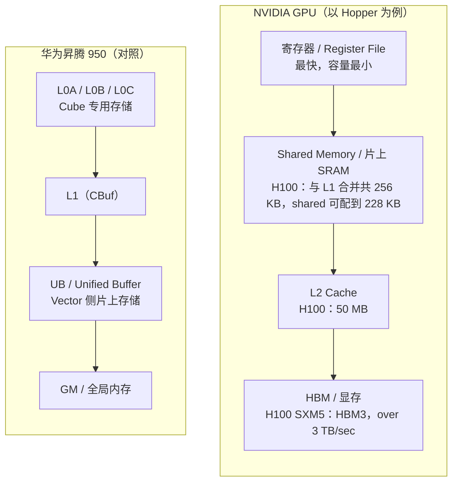

# 图 1：存储层级对照（NV GPU vs 昇腾 NPU）

对应正文第 2.1 节。要点：越靠近计算单元，容量越小、延迟越低、带宽越高；两台机器的层级
**不是一一对应**的。



ASCII 版本（便于在不支持 Mermaid 的环境里读）：

```text
NVIDIA GPU                                       昇腾 950
┌───────────────────────┐                        ┌───────────────────────┐
│ 寄存器                │                        │ L0A / L0B / L0C       │
│  ↓                    │                        │  ↓                    │
│ Shared Memory (+L1)   │                        │ L1 (CBuf)             │
│  ↓                    │                        │  ↓                    │
│ L2 Cache              │                        │ UB (Unified Buffer)   │
│  ↓                    │                        │  ↓                    │
│ HBM / 显存            │                        │ GM / 全局内存         │
└───────────────────────┘                        └───────────────────────┘
   越往下：越大、越慢、越便宜                        越往下：越大、越慢、越便宜

注意：两边不是一一对应的——L0A/L0B/L0C 在 NV 侧没有同名对应物，
      NV 的 shared memory 在昇腾侧要拆成 L1 与 UB 两种角色。
```

## 来源

* NV 侧的层级与容量：`../tilelang-corpus/05-nvidia-backend/raw/nvidia-cuda-c-programming-guide.md`
  与 `../tilelang-corpus/05-nvidia-backend/raw/nvidia-blog-hopper-architecture-in-depth.md`
  （H100 厂商公开资料：256 KB shared+L1、shared 可配到 228 KB、50 MB L2、“over 3 TB/sec”）。
* 昇腾侧的层级：`../tilelang-corpus/09-zhihu-da-zhi-ruo-yu/raw/zhihu-dazhiruoyu-deepseek-ascend.md`
  （**社区一手文章，非厂商官方文档**）与
  `_vendor/tilelang-v0.1.15/tilelang/ascend/README.md:134-139`。
* 两台机器的完整抽象对照见第 6 章。
