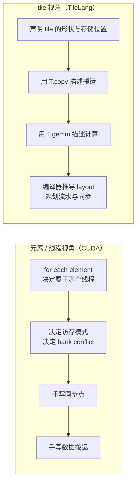

# 图 2：元素/线程视角 vs tile 视角

对应正文第 2.4 节。



ASCII 版本：

```text
元素/线程视角（CUDA）                tile 视角（TileLang）
  元素 → 属于哪个线程                    tile 的形状 + 存储位置
       ↓                                      ↓
  访存模式 / bank conflict               T.copy 描述搬运
       ↓                                      ↓
  手写同步点                             T.gemm 描述计算
       ↓                                      ↓
  手写数据搬运                     编译器推导 layout / 流水 / 同步
```

## 来源

* 「tile 可以被某个并行单元拥有和操作」的定义：
  `../tilelang-corpus/01-tilelang-official-docs/raw/site/_sources/get_started/overview.md`。
* CUDA 侧的管理对象清单：`../tilelang-corpus/05-nvidia-backend/raw/nvidia-cuda-c-programming-guide.md`
  与 `../tilelang-corpus/05-nvidia-backend/raw/nvidia-cuda-best-practices.md`。
