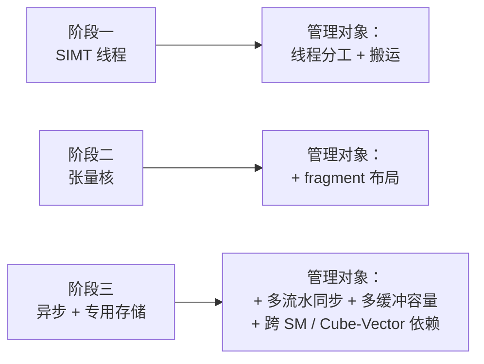

# 图 3：硬件三阶段与“必须人工管理的资源”的增长

对应正文第 4.2 节。



时间线版本：

```text
SIMT           张量核                异步搬运 + 专用存储
(Volta 之前)   (Volta 起)            (Hopper / Blackwell；昇腾 950)
   │              │                        │
   │  新增：       │  新增：                 │  新增：
   │  线程分工     │  fragment 布局          │  多流水同步协议
   │  片上搬运     │  矩阵指令约束            │  多缓冲容量约束
   │              │                        │  跨核/跨 SM 依赖
   ▼              ▼                        ▼
 人管 2 类资源    人管 3 类资源            人管 5+ 类资源（互相约束 → 组合爆炸）
```

## 来源

* NV 侧：“NVIDIA H100 is the first truly asynchronous GPU.”、TMA、thread block cluster、
  distributed shared memory ，`../tilelang-corpus/05-nvidia-backend/raw/nvidia-blog-hopper-architecture-in-depth.md`
  （H100，厂商公开资料）。
* 昇腾侧：Cube/AIC 与 Vector/AIV 的分工、L1/L0A/L0B/L0C/UB 的角色、MTE 流水与 Set/Wait ，
  `../tilelang-corpus/09-zhihu-da-zhi-ruo-yu/raw/zhihu-dazhiruoyu-deepseek-ascend.md`
  （**社区一手文章，非厂商官方文档**）。
* 编译器为昇腾接管的同步与调度：`_vendor/tilelang-v0.1.15/tilelang/ascend/pipeline.py:108-114`
  与 `_vendor/tilelang-v0.1.15/tilelang/ascend/README.md:144-152`。
