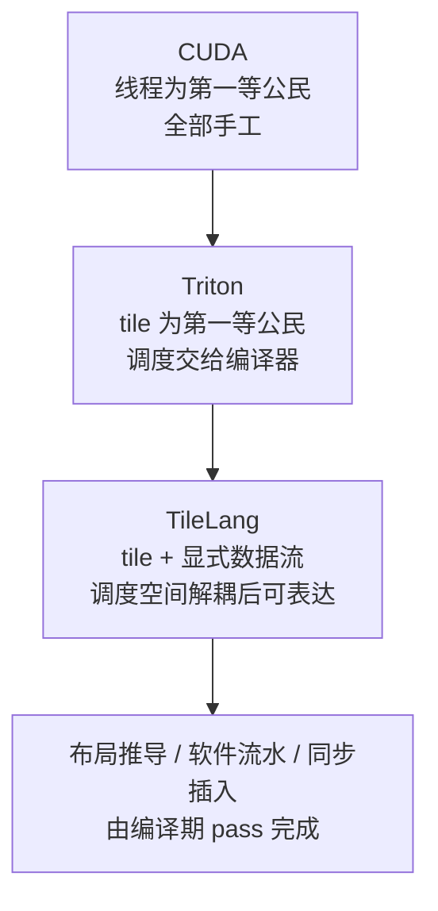

# 图 4：CUDA / Triton / TileLang 的信息分工演进

对应正文第 4.5 节。



分工对照表：

```text
                 人负责                          编译器负责
CUDA      线程分工 / 搬运 / 布局 / 同步 / 流水      指令选择 / 寄存器分配
Triton    tile 级算法与索引                        tile 内部布局 / 线程分配 / 调度
TileLang  数据流 + 资源信息（放哪、怎么流）          布局推导 / 流水 / 同步 / 多缓冲
```

## 来源

* Triton 的取舍（含原论文自述的代价）：
  `../tilelang-corpus/11-related-compilers/raw/triton-mapl-2019.md`，第 3 页。
* TileLang 的解耦声明：
  `../tilelang-corpus/03-tilelang-papers/raw/arxiv-2504-17577.md`（摘要）。
* 三层接口（含 beginner 层“not yet fully implemented”）：
  `../tilelang-corpus/01-tilelang-official-docs/raw/site/_sources/get_started/overview.md`。
* 编译期实际执行的 pass 位置：
  `_vendor/tilelang-v0.1.15/tilelang/cuda/pipeline.py:104-196`（NV）、
  `_vendor/tilelang-v0.1.15/tilelang/ascend/pipeline.py:108-114`（昇腾）。
