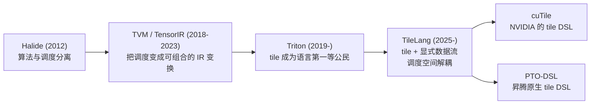

# 图 5：tile DSL 谱系

对应正文第 5.1 节。



ASCII 版本：

```text
Halide ──► TVM / TensorIR ──► Triton ──► TileLang ──┬──► cuTile   (NVIDIA)
算法/调度    调度 = 可组合 IR   tile 成为     tile +    │
分离         变换 + 自动搜索    语言原语      显式数据流 └──► PTO-DSL (昇腾)
```

一代的关键取舍：

| 节点 | 关键贡献 | 留下了什么 |
| --- | --- | --- |
| Halide | 把“算什么”与“怎么排”分开写 | 调度仍是人写的，且面向图像/数组处理 |
| TVM / TensorIR | 调度成为可组合、可搜索的 IR 变换；成为 TileLang 的 IR 基础 | 需要使用者理解 IR 与调度原语 |
| Triton | tile 成为语言第一等公民，编译器接管 tile 内部调度 | tile 与调度绑定，硬件资源信息无法显式表达 |
| TileLang | tile + 显式数据流；把调度空间从数据流里解耦 | 需要更多显式决策；抽象仍在快速演化 |
| cuTile / PTO-DSL | 把 tile 抽象带到各家硬件，使其成为跨厂商概念 | 两条线各自演进，生态尚未统一 |

## 来源与核验状态

| 节点 | 来源 | 核验状态 |
| --- | --- | --- |
| Halide | `../tilelang-corpus/11-related-compilers/raw/halide-docs.md`（halide-lang.org，抓取 2026-09-30） | 已核验 |
| TVM | `../tilelang-corpus/04-language-and-ir/raw/arxiv-1802-04799.md`（OSDI 2018，摘要） | 已核验 |
| TensorIR | `../tilelang-corpus/04-language-and-ir/raw/arxiv-2207-04296.md`（ASPLOS 2023，摘要） | 已核验 |
| Triton | `../tilelang-corpus/11-related-compilers/raw/triton-mapl-2019.md`（MAPL 2019，全文） | 已核验 |
| TileLang | `../tilelang-corpus/03-tilelang-papers/raw/arxiv-2504-17577.md`（摘要） | 已核验；**正文不在 corpus，建议补料，见 `../references.md` 的“待补资料”** |
| cuTile | 无一手资料；仅见 PTO-DSL README 的间接提及（`../tilelang-corpus/06-huawei-ascend/raw/github-huawei-csl-pto-dsl.md`） | **未核验**；corpus 缺 NVIDIA cuTile 官方资料 |
| PTO-DSL | `../tilelang-corpus/06-huawei-ascend/raw/github-huawei-csl-pto-dsl.md`（GitHub，抓取 2026-09-30） | 已核验 |

图中每个节点的年份来自对应资料的发表时间；TileLang 的起点取其在 corpus 中的论文年份，
cuTile 与 PTO-DSL 的年份未标注（资料不足，避免编造）。
