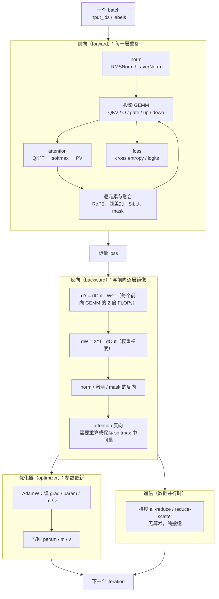

# 图 1：一次训练迭代的算子地图

对应正文第 1.1 节。一次 `loss.backward(); optimizer.step()` 里，算子出现在四个位置：
前向、反向、优化器、通信。每个位置下面标出这一阶段在 roofline 上的典型判据。

各阶段的判据（用本书 `code/02-step-budget/step_budget.py` 的粗模型算出来，
8B 级模型、seq_len=4096、batch=1、8 卡、H200 标定参数）：

| 阶段 | 下界由谁决定 | 为什么 |
| --- | --- | --- |
| 前向 | 算力 | 长序列下 attention 与 GEMM 的 FLOPs 远大于权重与激活的字节数 |
| 反向 | 算力 | 每个 GEMM 的反向是它的 2 倍 FLOPs |
| 优化器 | 带宽 | 每参数要搬 ±26 字节（grad、param、m、v 的读写），算术只有十几 FLOP |
| 通信 | 网络带宽 | 没有算术，只有 all-reduce 的搬运 |

## 来源

* 优化器的状态张量与公式：`../tilelang-corpus/06-huawei-ascend/raw/hiascend/llms-content/document/detail/canncommercial/canncommercial_900_API_aolapi_context_ops-nn_aclnnApplyAdamW_md.md:25-60`
  （CANN 官方算子文档，`aclnnApplyAdamW` 的 `varRef/mRef/vRef` 与公式）。
* 「反向 ≈ 2 倍前向」的推导见正文 1.1 节（对单个 GEMM 逐项做加法）。
* 各阶段占比的具体数字由 `code/02-step-budget/step_budget.py` 复算，属本书的粗模型推导，
  **不是实测**。
