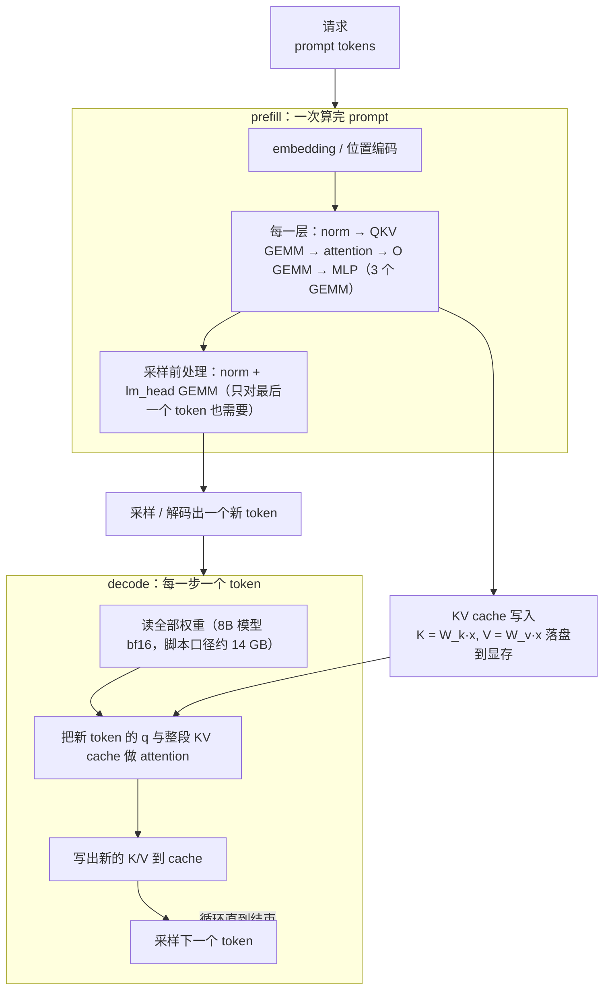

# 图 2：一次推理请求的算子地图

对应正文第 1.2 节。一次推理请求分成两段：**prefill**（把 prompt 一次性算完，批量大、
算力密集）和 **decode**（每步只算一个新 token，读整段 KV cache，带宽密集）。
同一个 attention 算子，在两段的判据完全相反。

两段的账（本书 `code/02-step-budget/step_budget.py`，8B 级模型、32 层、
seq_len/KV 长度 4096、H200 标定参数）：

| 阶段 | 运算量 | 访存量 | 判据 |
| --- | --- | --- | --- |
| prefill（整段 prompt 的全部层） | 66.1 TFLOP | 28.5 GB | compute-bound |
| decode（每个 token 的全部层） | 16.1 GFLOP | 14.5 GB | memory-bound |

也就是说：**prefill 的瓶颈是算力，decode 的瓶颈是“读权重 + 读 KV cache”**。
decode 段每产出一个 token 就要把整个模型的权重读一遍。这就是 batch、
量化、MQA/GQA、投机解码这些技术要解决的问题。

## 来源

* paged KV cache 的真实 kernel 接口（`block_table` + `cache_seqlens`）：
  `_vendor/tilelang-v0.1.15/examples/deepseek_mla/example_mla_decode_paged.py:30-38`。
* 昇腾把“norm + RoPE + 写 cache”做成一个融合算子：
  `../tilelang-corpus/06-huawei-ascend/raw/hiascend/llms-content/document/detail/canncommercial/canncommercial_900_API_aolapi_context_ops-transformer_aclnnKvRmsNormRopeCache_md.md:25`。
* 上表的数字由 `code/02-step-budget/step_budget.py` 复算，是本书口径的**下界推导**，不是实测。
