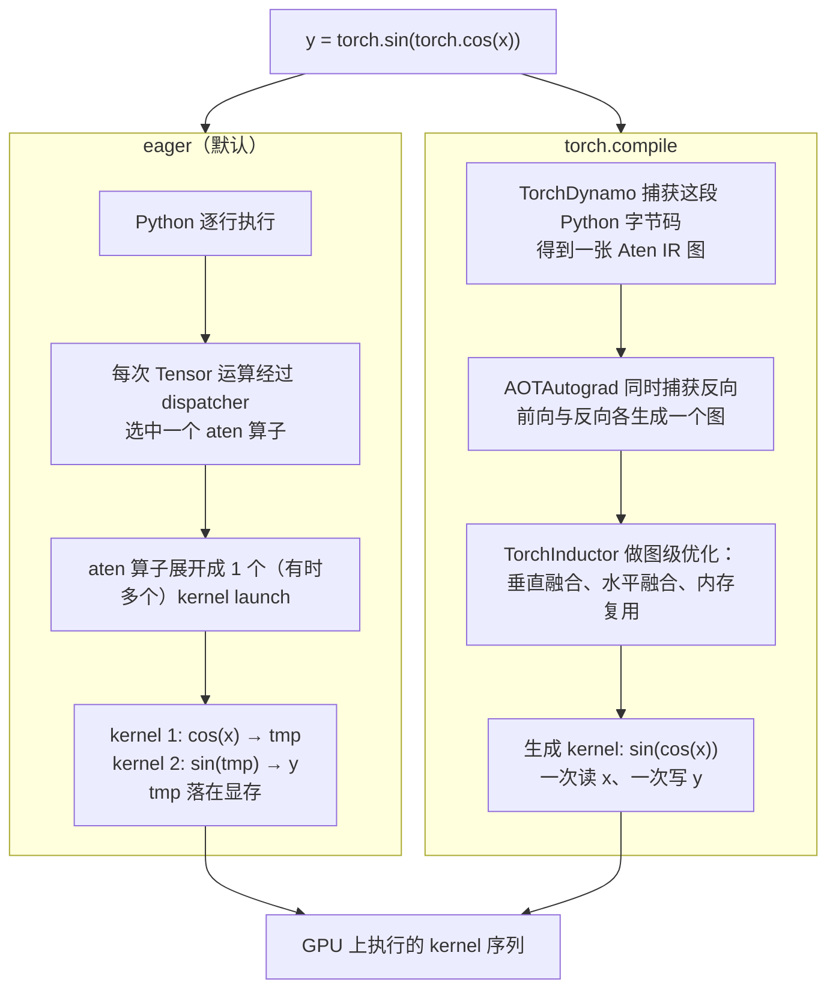

# 图 3：一行 PyTorch 的两条路径

对应正文第 3.1、4.3 节。左边是 eager 路径（默认），右边是 `torch.compile` 路径。
两条路径最终都落到 kernel 上；差别只在「谁来决定有几个 kernel、每个 kernel 里放多少算子」。

落到一个具体例子上（PyTorch 官方文档自己的例子，`cos` 后接 `sin`）：

| 路径 | 对显存做几次读/写 | 出处 |
| --- | --- | --- |
| eager | 读 `x`、写 `a`、读 `a`、写 `b` = 2 读 + 2 写 | PyTorch「Getting Started with torch.compile」 |
| Inductor 融合后 | 读 `x`、写 `b` = 1 读 + 1 写 | 同上 |

在真正的模型里，图中「谁来决定 kernel 边界」这一层就是第 26 章要讲的集成点：
你是让 Inductor 生成这个 kernel，还是把一个用 TileLang 写好的算子挂在同一个位置。

## 来源

* 融合前后的读写次数与 `TORCH_COMPILE_DEBUG=1`：PyTorch 官方文档
  <https://docs.pytorch.org/docs/2.14/user_guide/torch_compiler/torch.compiler_get_started.html>
  （2026-10-01 核验；注意 corpus 里的 `pytorch-torch-compile-docs` 抓到的是一张跳转页，
  见 `../references.md` 的「待补资料」）。
* Inductor 生成的 kernel 名字形如 `triton_poi_fused_<aten算子>_<序号>`：
  <https://docs.pytorch.org/docs/2.14/user_guide/torch_compiler/torch.compiler_inductor_profiling.html>。
* 图右侧的「AOTAutograd 同时捕获反向」：同上 torch.compiler 文档
  <https://docs.pytorch.org/docs/2.14/user_guide/torch_compiler/torch.compiler.html>。
