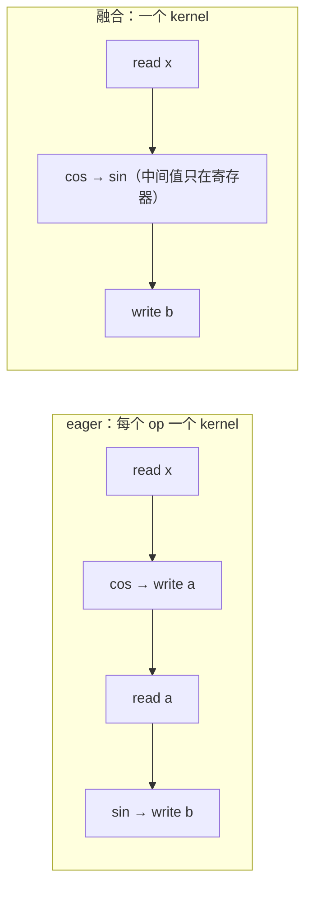

# 图 5：融合的账本

对应正文第 4.1、4.2 节。融合不是「少写几行代码」，而是**把中间张量的读写从显存里省掉**。
下面三个例子都是本章正文里手算过的。

| 例子 | eager / 未融合的访存 | 融合后的访存 | 理论下界之比 |
| --- | --- | --- | --- |
| `y = sin(cos(x))`，`x` 有 16.8M 个 fp16 元素 | 2 读 + 2 写 = 134.2 MB | 1 读 + 1 写 = 67.1 MB | 2.0× |
| LayerNorm，8192×4096 fp16（自己用 `mean/pow/rsqrt` 拼） | 3 读 `x` + 1 写 `y` = 268.4 MB | 1 读 + 1 写 = 134.2 MB | 2.0× |
| attention prefill，S=4096、32 head、fp16 | 落 S×S 分数矩阵，共约 6.58 GB | 只读 Q/K/V、写 O，共 134.2 MB | 49× |

第三行是量级上的差别：S×S 中间量（32×4096×4096×2 字节 ≈ 1.07 GB）在标准实现里要被写一次、
被 softmax 读一次写一次、再被 PV 读一次。这就是 FlashAttention 那篇论文的核心论证：
把「读写 HBM 的次数」当成一等公民来优化，而不是只看 FLOPs。

生产栈里到处都能看到同一条结论。昇腾 CANN 的算子文档把融合的动机直接写在功能说明里：

> 「AddRmsNormDynamicQuant算子将RmsNorm前的Add算子和RmsNorm归一化输出给到的1个或2个
> DynamicQuant算子融合起来，减少搬入搬出操作。」
> —— `../tilelang-corpus/06-huawei-ascend/raw/hiascend/llms-content/document/detail/canncommercial/canncommercial_900_API_aolapi_context_ops-nn_aclnnAddRmsNormDynamicQuant_md.md:25`

同一份文档体系里，`aclnnKvRmsNormRopeCache` 把「切分 + RMSNorm + RoPE + 写入两块 KV cache」
做成一个算子，`aclnnApplyAdamW` 把整个优化器更新做成一个算子。**融合的粒度就是硬件厂商
对「一次该搬多少数据」的答案。**

## 来源

* `cos → sin` 的 2 读 2 写 与 1 读 1 写：PyTorch 官方文档
  <https://docs.pytorch.org/docs/2.14/user_guide/torch_compiler/torch.compiler_get_started.html>（2026-10-01 核验）。
* 表格中所有访存量：本书 `code/01-op-traffic-model/op_traffic.py` 的实际输出。
* FlashAttention 的 IO-aware 论证与其报告的训练加速（BERT-large 15%、GPT-2 3×、
  LRA 2.4×）：`../tilelang-corpus/03-tilelang-papers/raw/arxiv-2205-14135.md`（论文摘要；
  测量条件见论文正文，本章未把它当作 TileLang 的性能）。
* 昇腾融合算子：CANN 官方算子文档三条，路径见上。
