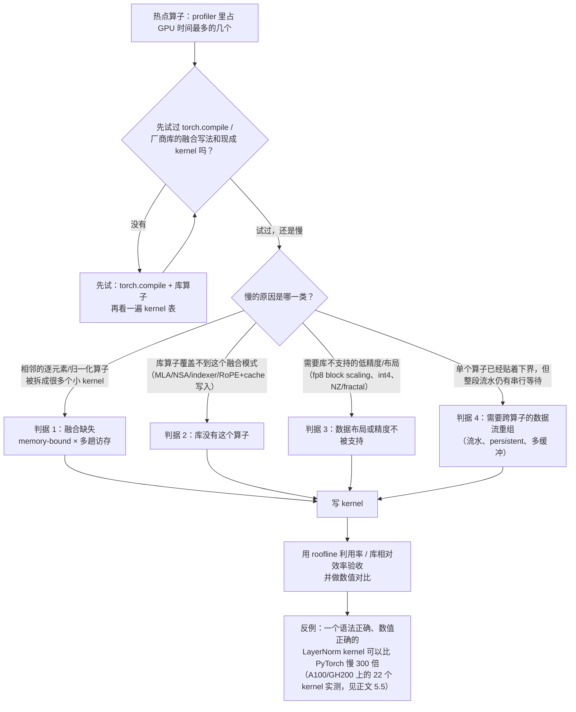

# 图 6：什么时候需要自己写 kernel

对应正文第 5 节。这是一个**从测量出发**的决策树，不是「先写 kernel 再看效果」。
树叶上的四个判据分别对应正文 5.1–5.4 的四类情况。

## 来源

* 决策树本身是本书的归纳，判据在正文 5.1–5.4 逐条给出证据。
* 「写得对但很慢」的反例与「roofline 利用率 / 库相对效率」两个验收判据：
  `../tilelang-corpus/03-tilelang-papers/raw/arxiv-2607-04454.md`（摘要里写明在 NVIDIA A100 与
  GH200 上对 22 个 Triton/TileLang kernel 的实测，其中一个 LayerNorm 比 PyTorch 基线慢 300 倍以上）。
* 「先试 torch.compile」：见正文 4.3 与 `code/README.md` 里给出的观察步骤。
