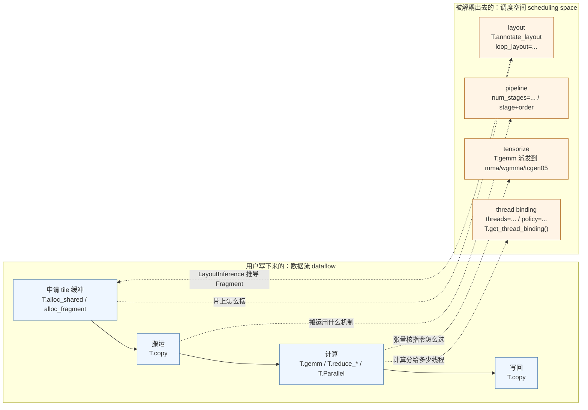

# 图 1：数据流与调度空间的解耦

对应正文 **2.1–2.3 节**。左列是用户直接写出来的东西，右列是被解耦出去、由注解或
编译器决定的东西。

要点：

* 四个调度维度在 v0.1.15 里**都有入口，也都有缺省**（见正文 2.3 节的表）。
* 虚线表示「用户可以选择介入」；不介入时由编译器决定。
* 注意 `layout` 那条是双向的：用户可以在 `T.annotate_layout` 里写死，也可以留空让
  LayoutInference 推导（`_vendor/tilelang-v0.1.15/tilelang/transform/__init__.py:30-38`）。

事实来源：正文 2.1–2.3 节；`../tilelang-corpus/03-tilelang-papers/raw/arxiv-2504-17577.md`
（论文摘要）；`_vendor/tilelang-v0.1.15/docs/get_started/overview.md:74-84`。
