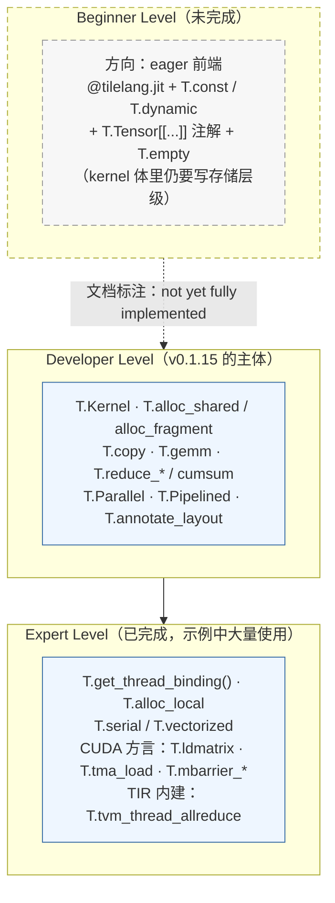

# 图 2：三层接口的定位、形态与实现状态

对应正文 **2.5 节**。**注意中间那一层（beginner）是虚线框**：官方文档明确写着
“This interface is not yet fully implemented”
（`_vendor/tilelang-v0.1.15/docs/get_started/overview.md:20`）。本章如实标注，不把它画成已完成。

三层的官方类比（`_vendor/tilelang-v0.1.15/docs/deeplearning_operators/matmul.md:17-21`）：

| 层 | 类比对象 | 文档原话的关键词 |
| --- | --- | --- |
| Level 1 / beginner | TVM | “conceptually similar to the idea behind TVM” |
| Level 2 / developer | Triton | “somewhat comparable to Triton's programming model” |
| Level 3 / expert | 手写 CUDA/HIP | “almost as explicit as a hand-written CUDA/HIP kernel” |

三层**可以混用**，这是 TileLang 相对 Triton 的官方差异之一
（`_vendor/tilelang-v0.1.15/docs/deeplearning_operators/matmul.md:214-218`）。
