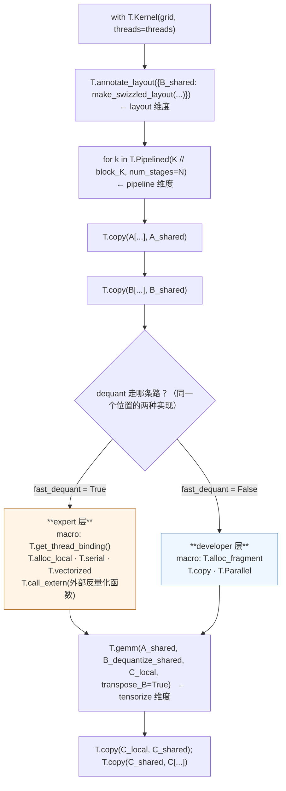

# 图 3：composable ，一个 kernel 里的两层

对应正文 **2.6 与 3.3 节**。图为
`_vendor/tilelang-v0.1.15/examples/dequantize_gemm/example_dequant_gemm_bf16_mxfp4_hopper.py`
的流水循环（`:366-373`）的结构简化：**同一个 `T.Pipelined` 循环体里，一个是 thread 级
macro，一个是 tile 级 `T.gemm`，中间没有任何模式切换。**

同一份代码里，四个调度维度全部出现过：

| 维度 | 在这个 kernel 里的出现位置 |
| --- | --- |
| thread binding | `threads=threads`（`:336`），macro 内 `T.get_thread_binding()`（`:225`） |
| layout | `T.annotate_layout` + `make_swizzled_layout`（`:344-348`） |
| tensorize | `T.gemm(..., transpose_B=True)`（`:373`） |
| pipeline | `T.Pipelined(..., num_stages=num_stages)`（`:366`） |

第二个例子（低层写在高层的旁边）见
`_vendor/tilelang-v0.1.15/examples/gemm/example_gemm_intrinsics.py:122-142`：
`T.Parallel` 搬运与 `mma_emitter.ldmatrix_a/b`、`mma_emitter.mma` 直接相邻。

事实来源：实体文件的对应行号已在正文 3.3 节逐条给出并核验（见 `../references.md` S12）。
