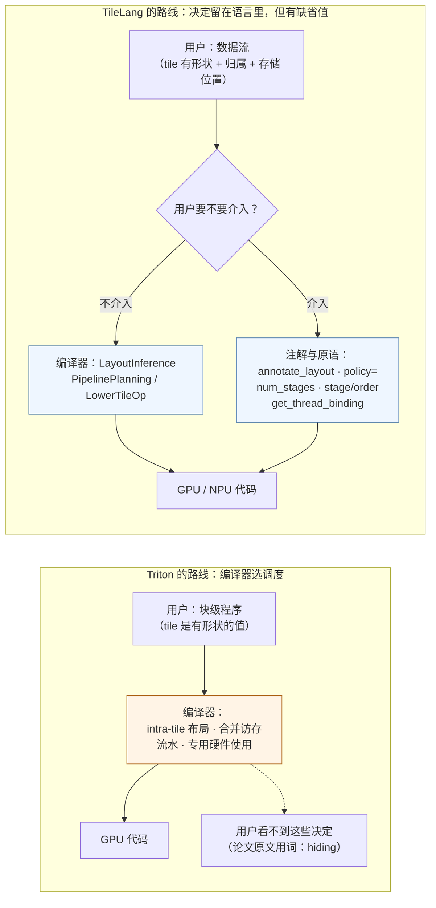

# 图 4：Triton 与 TileLang 把决定放在哪里

对应正文 **第 5 节**。图回答一个问题：同样写块级程序，「tile 里的布局、搬运机制、
流水深度」这些决定，最终是谁做的？

两边各自的依据：

| 判断 | 出处 |
| --- | --- |
| Triton「围绕 tile 概念」，tile 是 statically shaped multi-dimensional sub-arrays | `../tilelang-corpus/11-related-compilers/raw/triton-mapl-2019.md:36-37` |
| Triton 自动推导 schedule，且「The benefits of Triton come at the cost of increased programming efforts」 | 同文件 `:248-256` |
| Triton 的 tile 语义 **hiding** intra-tile coalescing / cache / 专用硬件使用 | 同文件 `:325-329` |
| TileLang 的 developer 层「somewhat comparable to Triton's programming model」 | `_vendor/tilelang-v0.1.15/docs/deeplearning_operators/matmul.md:19` |
| TileLang 相对 Triton 的三条差异（布局注解、可手工的流水、混用层次） | 同文件 `:214-218` |
| Triton 自己也有更低层的 Gluon 编程模型 | `../tilelang-corpus/11-related-compilers/raw/triton-docs.md`（Gluon 一节） |

**注意时间线**：上表引用的 Triton 观点来自 2019 年的原始论文，当时的语言比今天小得多
（corpus 的注释书目也提醒了这一点）。本章只用它说明**两条路线的设计取向**，
不做「今天的 Triton 还是不是这样」的断言。
