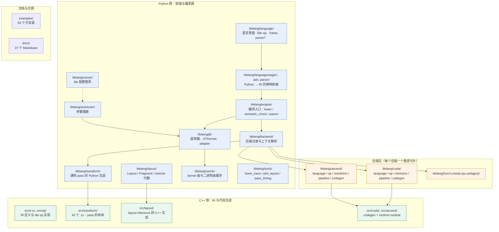

# 图 1：v0.1.15 仓库地图（模块 → 职责）

来源：本图由本章作者根据 `_vendor/tilelang-v0.1.15/` 的实际目录结构绘制
（`find tilelang -maxdepth 1 -type d`、`find src -maxdepth 1 -type d` 的输出，
核验日期 2026-10-01）。图中所有路径都是相对 `_vendor/tilelang-v0.1.15/` 的路径。

## 1.1 一张图看懂「谁负责什么」



## 1.2 同样的内容，纯 ASCII 版（便于 grep / diff）

```text
                          tilelang/jit/  (装饰器, JITKernel, adapter)
                                 |
                                 v
tilelang/language/  -->  tilelang/engine/lower.py  -->  tilelang/backend/  (注册 + 上下文)
   | 语言表面             编译入口                       |
   |                                                  +--> tilelang/<backend>/pipeline.py
   v                                                  |
TIR IRModule <----------------------------------------+
   |
   +--> src/transform/*.cc            (pass 本体, 42 个 .cc)
   +--> src/layout/layout_inference/  (layout 求解)
   +--> src/<backend>/codegen/        (CUDA C / Ascend C codegen)
   |
   v
tilelang/jit/adapter/  (tvm_ffi / nvrtc / cython / torch / cutedsl)
   |
   v
可调用 kernel

横向支撑：
  tilelang/cache/     kernel 缓存与 CUDA/Ascend 二进制缓存
  tilelang/autotuner/ 参数搜索            tilelang/carver/  tile 配置推荐
  tilelang/tools/     lower_trace / plot_layout / pass_timing / pass_visualizer
  examples/ (54 子目录)   docs/ (37 Markdown)
```

## 1.3 数字口径

| 项 | v0.1.15 实际值 | 核验命令 |
| --- | --- | --- |
| `VERSION` | `0.1.15` | `cat VERSION` |
| `tilelang/` 顶层子目录（不含 `__pycache__`） | 24 | `find tilelang -maxdepth 1 -type d` |
| `tilelang/` 下 `.py` 文件 | 390 | `find tilelang -name '*.py' \| wc -l` |
| `src/transform/` 下 `.cc` | 42 | `ls src/transform/*.cc \| wc -l` |
| `src/` 下 `.cc` + `.h` | 384 | `find src -name '*.cc' -o -name '*.h' \| wc -l` |
| `examples/` 子目录 | 54（另有 `conftest.py` / `pytest.ini` / `quickstart.py` 三个文件，共 57 项） | `find examples -maxdepth 1 -type d \| tail -n +2 \| wc -l` |
| `docs/` 下 Markdown | 37 | `find docs -name '*.md' \| wc -l` |

> 注意：`VERSIONS.md` 写的是「`examples/` 有 57 个目录」。按 `find ... -type d`
> 实际统计是 54 个目录 + 3 个文件 = 57 项。本章采用实测口径，并把这一差异记在
> `references.md` 的「待确认」小节。
