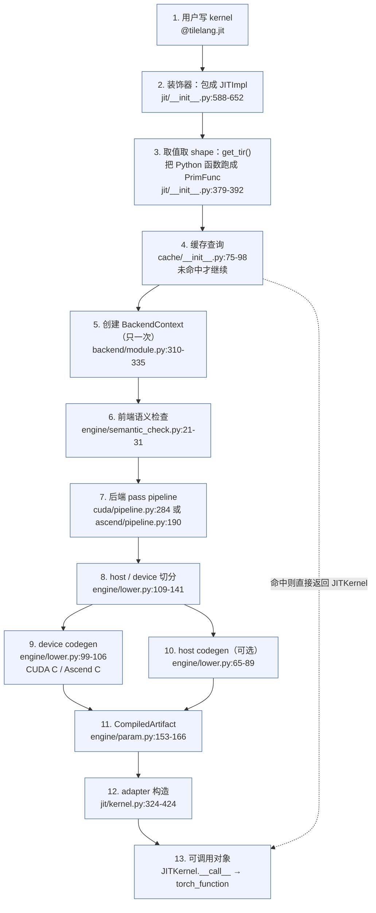

# 图 2：一次编译的全流程（Python kernel → 可调用对象）

来源：本章作者根据 `_vendor/tilelang-v0.1.15/` 源码走读绘制。每个方框后面标注
了实际实现所在的“文件:行号”，行号核验日期 2026-10-01。



## 关键分界线

```text
        Python 侧（可读、可调试）                   C++ 侧（性能、IR 变换）
  +---------------------------------------+  +--------------------------------------+
  | decorator -> PrimFunc -> BackendContext|  | pass 本体（src/transform/*.cc）       |
  |  -> pipeline 的 Python 调度            |->| codegen（src/cuda, src/ascend）      |
  +---------------------------------------+  +--------------------------------------+
                    ^                                        ^
        「顺序」写在这里（backend/<x>/pipeline.py）   「做什么」写在这里（src/transform/）
```

这条分界线解释了两件事：

1. 想改 **pass 的顺序、开关、目标相关裁剪** → 改 `tilelang/<backend>/pipeline.py`。
2. 想改 **某个 pass 的行为** → 改 `src/transform/`（或对应后端的 `src/<backend>/transform/`）。

## 三条容易被忽略的支路

```text
  adapter 选择（jit/kernel.py:338-424）
      tvm_ffi | cython | nvrtc | torch(Metal) | cutedsl
                ^ 由 BackendContext.execution_backend 决定，不由 target 决定

  host codegen 开关（engine/lower.py:144-213）
      enable_host_codegen=False（默认）时只产出 device 源码 + IR，交给 adapter 自己编译

  缓存短路（cache/__init__.py:75-98）
      kernel_cache 命中时整个 pipeline 都不会跑；这也是「改了 pass 但结果没变」的常见原因
```
