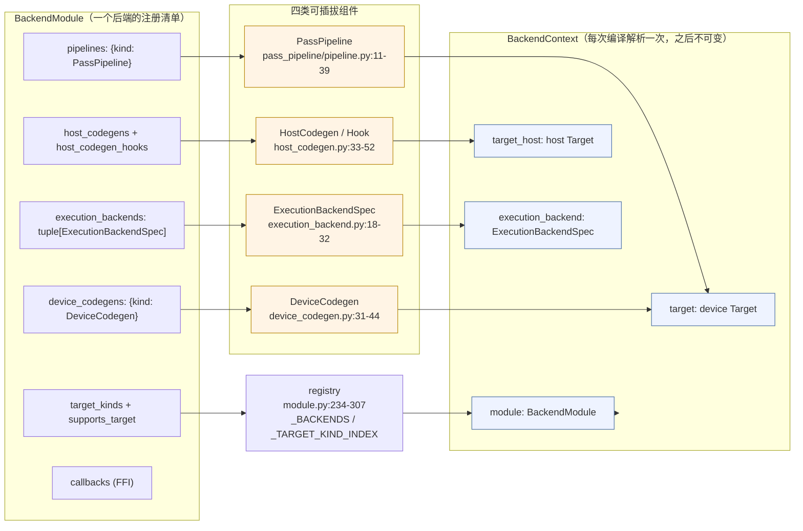

# 图 3：多后端抽象（`tilelang/backend/pass_pipeline/` 与它周围的对象）

来源：本章作者根据 `_vendor/tilelang-v0.1.15/tilelang/backend/` 下 6 个 Python 文件
与 `tilelang/backend/README.md` 绘制，行号核验日期 2026-10-01。

## 3.1 五种「组件」与一个「上下文」



## 3.2 target backend 与 execution backend 是两件事

```text
   target backend（决定「生成什么 IR / 什么源码」）      execution backend（决定「怎么编译与启动」）
   ------------------------------------------------      -------------------------------------------------
   cuda        -> tilelang/cuda/pipeline.py              tvm_ffi / nvrtc / cython
   cutedsl     -> 复用 CUDA pipeline，换 codegen          cutedsl
   ascend      -> tilelang/ascend/pipeline.py             tvm_ffi / cython
   hip         -> tilelang/rocm/pipeline.py               （见 tilelang/rocm/execution_backend.py）
   metal / c / llvm / webgpu -> 各自 pipeline             （见各包 execution_backend.py）
```

对应到代码：

| 事实 | 位置 |
| --- | --- |
| CUDA 报 `tvm_ffi` → `nvrtc` → `cython` 的优先级 | `_vendor/tilelang-v0.1.15/tilelang/cuda/execution_backend.py:24-33` |
| CuTeDSL 单独一个 manifest，但显式复用 `pipeline.CUDA_PIPELINE` | `_vendor/tilelang-v0.1.15/tilelang/cuda/cutedsl_backend.py:8-23` |
| Ascend 报 `tvm_ffi` → `cython`，并声明 `supports_callee_allocated_outputs=True` | `_vendor/tilelang-v0.1.15/tilelang/ascend/execution_backend.py:7-21` |
| 同一个 target kind 上允许多个 manifest，靠 `supports_target` 消歧 | `_vendor/tilelang-v0.1.15/tilelang/backend/module.py:291-307` |
| 共享的 host codegen 只有 `c` 与 `llvm` 两种 | `_vendor/tilelang-v0.1.15/tilelang/backend/host_codegen.py:55-59` |

## 3.3 一条硬规则

```text
  ✅ 允许：backend/pass_pipeline/pipeline_utils.py 里放「所有后端都可能用到的小开关」
  ✅ 允许：tilelang/<backend>/pipeline.py 里写这个后端完整的、有序的 pass 序列
  ❌ 禁止：在 tilelang/engine/lower.py 里写 if target.kind.name == "cuda": ...
```

这条规则写在 `_vendor/tilelang-v0.1.15/tilelang/backend/README.md:374-392`
（Ownership Rules），也是「加一个新后端不需要动 engine」这句承诺的实现依据。
