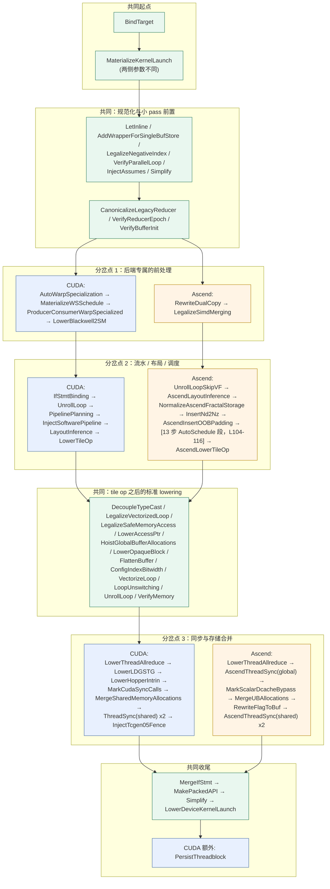

# 图 4：CUDA 与 Ascend 两条 pipeline 的阶段对照

来源：本章作者从 `_vendor/tilelang-v0.1.15/tilelang/cuda/pipeline.py` 与
`_vendor/tilelang-v0.1.15/tilelang/ascend/pipeline.py` 逐行提取（脚本见
`../code/pass-order/dump_pass_order.py`）。完整的 74 / 80 步清单在 `chapter.md`
第 4.5、4.6 节；本图只画阶段。

## 4.1 阶段对照（左 CUDA，右 Ascend）



## 4.2 用文字说清三处关键差异

```text
差异 1  MaterializeKernelLaunch 的参数（pipeline.py:70 vs :45-51）
        CUDA:   lower_thread_binding=True,  default_threads=128
        Ascend: lower_grid_binding=True, lower_thread_binding=False,
                launch_dim_tags=["cthread"], unsupported_annotations=["cluster_dims"]
        => CUDA 有 threadIdx；Ascend 的 kernel 作用域没有线程，线程只存在于 T.SimtVF 内。

差异 2  调度发生在不同的位置（cuda/pipeline.py:127-144 vs ascend/pipeline.py:83-116）
        CUDA:   PipelinePlanning + InjectSoftwarePipeline 在 LayoutInference 之前。
        Ascend: layout 先推（AscendLayoutInference），再进 16 步 AutoSchedule（含 Z3 求解）。

差异 3  同步 pass 的归属与粒度（cuda/pipeline.py:258-266 vs ascend/pipeline.py:162-182）
        CUDA:   通用 ThreadSync("shared") / ThreadSync("shared.dyn")。
        Ascend: AscendThreadSync("global"/"shared"/"shared.dyn")
                + RewriteFlagToBuf（把 flag 归一化到 8 槽命名空间，必要时溢出到共享 mutex 池）。
```

## 4.3 一句提醒

图中的 `[13 步 AutoSchedule 段]` 不是无条件执行的：`ascend/pipeline.py:103` 用
`if auto_schedule_enabled:` 包住，`ascend/pipeline.py:169` 又在关闭时补一个
`InferBufferAliases`。所以 **pass 序列是一段带分支的程序，不是一张静态表**；
本章第 5 节专门讲这件事。
