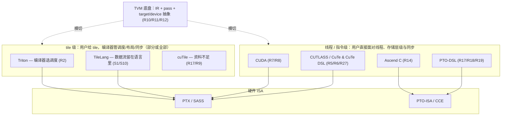

# 图 1：抽象层次纵轴与 TVM 底盘

用于正文 §2.1 与 §4。图里的证据编号对应 `references.md`。



ASCII 版（方便在纯文本环境阅读）：

```text
高层  ▲  tile 级         :  Triton        cuTile        TileLang
      │
      │  线程 / 指令级    :  CUDA          CUTLASS-CuTe
      │                     Ascend C      PTO-DSL
      ▼
低层     硬件 ISA        :  PTX / SASS            PTO-ISA / CCE

横穿所有层的底盘： TVM（IR + pass 基础设施 + target/device 抽象）
```

读图要点：

* TileLang 是唯一同时出现在“tile 级”和“底盘使用方”的对象，前端在 tile 层，
  实现落在 TVM 上。
* CuTe DSL 虽然用 Python，但仍在**低层**（R5/R27）；不要因为它不是 C++ 就把它归到 tile 级。
* TVM 不是某一层的一员，而是横切面（§4）。
