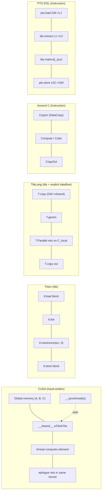

# 图 2：统一例子 `C = relu(A @ B)` 的数据流对照

用于正文 §3。横轴是六个系统，纵轴是「一件事由谁负责」。

「谁负责什么」对照（正文 §3.7 的表就是它的文字版）：

| 关注点 | CUDA | Triton | TileLang | Ascend C | PTO-DSL |
| --- | --- | --- | --- | --- | --- |
| 片上存储 | 用户 | 编译器 | 用户声明，pass 布局 | 用户 | 用户 |
| 多缓冲 | 用户 | 编译器 | `num_stages` | 用户 (`BUFFER_NUM`) | 自动/可选手写 |
| 同步 | 用户 | 编译器 | 编译器 pass | 用户 `EnQue/DeQue` | PTOAS InsertSync |
| 融合 ReLU | 用户 epilogue | 块级一行 | fragment 上一行 | 手写 Vector 段 | 手写 Vector 段 |

证据：CUDA=R7/R8；Triton=R2/R4；TileLang=S1/S10/S11；Ascend C=R14；PTO-DSL=R18/R19。
