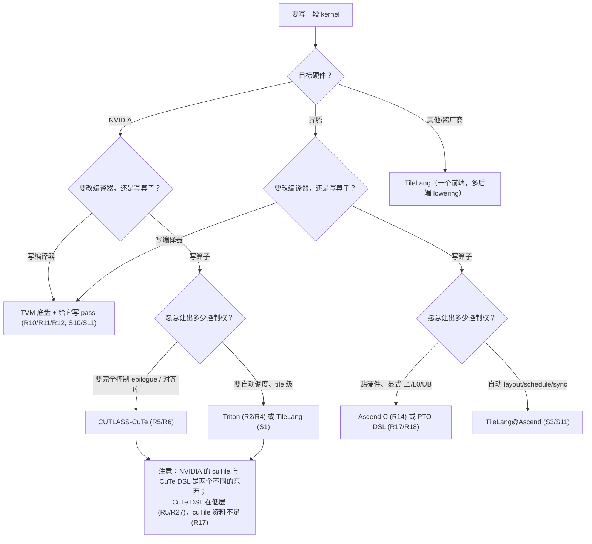

# 图 3：什么时候该选谁

用于正文 §5 与 §7。判定顺序：**硬件 → 目标是算子还是编译器 → 愿意让出多少控制权**。

判定要点（都来自正文）：

1. **先选硬件**：NVIDIA / 昇腾 / 跨厂商，决定可选项集合（S2）。
2. **再问“改编译器还是写算子”**：改编译器 → TVM 底盘（§4）；写算子 → tile 层或低层。
3. **最后问“让出多少控制权”**：让得多 → tile 层自动调度；让得少 → 低层手写。
4. **不要用代码行数决定**：社区文章的“差几倍”没有公开基线（R22 的核验备注）。
