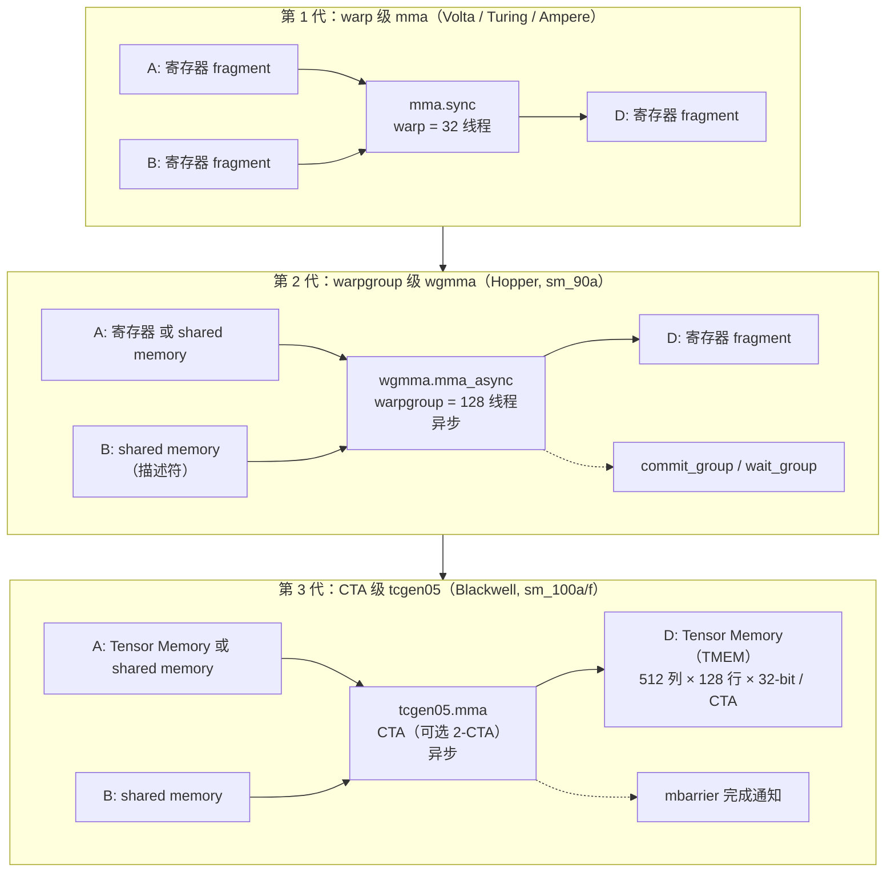

# 图 4 · Tensor Core 三代：把什么从寄存器里拿了出来

正文位置：第 3.3 节。

## 每代“解决了什么 / 留下了什么”

* **`mma`**：第一次提供远超通用 FP32 的矩阵乘吞吐。代价是操作数与累加器全在寄存器里，
  fragment 布局必须由程序员显式安排，寄存器压力限制了 tile 大小。
* **`wgmma`**：粒度升到 warpgroup（4 个连续 warp），变成异步；操作数可以放在 shared
  memory，不再全部占寄存器；发射与完成分离换来更深的流水。代价是累加器仍在寄存器，
  且要手工维护 commit/wait。
* **`tcgen05`**：把累加器搬进专用的 **Tensor Memory**；`A` 可在 TMEM 或 SMEM，`B` 在
  SMEM，`D` 在 TMEM；支持 block scaling（MXFP 格式）；完成通过 `mbarrier` 通知。
  代价是多了一种必须显式管理的存储和一套新的同步协议。

## 事实来源

* `../tilelang-corpus/05-nvidia-backend/raw/nvidia-ptx-isa.md`
  （9.7.16 `mma` / 9.7.17 `wgmma` / 9.7.18 `tcgen05`；TMEM 的形状与用途见 9.7.18.1
  与 9.7.18.10）。
* TileLang 侧的选择逻辑：`_vendor/tilelang-v0.1.15/tilelang/language/gemm_op.py:177-181`。

均为厂商公开文档，**非实测**。

## 许可

自绘（Mermaid），随本书正文。
