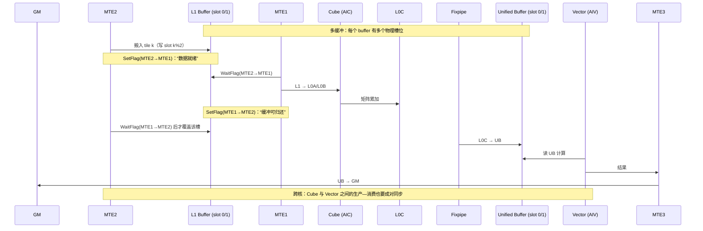

# 图 6 · 昇腾 MTE/Cube/Vector 流水与多缓冲同步

正文位置：第 4.3、4.4 节。

## 这张图想说什么

* 每一次「覆盖同一块 buffer」都需要一个**反向**的归还信号。正反两个方向是**独立的
  event id 空间**（TileLang-Ascend 编程指南：「event ID 按有向 pipe pair 分配」）。
* 多缓冲版本数、片上容量和 Set/Wait 必须**一起**算，不能分开。
* 在 TileLang 里你不用手写这些 flag：`InsertSync` 把它们插进去
  （`_vendor/tilelang-v0.1.15/tilelang/ascend/pipeline.py:113`）。

## 事实来源

* MTE 路径与 SetFlag/WaitFlag 语义：
  `../tilelang-corpus/06-huawei-ascend/raw/hiascend/llms-content/document/detail/canncommercial/canncommercial_900_programug_Ascendcopdevg_atlas_ascendc_10_0008_html.md`。
* 指令队列与 double buffer：
  `../tilelang-corpus/06-huawei-ascend/raw/hiascend/llms-content/developer/zh_developer_techArticles_20240819-1.md`（厂商示意模型）。
* 手工同步的完整生命周期（含反向归还、`MTE2 → MTE1` 与 `MTE1 → MTE2` 的例子）：
  `_vendor/tilelang-ascend-v0.1.2.000/docs/TileLang-Ascend Programming Guide.md`
  「同步原语」一节。
* `AutoSchedule → PrepareMultiBuffer → InsertSync → MaterializeMultiBuffer` 的顺序：
  `_vendor/tilelang-v0.1.15/tilelang/ascend/pipeline.py:107-115`。

## 注意

图中是**结构示意**，不是某次运行的 trace，也不含任何延迟/带宽数字。真实时间线必须用
msProf 或 camodel 在设备上取证（见第 12、19 章）。

## 许可

自绘（Mermaid），随本书正文。
