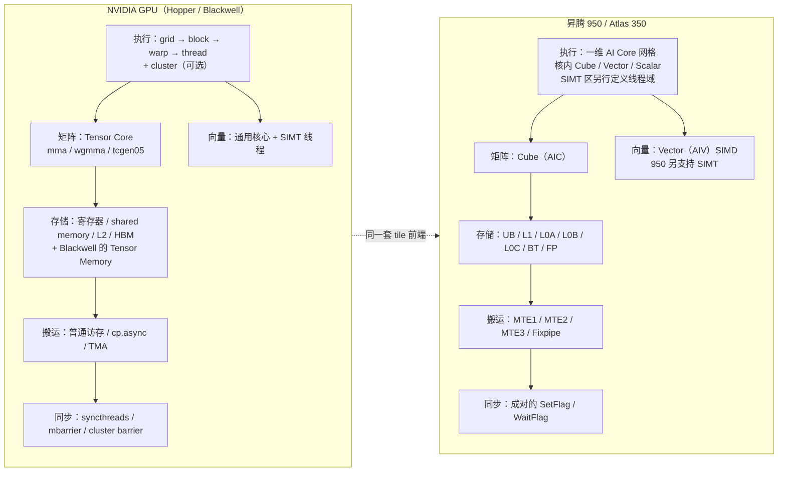

# 图 7 · NV 与昇腾 950 的五维对照

正文位置：第 5.1、5.2 节。

## 五个维度的文字对照

| 维度 | NV | 昇腾 950 |
| --- | --- | --- |
| 存储层级 | 寄存器 / shared / L2 / HBM（+ TMEM） | UB / L1 / L0A / L0B / L0C / BT / FP + GM |
| 执行单元 | SIMT 线程 + Tensor Core | Cube / Vector / Scalar，SIMT 与 SIMD 并存 |
| 数据搬运 | 线程发指令 + TMA | 固定路径 MTE1/2/3 + Fixpipe |
| 同步 | syncthreads / mbarrier / cluster barrier | SetFlag/WaitFlag（成对，按有向 pipe pair） |
| 编程粒度 | thread / warp / warpgroup / CTA / cluster | AI Core 网格 + Cube/Vector 单元；TileLang 以 tile 为单位 |

## 这张图想说什么

* 两台机器在五个维度上**一一对应但取值不同**；不存在“一边全是 SIMT、一边全是 SIMD”
  的简单二分。
* TileLang 的位置是中间那条虚线：同一套 tile 前端，后端各自落到上面的具体资源。

## 事实来源

* NV 侧：`../tilelang-corpus/05-nvidia-backend/raw/nvidia-blog-hopper-architecture-in-depth.md`、
  `nvidia-ptx-isa.md`、`nvidia-hopper-tuning-guide.md`、`nvidia-blackwell-tuning-guide.md`。
* 昇腾侧：
  `../tilelang-corpus/06-huawei-ascend/raw/hiascend/llms-content/document/detail/canncommercial/canncommercial_900_programug_Ascendcopdevg_atlas_ascendc_10_0008_html.md`、
  `.../hardware/zh_hardware_processor.md`、`.../hardware/zh_hardware_accelerator-card.md`、
  `.../canncommercial_900_programug_Ascendcopdevg_atlas_ascendc_10_10064_html.md`。
* “跨核同步”的定性描述也引用了社区文章：
  `../tilelang-corpus/09-zhihu-da-zhi-ruo-yu/raw/zhihu-dazhiruoyu-deepseek-ascend.md`
  （**社区文章，非厂商官方文档**）。

## 许可

自绘（Mermaid），随本书正文。
