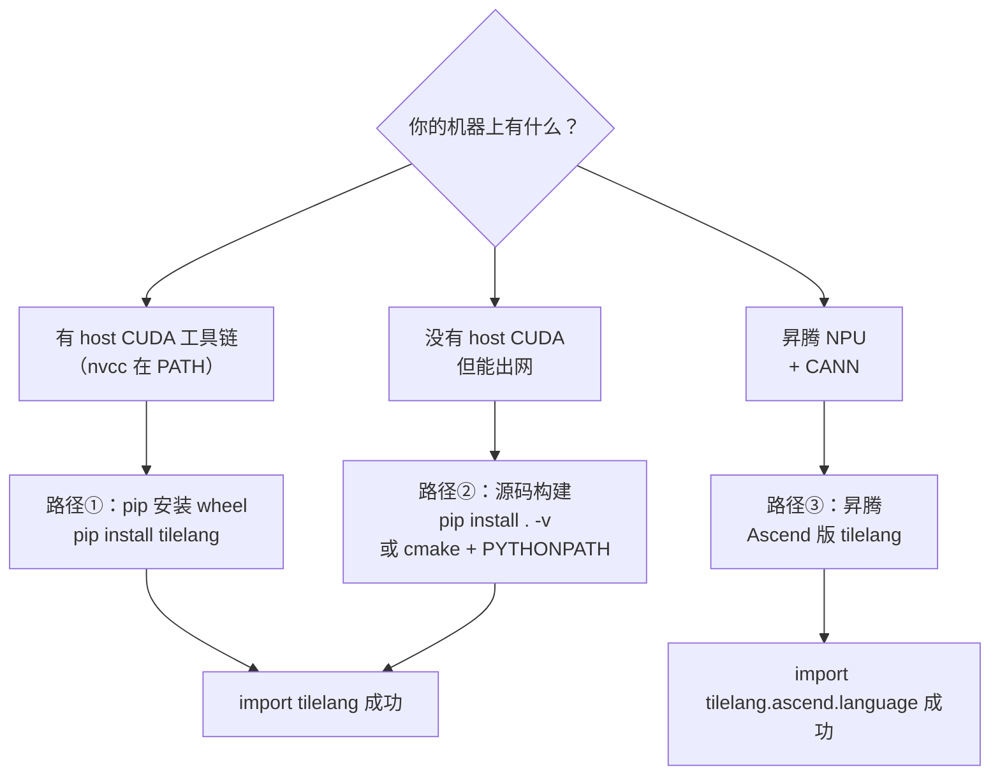

# 图 1 · 安装的三条路径

正文位置：第 3 节。

## 1.1 总览



## 1.2 三条路径的对照

```text
                    路径① wheel            路径② 源码构建              路径③ 昇腾
  ───────────────────────────────────────────────────────────────────────────────
  安装方式           pip install tilelang   git clone --recursive     Ascend 版 wheel 或
                                            + pip install . -v         install_ascend.sh
  Python             >= 3.10                >= 3.10                   >= 3.10（install_ascend.sh 检查）
  OS / libc          Ubuntu 20.04+/glibc2.28  Linux / Windows          Linux + CANN
  工具链             host CUDA >= 10.0      host CUDA 或 pip CUDA>=13   bisheng + ld.lld
  CANN               —                      —                         >= 8.3.RC1
  torch              由 wheel 依赖带入      自行准备                    torch + torch-npu >= 2.6.0.RC1
  验证命令           python -c "import      同上                       同上（另看 torch.npu.is_available()）
                     tilelang;print(tilelang.__version__)"
```

## 1.3 「昇腾」为什么有两条不同的路

```text
  tilelang v0.1.15（主干）                     tile-ai/tilelang-ascend（独立仓库）
  ────────────────────────────────────        ───────────────────────────────────────
  包内路径  tilelang/ascend/                   仓库根 = 一个 tilelang 分支
  方言      tilelang.ascend.language           tilelang.language（带 is_npu 等扩展）
  网格      T.Kernel(num_blocks)（1-D 核网格）  T.Kernel(..., is_npu=True) as (cid, vid)
  片上分配  alloc_shared / alloc_l1 / alloc_l0* alloc_ub / alloc_l1 ...
  线程域    T.SimtVF / T.SimdVF 两个 frame     T.Scope("V") + T.barrier_all
  目标      target="ascend"（dav-3510）         同上（编译时 USE_ASCEND）

  ⇨ 本章第 7 节先用主干方言写第一个昇腾 kernel（对照用），两个方言的细节留到第 19、25 章。
```

## 事实来源

* `_vendor/tilelang-v0.1.15/docs/get_started/Installation.md:3-10`（pip 前置条件）、`:70-76`
  （源码构建前置条件）、`:389-391`（缓存目录 `~/.tilelang/cache`）。
* `_vendor/tilelang-v0.1.15/tilelang/ascend/README.md:10-51`（昇腾前置条件与源码构建）。
* `_vendor/tilelang-ascend-v0.1.2.000/README.md:76-134`（三种安装方式）；
  `install_ascend.sh:37-45`（Python >= 3.10 检查）；`build_wheel_ascend.sh:29-35`（要求
  `ASCEND_HOME_PATH`）。
* 主干与独立仓库的方言差异：`_vendor/tilelang-v0.1.15/tilelang/ascend/language/kernel.py:139`
  对比 `_vendor/tilelang-ascend-v0.1.2.000/examples/elementwise/elementwise_add.py:31-46`。
