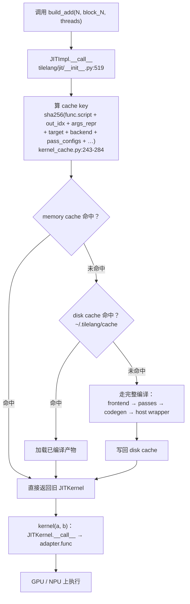

# 图 3 · `@tilelang.jit` 一次调用的生命周期与缓存

正文位置：第 6 节。

## 3.1 一次调用经过哪些阶段



## 3.2 两种写法（lazy / eager）的分叉点

```text
  lazy 模式                                           eager 模式
  ──────────────────────────────────────────────      ──────────────────────────────────────────
  @tilelang.jit(out_idx=-1)                           @tilelang.jit
  def build_add(N, block_N, threads):                 def add_eager(A, B, block_N=256):
      @T.prim_func                                        N = T.const("N")
      def main(A, B, C):                                  A: T.Tensor((N,), dtype)
          with T.Kernel(...): ...                         C = T.empty((N,), dtype)
      return main          # ← 返回 PrimFunc                with T.Kernel(...): ...
                                                          return C      # ← 返回输出张量
  k = build_add(1<<20)     # k 是 JITKernel            c = add_eager(a, b)   # 编译并立即执行
  c = k(a, b)              # 再手动调用                 # c 就是结果

  ⇨ 想复用同一个 kernel、想看生成源码、想接 autotuner  → lazy
  ⇨ 想「像调用普通函数一样」                          → eager
```

## 3.3 缓存里到底存了什么键（决定“命中 / 不命中”）

```text
  key = sha256(                     来源（kernel_cache.py:243-284）
    func.script()          ←----------------- 你写的 kernel 的 TIR 文本（含 meta）
    out_idx                ←----------------- compile 时的 out_idx
    args_repr              ←----------------- 编译参数（N、block_N、threads …）
    target / target_host   ←----------------- "cuda" / "ascend" / ...
    execution_backend      ←----------------- tvm_ffi / cython / nvrtc / ...
    pass_configs / compile_flags
    version / platform     ←----------------- 来自 _get_base_key()
  )

  推论：
    * 改一个 tile 参数  → 新 key → 重新编译（旧 key 仍在，可复用）
    * 改一个 pass 开关  → 新 key → 重新编译
    * 只改注释 / 空白    → func.script() 不变 → 同一 key
    * 换了 tilelang 版本 → version 变 → 全 miss（这是好事）
```

## 3.4 两个层级的缓存

```text
  ┌ 内存级：KernelCache._memory_cache（进程内字典）───────────────────────┐
  │  命中 → 直接返回 JITKernel 对象，连磁盘都不碰                         │
  └───────────────────────────────────────────────────────────────────────┘
  ┌ 磁盘级：env.TILELANG_CACHE_DIR（默认 ~/.tilelang/cache）──────────────┐
  │  路径结构：<version>/<platform>/...                                   │
  │  命中 → 加载已编译产物（kernel 源码 / so / cubin …）                  │
  └───────────────────────────────────────────────────────────────────────┘

  开关：
    tilelang.disable_cache() / enable_cache()      （env.py:438-441, 558-559）
    TILELANG_DISABLE_CACHE=1                        （env.py:372-374）
    TILELANG_CACHE_DIR=/somewhere                   （env.py:368）
```

## 事实来源

* `_vendor/tilelang-v0.1.15/tilelang/jit/__init__.py:466-560`（`JITImpl.compile` / `__call__`
  与 mode 推断）、`:571-635`（`jit` 装饰器签名与两种模式说明）。
* `_vendor/tilelang-v0.1.15/tilelang/jit/kernel.py:206-220`（`JITKernel.__call__`）、
  `:532-543`（`get_kernel_source`）。
* `_vendor/tilelang-v0.1.15/tilelang/cache/kernel_cache.py:243-284`（key 生成）、
  `:455`（`clear_cache` 实例方法）。
* `_vendor/tilelang-v0.1.15/tilelang/cache/__init__.py:24-97`（两条 dispatch map、
  `cached()` 入口；注意这里是**模块级 `cached`**，与独立仓库的顶层 `clear_cache` 不同）。
* `_vendor/tilelang-v0.1.15/tilelang/env.py:368`、`:372-374`、`:438-441`、`:558-561`。
