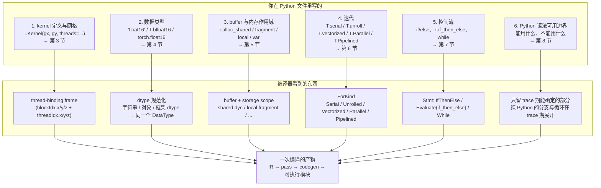

# 图 1 · 一个 TileLang kernel 的构件地图

正文位置：第 2 节（概念与模型）。

这张图回答一个问题：**一个 TileLang kernel 里，哪些东西是必须显式写出来的，
哪些是编译器的活儿。** 左边一列是语言表面的六个构件，右边是后面各节的位置。

## 关键分工

* **你写的是块（tile）级的意图**，不是线程级的指令。`T.Kernel` 之内默认是
  「一个块要做的全部事」，`T.Parallel` 的循环边界是**逻辑迭代空间**，
  线程映射由布局推导决定（第 3、6 节）。
* **类型、内存作用域、迭代、控制流**这四件事必须显式写出来；它们直接决定
  IR 里的 `DataType`、`storage_scope`、`ForKind` 和语句形状。
* **trace 期的 Python 与运行期的 TIR 是两种东西**：纯 Python 的 `if`、`for`、
  列表推导在构造 IR 时就求值完了；TIR 表达式写成的 `if`、`while` 才是设备上的
  控制流（第 7、8 节）。

## 事实来源

* `_vendor/tilelang-v0.1.15/tilelang/cuda/language/kernel.py:13-55`（`T.Kernel`）
* `_vendor/tilelang-v0.1.15/src/ir.cc:236-262`（网格绑定与 `blockIdx` 标签）
* `_vendor/tilelang-v0.1.15/tilelang/language/allocate.py:49-192`（分配函数与 scope）
* `_vendor/tilelang-v0.1.15/tilelang/language/loop.py:13-357`（循环构造子）
* `_vendor/tilelang-v0.1.15/docs/programming_guides/python_compatibility.md`

自绘，随本书正文。
