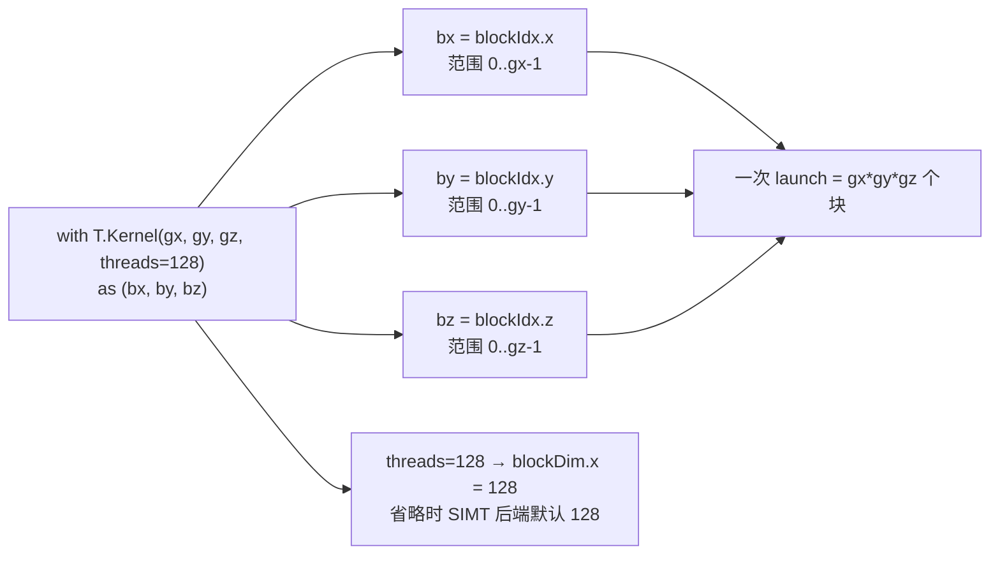
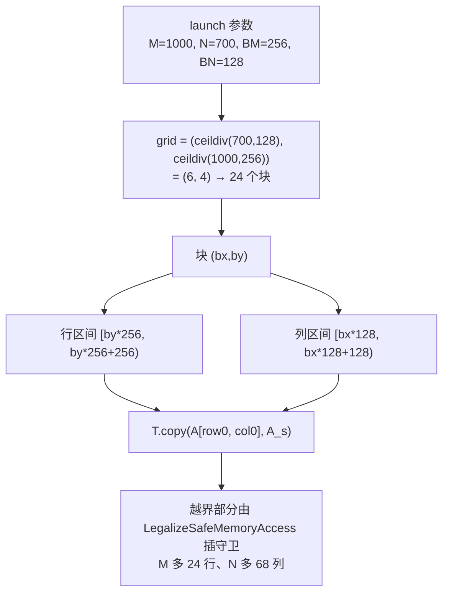

# 图 2 · `T.Kernel` 的网格与索引

正文位置：第 3 节（kernel 定义与网格）。

## 2.1 位置参数按顺序对应 x / y / z



来源：`_vendor/tilelang-v0.1.15/src/ir.cc:236-262` 给每个轴建一个 thread-binding
frame，标签依次是 `blockIdx.x`、`blockIdx.y`、`blockIdx.z`；
`_vendor/tilelang-v0.1.15/tilelang/transform/__init__.py:201` 定义
`DEFAULT_SIMT_THREADS = 128`。

## 2.2 线性块号与二维网格的对应（x 变得最快）

```text
grid = (gx=3, gy=2)      每行 gx 个块，行内 x 递增

            bx=0     bx=1     bx=2
          ┌────────┬────────┬────────┐
   by=0   │ pid 0  │ pid 1  │ pid 2  │
          ├────────┼────────┼────────┤
   by=1   │ pid 3  │ pid 4  │ pid 5  │
          └────────┴────────┴────────┘

块号分解：  bx = pid % gx
            by = (pid // gx) % gy
            bz = pid // (gx*gy)
```

写 `T.Kernel(ceildiv(N, BN), ceildiv(M, BM))` 时，x 轴吃的是 **N**（列方向），
y 轴吃的是 **M**（行方向）。这正是 `examples/quickstart.py` 的写法：
`as (bx, by)` → `A[by*BM, ...]`、`B[..., bx*BN]`。

## 2.3 块索引 → 数据分片



上面的数字由本目录 `code/01-kernel-grid/grid_index_model.py` 现算（`python3
grid_index_model.py`）。

## 2.4 昇腾：一维核网格 + 核内线程域

```text
NVIDIA（CUDA dialect）                      Ascend（ascend dialect）
──────────────────────────                  ─────────────────────────────
T.Kernel(gx, gy, threads=128)               T.Kernel(num_cores)
  └─ 2 维块网格 + 块内 128 线程                └─ 1 维核网格，没有 threads=
                                              └─ with T.SimtVF(threads=128):
                                                   └─ 核内真实的线程域
                                              └─ with T.SimdVF():
                                                   └─ 寄存器级 SIMD，无线程维
```

昇腾方言的 `Kernel` 只声明 `prelude`，传 `threads=` 或 `cluster_dims=` 会被
Python 本身拒绝；多维网格也会在 `Kernel` 里直接报错
（`_vendor/tilelang-v0.1.15/tilelang/ascend/language/kernel.py:139-172`）。

## 事实来源

* `_vendor/tilelang-v0.1.15/tilelang/cuda/language/kernel.py:13-55`
* `_vendor/tilelang-v0.1.15/tilelang/language/kernel.py:88-151, 392-427, 587-611`
* `_vendor/tilelang-v0.1.15/src/ir.cc:236-262`
* `_vendor/tilelang-v0.1.15/tilelang/transform/__init__.py:201-232`
* `_vendor/tilelang-v0.1.15/tilelang/ascend/language/kernel.py:139-172`
* `_vendor/tilelang-v0.1.15/examples/quickstart.py:20-24`

自绘，随本书正文。
