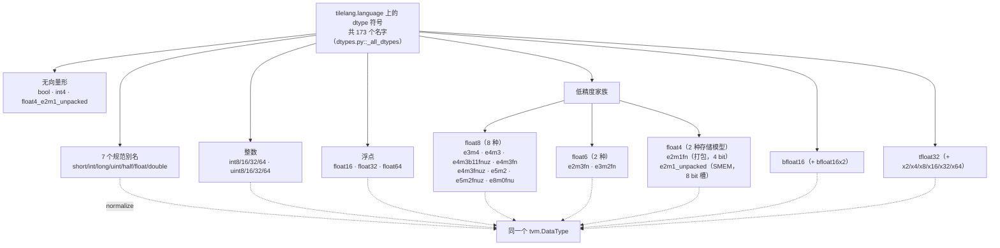

# 图 3 · 数据类型家族（v0.1.15）

正文位置：第 4 节（数据类型）。



## 三种写法等价

```text
'float16'          字符串
T.float16          TileLang dtype 对象
torch.float16      框架 dtype
        \    |    /
         \   |   /
      dtype('float16')      ← 只会得到同一个 tvm.DataType
```

## 向量打包（lane）规则

```text
base dtype                    可用 lane
────────────────────────────  ────────────────────────────────
int8/16/32/64                 x2 x4 x8 x16 x32 x64
uint8/16/32/64                x2 x4 x8 x16 x32 x64
float16/32/64                 x2 x4 x8 x16 x32 x64
每个 float8 变体               x2 x4 x8 x16 x32 x64
每个 float6 变体               x2 x4 x8 x16 x32 x64
float4_e2m1fn                 x2 x4 x8 x16 x32 x64
tfloat32                      x2 x4 x8 x16 x32 x64
bfloat16                      x2            ← 只有 x2
bool / int4 / float4_e2m1_unpacked   无
```

## fp8 选型（同一份 E4M3 有四种拼法）

```text
                    指数  尾数  NaN 规则
float8_e4m3           4     3   后端决定
float8_e4m3fn         4     3   有限值 + NaN（CUDA 默认）
float8_e4m3fnuz       4     3   FNUZ（ROCm 默认）
float8_e4m3b11fnuz    4     3   bias-11 的 FNUZ
float8_e8m0fnu        8     0   只有指数，用作 MX 的块 scale
```

`tilelang/language/fp8.py` 的 `determine_fp8_type()` 按平台在 `e4m3fn` /
`e4m3fnuz` 之间切换；gfx950 例外，优先用 OCP 拼法。

## fp4 的两种存储模型

```text
float4_e2m1fn              float4_e2m1_unpacked
  2 个值 / 字节               1 个值 / 1 个字节槽
  全局张量、打包 SMEM 往返     只在 SMEM / TMA 上，配对
  （CUTLASS float_e2m1_t）    tcgen05 kind::f8f6f4 / mxf8f6f4
  bits = 4                    bits = 8
```

两者在逻辑上都是「FP4 E2M1」：`is_float4()` 对两者都返回 `True`
（`tilelang/language/dtypes.py:262-305`）。

## 事实来源

* `_vendor/tilelang-v0.1.15/tilelang/language/dtypes.py:105, 120-142, 245-253,
  262-317, 324-347, 633-711, 891`
* `_vendor/tilelang-v0.1.15/tilelang/language/fp8.py:1-49`
* `_vendor/tilelang-v0.1.15/docs/programming_guides/type_system.md:7-41`
* 家族与 lane 清单由本目录 `code/02-dtypes/dtype_families.py --diff` 逐条比对
  过：与 vendor 的 `_all_dtypes` 完全一致（173 条）。

自绘，随本书正文。
