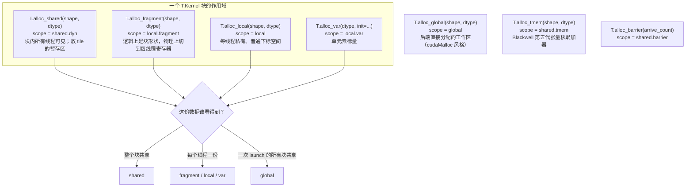

# 图 4 · 存储作用域与分配函数

正文位置：第 5 节（buffer 与内存作用域）。

## 4.1 通用侧：四个常用作用域



### 选择依据（一句话版）

```text
要放一个 tile 的暂存副本，块内共享          → alloc_shared
要放一个「块形状」的累加器 / 中间结果        → alloc_fragment
要一个每线程私有、能自己下标的小数组         → alloc_local
要一个标量（计数器、标志、临时值）           → alloc_var
要一块跨块的工作区（少见）                  → alloc_global
要 Blackwell 的 TMEM 累加器                 → alloc_tmem
```

## 4.2 `fragment` 为什么“看起来像 shared，实际在寄存器里”

```text
你写的：  C_f = T.alloc_fragment((128, 128), "float32")     # 64 KiB 的"逻辑"缓冲

编译器：  在 LayoutInference 里给 C_f 推一个 T.Fragment 布局，
          把 128x128 的迭代空间映射到 128 个线程 + 每线程 128 个 slot

实际：    64 KiB / 128 线程 = 512 B/线程 = 128 个 fp32 寄存器/线程
```

数字来自 `code/03-memory-scopes/scope_footprint.py`（现算，不是实测）。

## 4.3 昇腾侧：UB / L1 / L0A / L0B / L0C

```text
主库 v0.1.15 的 ascend 方言                  适配器仓库 tilelang-ascend-v0.1.2.000
──────────────────────────────────         ─────────────────────────────────────
T.alloc_shared(shape, dtype)               T.alloc_shared(shape, dtype)
  → UB，scope "shared.dyn"                   → UB，scope "shared"（bool → "shared.ub"）
                                             T.alloc_ub(shape, dtype)  ← 只在这里有
                                               → UB，scope "shared.ub"

T.alloc_l1(shape, dtype)  → "shared.l1"    T.alloc_L1(shape, dtype)  → "shared.l1"
T.alloc_l0a(shape, dtype) → "shared.l0a"   T.alloc_L0A(shape, dtype) → "wmma.matrix_a"
T.alloc_l0b(shape, dtype) → "shared.l0b"   T.alloc_L0B(shape, dtype) → "wmma.matrix_b"
T.alloc_l0c(shape, dtype) → "shared.l0c"   T.alloc_L0C(shape, dtype) → "wmma.accumulator"
```

**两处容易踩的点。**

1. 主库 v0.1.15 **没有** `T.alloc_ub`；UB 就是用 `T.alloc_shared` 分配
   （`tilelang/ascend/README.md:138`：`Use T.alloc_shared for Unified Buffer
   storage`）。`alloc_ub` 是适配器仓库的拼法。
2. 两边的 scope 名不一样（`shared.dyn` vs `shared`，`shared.l0a` vs
   `wmma.matrix_a`）。把片段在两边搬来搬去不会自动等价。

## 4.4 片上容量是要算的账

```text
tile 形状 x dtype x 多缓冲份数 = 占用

  (128,256) fp32 x 1 = 128 KiB     放得进示例里的 192 KiB UB
  (128,256) fp32 x 2 = 256 KiB     ❌ 放不下
  (128,256) fp16 x 2 = 128 KiB     ✔
  (128,128) fp16 x 2 =  64 KiB     ✔
```

对应 `code/03-memory-scopes/scope_footprint.py` 的输出。注意第 6 章的提醒：
192 KiB、512 KB 这类数字是**特定型号的示例**，不是昇腾通用规格，真实容量要用
`GetCoreMemSize` 查。

## 事实来源

* `_vendor/tilelang-v0.1.15/tilelang/language/allocate.py:49-191, 254-289`
* `_vendor/tilelang-v0.1.15/tilelang/ascend/language/allocate.py:15-80, 103-125`
* `_vendor/tilelang-ascend-v0.1.2.000/tilelang/language/allocate.py:140-157`
* `_vendor/tilelang-v0.1.15/tilelang/ascend/README.md:131-151`
* `_vendor/tilelang-v0.1.15/docs/programming_guides/language_basics.md:152-172`

自绘，随本书正文。
