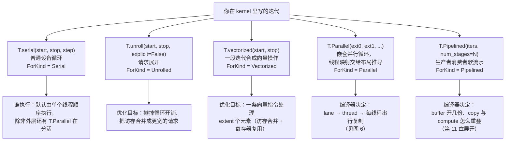

# 图 5 · 五种循环构造子

正文位置：第 6 节（并行与循环）。



## 与 Python 写法的对应

```text
你写的 Python                       编译成
──────────────────────────         ─────────────────────────────
for i in range(n)                  T.serial(n)
for i in range(a, b, s)            T.serial(a, b, s)
for i in T.serial(n)               T.serial(n)
for i in T.unroll(n)               T.unroll(n)
for i in T.vectorized(4)           T.vectorized(0, 4)
for i, j in T.Parallel(M, N)       嵌套 T.Parallel 循环（depth = 参数个数）
for ko in T.Pipelined(K, 3)        T.Pipelined(K, num_stages=3)
for x in [0, 1, 2] / enumerate(..)  trace 期展开，不产生设备循环
```

来源：`_vendor/tilelang-v0.1.15/docs/programming_guides/python_compatibility.md:21-28,
30-70`。

## 一处容易混淆的地方

`T.serial` 与 `T.Serial` 是同一个东西，只是后者用大写强调「这是 tile 级循环」；
`T.unroll` / `T.Unroll`、`T.vectorized` / `T.Vectorized` 同理
（`_vendor/tilelang-v0.1.15/tilelang/language/loop.py:297-357`）。

## 事实来源

* `_vendor/tilelang-v0.1.15/tilelang/language/loop.py:13-357`
* `_vendor/tilelang-v0.1.15/tilelang/cuda/language/loop.py:16-79`（CUDA 侧额外
  的 `prefer_async` 与 `unroll_factor`）
* `_vendor/tilelang-v0.1.15/docs/programming_guides/control_flow.md:47-110`
* `_vendor/tilelang-v0.1.15/docs/programming_guides/language_basics.md:124-135`

自绘，随本书正文。
