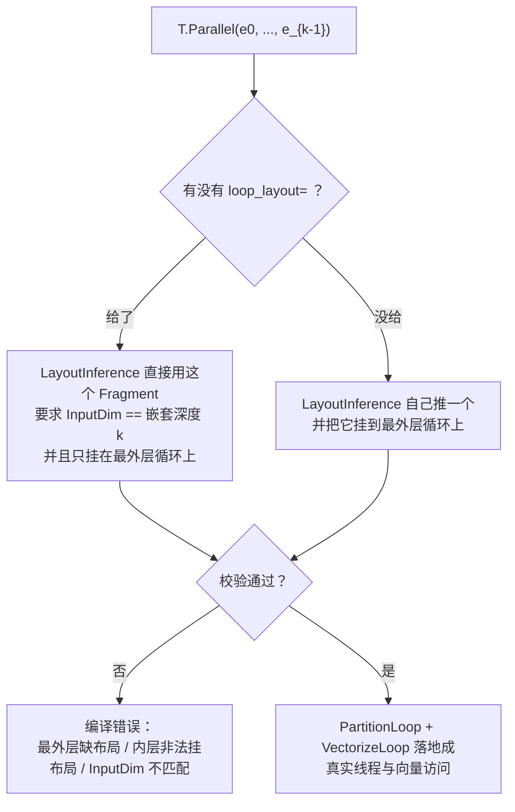

# 图 6 · `T.Parallel` 的维度映射

正文位置：第 6 节（并行与循环）。

## 6.1 默认映射：lane → thread → 每线程串行

```text
对 k 维的 T.Parallel(e0, e1, ..., e_{k-1})：

  flattened  = e0*(e1*(...*i0 + i1)...) + i_{k-1}     ← 行优先展平
  access_idx = flattened // vector_size                ← 先按 lane 分组
  thread     = access_idx % num_thread                 ← 再轮转到线程
  local_idx  = (access_idx // num_thread) * vector_size
               + (flattened % vector_size)             ← 剩下的变每线程串行

  快 ────────────────────────────────────────────────→ 慢
  │ lane（连续，可向量化） │ thread（相邻，可合并） │ 每线程串行复制 │
```

也就是说，`T.Parallel` 的 extents **不是**「哪个维度给线程」的直接声明，
而是**逻辑迭代空间**；真正决定谁是 lane、谁是 thread 的是布局推导。

## 6.2 同一份工作，不同 nest 形状 → 不同线程归属

```text
threads=8, vector_size=2, 总共 64 次迭代

T.Parallel(8, 8)            thread 0 拿 (0,0) (0,1) (2,0) (2,1) ...
T.Parallel(2, 32)           thread 0 拿 (0,0) (0,1) (0,16) (0,17) ...
T.Parallel(4, 4, 4)         thread 0 拿 (0,0,0) (0,0,1) (1,0,0) (1,0,1) ...

每线程的次数完全相同；变的是**哪个逻辑下标落到哪个线程**，
也就是访存会不会合并。
```

数字由 `code/04-loops/loop_mapping.py --compare` 现算。它是
`src/transform/loop_partition.cc` 里 `PlanLoopPartition` 公式的纯 Python 复现，
不是硬件测量。

## 6.3 什么时候必须给布局



来源：`_vendor/tilelang-v0.1.15/tilelang/language/loop.py:40-79`（约束说明）、
`_vendor/tilelang-v0.1.15/src/transform/loop_partition.cc:244-271`（映射公式）、
`_vendor/tilelang-v0.1.15/src/transform/loop_partition.cc:324-350`
（`LowerParallelLoop` 的分区 / 向量化两步）。

## 6.4 `T.Parallel` 与 `T.Pipelined` 的关系

```text
for ko in T.Pipelined(K // BK, num_stages=3):   ← 外层：软流水
    T.copy(A[...], A_s)                         ← 生产者：GM → shared
    T.copy(B[...], B_s)                         ← 生产者：GM → shared
    T.gemm(A_s, B_s, C_f)                       ← 消费者：shared → 计算

T.copy 在 lowering 时会先展开成 T.Parallel（见 LowerTileOP），
再由流水 pass 决定这个 Parallel 属于哪一级、开几份 buffer。
```

## 事实来源

* `_vendor/tilelang-v0.1.15/src/transform/loop_partition.cc:244-271, 324-350`
* `_vendor/tilelang-v0.1.15/tilelang/language/loop.py:13-80, 112-188`
* `_vendor/tilelang-v0.1.15/docs/tutorials/debug_tools_for_tilelang.md:52`

自绘，随本书正文。
