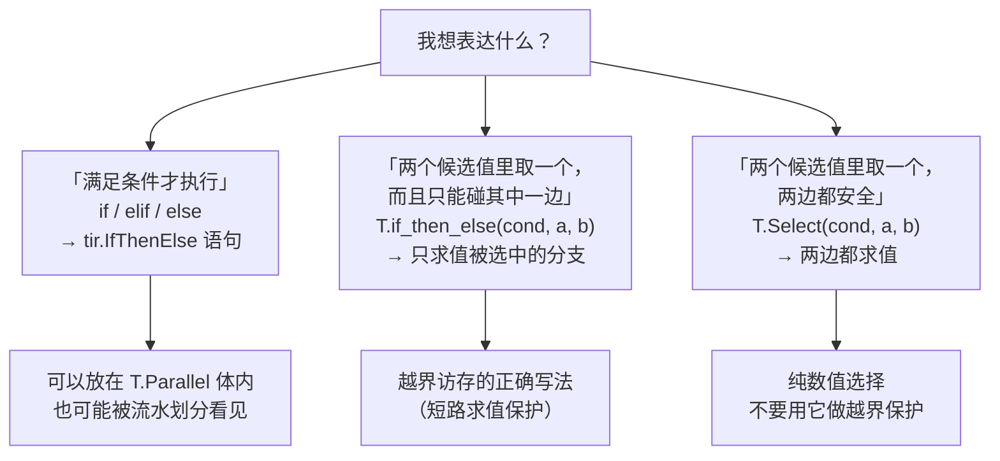
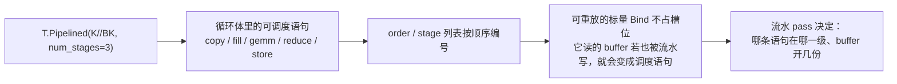

# 图 7 · 控制流的三种写法和两种代价

正文位置：第 7 节（控制流）。

## 7.1 语句分支 / 取值分支 / 双路取值：三种不同的东西



来源：`_vendor/tilelang-v0.1.15/tilelang/language/tir/ir.py:172-179`（`Select` 的
docstring：“``Select`` evaluates both value expressions. Use ``if_then_else``
when a branch must guard side effects or out-of-bounds memory accesses.”）。

## 7.2 两种代价：向量化被守卫挡住、流水被分支切开

```text
情形 A：守卫在向量化之外
────────────────────────────────────────────────────
  for i, j in T.Parallel(threads, vec):
      gi = ...
      if gi < N:               ← 每次迭代都带一个谓词
          Y[gi] = X[gi]

  规划器无法把 predicated 访问合成宽向量请求 →
  退化成带条件的标量循环（第 6 章的 elementwise 文档给了生成代码的例子）


情形 B：把守卫拿掉
────────────────────────────────────────────────────
  网格只覆盖整块（grid = ceildiv(full, BLK)），
  剩余尾部另起一次 launch
  → fast path 里 gi 的取值可证在界内，规划器可以自由向量化
```

## 7.3 分支与流水



来源：`_vendor/tilelang-v0.1.15/tilelang/language/loop.py:139-168`（`T.Pipelined`
的 docstring 关于“可重放 Bind 不占槽位”的说明）。

## 7.4 `while` / `break` / `continue`

```text
while <TIR 条件>:        条件必须是 TIR 表达式；
                        常量恒真的 while 会被编译期拒绝
  break / continue       在 serial / unroll / parallel / while 里可用；
                        trace 期的 Python 循环里，只有编译期条件才支持这两个
```

来源：`_vendor/tilelang-v0.1.15/docs/programming_guides/control_flow.md:112-131` 与
`_vendor/tilelang-v0.1.15/docs/programming_guides/python_compatibility.md:21-28,
42-48`。

## 7.5 一个文档与源码不一致的点

`docs/programming_guides/control_flow.md:33-38` 给出的用法是：

```python
if T.all_of(i < M, j < N):
```

但 v0.1.15 的 `tilelang/language/logical.py:51` 里 `all_of` 的签名是
`def all_of(buffer: BufferLikeType)`，接受的是**缓冲区或缓冲区切片**，不是
条件列表。对应的测试也这样用：`T.all_of(BlockMask[by, bx, k, :])`
（`testing/python/language/test_tilelang_language_all_of.py:56`）。要做“多个
条件的与”，用 `and` / `or`（会降级成 `tir.And` / `tir.Or`，见
`tilelang/language/eager/builder.py:820-846`）。

## 事实来源

* `_vendor/tilelang-v0.1.15/tilelang/language/tir/ir.py:172-186, 228`
* `_vendor/tilelang-v0.1.15/tilelang/language/logical.py:12-87`
* `_vendor/tilelang-v0.1.15/testing/python/language/test_tilelang_language_all_of.py:56,105`
* `_vendor/tilelang-v0.1.15/tilelang/language/eager/builder.py:115-128, 820-846`
* `_vendor/tilelang-v0.1.15/docs/programming_guides/control_flow.md:16-131`

自绘，随本书正文。
