# 图 8 · Python 在 kernel 里的可用边界

正文位置：第 8 节（Python 兼容性边界）。

```mermaid
flowchart TB
    SRC["你在 `with T.Kernel(...)` 里写的 Python 代码"]

    SRC --> OK["直接可用 ✅"]
    SRC --> CAVEAT["可用但有限制 ⚠️"]
    SRC --> NO["不可用 ❌"]

    OK --> OK1["for i in range(n) / range(a,b,s)<br/>→ 设备侧 T.serial"]
    OK --> OK2["for x in list / tuple / enumerate / zip<br/>→ trace 期展开（必须有限）"]
    OK --> OK3["while（条件是 TIR 表达式）"]
    OK --> OK4["if / elif / else、x if c else y"]
    OK --> OK5["break / continue"]
    OK --> OK6["a[i] / a[i,j,k] / a[i:j] / a[-1]"]
    OK --> OK7["+ - * / %、+= 等增强赋值"]
    OK --> OK8["列表/字典/集合推导式（边界必须在 trace 期可求值）"]

    CAVEAT --> C1["with：只认 T.Kernel 这类 DSL 上下文"]
    CAVEAT --> C2["assert：用 T.device_assert 或 T.assert"]
    CAVEAT --> C3["print()：只在 Python 表达式上有效；设备侧用 T.print()"]

    NO --> N1["函数与类：kernel 里不能有 def / class<br/>要复用就写 @T.macro（编译期内联）"]
    NO --> N2["a = b = c：链式赋值，必须拆开"]
    NO --> N3["len()：用 buffer.shape[dim]"]
    NO --> N4["type() / isinstance()"]
```



## “编译期值”与“设备值”：最容易搞错的一件事

```text
一个名字到底是哪一种？看它的来源。

  N              Python int（来自 @jit 工厂的参数）        → 编译期常量
  A.shape[0]     从 buffer 形状读出来的符号                → 既可用于 trace，也可进 TIR
  T.dynamic(...) 显式声明的符号变量                        → 设备值（TIR Var）
  bx              T.Kernel 返回的块索引                    → 设备值（TIR Var）
  X[i]            buffer load                              → 设备值（TIR 表达式）

对「设备值」用 Python 的 if / for / len 就会出错或产生错误语义；
对「编译期值」写 T.serial/T.Parallel 就把本该展开的东西变成了设备循环。
```

## 两个具体例子

```text
✅ 正确：用 shape 而不是 len
   for i in T.serial(A.shape[1]):        # 而不是 len(A[0])

✅ 正确：需要运行期查表就用 buffer，不要用 Python list
   scale_idx_table = [...]               # 这是 trace 期的 Python list
   for index, value in enumerate(scale_idx_table):   # 展开，OK
       output[index] = value
   # 但 buf[table[runtime_index]] 不会变成设备侧查表；要用 buffer 或直接算下标

❌ 错误：kernel 里定义函数
   def helper(x): ...                     # 不支持，用 @T.macro

❌ 错误：链式赋值
   a = b = 0                              # 拆成 a = 0; b = 0
```

## 事实来源

* `_vendor/tilelang-v0.1.15/docs/programming_guides/python_compatibility.md:19-101`
* `_vendor/tilelang-v0.1.15/tilelang/language/parser/entry.py:105`（`T.macro`）
* `_vendor/tilelang-v0.1.15/tilelang/language/eager/builder.py:1075`（eager 的
  `macro`）
* `_vendor/tilelang-v0.1.15/docs/programming_guides/language_basics.md:26-58`
  （`T.dyn` / `T.dynamic`）

自绘，随本书正文。本图的可判定部分由
`code/06-python-boundary/py_compat_scan.py` 做了一个教学用的静态扫描器。
