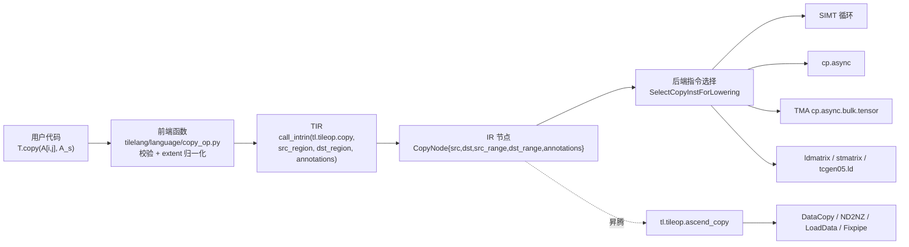

# 图 01 · 一个原语的三段式生命周期



ASCII 版：

```text
  用户代码              前端                   TIR / IR 节点              后端
  ────────              ────                   ─────────────              ────
  T.copy(...)  ──▶  校验 + extent 归一化  ──▶  tl.tileop.copy        ──▶  选指令
                    (标量 BufferLoad 对      CopyNode{src, dst,          ├─ SIMT
                     直接退化成 BufferStore)  src_range, dst_range,      ├─ cp.async
                                              annotations}               ├─ TMA
                                                                         └─ LDSM/TMEM
                    昇腾路径：tl.tileop.ascend_copy ──▶ DataCopy/ND2NZ/LoadData/Fixpipe
```

**来源**：`_vendor/tilelang-v0.1.15/tilelang/language/copy_op.py:59-130`、
`src/op/copy.cc:615`、`src/cuda/op/copy_analysis.cc:716`。

**要点**：Python 只在最左边一列起作用。你越往右看，能影响的只剩
`annotations` 里的那几个键。
