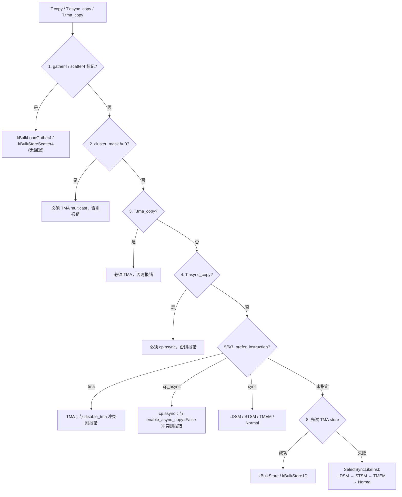

# 图 02 · `T.copy` 的降级判定链



ASCII 版：

```text
  ①  gather4 / scatter4 ─────────────▶ 强制 TMA gather/scatter（无回退）
  ②  cluster_mask != 0 ─────────────▶ 必须 TMA multicast
  ③  T.tma_copy ────────────────────▶ 必须 TMA
  ④  T.async_copy ──────────────────▶ 必须 cp.async
  ⑤  prefer_instruction="tma" ──────▶ TMA（冲突即报错）
  ⑥  prefer_instruction="cp_async" ─▶ cp.async（冲突即报错）
  ⑦  prefer_instruction="sync" ─────▶ 同步形态
  ⑧  默认 ──────────────────────────▶ 先试 TMA *store*；不行再走
                                      LDSM → STSM → TMEM → Normal
```

**来源**：`_vendor/tilelang-v0.1.15/src/cuda/op/copy_analysis.cc:716-808`
（`SelectCopyInstForLowering`）、`:593-625`（`SelectTmaInst`/`SelectSyncLikeInst`）、
`src/cuda/op/copy.h:21-33`（`CopyInst` 枚举）。

**两条容易记错的规则**：

1. 默认路径只对 **store** 方向尝试 TMA；global→shared 的 load 不写提示就不会选 TMA。
2. 显式 `T.async_copy` / `T.tma_copy` 是**硬约束**：不满足就编译失败，不会静默回退。

**边界条件**：TMA bulk load 要求最后一维位宽是 128 的整数倍
（`copy_analysis.cc:195-225`）；cp.async 要求 global→shared 且 dtype 相同
（同文件 `:427-437`）。
