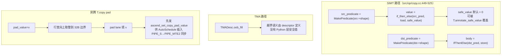

# 图 03 · 三条 padding 路径不是同一件事

对照表：

| 路径 | 触发条件 | “填充”发生在哪 | 填什么 | 能不能改 |
| --- | --- | --- | --- | --- |
| SIMT（NV） | 默认回退路径 | 每条越界 lane 的取值 | 默认 0 | 能，`T.annotate_safe_value({A: v})` |
| 目标侧越界（NV） | dst 区域超出 dst buffer | 整条 store | 不写 | 不需要改 |
| TMA（NV） | `prefer_instruction="tma"` / `T.tma_copy` / TMA store | tensor map descriptor | `oob_fill` | 只能在 descriptor 参数层面 |
| 昇腾 DMA | `T.copy(..., pad_value=v)` | 行尾对齐到 32B 的位置 | `v` | 传参；也可 `data_select=True` 复用上次的 pad 寄存器 |

**来源**：`_vendor/tilelang-v0.1.15/src/op/copy.cc:449-481,507-525`；
`src/cuda/op/copy.h:49-60`；`tilelang/ascend/language/copy_op.py:278-287,326-353`。

**要点**：昇腾的 `pad_value` 是**DMA 对齐填充**，与“越界读替一个值”是两件事；
把两者混在一起写 kernel 会在 tail 处理上出错。
