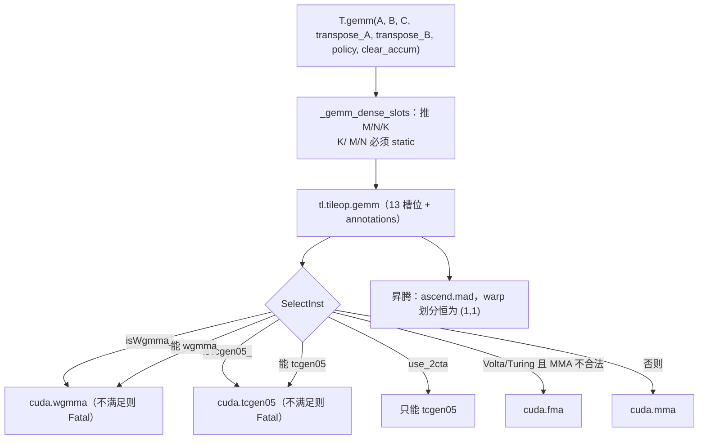

# 图 04 · `T.gemm` 的指令选择与 policy



policy 的用法：

```text
GemmWarpPolicy.Square = 0     均衡划分
GemmWarpPolicy.FullRow = 1    所有 warp 分到行
GemmWarpPolicy.FullCol = 2    所有 warp 分到列

ComputeWarpPartition:
  tcgen05 → (1, num_warps)                       ← policy 不起作用
  wgmma   → ComputeWgmmaWarpPartition(policy,…)  ← policy 起作用
  fma     → (1, num_warps)                       ← policy 不起作用
  其它     → ComputeDefaultWarpPartition(policy, M, N, num_warps, k_n_per_warp=8)
```

**来源**：`_vendor/tilelang-v0.1.15/tilelang/language/gemm_op.py:38-122,160-210`；
`tilelang/tileop/base.py:5-12`；`src/cuda/op/gemm.cc:40-93,336-395`；
`src/ascend/op/gemm.cc:24-45`。

**两个关键推论**：

* `clear_accum` 会把 C 的 access region 从 `rw` 改成 `w`
  （`gemm_op.py:103`）。它进了 IR，影响依赖与同步分析。
* 只有 `cuda.mma` / `cuda.mma.blockscaled` 复用已有 shared layout；
  wgmma/tcgen05 会重新推导（`cuda/op/gemm.cc:398-400`）。
