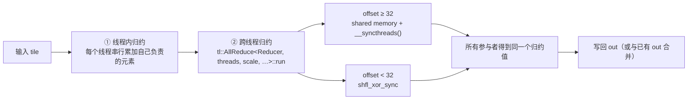

# 图 05 · 两级归约与 XOR-butterfly



以 `threads=256, scale=1` 为例：

```text
offset:  128      64      32   │   16     8     4     2     1
mech:   shared  shared  shared │ shuffle shuffle shuffle shuffle shuffle
        └──── 3 级 ────┘        └──────── 5 级 ────────┘

offset:  threads/2 = 128，每级减半，直到 offset == scale 停止。
```

`clear` 的作用位置：

```text
clear = True   →  直接归约，结果覆盖 out
clear = False  →  先把 out 拷进 red_frag_out，再以 clear=False 归约，最后写回
                  ⇒ out_new = out_old ⊕ reduce(src)
```

**来源**：`_vendor/tilelang-v0.1.15/tilelang/language/reduce_op.py:103-171,141-158`；
`src/tl_templates/cuda/reduce.h:211-238,240-253,279-296`；
`src/op/reduce.cc:185-188`。

**约束**：`(threads/scale)` 必须是 2 的幂，`scale` 也必须是 2 的幂
（`reduce.h:245-252` 的四条 `static_assert`）。
