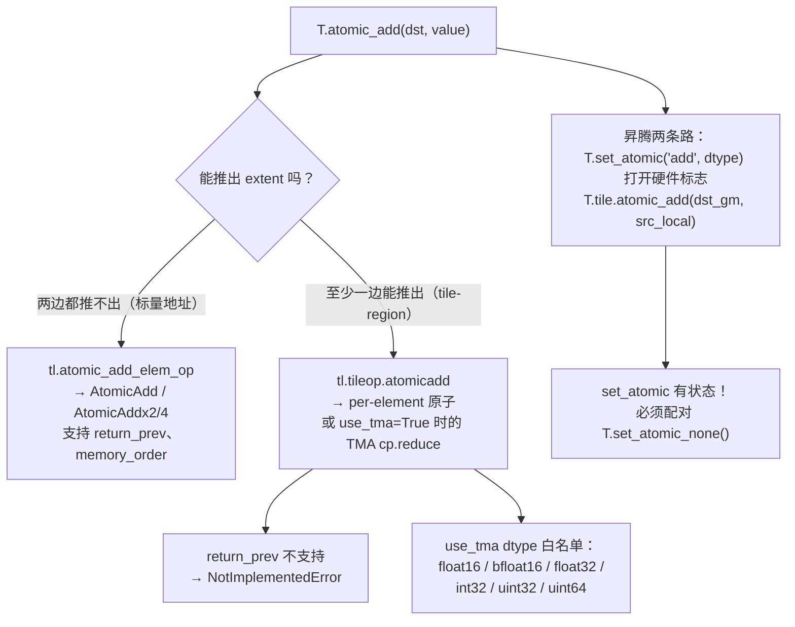

# 图 06 · 原子操作的两条路径

**来源**：`_vendor/tilelang-v0.1.15/tilelang/language/atomic.py:264-311`；
`tilelang/cuda/language/atomic.py:12-50`；`src/cuda/op/atomic_add.cc:36-62`；
`tilelang/ascend/language/mode.py:63-105`；
`_vendor/tilelang-ascend-v0.1.2.000/tilelang/language/ascend_tile.py:313-341`；
`_vendor/tilelang-ascend-v0.1.2.000/src/op/ascend.cc:748-761`。

**要点**：判据是 `get_extent()` 能不能推出区域，不是“dst 有几个元素”。
`T.set_atomic` 是模式开关，`T.atomic_add` 是一次性原语，两者不等价。
