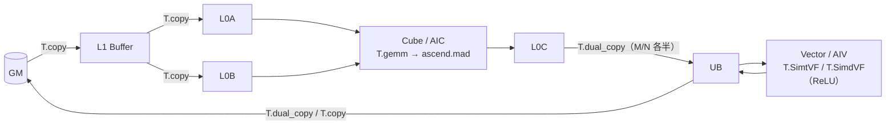

# 图 07 · 昇腾一次 GEMM+ReLU 的原语与存储层级



ASCII 版：

```text
  GM ──T.copy(GM→L1)──▶ L1 ──┬──T.copy(L1→L0A)──▶ L0A ──┐
                             └──T.copy(L1→L0B)──▶ L0B ──┤
                                                  T.gemm (ascend.mad)
                                                         ▼
                                                       L0C
                                                         │
                                              T.dual_copy（两个 AIV 各一半）
                                                         ▼
                                                        UB ──T.SimtVF/T.SimdVF──▶ UB
                                                         │
                                                T.dual_copy / T.copy ──▶ GM
```

**来源**：`_vendor/tilelang-v0.1.15/tilelang/ascend/README.md:60-155`
（Quick Start 与“Writing Ascend Kernels”）；
`tilelang/ascend/language/copy_op.py:53-163`；
`tilelang/ascend/language/frame.py:107-195`。

**要点**：`T.dual_copy` 在这里的职责是把 L0C 累加器按 M 或 N 切开交给两个 AIV，
否则 Vector 侧只有一半并行度；它不是“把纯 Vector kernel 变成双 AIV”的开关。
