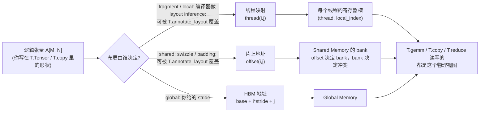

# 图 1：逻辑张量到物理存储的映射

对应正文第 2.1 节。要点：你写下的 `[M, N]` 是**逻辑**形状；数据最终落在
**线程 / 寄存器槽 / 片上存储**上的方式叫布局（layout）。同一份逻辑张量可以有很多种
物理摆法，性能差别来自它们对搬运与访存的影响。



ASCII 版本（便于在没有 Mermaid 的环境里读）：

```text
逻辑视图                        物理视图
────────────────────────      ─────────────────────────────────────────────
A[M, N]                       fragment ──▶ (thread t, 寄存器槽 l)   每线程一份切片
  │                           shared   ──▶ offset(i,j) ─▶ bank    swizzle/padding 改 offset
  │  同一个 A，多种摆法        global   ──▶ base + i*stride + j   stride 由你给
  ▼
T.gemm / T.copy ────────────▶ 编译器在物理视图上生成访存与计算指令
```

## 关键点

1. **逻辑形状不等于物理摆法。** `T.alloc_fragment((block_M, block_N))` 这一行里写的是
   逻辑大小；每个线程实际拿到哪几个元素，由 `Fragment` 这张映射表决定
   （`_vendor/tilelang-v0.1.15/tilelang/layout/fragment.py:12-99`）。
2. **布局是接口，因为它出现在两段代码之间。** 生产者（如 `T.copy`）按一种布局写，
   消费者（如 `T.gemm`）按另一种布局读；两者不一致时，要么插入一次转换，要么直接
   编译失败。编译器能自动推导，也能被你覆盖——这正是它被当作「接口」而不是
   「内部细节」的原因。
3. **同一数组的三条映射路径会同时存在。** 上面三种落点不是三选一，而是同一个 kernel
   里同时出现的三张表：寄存器那层影响 ILP 与 bank，shared 那层影响 bank conflict，
   global 那层影响合并访存。

来源：`_vendor/tilelang-v0.1.15/tilelang/layout/layout.py:12-43`、
`tilelang/layout/fragment.py:12-99`、`tilelang/language/allocate.py:49-103,171`；
`../tilelang-corpus/01-tilelang-official-docs/raw/site/_sources/get_started/overview.md`
（官方文档对 `T.alloc_fragment` 与 layout inference 的说明）。
