# 图 1：流水时空图（不做流水 vs 2-stage vs 3-stage）

对应正文第 2.2、2.4 节。要点：**流水改变的是重叠，不是单次操作的耗时。**
不做流水时，搬运与计算严格串行；加了流水之后，搬运与计算在时间轴上被推到同一段
区间里；超过“刚好够隐藏延迟”的深度以后，总时间不再下降，只剩内存开销。

图中的周期数来自 `code/01-pipeline-timeline/pipeline_timeline.py` 的模型
（`issue=1, latency=30, compute=20, iterations=8`）。这是**模型输出**，不是硬件实测。

## Mermaid 版本（甘特图）

```mermaid
gantt
    title 不做流水：copy 与 gemm 严格串行（前 4 轮；8 轮总时长 400）
    dateFormat X
    axisFormat %s
    section 搬运
    copy 0 :c0, 0, 30
    copy 1 :c1, 50, 30
    copy 2 :c2, 100, 30
    copy 3 :c3, 150, 30
    section 计算
    gemm 0 :g0, 30, 20
    gemm 1 :g1, 80, 20
    gemm 2 :g2, 130, 20
    gemm 3 :g3, 180, 20
```

```mermaid
gantt
    title 3-stage：搬运被提前，计算几乎不停（前 6 轮；8 轮总时长 190）
    dateFormat X
    axisFormat %s
    section 搬运
    copy 0 :c0, 0, 30
    copy 1 :c1, 1, 30
    copy 2 :c2, 2, 30
    copy 3 :c3, 50, 30
    copy 4 :c4, 70, 30
    copy 5 :c5, 90, 30
    section 计算
    gemm 0 :g0, 30, 20
    gemm 1 :g1, 50, 20
    gemm 2 :g2, 70, 20
    gemm 3 :g3, 90, 20
    gemm 4 :g4, 110, 20
    gemm 5 :g5, 130, 20
```





## ASCII 版本

行内的**一个字符 = 10 个周期**，每个字符是该区间占主导的状态：

```text
C = 数据正在搬运（已发出、还没到）
G = 计算单元（GEMM）正在执行
B = 两者同时在进行（重叠区）
```

每一行都直接来自 `code/01-pipeline-timeline/pipeline_timeline.py` 的模拟输出，
所以行内 `B` 的个数就是“真正重叠起来的周期数”。

```text
（1）不做流水：num_stages = 1，缓冲区只有一份

     0         100       200       300       400   t →
     |         |         |         |         |
     CCCGG|CCCGG|CCCGG|CCCGG|CCCGG|CCCGG|CCCGG|CCCGG
     ^^ ^^
     C  G
     copy 占 30、gemm 占 20，每轮 50 周期，一次重叠都没有

     总时长 400   计算单元利用率 43%   速度 1.00x


（2）2-stage：两份缓冲区，搬运可以领先一轮

     0    20   40   60   80   100  120  140  160  180  200  220  t →
     |    |    |    |    |    |    |    |    |    |    |    |
     CCCBGBBCBBBB CBBBB CBBGG
        ^^^^^^^^ ^^^^^ ^^^^^
        B 段 = 搬运与计算同时进行

     总时长 220   计算单元利用率 84%   速度 1.82x
     每轮 24.3 周期而不是 20：深 2 只盖住了一部分搬运延迟


（3）3-stage：三份缓冲区，搬运可以领先两轮

     0    20   40   60   80   100  120  140  160  180  190  t →
     |    |    |    |    |    |    |    |    |    |
     CCCBGBBBBBBBBBBBGGG
        ^^^^^^^^^^^^^^^^
        从第 3 轮起计算单元再没停过，每轮 20 周期 = 计算本身的时间

     总时长 190   计算单元利用率 100%   速度 2.11x


（4）再加深没有收益，但每一层都要一份片上缓冲

     num_stages:  1     2     3     4     5     6     7     8
     总时长:     400   220   190   190   190   190   190   190
     相对 1x:   1.00  1.82  2.11  2.11  2.11  2.11  2.11  2.11
     片上缓冲:   1S    2S    3S    4S    5S    6S    7S    8S

     「S」= 一份 A tile + B tile 的字节数

     模型给出的判据：最小够用深度 = 1 + ceil(latency / compute)
                              = 1 + ceil(30 / 20) = 3
     超过这个深度，总时长不再下降，只有片上占用继续涨。
```

## 读图要点

1. **流水不减少工作量**。三种情况下搬运总量与计算总量完全相同，只是时间轴上的排列
   不同。所以流水优化的是**吞吐（throughput）**，不是单次操作延迟。
2. **第一个 `copy` 无法被隐藏**。图的左上角总有一段没有计算可重叠的搬运，这就是
   “填充（prologue / fill）”。迭代次数越多，这一段占的比例越小。所以流水对长
   reduction 循环（GEMM 的 `K/BK`、Attention 的 KV 长度）收益最大。
3. **深度不是越大越好**。`1 + ceil(latency / compute)` 是模型给出的最小够用深度；
   实机上还有别的约束把它往回推，见第 4.5 节与图 2。

## 来源

* 模型与其中的全部数字：本章 `code/01-pipeline-timeline/pipeline_timeline.py`
  （纯标准库，可在任意机器复算）。
* “stage 数 = 需要的缓冲区份数”这一对应关系：
  `_vendor/tilelang-v0.1.15/src/transform/inject_pipeline.cc:1488-1544`
  （`ComputeBufferVersions` 用 `use - def + 1` 推出份数）。
